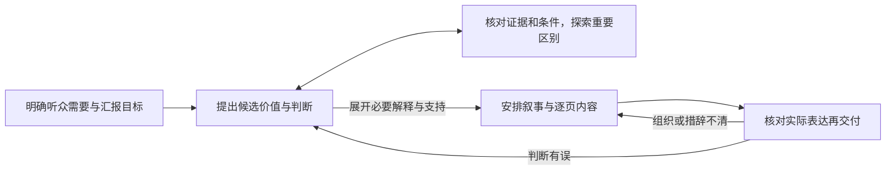

<div align="center">

# How-to-Report

### 先想清楚这次汇报要解决什么，再把话讲给对的人。

探索目标 · 发现价值 · 核清依据 · 写成能用的内容

[设计哲学](#设计哲学) · [开始使用](#开始使用) · [使用示例](#使用示例) · [交付什么](#交付什么)

</div>

---

一份好汇报，应该让对方更清楚情况、作出有依据的判断，或知道接下来需要做什么。

How-to-Report 是一组帮助 AI 构思、成稿和审查汇报的 Skill。你可以带着零散材料来，也可以只带着一句“我明天要向领导解释项目延期”。它围绕这次沟通，帮助你确认目标、找到值得讲的内容，再形成可用于制作的汇报方案：做多少页、每页讲什么、具体怎么写。

**当前版本 0.10.0，以 Markdown 交付汇报内容与审查意见。** 需要 PPT 时，可从总入口提出完整任务，确认内容后连续接续宿主可用的 PPT-Master，由其完成设计、制作与导出。

## 设计哲学

### 把精力放在“这一次”

我们相信，模型的写作、绘图和排版能力会不断发展。这个项目选择把精力放在它需要从本次任务中理解的事情上：你面对谁，对方已知什么、能够决定什么，你希望沟通之后发生什么变化，以及手里的材料究竟能支持哪些判断。

同样是“项目延期了”，不同目标会改变整份汇报：

| 希望取得的结果 | 内容应该回答什么 |
|---|---|
| 让对方了解原因 | 偏差在哪里，哪些原因有依据，如何防止再发生 |
| 请对方协调资源 | 什么工作被卡住，需要谁提供什么支持 |
| 请对方批准调整计划 | 原计划为何难以维持，有哪些选择，各自代价是什么 |

目标探索会提出有依据的候选，澄清真正影响主线的未知。它不会凭一句话认定你“真正想证明自己的能力”；你已经说清楚的目标，也无需反复确认。

### 把价值讲具体

听众应当看见这件事与自己承担的任务有什么关系：帮助做出哪个选择，减少什么不确定性，或者解决什么实际困难。汇报者也可以正面呈现自己识别的问题、作出的判断和推动的工作，同时讲清伙伴的贡献。用途、可能收益和已经实现的成果分别有自己的依据；缺少收益数字，并不妨碍把真实用途讲明白。

### 用思考打开空间

有价值的发散，应该发现一个原来遗漏、又会改变判断的区别。例如，同样晚了两周，“已有可执行的替代方案”和“仍在等待外部批准”，需要的后续行动就不同。

完整判断类材料在收敛前主动寻找一次遗漏的重要区别：当前描述相同的两种情形，是否应让听众作出不同选择？有用的新视角进入主张、比较或建议，不只放在末页的待办清单。

Skill 按疑点调用方法：该追问时追问，该检查前提时检查前提，该把材料重新分组时重新分组。相关但有用的方向可以保留，同义换词应当合并；缺少事实，就回到材料或请求补充。简单更新和局部改写直接处理，无需走完固定流程。

内部保留目标与受众、证据与主张、内容与叙事等多种关系视图，帮助复杂任务保持连贯。它们可以只是短笔记，不要求用户填写一套 Graph、表单或 JSON。详见[架构说明](docs/architecture.md)。

### 也把一件事讲透

找到值得讲的判断之后，还要补足理解它所需的解释：对象是什么，事情怎样发生，差别在哪里，已有记录能说明到哪一步。广度帮助发现遗漏，厚度让听众能够理解、核查和使用一个判断。

通常先让人抓住主要意思，再展开解释。整场、页面和段落可以采用这项分工，但不必长成同一模板：问题尚未解决，就先说明问题；过程需要前后衔接，就把关系讲完整。概要不能只是漂亮口号，正文也不应只是标题的同义改写。熟悉背景的短沟通可以收束，完整评审则需要具体过程、实例和依据。

### 让事实扎实，让正文自然

把事实排成顺序，不会自动得到因果；把几项功能放在一起，也不会自动得到“显著收益”。整理材料时，需要看清真实关系，找出能成立的判断，再安排听众理解它们的顺序。

成稿由实际汇报者向听众说话，写清对象、动作、理由和请求。必要的条件留在相应判断旁边；制作说明和核验过程放在合适的位置。正文应当能够直接说出口、交给人阅读。

### 把表达自由留给模型

完整材料要明确建议页数，写出每页可用的标题、正文和必要数据；不规定一页放几张卡片、画什么图、用什么配色。需要三十秒更新时，就交付一段话。

内容 Skill 负责正文、来源和必须保留的含义，PPT-Master 负责 PPT 专用设计、模板、对象、导出及制作检查。总入口传递用户实际确认的页数、页序、措辞或语义范围，制作时保留关键条件。其他表现形式可由用户选择相应工具。旧视觉实现保存在[历史归档](legacy/visual-0.5.3/README.md)。

## 一条生成主线，按当前需要进入



主线由[生成与修订方法](skills/how-to-report/references/reporting-method.md)统一负责。材料提炼、探索、论证和编辑是解决具体难点的专题，不再各自定义一套完整流程。已经确定的目标直接沿用；只改一句就从这句话进入。独立审计有自己的读取顺序和判断方法。

### 真实职责与独立委派

新完整汇报先确认目的、场合，以及具体参会者代表的职责、决定权、否决范围和影响方式。只有“部门领导”这样的头衔时，会协助你补清；已确认的信息沿用，局部改句无需重新访谈。

针对重要未决判断，主代理把与实际角色相关的定向挑战交给真实子代理。挑战者根据本次事实和逻辑提出问题；主代理自己查资料、做分析、回应并维护唯一当前稿。事实仍不足时，会说明最小补件、用途和不补的边界。不同职责可分批执行，不按部门目录机械派一队代理。

独立审计也必须真实委派，先只读听众正文，再开放任务、来源和必要作者说明。没有子代理或上下文隔离能力时，相应环节保持未完成；助手仍能整理有依据的内容。其他分析按实际能力串行或并行。具体约定见[执行能力](skills/how-to-report/references/host-capabilities.md)与[委派方法](skills/how-to-report/references/agent-delegation.md)。

## 总入口与两个独立 Skill

从仓库根目录的 [SKILL.md](SKILL.md) 开始即可。它根据当前需求进入生成、先分析、修订或审计工作流，也可在用户确认内容后接续 PPT-Master；内容方法由以下两个 Skill 负责。

| Skill | 什么时候用 | 得到什么 |
|---|---|---|
| [how-to-report](skills/how-to-report/SKILL.md) | 先讨论思路、从材料成稿，或修改已有内容 | 可讨论的方向，或含具体页数与逐页内容的汇报方案；局部任务直接给修改结果 |
| [report-audit](skills/report-audit/SKILL.md) | 检查一份稿件是否服务目标、事实和论证是否成立、有没有重要遗漏 | 有位置、依据、影响和修复方向的审查意见 |

两者可以分别安装。`report-audit` 接受外来稿件，不要求先由 `how-to-report` 生成；仅要求审计时，不修改原稿。主会话协调真实独立审计子代理；已由宿主指派的审计执行者直接完成本角色。生成者的自评不能当成独立审计结论。

## 开始使用

**1. 获取仓库。**

```bash
git clone https://github.com/River-Singer/How-to-Report.git
```

**2. 读取总入口，或分别安装。** 完整克隆后，可以让能够读取本地文件的助手显式读取根目录的 [SKILL.md](SKILL.md)：

```text
请读取 How-to-Report/SKILL.md，按其中的方法处理接下来的汇报任务。
```

将路径换成你本机的实际位置。总入口需要仓库中的 `skills/` 资源，不能只复制一个 `SKILL.md` 文件。

如果你的 AI 助手支持安装 Skill，也可以将 `skills/how-to-report/` 或 `skills/report-audit/` **整个目录**放到该宿主支持的位置。两包都已包含各自需要的方法与资源，不依赖另一个包；也可以显式读取它们各自的 `SKILL.md`。`skill-src/` 是开发源码，不是完整安装包。宿主的安装位置和自动发现方式以其自身支持为准；本项目不承诺平台会自动识别仓库总入口或嵌套目录。

**3. 给出已有材料和当前需求。** 汇报对象、场合、时长、目标，以及各参会者本次代表的职责和要作的判断，知道多少就说多少。不确定的部分可以一起讨论，不用先填模板。真实材料与输出保存在 Skill 安装目录之外。

普通内容任务无需 Python 或浏览器。核心方法与选用的知识资料可离线读取，外部链接用于溯源；模型运行方式由宿主决定。详细说明见[使用指南](docs/usage.md)与[离线资料说明](docs/offline-knowledge.md)。

### 从总入口连续制作 PPT

让助手读取总入口，并在当前任务中说明需要 PPT。宿主已提供的 PPT-Master 可直接发现和使用，也可以给出其完整 `SKILL.md` 的实际路径。完整制作工具包含自己的工作流、脚本与资源，运行依赖由所选路线核对。

```text
请读取 [仓库实际位置]/SKILL.md。我需要向负责安排业务试用的主管
做五分钟汇报 PPT，希望他判断是否进入下一轮试用，材料在 [资料路径]。
请先完成内容，交我确认后继续制作 PPT，保存到 [输出目录]。
PPT-Master 的完整入口在 [实际位置]/SKILL.md。
```

总入口沿用已确认目的、角色和来源，明确当前内容及其可改范围后进入制作。PPT-Master 保留自己适用的沟通、模板和方案确认，助手继续处理至实际输出或具体未完成项。已有 PPT 要保留原设计时，交接会记录原稿和允许修改范围，由下游进入相应原稿编辑路线。可复用模板通过其 Create Template 路线单独沉淀。

外部入口缺失或制作失败时，助手保存当前内容、已确认要求和实际失败位置，取得所需能力后接续。交付时分别说明内容对照、渲染和对象编辑实际完成的范围。完整链路与模板效果通过用户运行的试点验证。[内容交接方法](skills/how-to-report/references/ppt-handoff.md)说明具体职责。

## 使用示例

### 还没想清楚，先讨论

```text
请用 how-to-report。我明天要向领导说明项目延期，材料在 [路径]。
我还不确定这次该重点讲什么。先帮我梳理可能的汇报目标和主线，
只就会影响方向的重要未知向我提问，暂时不要成稿。
```

### 目标明确，准备汇报材料

```text
请用 how-to-report。我是项目负责人，要在资源协调会上向部门主管汇报。
这次希望主管指定一位业务联系人，和我们确认取数规则。材料在 [路径]。
我有三分钟，请建议具体页数，写出每页可直接使用的标题和内容，
保存为 [输出目录]/汇报方案.md。
```

### 只改当前需要的地方

```text
请用 how-to-report，只修改 [文件] 的第二段。
这段太绕，请把谁做了什么、下一步需要谁配合说清楚。
保留原有事实和其他段落，不重新规划整份汇报。
```

### 审查一份已有稿件

```text
请用 report-audit，先读 [实际稿件]，再结合 [原要求和材料] 审查。
重点看它是否支持本次目标、判断有没有依据、是否漏掉会影响决定的信息。
把审查意见保存到 [输出目录]/审查意见.md，仅审计，不覆盖原稿。
```

## 交付什么

完整材料默认交付一份 `汇报方案.md`，包含：

- **汇报安排**：明确本次建议做几页、按什么顺序讲。封面和结束页若采用则计入主材料，备查页单列。
- **逐页内容**：每页有标题、可直接使用的正文，以及需要的数据、比较或关系。不是“第1页介绍背景”式空大纲。
- **必要补充**：按需列真正影响使用的待确认事项与来源，不计作汇报页。

先使用已有资料并完成可行分析。真正影响当前目标的事实不足时，会明确求助：缺什么最小输入或替代、它支持什么判断，不补时哪项结论仍不能成立。可选深化不妨碍当前有据内容交付。可以只补一部分，也可以暂不补；新记录不支持原先构想时，方案会据实调整。只改标题等局部任务不附例行材料清单。

例如，[完整合成示例](skills/how-to-report/assets/examples/report-proposal.md)交付两页：第一页用两组规则差异说明首轮样本选择及实际贡献，第二页提出联系人与可参与时间请求，并交代后续核对安排。主管已看过工具演示，因此已有能力不再各占一页；两页只适用于这组输入。

[另一份短长对照](skills/how-to-report/assets/examples/report-depth-proposals.md)用同一组检修交接资料，分别写成两页管理摘要和七页联合评审。长稿具体解释版本如何对应、待核记录如何处理、检查结果说明了什么；新增的是理解所需的关系，建议和证据强度保持一致。

明确只要口头稿、独立阅读稿或先讨论思路时，按该形式交付；一句话修改直接给替换文字。后续可以继续修改某一页、补充事实或调整时长。增删、合并页面时，同步总页数、页序及相关内容；不因局部改动重做全部分析。

需要进一步了解，可阅读[当前范围](docs/content-scope.md)、[内容取舍示例](skills/how-to-report/references/content-decisions.md)、[0.9.1 内容评测](evaluation/content-0.9.1/README.md)或[独立审查入口](docs/audit-start-here.md)。

---

<details>
<summary><strong>开发与验证</strong></summary>

源码在 `skill-src/how-to-report/`、`skill-src/report-audit/` 和 `skill-src/shared/`；`skills/` 是构建生成的完整安装包。修改源码后统一构建，不手改生成目录。

计算、日期校验、版本记录与已确认偏好等工具使用 Python 3.10+ 标准库。影响判断的数值先按[计算方法](skills/how-to-report/references/report-calculation.md)取得可复算结果，再检查正文的比较与推荐；Python可用时执行受支持计算，工具不可用时如实说明。普通写作无需初始化 Run 或额外 JSON；私有资料和输出留在安装包之外。

在项目根目录执行：

```text
python tools/package_skills.py build
python tools/package_skills.py check
python tools/vendor_knowledge_sources.py check
python evaluation/tools/validate_content_cases.py
python -m unittest discover -s tests -v
```

0.10.0增加总入口到完整 PPT-Master 的内容确认与制作接续，工程检查覆盖入口、资源闭包和搬迁，详见[本版工程记录](verification/0.10.0/README.md)。完整模型执行与实际 PPT 效果由用户试点核验。0.9.1 的[18场景41轮](evaluation/content-0.9.1/README.md)继续记录计算、来源与多轮更新的既有回归范围，模型测试由用户运行。[0.9.1 工程记录](verification/0.9.1/README.md)与[0.9.0 记录](verification/0.9.0/README.md)对应各自交付。详见[开发与验证计划](docs/development-plan.md)。

</details>
