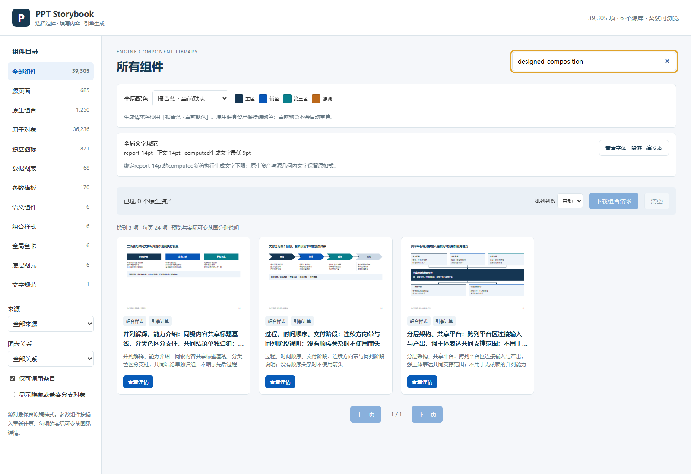
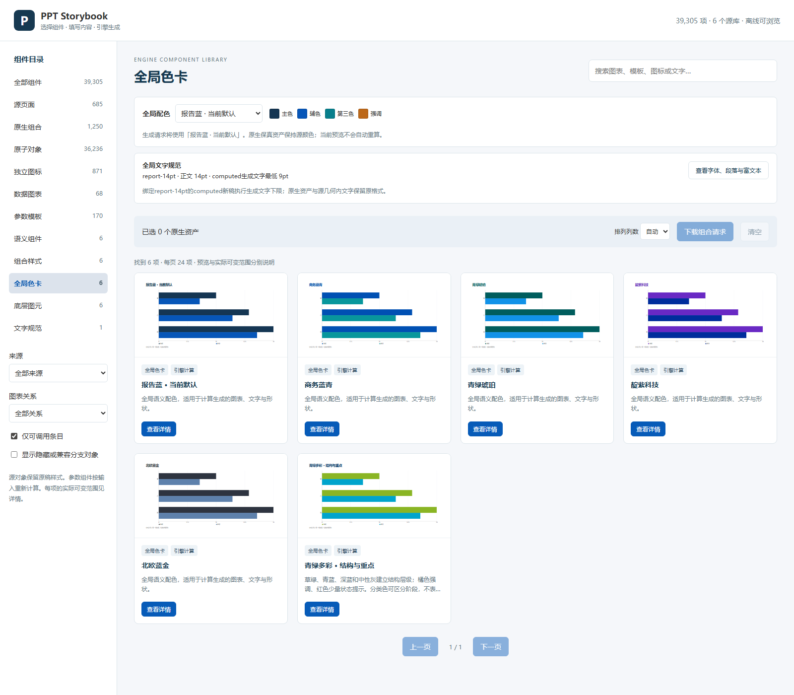
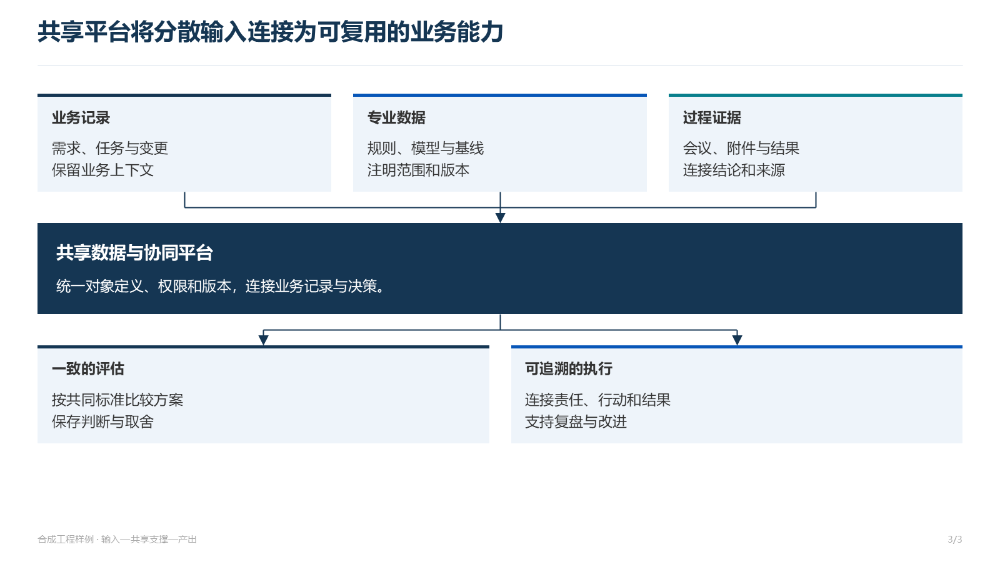
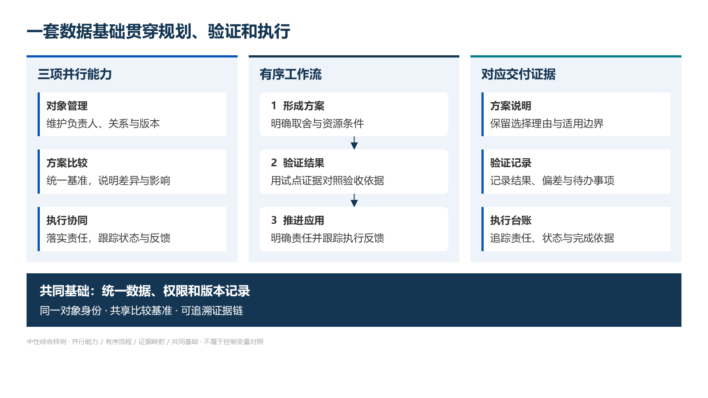

<div align="center">

# How-to-Report

### 从一份材料，到一份讲得清、排得下、可编辑的 PPT。

AI 梳理内容与叙事 · Storybook 提供组件 · Engine 计算布局 · Audit 复核成稿

[开始制作](#开始制作) · [完整链路](#完整制作链路) · [Storybook](#先看组件再生成) · [能力与边界](#当前能力与边界)

</div>

How-to-Report 把汇报思考、PPT 制作和独立审查接成同一条工作流。输入 Word、已有数据或零散材料，先明确听众要理解什么，再安排叙事、选择图表和结构，调用引擎生成 **可编辑 PPTX**。后续修改内容时，保留来源和约束，重新计算页面并复核。

AI 负责内容判断、表达选型与设计意图；程序负责已支持组件的文字测量、容器布局、拓扑几何和导出。用自然语言决定“为什么这样讲”，用可重放的工程决定“这些东西怎样放得下”。



*实际 Storybook 页面截图：检索`designed-composition`，查看可用于成稿的设计组合。上方原生资产数量来自本地导入的6份PPT素材库，随输入变化；这些原始文件不随公开仓库发布。所有展示文字和数据为合成示例。*

## 完整制作链路


| 阶段 | 要解决的问题 | 形成什么 |
|---|---|---|
| 理解材料 | 对谁讲、为了什么，事实能支持多强的判断 | 有来源的事实、必要计算、明确的数据缺口 |
| 组织内容 | 听众先知道什么，才能理解下一步 | 叙事路线、每页任务、可直接讲述的正文与备注 |
| 设计评估 | 解释还是查阅，什么图与素材能承担任务 | 表示选择、组件候选、栅格读序、文字与容量约束 |
| 引擎制作 | 内容变化后如何重新排布 | 持久作者工程、计算布局、原生PPTX与诊断 |
| 审查修订 | 是否正确、易懂、协调、完整，能不能再少一页 | 有位置和依据的意见、定向修订、实际复验 |

日期事件、比例状态、因果过程和明细清单承担不同任务：评估时就决定采用时间线、比例图、流程或表格。制作完成后，数值准确、几何通过、叙事成立和视觉可读分别核验。缺数时可按授权先交有据草稿，补件说明单独给作者。

## 先看组件，再生成

Storybook 是引擎资产的离线浏览与取用界面。可以按类型、来源、图表关系与关键词检索，查看预览、用途、输入规格和实际可变范围，再下载参数请求交引擎生成。

- **数据表达**：68种注册图表，覆盖偏差、相关、排名、分布、时间、规模、部分与整体、空间和流向。图种有各自的数据条件和编辑等级，见[图表使用手册](skills/how-to-report/references/ppt-chart-usage.md)。
- **组件与组合**：参数模板、语义组件、组合样式、独立图标，以及可选导入的原生页/组合/对象。实际目录与调用方式见[组件系统](skills/how-to-report/references/ppt-component-system.md)。
- **成稿设计组合**：`recipe.editorial-pillars`（并列解释）、`recipe.stage-ribbon`（阶段过程）、`recipe.capability-platform`（共享平台），可通过`library`及Storybook的`designed-composition`关键词检索；按实际关系与容量选择。
- **全局控制**：六套注册色卡、正文14pt和最小9pt的文字规范。默认`report-default`以深蓝、蓝、青绿、灰蓝组织页面，橘红少量强调；可选的第六套`consulting-spectrum`增加草绿等配色。按角色/系列使用，不要求每页用齐全部颜色。
- **可重放请求**：选中参数不等于生成完成。浏览器展示已生成预览，修改内容或配色后由引擎重新校验、计算和导出。



*这是实际色卡目录界面。全局选择会进入后续生成请求；原生保真资产保留源颜色，已有静态缩略图不会伪装成实时重算。*

完整使用方法见[Storybook手册](skills/how-to-report/references/ppt-storybook.md)。已有原生资产catalog时，可生成自己的离线站点：

```bash
python skills/how-to-report/scripts/report_engine.py storybook-export --catalog /path/to/catalog --output /path/to/new-storybook
```

目录生成后打开 `index.html`。Storybook是浏览入口；生成仍需要对应完整资产和本地运行环境。

## 这条链路带来什么

| 关心的事 | 项目的做法 | 可以检查的证据 |
|---|---|---|
| 改内容不想重新手调坐标 | 声明内容、关系、容器和约束，走computed构建 | 作者工程、布局报告、输入与运行身份 |
| 有很多模板却总用同一种 | 查询真实组件与使用场景，制作前比较适配方案 | 组件合同、样例、选型及必要备选说明 |
| 页面整齐但讲不清 | 先组织理解顺序，再映射物理页面；合页后重审叙事 | 可直接阅读的正文、备注、独立初读 |
| 图表漂亮却容易误导 | 区分期间、单位、分母与估算条件，按听众任务选表示 | 源数据、可复算结果、实际图形编码 |
| 表格和图表怎么选 | 解释增长、差异、分布用图；名单和精确明细供核对时用表 | [表示选择方法](skills/how-to-report/references/ppt-data-display.md) |
| 全稿风格散、页数多 | 统一视觉语法、tokens和栅格；每轮挑战内容不变地少一页 | 实际成图、内容占用提示、合页审阅/试排 |
| AI声称检查过却没有证据 | 分开记录工程检查、实际成图、独立审核与业务验收 | 当前版本的检查记录和可访问产物 |

这些是设计和执行机制，不是“任意材料一键优秀”的效果承诺。模型、宿主工具、字体与渲染器会影响实际结果，应通过相同输入与版本的测试验证。

## 可直接取用的结构样例

提供 **31种中性结构样例**，均有作者工程、槽位、预览与逐项说明。文字和数值为原创合成内容，原业务PDF与真实报告不公开。

| 样例集 | 适合寻找什么 | 入口 |
|---|---|---|
| 咨询结构21种 | 生命周期、平台架构、阶段范围、团队、供应商目录、资源配置等 | [浏览与调用](examples/consulting-explanatory/README.md) |
| 公开研究派生10种 | 分类解释、并列概念、分层机制、流程配图、条带、时间线、情景矩阵等 | [浏览与调用](examples/consulting-public-patterns/README.md) |

这些样例采用自有tokens与计算容器，吸收原材料的结构方法。它们是独立索引，当前不自动注册到 `library`，也不代表PDF逐像素复刻。绑定新内容后须重新构建和查看输出。

资产用途分三类：原生保真资产用于保留原稿；结构原型提供关系和槽位；成稿设计组合进一步组织形状、分区、色义、主次和阅读节奏。当前已实际查看31个公开结构样例，以及170个参数模板中的23个变体、覆盖21个family；其余147个尚未逐项查看。新增3个设计recipe解决代表性场景，不代表170个模板都已完成美化。

[3种成稿设计的真实PPT样例与调用方式](examples/presentation-ui/README.md)提供中性内容的作者请求、实际成图及可编辑PPTX。取用时仍需检查本次内容、容量和目标渲染器结果。



*共享平台通过分支连接对应的输入与输出，跨列主体表达共同支撑范围。主展示使用`report-default`；这是合成组件示例，实际报告仍须检查内容密度与篇幅。另可查看[并列解释](examples/presentation-ui/previews/editorial-pillars.png)和[阶段过程](examples/presentation-ui/previews/stage-ribbon.png)。*

[制作前评估与方法导航](docs/ppt-design-methods.md)继续列出16类栅格的适配场景、长文本结构化、图表选型、字体颜色和减页审阅。

## 让视觉形式表达内容关系

引擎支持按容器计算的左侧标线、顶部分隔线与分组括线（rail / rule / bracket）、有限跨列和显式顺序连接。0.11.6新增`arrow-ring`厚弧箭头闭环及三种成稿设计recipe；形状、文字和关系由同一输入重新计算，颜色继承全局tokens。



*实际PowerPoint成图，采用原创合成内容。第7页展示组合效果；前三组保持相同标题、正文、字体角色、画布与tokens，用于观察结构表达的变化。*

| 对照 | 内容关系与变化 | 实际成图 |
|---|---|---|
| 并行能力与共同平台 | 用分区和跨列底座表示共同覆盖范围 | [调整前](examples/visual-composition/previews/slide-01.png) → [调整后](examples/visual-composition/previews/slide-02.png) |
| 四阶段交接 | 用原生箭头形状、端点连接和对齐的说明表示先后 | [调整前](examples/visual-composition/previews/slide-03.png) → [调整后](examples/visual-composition/previews/slide-04.png) |
| 闭环、能力和维度 | 用厚弧箭头表达定性循环，开放式说明组区分层级 | [调整前](examples/visual-composition/previews/slide-05.png) → [调整后](examples/visual-composition/previews/slide-06.png) |

[浏览全部7页](examples/visual-composition/index.html) · [下载可编辑PPTX](examples/visual-composition/visual-composition.pptx) · [作者工程与重建方法](examples/visual-composition/README.md) · [内容与原生对象核验](examples/visual-composition/comparison-check.json)

这次同时修复原生箭头形状与连接端点的导出，保留节点和连接线的可编辑性。新增能力用于明确的分组、覆盖与顺序；采用哪种关系、文字主次是否清楚，仍由设计评估与实际成图审阅判断。前三组是局部机制演示，不能据其留白判断业务报告的最少页数。

## 开始制作

**1. 获取完整仓库。**

```bash
git clone https://github.com/River-Singer/How-to-Report.git
```

**2. 让能读本地文件的AI从总入口开始。**

```text
请读取 [仓库路径]/SKILL.md，基于 [材料路径] 制作一份中文PPT。
汇报对象：[谁，以及本次要理解或决定什么]。
汇报目的：[希望这次沟通带来什么结果]。
输出目录：[仓库外的可写目录]。

先整理材料、确定叙事和逐页内容，再完成制作前设计评估，
使用本项目组件与统一规范，沿computed入口计算并生成可编辑PPTX。
本次允许你自主整理并先出测试稿；缺数据时缩小结论，补件建议单列。
请实际查看能够渲染的页面，并明确独立审核和工具检查做到了哪一步。
```

如希望先讨论内容，把最后一段改为“先交我确认内容，确认后继续制作”。两种授权都可用，已确认的信息无需重复询问。

**3. 准备宿主实际需要的能力。**

调用引擎前，把输出目录解析为绝对路径；不要将含`..`的相对路径直接传给CLI。输入文件位置与输出目录按实际宿主填写。

- 普通内容分析可只用模型和文件读取；PPT引擎需要Python及[运行依赖](skills/how-to-report/runtime/ppt-engine/requirements.txt)。
- 渲染需可用的PowerPoint、LibreOffice或其他目标渲染器；如无法查看实际成图，就明确该项未完成。
- 独立审核需要宿主支持真实子agent/上下文隔离；无此能力可继续交工作稿，但不能把串行自评写成独立通过。
- 字体、操作系统和渲染器不同可能改变换行与图形显示；最终应在实际演示环境确认。

`skills/how-to-report/`和`skills/report-audit/`也可作为两个完整独立包安装。`skill-src/`是开发源码；只复制根 `SKILL.md` 无法获得完整能力。宿主是否自动发现Skill取决于其自身支持。[使用指南](docs/usage.md)说明内容任务的其他入口。

## 当前能力与边界

| 已有能力 | 需要保留的边界 |
|---|---|
| row、column、grid、有限内在尺寸协商、有界column_span、参数模板与recipe | column_span限显式列Grid的直接子项，不与auto_fit混用；没有row_span、subgrid、自动跨栏续排或通用孤行控制 |
| 按容器计算rail / rule / bracket，显式row / column的sequence连接 | 顺序须由作者声明，端点须支持连接；没有任意连线避障、通用路径布尔、遮罩或完整CSS/Figma能力 |
| `arrow-ring`厚弧闭环、3种注册成稿设计recipe | 厚弧闭环支持3–6个定性阶段，等角不表示数值占比；recipe有明确容量，不提供任意内容自动美化 |
| 文字、形状、受支持原生图表/表格和图片导出 | 图表有原生Chart或可编辑形状等不同等级；截图内部不可逐字编辑 |
| 原生PPTX配置读取与重建、原生资产目录 | 原样重放不等于内容改变后的任意自动重排；不同渲染环境仍需对照 |
| 内容占用、溢出和部分几何诊断 | 不是语义正确性或审美分数；铺满画面不能证明信息充分 |
| 模板/数据/叙事/视觉的审查方法 | 只有真实执行的审阅才算证据，方法存在不等于每次已达标 |

源保真重放与新稿计算是不同入口。新稿由 `build --geometry-policy computed` 处理；历史scene只能通过明确的兼容重放路径恢复。详细合同见[引擎作者工程](skills/how-to-report/references/ppt-engine.md)与[计算排版](skills/how-to-report/references/ppt-layout.md)。

## 开发与验证

源码集中在 `skill-src/`，生成包在 `skills/`。改源码后统一构建，不手改生成包；业务材料与运行结果放在包外。

```bash
python tools/package_skills.py build
python tools/package_skills.py check
python -m unittest discover -s tests -v
```

Windows目录被占用时可显式使用 `build --preserve-directories`，沿已有备份与恢复事务更新。不要跳过失败或把生成目录存在当作构建成功。

[0.11.6工程记录](verification/0.11.6/README.md)：247项相关引擎/打包回归最终通过、无跳过；两包正常build/check及validator通过，237个Python文件完成语法解析。真实Chromium检查验证Storybook在混合目录中按角色精确检索3个设计组合和170个结构模板。7页视觉组合与3页设计recipe均有实际查看的PowerPoint预览；最终包绑定、预览继承条件和文件身份见工程记录。厚弧几何、标签安全区、可编辑形状与平台分支连接均有专项检查。

这次未重新运行全部历史测试；[0.11.5的654项全套记录](verification/0.11.5/README.md)保留在其版本范围，不与本轮相加。工程检查不替代真实报告质量，也不代表跨AI业务测试成绩。较早的[内容评测](evaluation/content-0.9.1/README.md)同样保留原任务范围。

跨AI测试应冻结同一材料、brief和包版本，单列宿主/模型/工具/字体/渲染器条件；比较内容、叙事、数据表达、审美、计算路径和实际交付。模型案例由用户运行，结果返回后再对照审阅；尚未运行的测试不写成绩。

[设计方法](docs/ppt-design-methods.md) · [架构](docs/architecture.md) · [独立审计](docs/audit-start-here.md) · [来源与离线资源](docs/offline-knowledge.md)
