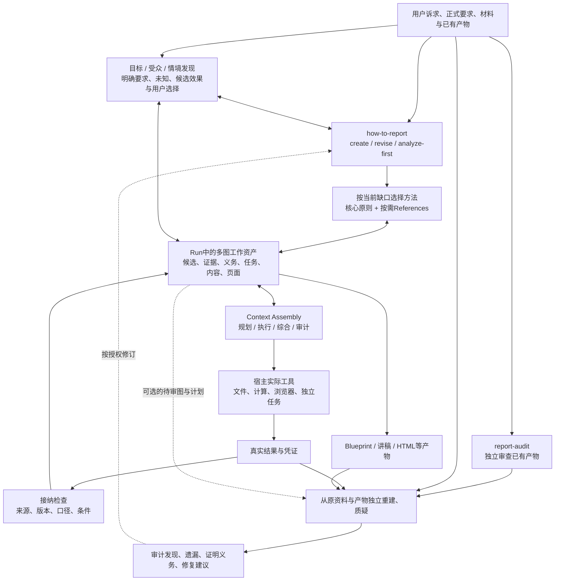
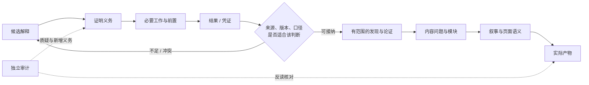

# How-to-Report：多图内核与双 Skill 架构

更新（2026-10-28）：当前候选为0.5.0，完整A/B增量与边界见[本版交付](complete-plan-release.md)，最终实际检查见[0.5.0验证](../verification/0.5.0/README.md)。下列0.4.0及更早数字/结果保持为对应版本历史证据，不转为新版通过。

版本：包0.5.0，Run契约0.1，PagePlan0.2兼容0.1；知识与核心方法来源各按随包清单版本。

**How-to-Report的主架构是多图协作的认知与执行体系。`how-to-report`和`report-audit`是两个独立使用入口，不能用两个入口代替内部架构。**图的方法与协议随Skill分发，每次任务的实际图、资料、版本和产物保存在Run工作区。

本文依据原交付PRD、共享对话中的目标/受众发现、表示重构、内容结构化和多图协作讨论，以及用户后续纠偏。具体命名是当前工程选择；不将历史助手每个框图都建设成独立服务。

当前状态：目标发现、问题表示重构和解释探索专门方法已写入两个入口，12张领域卡及18个来源文字表示已随包提供。初次认知试用和独立复核见[第一版结果](first-version-results.md)，离线范围见[资料说明](offline-knowledge.md)。[目标发现设计](goal-discovery-design.md)、[解释探索设计](insight-discovery-design.md)和[Knowledge计划](knowledge-plan.md)保留设计依据；结构检查与有限案例不构成普遍能力证明。

0.2.2补充[审计 Run 创建与自身校验](../skills/report-audit/references/audit-run.md)：从模板登记实际目标，内容检查初始未运行；正式审计交付明确校验自己的目录。用户运行的八案审计及后续纠正已完成流程验收；结构通过不能证明内容判断正确。

0.2.3增加[审计判定](../skills/report-audit/references/audit-judgment.md)、[数值证据](../skills/how-to-report/references/numeric-evidence.md)和[证据交接](../skills/how-to-report/references/evidence-handoff.md)方法，沿用现有来源、检查及依赖记录，按需附带计算说明与材料清单。0.2.4进一步区分意见性质与优先级、计算原始输出与整理分析，并成对核对来源文件和定位。不新增图类型、强制图流程或机器字段；不自动执行计算或接纳结果。版本证据和未验证边界见[本轮说明](audit-evidence-release.md)。

0.3.0增加[生成 Run 操作](../skills/how-to-report/references/report-run.md)：创建、修订和分析优先可从模板初始化，只把明确指定的文件复制为 Run 内快照；只读检查核对记录、快照和显式引用。原路径仅作溯源，工具不决定现行业务版本，也不自动执行后续工作。详见[本轮范围](report-run-release.md)及[完整 V1 进度](v1-progress.md)。

0.3.1增加[版本选择与结果接纳](../skills/how-to-report/references/version-lifecycle.md)：实际文件追加登记、显式选版、精确产物与已有复核证据绑定。相关材料/决定/检查变化后旧接纳待复核，不改写历史图和检查。可选 `version_state` 扩展仍保留基础 Run0.1；这不是自动执行器或语义认证。范围和限制见[0.3.1说明](version-lifecycle-release.md)。

## 1. 全景：入口、方法、图资产与执行环境



图中箭头表示信息使用、职责和反馈，不规定所有任务必须按顺序执行。只有已有报告要审计时，可以直接进入右侧；只修改一段内容时，可以局部进入修订。调用宿主工具的权限和能力由实际环境决定。

0.4.0增加[离线HTML运行时](html-runtime-release.md)：显式PagePlan到实际16:9页面、有界递归主辅组合和基础图表、元素映射与真实浏览器检查路径。简单聚焦/比较/顺序/数值计划继续可用；空间树、内容声明与来源支持保持分工。渲染不自动验证内容，新的模型页面语义回归尚待用户运行。

## 2. 多种图分别负责什么

| 图 / 视图 | 核心对象与关系 | 产生什么可审阅结果 | 谁建立，谁检查 |
|---|---|---|---|
| **Goal / Audience / Context 视图** | 正式要求、目标候选与来源、受众认知/权责、约束、手段与目的、冲突及用户选择 | 当前追求什么沟通变化、为什么采用、成功边界、哪些诉求仅为假设 | Agent提出有依据的候选；重大取舍由用户确认；审计核对目标偷换、动机误推和可达性 |
| **Hypothesis Graph** | 问题表示、候选解释、竞争解释、未知、能区分解释的观察 | 候选集合及其材料锚点、反例和待验证条件；可引出新的目标建议 | 生成侧探索；审计侧可提出遗漏的解释并挑战既有候选 |
| **Evidence Graph** | 来源、观察、计算凭证；支持、反驳、限定 | 证据能支持到何种范围，存在哪些冲突 | 生成侧整理并接纳；审计侧重新读取原资料核验 |
| **Argument / Obligation 关系** | 主张、推理前提、证明义务、限定与反证 | 为什么依据足以支撑判断；还缺什么、缺口影响什么 | 生成侧构建；审计侧检查推理与遗漏，可增加义务 |
| **Task Graph** | 具体工作项、输入、前置任务、结果和完成标准 | 为解决哪个未知而做什么，哪些可并行 | 生成或审计都可按需规划；宿主执行；审计核对执行及结果接纳 |
| **Content Blueprint** | 待回答问题、内容单元/模块、完整判断与依据 | 对听众讲什么、各部分如何共同回答问题 | 生成侧收敛；审计侧检查离题、重复、跳步、遗漏和强度 |
| **Narrative / Page Semantic Plan** | 理解先决、叙事顺序、Presentation Beat、同屏与分步关系、页面元素 | 何时理解什么、怎样表达而不新增错误含义 | 生成侧编排；审计侧从实际页面反读含义后核对 |
| **版本依赖视图** | 输入版本、已使用前提、产物及对应检查 | 变化后哪些结果需要复核，哪些仍可复用 | 依显式引用定位；生成侧修订，审计侧防止过时结果被当现行证据 |

Evidence与Argument可以共享对象，但两种职责要分清：证据图记录有哪些依据及适用范围，论证关系解释为什么能据此作出判断。证据很多不等于推理充分。版本依赖是跨越上述各层的视图，不替代其中任何一种语义。

目标也不能全部变成事实假设：正式要求有出处，候选诉求有待确认的推断，目标建议需要用户选择，目标依赖的现实判断需要证据。**目标被采用、主张被核验、工作已完成、沟通效果发生是四种不同状态。** 目标与问题表示、证据之间是双向关系；新证据可促使重新考虑目标，但不能由模型暗中替用户改写。信息同步本身可以是充分目标。

**能力选择也不同于Task Graph。**“需要比较分析”决定加载什么方法；“核对两期任务范围”是一项具体任务；“调用哪个计算器、是否并行”属于实际执行。能力路由可用图解释，但无需再存一份常驻能力图数据库。

## 3. 三类关系不能混用

| 关系 | 当前表示 | 允许怎样使用 | 禁止偷换 |
|---|---|---|---|
| 论证/认知/叙事关系 | `links`，例如supports、contradicts、qualifies、answers | 解释对象间含义，可交叉、可循环、可待定 | 不能由关系名称自动判真或推导因果 |
| 版本使用依赖 | `uses`；任务使用`input_refs` | 消费者引用具体输入版本，用于变更影响定位 | 不能把“使用了资料”当“资料充分支持结论” |
| 执行前置 | Task的`prerequisites` | 安排工作，执行快照中要求无循环 | 不能把所有语义图按DAG拓扑排序；不能把completed当verified |

例如，背景材料解释某个词语，与核心结论有语义联系，但未使用被更换的数值数据。数据变化不应触发该背景的重算。相反，影响关键结论的限制条件如果变化，就应明确登记其版本依赖，不能只留一条好看的限定关系。

引用固定为对象ID与revision；标题可改而身份不随标题变化。自然语言说明“为什么如此”，结构化记录保证跨环节使用的是哪个对象、哪个版本。没有必要给每个普通句子建节点。

## 4. 跨图转换有接纳条件



这是一种常见问题的依赖示意，不是每次强制跑完整流程：已有充分资料可以直接收敛内容；探索可以因新证据回退；分析优先可以停在有边界的发现与证据请求。

转换时至少保留以下区别：

- 候选被选入主线，仍可能缺证。
- Task执行完成，可以得到“未找到证明”或“不适合合并”的结果。
- 多个Worker分别成功，不能自动把不同口径、不同版本的结果相加。
- ContentUnit不是一页；多个单元可共同完成一次比较，一个单元也可分步呈现。
- 页面排布、翻译或标题改写，不能悄悄升级因果、收益或确定性。
- 审计可以提出新假设与新义务，不限于验证生成图的内部自洽。
- 解释基底筛选须检查改名、包含、竞争与交互，执行删除/区分测试；生成候选和接纳其为事实分开，收敛后仍须经过内容结构化。这些方法已随包实现，见[解释探索设计](insight-discovery-design.md)；陌生任务中的适用性和稳定性仍需更广泛的行为验证。

## 5. Graph究竟放在哪里

```text
安装包：只放方法、协议、必要工具与模拟示例
  how-to-report/     生成、修订、分析的判断方法
  report-audit/      独立重建、挑战、定位与修复建议
  两包内各自包含同版本的共享契约

每次Run工作区：放实际资料引用和图实例
  run.json          输入/产物版本与检查的机器清单
  run.md            目标、策略图、假设/解释、选择理由与缺口
  inputs/           使用初始化工具时保存显式文件快照，不自动追踪原文件
  semantic.json     需要机器追溯时保存关键节点与关系
  tasks.json        复杂工作需要显式任务依赖时创建
  events.jsonl      有相关许可/读取事件时创建
  outputs/          实际交付物与凭证

独立画像位置：已确认偏好与经历，可查看、修正
独立审计Run：读取待审材料，保存自己的检查与结论
```

这不是要求每次创建全部文件。简短任务可以在可读记录中保留几个判断与来源；外来文档审计不要求先有semantic.json或生成包。需要精确追溯、复用和失效定位时，再将相应对象显式化。Task、PagePlan等概念从第一版就有职责和引用出口，但不需要为每张图创建独立服务或存储副本。

`run.json`是版本与机器检查状态的权威记录；`run.md`维护解释和策略，显示状态时引用机器记录。同一事实不由两个文件各自维护。画像与安装目录、Run状态分离；当次明确要求优先，临时选择不自动变永久偏好。

## 6. 两个Skill怎样共享而保持独立

采用“**开发时单一共享源，发布时两个自包含包**”：

```text
skill-src/
  how-to-report/     生成侧入口与专属方法
  report-audit/      审计侧入口与专属方法
  shared/           图模型、运行契约、宿主边界、通用检查与模拟示例
          ↓ 构建、校验、记录内容hash
skills/
  how-to-report/     可单独搬迁使用
  report-audit/      可单独搬迁使用
```

两包共享术语、版本解析和一致性检查；不共享某次生成过程的答案、自评或隐藏上下文。审计方法仍独立：先检查原材料与实际产物，再把生成图当作待审对象。一个`verified`标签只是一项待核验声明，审计可以推翻它。

运行时不依赖`../shared`、另一个Skill的固定安装位置或开发机路径。两个包可以分别升级，兼容性由产物契约版本判断，不能靠包名相同猜读。0.1只承诺支持明确的0.1契约；未知版本需声明未能结构验证，仍可按可读材料开展范围明确的人工式审查。

未选择的方案：两包手工复制共有协议容易漂移；sibling目录/符号链接作为发布依赖会依赖安装布局和宿主行为。当前共享文件数量有限，用一个轻量打包器即可，不引入通用插件平台。

## 7. 加载与Context Assembly

入口保留少量共同约束和资源选择条件；按当前缺口读取探索、论证、内容、视觉或审计方法。不会因为目录里存在所有资料就全量加载，也不把171个研究链接全部变成运行时知识包。

| 上下文 | 应提供 | 不应默认混入 |
|---|---|---|
| 规划 | 目标、关键事实/未知、义务、依赖、工具边界 | 所有长日志与所有可选方法 |
| 执行 | 当前任务、获准输入版本、口径、完成标准 | 无关讲稿与生成者希望证明的答案 |
| 综合 | 可联合使用的发现、反证、范围和剩余未知 | 未核对版本的Worker摘要 |
| 审计 | 原要求、原资料、最终产物及实际核验能力 | 作为裁决前提的生成者自评 |

若要声称页面语义反读独立，应先记录从实际页面读出的含义，再看生成计划。新代理若继承了全部生成上下文，就必须如实说明；两个Skill文件夹本身不能创造独立性。

## 8. 宿主与工具边界

第一验证环境是当前Codex文件/执行环境；跨宿主只保留标准包和能力判断接口，未经实际测试不声称云端全部兼容。

宿主负责真实文件访问、执行、渲染、隔离任务和权限。Skill负责如何使用这些能力、检查结果是否适用，以及能力不足时交付什么。核心方法和用户提供资料按当前任务授权使用；可选领域Knowledge遵守已确认的许可范围。许可日志能帮助审查，不构成操作系统访问拦截。

骨架中的只读校验工具检查格式、引用、状态声明和明确依赖。它不会自动让事实正确、持久化所有历史、后台监控文件、重新计算或运行图任务。计算和页面接入通过来源/产物/凭证引用，后续可以换具体工具，不需要改变上层内容问题。

## 9. 骨架的完成标准

| 骨架要证明 | 采用的证据 |
|---|---|
| 两个包独立可用，共有契约不漂移 | 搬迁到隔离目录、不同工作目录调用、干净重建与内容hash比较 |
| 多Graph关系未被合并成一种状态或边 | 有真实文件的模拟多图实例；语义循环与任务循环分别处理；变更影响只沿显式依赖 |
| 入口真的指导行为 | 新上下文按实际请求执行创建/分析及独立审计，记录产物与未验证项 |
| 审计有独立判断 | 能质疑已有图的verified、定位缺证并提出义务；Audit-only输入hash不变 |
| 修订和画像遵守范围 | 当前要求优先，已确认偏好可查看/修正，局部修改不扩成全量重做 |
| 结构检查不冒充质量实验 | 单独报告打包、契约、行为试用结果；不宣称相对裸模型增益 |

骨架已完成包、契约及限定行为试用，证据和限制见[验证记录](skeleton-validation.md)；[开发计划](development-plan.md)据实测缺口安排后续依赖。0.4.0已提供有界离线HTML；模型驱动的页面适配质量、更广泛图表/媒体、多图布局修复、深度计算与动态任务执行及正式B0/B1/B2评测仍需推进。

## 10. 设计来源与维护

- [已确认需求](requirements-alignment.md)与[公开资料研究](public-research.md)。
- 父工作区原交付PRD第6～9章与共享对话第34～36轮。
- 本轮Trellis研究：`skill-packaging.md`、`skill-contracts.md`、`architecture-validation-plan.md`，保存在父工作区`.trellis/tasks/10-25-how-to-report-skill-architecture/research/`。
- 可执行开发规范：父工作区`.trellis/spec/skills/architecture.md`。发布包内的共享Reference与实际检查脚本承载运行契约；修改时更新单一源并重建两包。

逻辑架构、包结构、运行数据和开发依赖图分别维护其含义。开发计划中的先后顺序，不作为每次汇报的强制流程。
