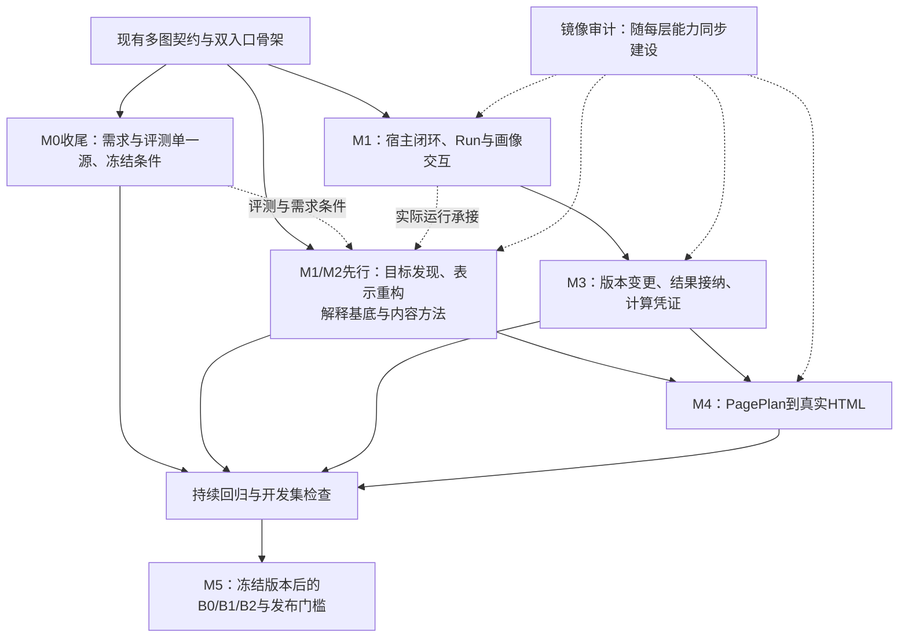

# How-to-Report 开发计划

更新：2026-10-28。依据[多图架构](architecture.md)、[需求基线](requirements-alignment.md)与骨架实测安排；不是发布日期承诺。尚未确定投入人数、模型预算与支持宿主，当前只确定依赖、交付物和准出条件。

**先把多图之间的对象、版本、接纳与审计边界做可靠，再扩展有用的方法和真实输出。** 两个 Skill 是入口；下表的工作包是建设顺序，不是用户每次汇报必须经过的流程。

用户进一步追问后的首批实现已经完成：[目标发现](goal-discovery-design.md)及[问题表示重构与解释基底](insight-discovery-design.md)进入运行方法，12张七领域知识卡及18个本地来源表示随0.2.1发布，有限开发探针已有独立复核。详见[第一版结果](first-version-results.md)和[离线范围](offline-knowledge.md)。后续优先用真实任务和不同表面材料发现方法失效，继续补齐A/B的宿主与实验基线，并按需求推进深度内容、计算和页面；不把此首批工作等同整个M1/M2完成。

MASTer四轮修订使用冻结0.2.1包。0.2.2增加[模板创建与自身结构校验](../skills/report-audit/references/audit-run.md)后，用户完成八案审计及七案记录纠正，审计流程与记录已验收。0.2.3补充审计判定、数值证据和最小证据交接，用户已交付四案定向审计：原数字复现、构造错标检出、历史缺件边界成立，结构与回执均通过；仍有计算输出身份、建议分类和来源定位问题。0.2.4收紧这些方法与模板，保留Run 0.1和知识版本0.1.1。详细范围见[0.2.4记录](audit-evidence-release.md)。

0.3.0提供生成 Run 初始化、显式文件快照和只读续接检查；0.3.1继续推进 B/D：显式选版、派生待复核状态及绑定已有检查的接纳记录，详见[发布说明](version-lifecycle-release.md)。当前实施与验证差距按[冻结需求](requirements-freeze.md)和[进度页](v1-progress.md)逐项追踪，不再沿用早期范围比例。

本轮完成相应工程检查，不自动开启另一批模型测试。0.2.3交付中的局部记录问题不要求重生成成熟报告；0.2.4的模型效果仍未验证。若后续安排批量实例测试，由开发侧冻结输入与Skill、准备输出目录及验收关注点，交用户运行后再复核。既有定向回归不替代A/F的正式对照实验；说明文档与工程检查也不是认知效果证据。

0.4.0把显式PagePlan接到默认16:9且可配置有界画布的离线HTML、递归主辅组合、基础图表、元素映射和浏览器检查路径，见[本版说明](html-runtime-release.md)。当前按冻结需求补齐本轮实现并提交仓库，供GPT先审计；master-v4与仓库评测是后续用户模型测试准备，工程通过不替代模型行为验证。

## 1. 已有基础与剩余边界

当前已有：

- 两个可单独分发的入口，支持创建/修订/分析优先与独立审计的行为说明。
- 单一共享源、可重复构建的发布目录、版本与内容清单、包完整性检查。
- 多 Graph 职责、三类关系、来源/产物/检查/任务的最小版本契约；可用的核心方法与真实文件示例。
- 只读结构检查和显式依赖影响查询；局部旧版本被替换时可定位消费者。
- 生成 Run 的创建/修订/分析优先初始化，显式输入快照及哈希核对；可从已有记录读取状态并由 Agent 续接，工具不执行内容工作。
- 显式版本选择和实际材料/产物追加；相关依赖、选择决定或检查变化后旧接纳待复核，重新接纳需要适用的真实检查记录；完整语义/执行闭环仍未完成。
- 轻量画像和许可记录的文件契约；使用宿主文件工具保存、查看及修正。
- 审计缺陷判定、可复算说明与材料清单方法，接入已有来源/检查/依赖记录；区分缺陷/缺口/建议和原始输出/整理分析，按任务需要使用模板。

骨架只提供可执行的起点。现行版本可由使用者明确选择，结果可基于真实检查登记接纳；它没有自动监控资料变化、替使用者决定版本、重新执行 Task 或自动开展复核；结构校验也不判断主张真假。当前包搬迁与按路径调用不能代替宿主原生安装、自动发现及跨宿主验证。0.4.0已提供有界HTML；其模型驱动适配质量与正式对照仍须验证。

早期实测结果与未测项见[骨架验证记录](skeleton-validation.md)，后续能力与证据见[完整 V1 进度](v1-progress.md)。当前已覆盖 M1/M2 方法及 M3 的部分基础，仍未满足任何以完整闭环为条件的整体验收；不将整个 M0、M1 或 M3 标记完成。

## 2. 建设依赖

共同契约稳定后，M2 方法与 M3 执行可并行；页面语义设计可提前研究，正式渲染接入依赖内容与数值契约。审计同步补充每层的新失效方式，不等到 HTML 完成后才开始。

## 3. 按顺序推进的工作包

| 工作包 | 前置条件 | 可审阅交付物 | 准出条件 |
|---|---|---|---|
| **A：M0 收尾与实验基线** | 当前骨架 | 正式 PRD/决定/评测输入单一维护源；需求追踪表；Dev/Holdout 清单；固定宿主、模型、预算和判定协议 | 消除示意字段冲突与重复副本；补齐缺失输入；成本分解明确交互项约定；已阅读案例不冒充未见 Holdout；先保留可比较的 B0 样本 |
| **B：M1 可持续使用闭环** | 骨架契约；A 的支持范围 | 目标宿主安装说明与真实发现记录；Run 创建/续接/范围修订约定；许可与画像操作；首批七领域精炼 Knowledge、目录及双面使用记录 | 两包分别独立调用；拒绝知识仍可继续；只在授权范围读正文；当前要求覆盖历史偏好；新 Run 可读取已确认修正；audit-only 原件不变；知识卡通过来源/迁移/误用检查 |
| **C：目标发现与多图方法（M1/M2先行）** | 现有骨架；与A/B必要工作同步 | C1情境/目标候选→披露/取舍→内容职责；C2表示变换→候选关系→删除/区分测试→解释基底；C3证明义务→内容/叙事；逐层对应独立审计 | 模糊目标有依据地发现与确认；目标选择不冒充事实核验；不猜定隐秘动机；新方向非换标签且可挑战；检查跨路径交互；先形成Blueprint再表达；简单任务保持轻量 |
| **D：M3 版本、计算与任务闭环** | A+B；与 C 共享语义合同 | 输入快照/现行版本决定；待复核传播与用户可见说明；计算收据；结果接纳检查；局部重算与失败恢复 | V1→V2 后旧结果不能充当现行证据；依赖声明与产物实际内容一致，漏记依赖不能当作无需复核；只更新明确受影响的对象；保留历史检查；语义联系不误作执行依赖；失败/未执行不转为零或 verified；独立复算真正执行 |
| **E：M4 页面语义与 HTML** | C 的内容出口、D 的数据契约 | PagePlan 与实际元素映射；可运行 16:9 HTML；按需图表/布局适配；浏览器检查与修复证据 | 有同屏比较、分步展开及层级/排序/趋势/矩阵等有根据的混合拓扑；窗口缩放/导航可用；无关键裁剪；缺失数值不补零；标签保持可区分；重排/翻译不升级主张；页面反读先于生成计划核对 |
| **F：M5 正式评测与发布收敛** | A 的冻结协议；B–E 实际完成 | 同条件 B0/B1/B2 结果、执行记录、缺陷修复与支持矩阵；可复现发布包 | 无确认且未解决的 P0；必需的未评估项不能计通过；同时评价洞察遗漏和过度解释；成本与质量分别报告；兼容性声明有对应测试；效果结论由真实比较支撑 |

C的目标发现/表示重构最小方法、配对开发探针及B的首批知识卡/本地来源已经落地；A已补仓库内评测维护源、协议与oracle，真实对照仍待执行；B的宿主原生使用及C的更广泛方法回归仍待验证。首批 Knowledge 为专业探索提供材料，不能代替这条认知回路。只在来源与验收具备时将卡纳入发布，不创建空卡或批量搬入研究目录。新的阻断行为先修复并回归，再扩展深度执行与渲染。

## 4. 每类 Graph 下一步具体补什么

| 图层 | 已有出口 | 下一步重点 | 同步审计 |
|---|---|---|---|
| Goal / Audience / Context | 目标记录与候选发现方法：材料正推/效果反推、权责、用户取舍及反馈 | 陌生场景验证、目标变化的局部续接；不新增僵硬参与者矩阵 | 是否目标偷换、把潜在效果当动机、把目标确认当事实已证实、把产物完成当实际达成 |
| Hypothesis | 开放节点及缺证状态；表示变换、解释基底、删除/区分测试和交互方法 | 用不同表面材料验证方法边界；新证据回开问题及目标候选的续接 | 是否遗漏合理解释、只换标签、过度抽象，或只寻找支持既定结论的证据 |
| Evidence / Argument / Obligation | 精确来源版本、支持/反驳/限定、检查与义务 | 证据需求反推、来源独立性、口径可合并性、结论强度接纳 | 来源是否足够、推理是否跳步，verified 是否有适用范围 |
| Task | objective/completion、输入/前置/结果 | 按需分工、实际执行收据、结果接纳与失败后续动作 | 工作完成是否只证明做过工作，结果是否可用于该判断 |
| Content Blueprint | 问题、内容单元/模块、来源与限制 | 选择取舍、完整判断、模块组合及用户主线反馈 | 离题、重复、重要遗漏、证据被压缩后失真 |
| Narrative / PagePlan | beat/page_plan 节点与语义映射 | 理解前置、共同观察、时间分配、页面容量与真实渲染 | 实际读者看到什么，是否与内容合同一致 |
| 版本依赖 | uses/input_refs、旧版本影响查询、显式选择及接纳指纹 | 声明依赖与实际内容核对、局部重算、混合历史版本与失败恢复的完整闭环 | 是否继续使用过时结果，局部变更是否意外改写无关内容 |

不要求为每张图建立一个服务、数据库或独立 Agent。先让必要的对象与关系实际贯通，再根据使用中的复杂度拆分。

## 5. 公开材料的定向使用

[资料库](research/public-sources.md)记录收集与阅读层级。研究结论只有解决具体失效方式时才转为方法或工具要求：

七领域12张卡和18个来源文字表示已随包提供；具体主题、加载与准出见[Knowledge计划](knowledge-plan.md)及[离线范围](offline-knowledge.md)，原文校正见[进一步发现](research/knowledge-findings.md)。数量描述当前交付规模，不能充当方法质量指标。

- 方法研究用于 C：把问题重述、候选比较、反证和证据需求转成可执行指引，附适用条件与失败例，避免背诵方法名或内置开发题答案。
- 执行与评测研究用于 B/D/F：渐进加载、上下文分工、真实工具凭证、可追溯版本与独立评价。
- 视觉研究用于 E：从沟通问题、数据含义和任务选择表达，再检查图形与页面；不直接复制原型的固定画布和静态审计。

每新增一项方法先写清它解决什么问题、何时不用、需要什么输入、如何检验。不要把全部历史链接装入运行包；也不要把“收集到”改写成“已精读并采纳”。具体库与版本在对应实现前核验官方资料，再记录选择。

## 6. 贯穿各阶段的检查方式

1. **确定性检查**：打包、引用闭包、数据类型、版本引用、许可事件、状态一致性；适合自动执行。
2. **行为回归**：实际调用 Skill，保留输入、工具凭证、产物和修订差异；检查多轮变化、独立审计和当前要求优先。
3. **语义与视觉评价**：从原材料核对主张，从实际页面反读含义；声明上下文、材料与计算独立程度。
4. **质量对照**：固定条件的 B0/B1/B2；开发集与未见评估分开，记录失败与未评估项。

四层证据不能互相替代。测试数量、图节点数量、方法调用次数和原始资料数量，都不能直接当产品质量分数。

## 7. 明确后置与当前未知

本计划不纳入 V1：自动跨任务画像采集、通用分布式图执行平台、全行业知识库、完整 Office 引擎及全图表适配库。双语、媒体、复杂统计、交互钻取和 PPTX 按真实任务与宿主能力启用，不阻塞核心闭环。

尚需在对应工作包确认：首个正式支持宿主的安装路径与发现方式、云端真实持久能力、计算/渲染扩展边界、可用模型与评测预算、开发投入。本轮以[冻结需求](requirements-freeze.md)的编号与实施状态收口，先提交可自包含审计的仓库；用户随后安排模型回归，再按真实问题修复。实际宿主使用、更广泛页面适配与正式对照继续按证据推进，不用历史估算比例、版本号或测试数量推算剩余工期。
