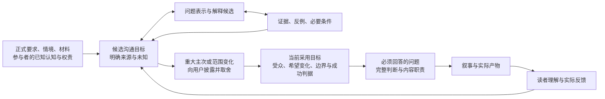

# 目标发现：从汇报情境到可采用的目标

更新：2026-10-26。状态：**专门方法已随 0.2.1 交付，首轮开发试用与有界独立复核已完成**。运行方法见 `skill-src/shared/references/goal-discovery.md`；本文件保留设计依据。包和 Run 结构检查不能证明认知效果，实际结果另见[第一版记录](first-version-results.md)。

0.4.0在既有候选目标、确认与否认处理上补强大纲前的可观察差异检查：候选结果须能改变证据、结构或结尾；先材料后少量中性澄清，明确目标不反复追问。主体按人/组织的行动与权责理解，项目不拟人，也不默认利益冲突或恢复旧计划。候选2–4只是可调起点，真实选择与模型行为仍待定向探针。

## 1. 先区分“目标”中的不同含义

| 对象 | 含义 | 采用或成立的依据 |
|---|---|---|
| 正式要求 | 本次必须告知、回答或交付的事项 | 用户明确要求、议程、评分/审批规则等；保留出处 |
| 已表达的目标 | 用户说希望实现的变化，可能尚笼统 | 当前用户表达；进一步澄清其对象、含义和边界 |
| 尚未表达诉求的假设 | 根据情境猜测用户或受众可能重视什么 | 当前线索支持提出假设，不能直接当作真实意图；必要时披露并由当事人确认/否定 |
| 新目标建议 | 材料与情境显示可能值得追求的沟通效果 | 说明为何值得、会改变哪些取舍，由用户决定是否采用；不冒充用户已有意图 |
| 项目目标/现实收益 | 项目希望达到的现实结果 | 实际项目证据、实现条件与后续观测；不是一次汇报即可保证 |

**潜在沟通效果不等于个人动机。** 一份准确展示问题判断与处理过程的报告，可能使人看到汇报者的能力；这并不证明用户是为了“表现自己”。用户画像中的已确认偏好也不证明当前受众的心理。

同样，做完幻灯片、听众理解、听众作决定、项目产生收益是不同层次。它们可能通过有条件的手段关系连接，不能共用一个“完成”状态。

## 2. 目标发现是循环，不只发生在开头

这是语义和选择的反馈关系，不是所有任务必须运行的固定流水线。明确的局部修订可以直接执行；信息同步本身可以是充分目标；不用强行制造争预算、争资源或说服目标。

## 3. 具体怎样找目标

### 3.1 从现有材料建立当前情境

先读取已有授权材料，找本次沟通的触发事件、正式必答事项、时间窗口、已有成果/异常/风险，以及参与者在该议题中的知识和权责。人物头衔只提供有限线索，不等于其偏好、利益或动机。

至少能区分：目前发生了什么；谁知道什么或存在什么分歧；近期谁需要判断/行动；什么还缺少证据或授权。不要求先填完整人物矩阵。已有材料不能回答且会改变方案的未知，才值得追问。

### 3.2 沿两条路径生成候选

**从材料正推：** 哪些变化、矛盾、限制、可复用经验或机会对这次受众重要？如果不说明，可能出现什么误解或错失什么必要行动？它们是否支持一个尚未提出的沟通目标？

**从可能效果反推：** 希望听众会后比现在多理解什么、能判断什么、协作方式有何改变？要出现这种效果，听众必须知道哪些事实、接受哪些有证据的判断、具备什么权限？

再作两种选择性检查：当前拟追求的只是某个手段，还是本次真正重视的后果；即使它实现，原来的困难是否仍存在。不能无限“为什么”到脱离此次场景，也不能在探索初期把所有意外发现按旧目标过滤掉。

候选可源于信息/认知差距、近期决策、协作阻塞、风险误解或材料中新发现的意义。这些是寻找线索的操作，不是每次必须输出的目标类别。

### 3.3 区分事实检验、价值选择与可达性

| 检查 | 需要回答 | 不能偷换 |
|---|---|---|
| 依据 | 为什么提出该目标；相关事实/受众判断来自哪里 | 有价值的机会不等于用户已想追求；猜测不等于画像事实 |
| 层级 | 是交付物、认知变化、他人行动还是项目结果 | “报告写完”不等于“目标已实现” |
| 证据 | 要追求这个目标，是否预设了尚未证明的结论 | 希望证明提效不能让提效先变成事实 |
| 主体/权限 | 这次受众能决定、影响或转交什么 | 有愿望不等于当次有可执行动作；不能保证对方同意 |
| 重要性与冲突 | 它如何改变内容、证据、篇幅与正式要求 | 不把不同主体的诉求平均成一个总分 |
| 归属 | 是明确要求、已确认偏好、推断诉求还是新建议 | 不能由模型自评分把一个建议变成用户选择 |

正式要求和已确定目标保持优先。材料不支持原拟表述时，应说明缺口、提出较弱表述或目标重述候选；重要取舍由用户作出，不能暗中换题。用户否定某个潜在诉求后，停止继续沿用它，不反复劝服。

### 3.4 把当前采用的目标转为内容职责

原对话的 **Stated → Validated → Operational Goal** 可作为认知区分：从用户表达，经必要核对/取舍，转成可执行的沟通目标。这里的 Validated 是意图和选择得到澄清，不是 Evidence 的 `verified`；三者也不是强制每次走三轮审批。

可操作目标至少说明：面对谁，希望其理解/判断/行动发生什么变化；为什么此刻重要；哪些正式要求与事实边界不能丢；什么现象可用于检查沟通是否起作用。随之列出必答问题、相应判断、依据与未决项，并进入 Blueprint。

比如仅需同步时，检查点可以是“受众能准确复述当前状态和限制”；若需要形成意见，则要增加方案/风险依据和意见形成路径。没有会后反馈时，只能评价产物是否有助于目标，不能声称受众已经理解或行动。

## 4. 各 Graph 怎样相互约束

| 视图 | 实际职责与反馈 |
|---|---|
| 目标 / 受众 / 情境 | 保留目标来源、采用理由、受众已知与未知、权责及约束；区分选择与事实，不强制新增独立数据库 |
| Hypothesis | 探索哪些问题/机制/沟通机会值得追求；对受众需求的推断仍待确认；新解释可能带回新的目标候选 |
| Evidence / Argument | 核对目标所依赖的事实和判断；可以否定“已产生收益”等前提，但不能替用户决定偏好 |
| Obligation | 记录采用或表达某目标前尚缺的事实、假设、确认或证明；不是让所有未知都阻塞交付 |
| Task | 将必要调查、计算、澄清或复核变为有完成标准的工作；完成不等于目标成立或受众行动 |
| Content Blueprint | 每块内容对哪个目标/受众问题负责、作什么判断、以何为据；发现缺口时允许回到前面 |
| Narrative / PagePlan | 安排理解前置与表达，保留限定；顺序服务读者，不直接照搬任务执行顺序 |
| 版本依赖与独立审计 | 目标、受众或材料改变后定位需重审的选择和表达；独立检查是否目标偷换、遗漏必答、过度推断动机或伪称达成 |

关系性质分别是要求/选择、手段与目的、事实支持、工作前置和内容职责。**Task 完成、Claim 得到核验、Goal 被采用、沟通效果实际发生，四件事不能互相替代。** 目标变化可能使内容取舍失效，却不必使原始事实变假。

这些区分是认知设计要求，尚未作为新增机器状态写入 Run 0.1 契约。先用少量可追溯对象和公开理由摘要承载，不能因为多建一张 Goal Graph 就宣布能力实现。

## 5. 一个虚构例子

用户说“向技术评审组汇报平台开发进展”。材料说明：核心功能已实现、接入规则尚有分歧，三天后另一个业务委员会要决定试点范围。只问“目标是什么”可能仍得到“汇报进展”。

从材料和权责可提出：

- 已有目标：让技术评审组准确理解可交付范围和限制。
- 有依据的新候选：形成供业务委员会使用的技术风险意见，减少试点决策前的信息缺口。
- 有条件的辅助候选：明确哪些接入规则需由谁补充判断，便于后续协调。
- 不能直接采用的目标：让技术评审组当场批准业务试点；现有信息不支持其有此权限。
- 没有依据的动机猜测：用户主要为了争取晋升；不能从“做进度汇报”推得。

若用户采用第二项为主线，Blueprint 就需要范围/场景、风险、可选试点条件与技术意见依据，不能仍只按已完成功能列目录。若用户明确仅同步，则保留准确状态与限制，不强行扩展评审工作。以上都是模拟说明，不是对真实用户或项目的判断。

## 6. 实施状态与后续验收

“情境提取→候选目标→依据/层级/权限/取舍→内容职责→反馈”已进入运行方法及独立审计问题，0.4.0补强大纲前的差异检查。后续用未依赖现有示例答案的行为场景验证：目标含糊但材料有决策线索、只需同步、受众无权执行、预设结论被反驳、多个目标冲突、用户否定潜在诉求、新材料改变原目标前提。

评价有依据的新目标、遗漏与误报、有效追问、目标选择对下游的真实影响，以及成本。不奖目标数、人物节点数、自动加权分数；不宣称能穷尽目标或猜中隐秘动机。这属于模型能力验收，不能由早期39项工程测试或六个骨架演练代替；历次结果按其版本与范围理解，0.4.0新增关口尚待用户运行分阶段探针。

## 7. 设计依据

原共享对话 R2、R4、R7、R11、R27、R28 的对应原文与用户纠偏，已在本任务 `research/goal-discovery-intent.md` 定向核对。外部方法参照 [MIT 的目的/受众指导](https://mitcommlab.mit.edu/nse/commkit/structuring-a-slide-presentation/)及 [Keeney 2008 原作者论文](https://www.researchgate.net/publication/233717349_Applying_Value-Focused_Thinking)。后者区分目标层级并讨论发现遗漏目标；本设计是对汇报任务的工程推导，尚无产品效果证据。

它与[解释探索](insight-discovery-design.md)、[领域知识预载](knowledge-plan.md)共同组成认知方法的设计依据，不能被任何一个目录或静态图代替。
