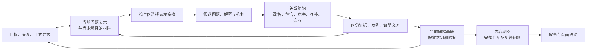

# 从问题表示到解释基底

更新：2026-10-26。状态：**专门方法已随 0.2.1 交付，首轮开发试用与有界独立复核已完成**。运行方法见 `skill-src/shared/references/insight-discovery.md`；本文件保留设计依据。正式质量对照尚未完成，实际结果另见[第一版记录](first-version-results.md)。

0.4.0在既有表示变换、区分/删除/交互测试上补强工作判据：独立问题、区分观察与判断行动差异；可用旧表示相同而新方向不同的两个假设情境检验增量，但不能把它们当事实。反命题不自动成为新维度，相关但决策含义不同的量不因相关合并。4–6初批/2–3补充只是可调预算，预算停止须标未解，不能以embedding或Gram–Schmidt类比认证正交。

## 1. 要寻找的“空间”是什么

工程目标是找到**相对于当前问题具有新增区分能力、解释贡献或决策意义的表示**。从材料抽象时保留关键约束；允许改变对象、单位、关系、时间尺度、系统边界或潜在机制，再用证据与目标筛选。

自然语言没有现成的通用内积。几何正交、统计独立、逻辑不等价、机制不同、对本次任务有用，是不同性质。不能用 embedding 距离、专业领域标签或更多抽象词直接证明得到新的思考方向。相关变量也可能各自重要；有时换表示或减少冗余即可，无须增加维数。

原对话 R19–20 的 **Explanatory Basis（解释基底）** 是设计目标：用较少的核心判断保住重要解释、证明义务和限制。其优化式并非已确定的可计算目标函数，不在此编造正交度、固定轴数或权重公式。

## 2. 目标发现与解释探索相互改变

这不是强制流水线。简单修订不必重新发散；新的解释可能暴露一个值得建议的新目标，但不能静默替换用户已经选择的目标。目标怎样发现与确认，另见[目标发现设计](goal-discovery-design.md)。

## 3. 可执行的探索动作

### 3.1 建立当前表示，找它分辨不了什么

记录当前要理解或决定的问题、已采用的分析对象/单位/时间/关系、关键事实锚点与正式限制。主动找现有说法无法解释的异常、矛盾、不同情况被混成同一种的地方；未知与资料缺失也要标明。

抽象的价值在于保留结构、暂去不相关表面细节。若去掉时间、身份、数量或范围会改变结论，这些不是可丢的细节。抽象节点应能回到原始材料，不能只剩“大局、体系、赋能”之类名称。

### 3.2 用有针对性的表示变换产生方向

| 当前盲区 | 可选动作 | 期待新增的区别 |
|---|---|---|
| 只有对象属性或功能清单 | 转看过程、关系、约束与相互作用 | 哪个机制使现象发生，谁依赖什么 |
| 总量或平均值掩盖差异 | 改粒度、时间尺度或分析单位，拆开混合概念 | 表面相同的情况为何需要不同判断 |
| 单一解释过早占据主线 | 找竞争解释、负例、边界情况和反事实 | 什么观察会使解释A与B得到不同支持 |
| 问题只描述症状 | 改系统边界、检查前后依赖与实现条件 | 当前问题是否只是更大过程的一个环节 |
| 熟悉框架找不到新关系 | 按需采用跨域关系类比或专业知识 | 哪些关系可迁移、哪些差异破坏类比 |
| 各局部分析都成立却难以综合 | 联合查看相关证据、检查交互与定义冲突 | 单独路径未看见的共同机制或条件 |

这些是操作库，不是永久坐标轴。七个领域 Knowledge 提供专业问题和验证要求，不要求每次跑七个领域，也不直接给出七条汇报结论。

### 3.3 允许大胆候选，分开生成与接纳

候选可以从新的问题、完整判断、机制或关系开始，不必一开始已被证实。至少逐渐说明：它比当前表示多解释了什么；依据或探索线索在哪里；哪些部分只是推测；有什么情况能区分或推翻它；若成立会改变什么理解或选择。

候选进入探索集合和主张进入最终内容采用不同门槛。暂时未证实的方向可以保留为 hypothesis/needs_evidence；不把合理的隐藏变量当作已观测事实。反过来，也不能在探索第一步因尚无证明就删掉所有可能新方向。

## 4. 怎样辨别真正不同的方向

| 检查 | 操作 | 边界 |
|---|---|---|
| 改名/包含检查 | 不用标题，比较两条完整判断；检查是否同义或已被另一条完全包含 | 词语不同不等于命题不同；词语相近也可能有必须保留的区别 |
| 可分离情境 | 在不违反已知约束的情况下，能否构造A成立而B不成立的情况 | 思维反例只揭示逻辑差异，不证明现实机制存在 |
| 区分测试 | 哪条新观察会分别改变两个候选的可信程度、解释或行动建议 | 有不同数据来源不自动成为不同机制，同一材料也可支持不同命题 |
| 删除测试 | 去掉一个候选，是否失去关键解释、必答问题、限制或决策差异 | 不是越短越好；必要反证和风险不可为精简删除 |
| 联合检查 | 候选是否处于同一机制链、分别必要、竞争、互补或产生交互 | 不为了“正交”把本来有关联的机制永久切开 |

这些是启发式和证据检查，不是数学独立性证明。向量检索可作为未来找资料或近义初筛的辅助手段，尚未成为本项目技术选型，更不能代替上述判断。

## 5. 三层收敛与 Graph 承接

**解释收敛：** 识别同义、包含、机制链、竞争和交互，选择当前有解释增量的核心结构。尚无法区分的候选保持未决，不因故事顺畅就选为真。

**论证收敛：** 核对来源、支持/反驳/限定与证明义务。只将确实必要的资料获取、测量或计算转成 Task；执行结果经过接纳，不能由 Task completed 自动变成 verified。

**沟通收敛：** 根据本次目标、受众、正式要求和时长，区分主线、备份、待研究或暂缓内容；保留会改变判断的限制。先形成 Content Blueprint 的完整判断、依据及问题关系，再进入 Narrative/PagePlan，不能从候选列表直接跳到好看的页面。

主要承接：Hypothesis 保存问题/解释候选及区分条件；Evidence/Argument/Obligation 管理论证与缺口；Task 管理真实工作；Blueprint 管理内容职责；Narrative/PagePlan 管理读者理解；版本依赖定位受新材料或新目标影响的判断。独立审计从原材料重建可能解释，检查生成侧漏掉的机制、类比越界和压缩损失，不只复述其候选表。

复杂任务可用适当隔离的探索路径减少锚定，但相同模型与互不交流并不保证独立性。综合阶段必须检查跨路径交互。所有过程只记录可审阅的候选、证据、选择及理由摘要，不要求保存私有推理过程。

## 6. 一个虚构的区分例

两次同类交付都用了10天。当前只有“总周期”的表示，无法区分：

| 情况 | 实际处理 | 等待 |
|---|---:|---:|
| A | 2天 | 8天 |
| B | 8天 | 2天 |

只有取得对应过程记录后，这个新表示才能成立。它使两个相同总数变得可区分，但固定总周期下两项相关，仍有诊断价值。进一步，“审批等待”和“返工等待”是不同机制候选，需要不同记录来检验；表格本身不能证明原因。

若本次目标只是告知总周期，可以不展开这些方向；若需要判断改进优先级，它们可能改变关注点。把同一个总周期分别称作“效率”“敏捷”“协同价值”，不会自动增加三种解释。这是方法说明，不是预装给所有报告的答案。

## 7. 实施与验收

表示重构、候选关系辨识、删除/区分测试与 Blueprint 转换已进入 Reference 和对应审计问题，0.4.0进一步约束区分观察与判断行动差异。继续复用自然语言记录和稳定引用；尚无证据需要另建“正交空间服务”、第三个 Skill 或通用图数据库。

专项场景至少覆盖：词异义同、词近机制异、抽象丢掉范围、类比源成立但目标不成立、关键反例、跨领域交互、用户改变主线、新证据迫使重构问题，以及无需发散的简单任务。评价非重复解释、关键遗漏、可检验性、证据强度、目标帮助和成本，不用唯一金句或候选数量评分。

先开发回归，再在同模型/输入/工具/预算条件下与基线比较。早期39项工程测试及六个骨架 Run 不证明这些专项能力；历次开发结果按其版本与范围理解。0.4.0新增关口尚待用户运行分阶段探针，也没有“自动找到最优思维基底”的效果证据。

## 8. 方法来源与外推边界

- [UW Invention 指引](https://writing.wisc.edu/handbook/processandstructure/generatingideas/)提供选择性问题生成视角，属于机构写作实践，不是 LLM 能力实验。
- [Gentner 1983 原论文](https://groups.psych.northwestern.edu/gentner/papers/Gentner83.2b.pdf)区分对象属性与关系结构、候选推论生成与后续接受；本轮定向读相关正文，不证明本产品类比算法有效。
- [Dorst / Cross 2001 作者机构副本](https://oro.open.ac.uk/3278/1/Creativity_-_coevolution.pdf)研究人类设计中的问题—方案共同演化；九名设计师的研究不能直接外推为自动 Agent 的收益保证。

原对话的数学类比、解释基底、三层收敛、结构化中间层及跨域交互纠偏已在本任务 `research/orthogonal-thinking-intent.md` 核对；外部读取层级与替代入口见 `research/orthogonal-thinking-engineering.md`。
