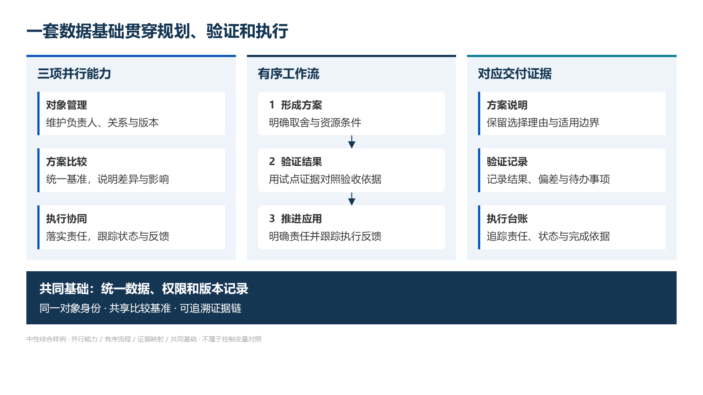

# 计算式视觉组合：3组对照与1页综合样例

[浏览实际成图](index.html) · [可编辑PPTX](visual-composition.pptx) · [作者布局树](comparison.author.json) · [内容与原生对象核验](comparison-check.json)

这些是原创、中性、确定性的工程样例，没有客户材料或模型案例测试。前三组分别保留相同标题/正文信息单元、字体角色、14pt正文/最低9pt、画布与tokens；页脚仅用于标注before/after，不纳入逐字一致比较。第7页是独立综合展示，不充当控制变量对照。默认纯色，未使用渐变、位图拓扑或手写最终frame。

| 页 | 关系与适用场景 | 计算变化 | 使用边界 |
| --- | --- | --- | --- |
| 1→2 | 三项并行能力共用一个平台；能力地图、系统说明 | 顶部分区rule区分并行组；共享基础column_span=3，以整条色带呈现覆盖范围 | 三项能力不生成顺序箭头；横跨不表示文字自动跨栏续排 |
| 3→4 | 从问题识别到应用的四阶段交接；阶段流程、工作方法 | 原生chevron与显式sequence连接，说明按同一四轨对齐 | 只有已声明先后的流程适用；不用于平级能力堆叠 |
| 5→6 | 持续改进闭环、执行能力和适用维度；方法介绍 | cycle的arrow-ring变体计算厚弧箭头；开放式说明组以rule和组距分层 | 3–6个定性阶段；等角不表示占比；没有声明的循环不能为了外观补上 |
| 7 | 并行能力／工作流／对应证据／共同基础；架构与交付机制介绍 | 三轨分区、嵌套文本流、纵向原生连接、全宽共享平台 | 独立合成展示；没有任意连线避障或通用布尔几何 |



## 从正常CLI重建

在仓库`project`目录，安装运行时依赖后执行。输出目录须是新路径，位于Skill包外。

```powershell
python skills/how-to-report/scripts/report_engine.py layouts grid
$out = [IO.Path]::GetFullPath((Join-Path (Get-Location) '../tmp/visual-composition-rebuild'))
python skills/how-to-report/scripts/report_engine.py build --input examples/visual-composition/comparison.author.json --output $out --pptx "$out.pptx" --geometry-policy computed
python examples/visual-composition/verify.py
```

`verify.py`核验随例提供的PPTX：三组作者标题/正文文字及字体角色相同，原生PPT文字单元忽略空白后相同；四个chevron仍为原生预设形状，三条原生连接正确绑定端点，层序在节点后方，原生对象ID无重复。第6页循环为4个原生自定义曲线形状和4个14pt文本框，没有贴图或叠加细线。它不提供审美分数。修改作者后应重新build，保留新的布局与导出收据，再在PowerPoint查看结果。

全套使用用户偏好的`report-default`内敛配色：深蓝、蓝、青绿与灰蓝。`consulting-spectrum`作为另一个可选色卡保留，不替换默认。第6页4阶段按categorical顺序取色，深浅背景分别自动选择可读文字颜色。前后对照使用相同色卡，颜色不会替代闭环、顺序和共享范围等关系表达。

预览来自Windows PowerPoint 16.0，1600×900；完整7页均已查看，未见遮挡或丢字。前6页有意只展示一个局部关系，不是以满版率优化的业务汇报；其留白不能拿来证明最少页数或高信息密度。第7页单独展示组合后的较完整页面。

## 能力与限制

- `column_span`仅支持显式列Grid直接子项，按行优先顺序放置，不能与auto_fit混用；未实现row_span/subgrid。
- `surface.accent`根据容器尺寸计算rail、rule或bracket，并预留相应内边距。装饰不计信息占用，不通过加色块伪造信息密度。
- `connect="sequence"`仅连接显式row/column的直接子项，使用形状连接点；并列不会自动变为因果。层序为父surface/accent、连接、子树。
- 文本仍可编辑；chevron、容器与accent是原生形状；连接是原生cxnSp。布局容器不是自动PowerPoint组合，局部topology组件保留自己的原生group。
- 厚弧箭头沿`components topology`或`library component.topology`查`variant="arrow-ring"`。数量和容器变化后重算角域、半径、缝隙及标签安全区，放不下会报错，不缩字。不是定量环形图，也不支持任意布尔、中心内容或徽标。
- 目前没有通用路径布尔操作、遮罩、任意连接避障、自动审美优化或完整Figma/CSS复刻。线条、分区、主次和形状是否有语义作用仍需设计与实际成图审核。

本例的视觉收益来自把同一内容的覆盖、顺序与分层表达出来，而非增加文字或装饰数量。完整机制与默认参数见[计算排版合同](../../skills/how-to-report/references/ppt-layout.md)。
