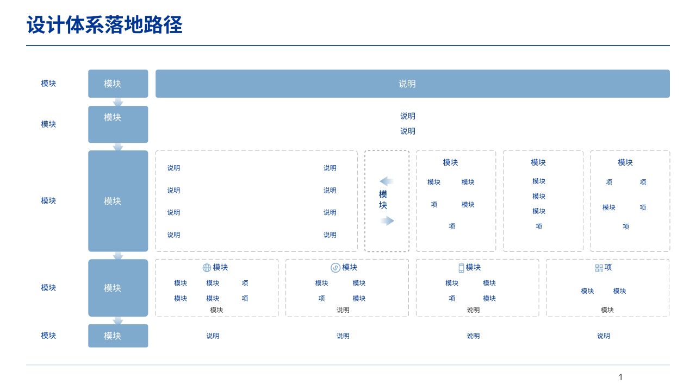

# 设计体系落地路径

来源为蓝色逻辑架构图.pptx#2。

## 结构与适用场景

STEP01–05竖向步骤；用户目标、原则、模式、技术、资产；模式层左组件分级、右3平台；技术4端

设计体系或标准落地路径

保留流程与横向平台/终端矩阵；不能将5步压成5个无关卡

固定节点、圆弧、扇区、分面和连接表达定性关系。数量比较、趋势或占比使用数据驱动图表，源页中已登记的微图槽可接收实际数据。

## 预览



## 调用

将下列完整page对象放入schema_version=1、template_id=business-blue-v1的pages数组，替换各节点内容。nodes键对应原文本框或已明确拆分的语义分段，字段角色及source_ref、segment见下表。

```json
{
  "id": "architecture-02",
  "family": "source-architecture",
  "variant": "page-02",
  "content": {
    "title": "设计体系落地路径",
    "nodes": {
      "shape_78": "模块",
      "shape_79": "模块",
      "shape_80": "模块",
      "shape_81": "模块",
      "shape_82": "模块",
      "shape_83": "模块",
      "shape_84": "模块",
      "shape_85": "模块",
      "shape_86": "模块",
      "shape_87": "模块",
      "shape_88": "说明",
      "shape_92": "说明",
      "shape_93": "说明",
      "shape_94": "说明",
      "shape_95": "说明",
      "shape_96": "说明",
      "shape_97": "说明",
      "shape_98": "说明",
      "shape_99": "说明",
      "shape_100": "模块",
      "shape_101": "模块",
      "shape_102": "模块",
      "shape_103": "模块",
      "shape_104": "模块",
      "shape_105": "模块",
      "shape_106": "项",
      "shape_107": "模块",
      "shape_108": "项",
      "shape_109": "模块",
      "shape_110": "模块",
      "shape_111": "模块",
      "shape_112": "项",
      "shape_113": "项",
      "shape_114": "项",
      "shape_115": "模块",
      "shape_116": "项",
      "shape_117": "项",
      "shape_118": "模块",
      "shape_119": "模块",
      "shape_120": "模块",
      "shape_121": "项",
      "shape_122": "模块",
      "shape_123": "说明",
      "shape_124": "说明",
      "shape_125": "模块",
      "shape_89": "说明",
      "shape_90": "说明",
      "shape_131": "模块",
      "shape_132": "模块",
      "shape_133": "模块",
      "shape_134": "模块",
      "shape_135": "项",
      "shape_136": "项",
      "shape_137": "项",
      "shape_138": "模块",
      "shape_139": "模块",
      "shape_140": "模块",
      "shape_141": "项",
      "shape_142": "模块",
      "shape_143": "模块",
      "shape_144": "模块",
      "shape_145": "模块",
      "shape_146": "模块",
      "shape_147": "说明",
      "shape_148": "说明",
      "shape_149": "说明",
      "shape_150": "说明"
    }
  },
  "config": {
    "show_source": true,
    "show_page_number": true
  }
}
```

config支持show_source、show_page_number、image_fit与image_position。image_fit可选contain或cover，image_position为xMin/xMid/xMax与YMin/YMid/YMax组合的九个焦点，默认为xMidYMid。字体、颜色、全局区和固定字阶取自tokens，节点数与连接结构由variant确定。

## 字段合同

每个业务节点required=true、min=1，max按具体框体登记。字符按规范化后的Unicode码点计数，空格标点换行均计入。build会以实际字体测量宽高，字符数通过后仍可能需要调整文字。

| 字段 | 节点角色与源标签 | 最短/最长 | 字阶 | 框体px | 原框引用 | 分段 | 旋转° | 垂直锚点 |
|---|---|---|---|---|---|---|---|---|
| nodes.shape_78 | 上左节点，源标签“STEP 01” | 1/9 | diagramCompact | [69.4877, 145.3341, 57.5241, 17.5] | slide:78 |  | 0.0 | t |
| nodes.shape_79 | 上左节点，源标签“STEP 02” | 1/9 | diagramCompact | [68.6203, 220.3705, 59.2589, 17.5] | slide:79 |  | 0.0 | t |
| nodes.shape_80 | 中左节点，源标签“STEP 03” | 1/9 | diagramCompact | [68.5274, 361.4808, 59.4344, 17.5] | slide:80 |  | 0.0 | t |
| nodes.shape_81 | 下左节点，源标签“STEP 04” | 1/9 | diagramCompact | [68.4448, 521.5282, 59.6099, 17.5] | slide:81 |  | 0.0 | t |
| nodes.shape_82 | 下左节点，源标签“STEP 05” | 1/9 | diagramCompact | [68.4448, 609.6472, 59.6099, 17.5] | slide:82 |  | 0.0 | t |
| nodes.shape_83 | 上左节点，源标签“用户目标” | 1/9 | caption | [183.9681, 144.0682, 66.7243, 20.0214] | slide:83 |  | 0.0 | t |
| nodes.shape_84 | 上左节点，源标签“价值观 / 设计原则” | 1/18 | caption | [183.9681, 205.9601, 66.7243, 46.3002] | slide:84 |  | 0.0 | t |
| nodes.shape_85 | 中左节点，源标签“设计模式” | 1/9 | caption | [183.9681, 360.2252, 66.7243, 20.0214] | slide:85 |  | 0.0 | t |
| nodes.shape_86 | 下左节点，源标签“技术实现” | 1/9 | caption | [183.9681, 520.2727, 66.7243, 20.0214] | slide:86 |  | 0.0 | t |
| nodes.shape_87 | 下左节点，源标签“资产运营” | 1/9 | caption | [183.9681, 608.3814, 66.7243, 20.0214] | slide:87 |  | 0.0 | t |
| nodes.shape_88 | 上中节点，源标签“用户访谈/工单收集/调研问卷” | 1/29 | caption | [651.5234, 144.0682, 215.1347, 20.0214] | slide:88 |  | 0.0 | t |
| nodes.shape_92 | 中左节点，源标签“设计风格：品牌、界面呈现等直观感受” | 1/30 | diagramMicro | [307.2872, 301.6244, 165.4374, 15.0] | slide:92 |  | 0.0 | t |
| nodes.shape_93 | 中中节点，源标签“界面配色、文案话术、插图等” | 1/23 | diagramMicro | [507.7595, 301.6244, 126.5098, 15.0] | slide:93 |  | 0.0 | t |
| nodes.shape_94 | 中左节点，源标签“组件模块：适用于业务通用的基础组件” | 1/30 | diagramMicro | [307.2872, 342.927, 165.4374, 15.0] | slide:94 |  | 0.0 | t |
| nodes.shape_95 | 中中节点，源标签“框架导航、数据呈现、数据输入等” | 1/27 | diagramMicro | [488.306, 342.927, 145.9736, 15.0] | slide:95 |  | 0.0 | t |
| nodes.shape_96 | 中左节点，源标签“典型页面：结合业务逻辑使用的场景能力” | 1/32 | diagramMicro | [307.2872, 383.5481, 175.1642, 15.0] | slide:96 |  | 0.0 | t |
| nodes.shape_97 | 中中节点，源标签“功能模块、典型页面、解决方案等” | 1/27 | diagramMicro | [488.306, 383.5481, 145.9736, 15.0] | slide:97 |  | 0.0 | t |
| nodes.shape_98 | 中左节点，源标签“效率工具：为各端积累的高效管理、适用工具” | 1/36 | diagramMicro | [307.2872, 424.8506, 194.628, 15.0] | slide:98 |  | 0.0 | t |
| nodes.shape_99 | 中中节点，源标签“TeaMaker、配图工具等” | 1/19 | diagramMicro | [529.3091, 424.8506, 104.9601, 15.0] | slide:99 |  | 0.0 | t |
| nodes.shape_100 | 中中节点，源标签“应用 / 提炼” | 1/8 | caption | [696.2954, 349.0116, 30.5845, 42.4384] | slide:100 |  | 0.0 | t |
| nodes.shape_101 | 中中节点，源标签“Web端中后台” | 1/14 | diagramCompact | [793.3771, 290.9257, 88.2739, 17.5] | slide:101 |  | 0.0 | t |
| nodes.shape_102 | 中右节点，源标签“小程序/移动端/H5” | 1/18 | diagramCompact | [941.1164, 290.9257, 115.7298, 17.5] | slide:102 |  | 0.0 | t |
| nodes.shape_103 | 中右节点，源标签“数据可视化” | 1/11 | diagramCompact | [1124.2829, 290.9257, 69.5122, 17.5] | slide:103 |  | 0.0 | t |
| nodes.shape_104 | 中中节点，源标签“腾讯 / 云控制台” | 1/7 | diagramMicro | [786.4383, 327.8027, 38.9277, 24.9571] | slide:104 |  | 0.0 | t |
| nodes.shape_105 | 中右节点，源标签“私有化 / 部署” | 1/5 | diagramMicro | [853.9473, 327.8027, 29.1906, 24.9571] | slide:105 |  | 0.0 | t |
| nodes.shape_106 | 中中节点，源标签“配置 / 系统” | 1/3 | diagramMicro | [796.165, 369.1053, 19.4638, 24.9571] | slide:106 |  | 0.0 | t |
| nodes.shape_107 | 中右节点，源标签“IDC / 管理系统” | 1/7 | diagramMicro | [849.0736, 369.1053, 38.9277, 24.9571] | slide:107 |  | 0.0 | t |
| nodes.shape_108 | 中中节点，源标签“···” | 1/2 | diagramMicro | [831.6439, 409.0111, 14.6005, 15.0] | slide:108 |  | 0.0 | t |
| nodes.shape_109 | 中右节点，源标签“腾讯云助手” | 1/9 | diagramMicro | [974.6644, 326.0652, 48.6544, 15.0] | slide:109 |  | 0.0 | t |
| nodes.shape_110 | 中右节点，源标签“云行业应用” | 1/9 | diagramMicro | [974.6644, 353.9444, 48.6544, 15.0] | slide:110 |  | 0.0 | t |
| nodes.shape_111 | 中右节点，源标签“H5运营活动” | 1/9 | diagramMicro | [972.9193, 381.1525, 52.1342, 15.0] | slide:111 |  | 0.0 | t |
| nodes.shape_112 | 中右节点，源标签“···” | 1/2 | diagramMicro | [991.6914, 409.3622, 14.6005, 15.0] | slide:112 |  | 0.0 | t |
| nodes.shape_113 | 中右节点，源标签“指标 / 监控” | 1/3 | diagramMicro | [1117.9843, 327.8027, 19.4638, 24.9571] | slide:113 |  | 0.0 | t |
| nodes.shape_114 | 中右节点，源标签“客情 / 系统” | 1/3 | diagramMicro | [1180.6299, 327.8027, 19.4638, 24.9571] | slide:114 |  | 0.0 | t |
| nodes.shape_115 | 中右节点，源标签“大数据” | 1/5 | diagramMicro | [1113.1209, 374.4349, 29.1906, 15.0] | slide:115 |  | 0.0 | t |
| nodes.shape_116 | 中右节点，源标签“云图” | 1/3 | diagramMicro | [1180.6299, 374.4349, 19.4638, 15.0] | slide:116 |  | 0.0 | t |
| nodes.shape_117 | 中右节点，源标签“···” | 1/2 | diagramMicro | [1151.7388, 409.7029, 14.6005, 15.0] | slide:117 |  | 0.0 | t |
| nodes.shape_118 | 下左节点，源标签“WEB” | 1/5 | diagramCompact | [391.3379, 483.8499, 34.0643, 17.5] | slide:118 |  | 0.0 | t |
| nodes.shape_119 | 下中节点，源标签“小程序” | 1/6 | diagramCompact | [629.1065, 483.8499, 41.7053, 17.5] | slide:119 |  | 0.0 | t |
| nodes.shape_120 | 下右节点，源标签“MOBILE” | 1/8 | diagramCompact | [856.4048, 483.8499, 55.6036, 17.5] | slide:120 |  | 0.0 | t |
| nodes.shape_121 | 下右节点，源标签“APP” | 1/4 | diagramCompact | [1111.3759, 483.8499, 29.5417, 17.5] | slide:121 |  | 0.0 | t |
| nodes.shape_122 | 下左节点，源标签“React” | 1/5 | diagramMicro | [386.2061, 563.1213, 28.1477, 15.0] | slide:122 |  | 0.0 | t |
| nodes.shape_123 | 下中节点，源标签“Native、mpvue、react+taro” | 1/25 | diagramMicro | [570.3329, 563.1213, 136.5876, 15.0] | slide:123 |  | 0.0 | t |
| nodes.shape_124 | 下中节点，源标签“Vue、react+taro” | 1/15 | diagramMicro | [837.6018, 563.1213, 81.1492, 15.0] | slide:124 |  | 0.0 | t |
| nodes.shape_125 | 下右节点，源标签“Flutter” | 1/6 | diagramMicro | [1104.8707, 563.1213, 33.3621, 15.0] | slide:125 |  | 0.0 | t |
| nodes.shape_89 | 上中节点，源标签“设计价值观：精确、高效、一致” | 1/30 | diagramCompact | [661.7768, 205.45, 194.628, 17.5] | slide:89 |  | 0.0 | t |
| nodes.shape_90 | 上中节点，源标签“设计原则：掌控感、轻量感、专注感、系统性、可靠性、指引性” | 1/61 | diagramCompact | [564.4576, 233.2156, 389.256, 17.5] | slide:90 |  | 0.0 | t |
| nodes.shape_131 | 下左节点，源标签“开发框架” | 1/7 | diagramMicro | [320.4008, 513.6511, 38.9277, 15.0] | slide:131 |  | 0.0 | t |
| nodes.shape_132 | 下左节点，源标签“定制工具” | 1/7 | diagramMicro | [320.4008, 541.8711, 38.9277, 15.0] | slide:132 |  | 0.0 | t |
| nodes.shape_133 | 下左节点，源标签“UI组件库” | 1/7 | diagramMicro | [379.608, 513.6511, 38.9277, 15.0] | slide:133 |  | 0.0 | t |
| nodes.shape_134 | 下左节点，源标签“开发文档” | 1/7 | diagramMicro | [379.608, 541.8711, 38.9277, 15.0] | slide:134 |  | 0.0 | t |
| nodes.shape_135 | 下中节点，源标签“CLI” | 1/2 | diagramMicro | [450.6278, 513.6511, 15.2923, 15.0] | slide:135 |  | 0.0 | t |
| nodes.shape_136 | 下中节点，源标签“主题” | 1/3 | diagramMicro | [448.542, 541.8711, 19.4638, 15.0] | slide:136 |  | 0.0 | t |
| nodes.shape_137 | 下中节点，源标签“CLI” | 1/2 | diagramMicro | [591.738, 541.8711, 15.2923, 15.0] | slide:137 |  | 0.0 | t |
| nodes.shape_138 | 下中节点，源标签“UI组件库” | 1/7 | diagramMicro | [579.9254, 513.6511, 38.9277, 15.0] | slide:138 |  | 0.0 | t |
| nodes.shape_139 | 下中节点，源标签“开发文档” | 1/7 | diagramMicro | [648.7562, 541.8711, 38.9277, 15.0] | slide:139 |  | 0.0 | t |
| nodes.shape_140 | 下中节点，源标签“主题定制工具” | 1/10 | diagramMicro | [639.0294, 513.6511, 58.3915, 15.0] | slide:140 |  | 0.0 | t |
| nodes.shape_141 | 下中节点，源标签“CLI” | 1/2 | diagramMicro | [831.2928, 541.8711, 15.2923, 15.0] | slide:141 |  | 0.0 | t |
| nodes.shape_142 | 下中节点，源标签“UI组件库” | 1/7 | diagramMicro | [819.4803, 513.6511, 38.9277, 15.0] | slide:142 |  | 0.0 | t |
| nodes.shape_143 | 下右节点，源标签“开发文档” | 1/7 | diagramMicro | [888.311, 513.6511, 38.9277, 15.0] | slide:143 |  | 0.0 | t |
| nodes.shape_144 | 下右节点，源标签“主题定制工具” | 1/10 | diagramMicro | [878.5843, 541.8711, 58.3915, 15.0] | slide:144 |  | 0.0 | t |
| nodes.shape_145 | 下右节点，源标签“UI组件库” | 1/7 | diagramMicro | [1068.669, 528.107, 38.9277, 15.0] | slide:145 |  | 0.0 | t |
| nodes.shape_146 | 下右节点，源标签“开发文档” | 1/7 | diagramMicro | [1127.8659, 528.107, 38.9277, 15.0] | slide:146 |  | 0.0 | t |
| nodes.shape_147 | 下左节点，源标签“DTC:腾讯云设计规范管理” | 1/26 | diagramMicro | [327.2983, 610.8802, 143.5367, 15.0135] | slide:147 |  | 0.0 | t |
| nodes.shape_148 | 下中节点，源标签“teamaker：sketch插件工具” | 1/30 | diagramMicro | [556.1661, 610.8802, 164.9108, 15.0135] | slide:148 |  | 0.0 | t |
| nodes.shape_149 | 下中节点，源标签“配图工具：插图快速拼接工具” | 1/30 | diagramMicro | [796.8465, 610.8802, 162.6495, 15.0135] | slide:149 |  | 0.0 | t |
| nodes.shape_150 | 下右节点，源标签“架构图工具：快速可视化画架构图” | 1/34 | diagramMicro | [1023.897, 610.8802, 187.6789, 15.0135] | slide:150 |  | 0.0 | t |

全局title必填、2至32码点，使用统一标题框。section_name可选0至24码点，source可选0至64码点。所有可编辑文本通过独立原生carrier导出，页码为派生文字。

## 来源处理

原生PPTX源件保存于用户材料目录，分发包仅含用户资产衍生的几何、字段和说明。原始逐框文字、源框与标准化框在page-catalog.json的variant.fields中。

源标题引用为`slide:6`，原文为“TEA设计系统架构图”。模板默认标题依据真实结构设置。

密集全景中的diagramCompact为14px、diagramMicro为12px。适用于体系概览或附录局部标签，现场关键结论用统一标题与正常正文字阶表达。

源画布边界裁切已烘焙为可编辑Bezier几何，3D顶面、侧面与前面通过tokens配色的相对明暗保留。

