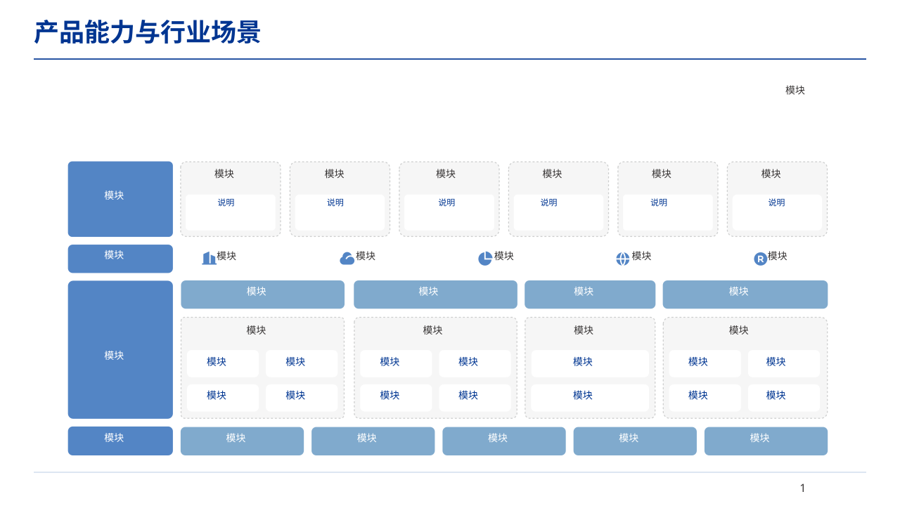

# 产品能力与行业场景

来源为蓝色逻辑架构图.pptx#3。

## 结构与适用场景

行业场景6列、应用服务图标行、平台4能力组、数据5模块；左4层标签

产品能力地图

与house05、architecture09近重复；固定网格仅是外观，语义分层不同

固定节点、圆弧、扇区、分面和连接表达定性关系。数量比较、趋势或占比使用数据驱动图表，源页中已登记的微图槽可接收实际数据。

## 预览



## 调用

将下列完整page对象放入schema_version=1、template_id=business-blue-v1的pages数组，替换各节点内容。nodes键对应原文本框或已明确拆分的语义分段，字段角色及source_ref、segment见下表。

```json
{
  "id": "architecture-03",
  "family": "source-architecture",
  "variant": "page-03",
  "content": {
    "title": "产品能力与行业场景",
    "nodes": {
      "shape_109": "模块",
      "shape_110": "模块",
      "shape_111": "模块",
      "shape_112": "模块",
      "shape_113": "模块",
      "shape_114": "模块",
      "shape_115": "模块",
      "shape_116": "模块",
      "shape_117": "模块",
      "shape_118": "模块",
      "shape_119": "模块",
      "shape_120": "模块",
      "shape_121": "模块",
      "shape_122": "模块",
      "shape_123": "模块",
      "shape_124": "模块",
      "shape_125": "模块",
      "shape_126": "模块",
      "shape_127": "模块",
      "shape_128": "模块",
      "shape_129": "模块",
      "shape_130": "模块",
      "shape_131": "模块",
      "shape_132": "模块",
      "shape_133": "模块",
      "shape_134": "模块",
      "shape_135": "模块",
      "shape_136": "模块",
      "shape_137": "模块",
      "shape_138": "模块",
      "shape_139": "模块",
      "shape_140": "模块",
      "shape_141": "模块",
      "shape_142": "模块",
      "shape_143": "模块",
      "shape_144": "模块",
      "shape_145": "模块",
      "shape_146": "说明",
      "shape_147": "说明",
      "shape_148": "说明",
      "shape_149": "说明",
      "shape_150": "说明",
      "shape_151": "说明",
      "shape_152": "模块",
      "shape_153": "模块",
      "shape_154": "模块",
      "shape_155": "模块",
      "shape_156": "模块",
      "shape_157": "模块"
    }
  },
  "config": {
    "show_source": true,
    "show_page_number": true
  }
}
```

config支持show_source、show_page_number、image_fit与image_position。image_fit可选contain或cover，image_position为xMin/xMid/xMax与YMin/YMid/YMax组合的九个焦点，默认为xMidYMid。字体、颜色、全局区和固定字阶取自tokens，节点数与连接结构由variant确定。

## 字段合同

每个业务节点required=true、min=1，max按具体框体登记。字符按规范化后的Unicode码点计数，空格标点换行均计入。build会以实际字体测量宽高，字符数通过后仍可能需要调整文字。

| 字段 | 节点角色与源标签 | 最短/最长 | 字阶 | 框体px | 原框引用 | 分段 | 旋转° | 垂直锚点 |
|---|---|---|---|---|---|---|---|---|
| nodes.shape_109 | 上右节点，源标签“UI/UX 2022” | 1/13 | diagramCompact | [1096.7916, 120, 86.552, 24.3855] | slide:109 |  | 0.0 | t |
| nodes.shape_110 | 上左节点，源标签“行业/场景” | 1/12 | diagramCompact | [131.6546, 269.6241, 79.2505, 25.9137] | slide:110 |  | 0.0 | t |
| nodes.shape_111 | 中左节点，源标签“应用服务” | 1/11 | diagramCompact | [134.1922, 354.2893, 74.1753, 25.9137] | slide:111 |  | 0.0 | t |
| nodes.shape_112 | 下左节点，源标签“平台服务” | 1/11 | diagramCompact | [134.1922, 497.442, 74.1753, 25.9137] | slide:112 |  | 0.0 | t |
| nodes.shape_113 | 下左节点，源标签“数据服务” | 1/11 | diagramCompact | [134.1922, 614.4641, 74.1753, 25.9137] | slide:113 |  | 0.0 | t |
| nodes.shape_114 | 下左节点，源标签“企业业务数据存储服务” | 1/25 | diagramCompact | [265.5059, 614.832, 158.001, 25.9137] | slide:114 |  | 0.0 | t |
| nodes.shape_115 | 下中节点，源标签“高德POI数据服务” | 1/19 | diagramCompact | [468.5233, 614.832, 124.5028, 25.9137] | slide:115 |  | 0.0 | t |
| nodes.shape_116 | 下中节点，源标签“高德AOI数据服务” | 1/19 | diagramCompact | [654.07, 614.832, 125.9272, 25.9137] | slide:116 |  | 0.0 | t |
| nodes.shape_117 | 下中节点，源标签“高德行政区划数据服务” | 1/25 | diagramCompact | [824.2967, 614.832, 158.001, 25.9137] | slide:117 |  | 0.0 | t |
| nodes.shape_118 | 下右节点，源标签“高德地图数据服务” | 1/20 | diagramCompact | [1024.5313, 614.832, 130.0591, 25.9137] | slide:118 |  | 0.0 | t |
| nodes.shape_119 | 中左节点，源标签“在线SaaS+API产品” | 1/21 | diagramCompact | [305.7774, 406.1922, 135.9267, 25.9137] | slide:119 |  | 0.0 | t |
| nodes.shape_120 | 中中节点，源标签“IOS SDK” | 1/11 | diagramCompact | [581.4135, 406.1922, 74.0149, 25.9137] | slide:120 |  | 0.0 | t |
| nodes.shape_121 | 中中节点，源标签“Android SDK” | 1/16 | diagramCompact | [788.3553, 406.1922, 101.7964, 25.9137] | slide:121 |  | 0.0 | t |
| nodes.shape_122 | 中右节点，源标签“小程序” | 1/9 | diagramCompact | [1029.6442, 406.1922, 60.2043, 25.9137] | slide:122 |  | 0.0 | t |
| nodes.shape_123 | 中左节点，源标签“空间数据托管” | 1/16 | diagramCompact | [322.3897, 461.51, 102.1172, 25.9137] | slide:123 |  | 0.0 | t |
| nodes.shape_124 | 中中节点，源标签“空间检索” | 1/11 | diagramCompact | [587.4038, 461.51, 74.1753, 25.9137] | slide:124 |  | 0.0 | t |
| nodes.shape_125 | 中中节点，源标签“空间计算” | 1/11 | diagramCompact | [802.0432, 461.51, 74.1753, 25.9137] | slide:125 |  | 0.0 | t |
| nodes.shape_126 | 中右节点，源标签“GIS模型服务” | 1/15 | diagramCompact | [1011.7018, 461.51, 96.0798, 25.9137] | slide:126 |  | 0.0 | t |
| nodes.shape_127 | 下左节点，源标签“数据存储” | 1/10 | diagramCompact | [282.4484, 506.3284, 69.0906, 24.3855] | slide:127 |  | 0.0 | t |
| nodes.shape_128 | 下左节点，源标签“数据查询” | 1/10 | diagramCompact | [282.4484, 554.0522, 69.0906, 24.3855] | slide:128 |  | 0.0 | t |
| nodes.shape_129 | 下左节点，源标签“数据编辑” | 1/10 | diagramCompact | [394.7443, 506.3284, 69.0906, 24.3855] | slide:129 |  | 0.0 | t |
| nodes.shape_130 | 下左节点，源标签“数据同步” | 1/10 | diagramCompact | [394.7443, 554.0522, 69.0906, 24.3855] | slide:130 |  | 0.0 | t |
| nodes.shape_131 | 下中节点，源标签“周边检索” | 1/10 | diagramCompact | [528.8503, 506.3284, 69.0906, 24.3855] | slide:131 |  | 0.0 | t |
| nodes.shape_132 | 下中节点，源标签“区块相交查询” | 1/14 | diagramCompact | [516.1529, 554.0522, 94.4949, 24.3855] | slide:132 |  | 0.0 | t |
| nodes.shape_133 | 下中节点，源标签“多边检索” | 1/10 | diagramCompact | [640.5236, 506.3284, 69.0906, 24.3855] | slide:133 |  | 0.0 | t |
| nodes.shape_134 | 下中节点，源标签“检索高德AOI” | 1/14 | diagramCompact | [629.7317, 554.0522, 90.6838, 24.3855] | slide:134 |  | 0.0 | t |
| nodes.shape_135 | 下中节点，源标签“业务数据运营” | 1/14 | diagramCompact | [790.6853, 506.3284, 94.4949, 24.3855] | slide:135 |  | 0.0 | t |
| nodes.shape_136 | 下中节点，源标签“数据融合计算” | 1/14 | diagramCompact | [790.6853, 554.0522, 94.4949, 24.3855] | slide:136 |  | 0.0 | t |
| nodes.shape_137 | 下右节点，源标签“等时圈/等距圈” | 1/15 | diagramCompact | [952.5257, 506.3284, 98.7777, 24.3855] | slide:137 |  | 0.0 | t |
| nodes.shape_138 | 下右节点，源标签“智能分区” | 1/10 | diagramCompact | [967.3645, 554.0522, 69.0906, 24.3855] | slide:138 |  | 0.0 | t |
| nodes.shape_139 | 下右节点，源标签“自然街区” | 1/10 | diagramCompact | [1078.085, 506.3284, 69.0906, 24.3855] | slide:139 |  | 0.0 | t |
| nodes.shape_140 | 下右节点，源标签“线路排程服务” | 1/14 | diagramCompact | [1065.3876, 554.0522, 94.4949, 24.3855] | slide:140 |  | 0.0 | t |
| nodes.shape_141 | 中左节点，源标签“点位上图” | 1/11 | diagramCompact | [308.0791, 355.8081, 74.1753, 25.9137] | slide:141 |  | 0.0 | t |
| nodes.shape_142 | 中中节点，源标签“区块上图” | 1/11 | diagramCompact | [506.0025, 355.8081, 74.1753, 25.9137] | slide:142 |  | 0.0 | t |
| nodes.shape_143 | 中中节点，源标签“轨迹上图” | 1/11 | diagramCompact | [702.7466, 355.8081, 74.1753, 25.9137] | slide:143 |  | 0.0 | t |
| nodes.shape_144 | 中右节点，源标签“空间检索” | 1/11 | diagramCompact | [898.406, 355.8081, 74.1753, 25.9137] | slide:144 |  | 0.0 | t |
| nodes.shape_145 | 中右节点，源标签“空间计算” | 1/11 | diagramCompact | [1091.6126, 355.8081, 74.1753, 25.9137] | slide:145 |  | 0.0 | t |
| nodes.shape_146 | 中左节点，源标签“网点布局/网店运营/保险出险” | 1/36 | diagramMicro | [280.1749, 280.482, 97.9193, 43.6675] | slide:146 |  | 0.0 | t |
| nodes.shape_147 | 中中节点，源标签“区块派单/订单统 / 计/路径规划” | 1/36 | diagramMicro | [433.5818, 280.482, 102.1172, 43.6675] | slide:147 |  | 0.0 | t |
| nodes.shape_148 | 中中节点，源标签“业务拓展/营销片 / 区/外勤管理” | 1/36 | diagramMicro | [592.0073, 280.482, 102.1172, 43.6675] | slide:148 |  | 0.0 | t |
| nodes.shape_149 | 中中节点，源标签“社区作战/线下营 / 销/竞品分析” | 1/36 | diagramMicro | [737.2259, 280.482, 102.1172, 43.6675] | slide:149 |  | 0.0 | t |
| nodes.shape_150 | 中右节点，源标签“区块派单/订单统 / 计/电子围栏” | 1/36 | diagramMicro | [893.8213, 280.482, 102.1172, 43.6675] | slide:150 |  | 0.0 | t |
| nodes.shape_151 | 中右节点，源标签“点位管理/空间检 / 索/权限管理” | 1/36 | diagramMicro | [1061.1803, 280.482, 102.1172, 43.6675] | slide:151 |  | 0.0 | t |
| nodes.shape_152 | 上左节点，源标签“金融” | 1/7 | diagramCompact | [304.8246, 238.9276, 46.2334, 25.9137] | slide:152 |  | 0.0 | t |
| nodes.shape_153 | 上中节点，源标签“家电” | 1/7 | diagramCompact | [461.4954, 238.9276, 46.2334, 25.9137] | slide:153 |  | 0.0 | t |
| nodes.shape_154 | 上中节点，源标签“零售” | 1/7 | diagramCompact | [619.9492, 238.9276, 46.2334, 25.9137] | slide:154 |  | 0.0 | t |
| nodes.shape_155 | 上中节点，源标签“O2O” | 1/7 | diagramCompact | [770.3751, 238.9276, 48.1389, 25.9137] | slide:155 |  | 0.0 | t |
| nodes.shape_156 | 上右节点，源标签“物流快递” | 1/11 | diagramCompact | [912.858, 238.9276, 74.1753, 25.9137] | slide:156 |  | 0.0 | t |
| nodes.shape_157 | 上右节点，源标签“政府” | 1/7 | diagramCompact | [1082.547, 238.9276, 46.2334, 25.9137] | slide:157 |  | 0.0 | t |

全局title必填、2至32码点，使用统一标题框。section_name可选0至24码点，source可选0至64码点。所有可编辑文本通过独立原生carrier导出，页码为派生文字。

## 来源处理

原生PPTX源件保存于用户材料目录，分发包仅含用户资产衍生的几何、字段和说明。原始逐框文字、源框与标准化框在page-catalog.json的variant.fields中。

源标题引用为`slide:107`，原文为“产品功能矩阵”。模板默认标题依据真实结构设置。

密集全景中的diagramCompact为14px、diagramMicro为12px。适用于体系概览或附录局部标签，现场关键结论用统一标题与正常正文字阶表达。

源画布边界裁切已烘焙为可编辑Bezier几何，3D顶面、侧面与前面通过tokens配色的相对明暗保留。

