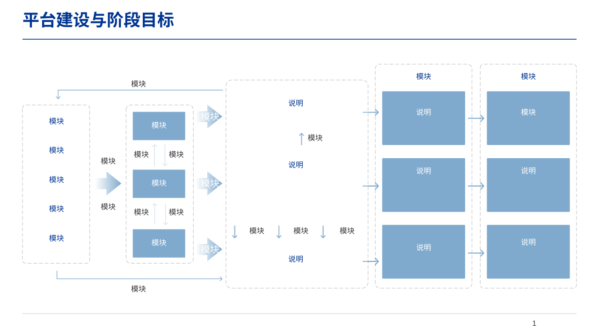

# 平台建设与阶段目标

来源为蓝色逻辑架构图.pptx#4。

## 结构与适用场景

左5类输入；教育/业务/众创3平台上下需求成果流；中心能力与成果转化；右近期/远期目标各3块

建设路线与阶段目标

输入、研究平台、能力、输出目标分开；年份数量为原例文

固定节点、圆弧、扇区、分面和连接表达定性关系。数量比较、趋势或占比使用数据驱动图表，源页中已登记的微图槽可接收实际数据。

## 预览



## 调用

将下列完整page对象放入schema_version=1、template_id=business-blue-v1的pages数组，替换各节点内容。nodes键对应原文本框或已明确拆分的语义分段，字段角色及source_ref、segment见下表。

```json
{
  "id": "architecture-04",
  "family": "source-architecture",
  "variant": "page-04",
  "content": {
    "title": "平台建设与阶段目标",
    "nodes": {
      "shape_63": "模块",
      "shape_85": "模块",
      "shape_86": "模块",
      "shape_87": "模块",
      "shape_88": "模块",
      "shape_90": "模块",
      "shape_95": "模块",
      "shape_96": "模块",
      "shape_97": "模块",
      "shape_98": "模块",
      "shape_65": "说明",
      "shape_67": "说明",
      "shape_69": "说明",
      "shape_108": "模块",
      "shape_66": "模块",
      "shape_68": "说明",
      "shape_70": "说明",
      "shape_109": "模块",
      "shape_89": "模块",
      "shape_99": "模块",
      "shape_64": "模块",
      "shape_83": "模块",
      "shape_84": "模块",
      "shape_100": "模块",
      "shape_105": "模块",
      "shape_106": "模块",
      "shape_107": "模块",
      "shape_101": "模块",
      "shape_102": "模块",
      "shape_103": "模块",
      "shape_104": "模块",
      "shape_110": "说明",
      "shape_111": "说明",
      "shape_112": "说明"
    }
  },
  "config": {
    "show_source": true,
    "show_page_number": true
  }
}
```

config支持show_source、show_page_number、image_fit与image_position。image_fit可选contain或cover，image_position为xMin/xMid/xMax与YMin/YMid/YMax组合的九个焦点，默认为xMidYMid。字体、颜色、全局区和固定字阶取自tokens，节点数与连接结构由variant确定。

## 字段合同

每个业务节点required=true、min=1，max按具体框体登记。字符按规范化后的Unicode码点计数，空格标点换行均计入。build会以实际字体测量宽高，字符数通过后仍可能需要调整文字。

| 字段 | 节点角色与源标签 | 最短/最长 | 字阶 | 框体px | 原框引用 | 分段 | 旋转° | 垂直锚点 |
|---|---|---|---|---|---|---|---|---|
| nodes.shape_63 | 上左节点，源标签“政策” | 1/6 | caption | [97.1391, 251.2783, 47.1417, 20.0] | slide:63 |  | 0.0 | t |
| nodes.shape_85 | 中左节点，源标签“理论” | 1/6 | caption | [97.1391, 313.542, 47.1417, 20.0] | slide:85 |  | 0.0 | t |
| nodes.shape_86 | 中左节点，源标签“技术” | 1/6 | caption | [97.1391, 376.6834, 47.1417, 20.0] | slide:86 |  | 0.0 | t |
| nodes.shape_87 | 中左节点，源标签“市场” | 1/6 | caption | [97.1391, 438.9472, 47.1417, 20.0] | slide:87 |  | 0.0 | t |
| nodes.shape_88 | 下左节点，源标签“机制” | 1/6 | caption | [97.1391, 502.0987, 47.1417, 20.0] | slide:88 |  | 0.0 | t |
| nodes.shape_90 | 上左节点，源标签“补充与提升” | 1/13 | caption | [247.0786, 171.3452, 97.8344, 20.0] | slide:90 |  | 0.0 | t |
| nodes.shape_95 | 下左节点，源标签“依据与基础” | 1/13 | caption | [247.0786, 610.7122, 97.8344, 20.0] | slide:95 |  | 0.0 | t |
| nodes.shape_96 | 上中节点，源标签“输出” | 1/4 | compactBody | [428.8964, 239.4669, 44.4683, 25.0] | slide:96 |  | 0.0 | t |
| nodes.shape_97 | 中中节点，源标签“输出” | 1/4 | compactBody | [428.8964, 382.6675, 44.4683, 25.0] | slide:97 |  | 0.0 | t |
| nodes.shape_98 | 下中节点，源标签“输出” | 1/4 | compactBody | [428.8964, 524.0825, 44.4683, 25.0] | slide:98 |  | 0.0 | t |
| nodes.shape_65 | 上右节点，源标签“2个高水平团队 / 10+ 就业岗位” | 1/32 | caption | [847.482, 232.0127, 115.6197, 40.2616] | slide:65 |  | 0.0 | t |
| nodes.shape_67 | 中中节点，源标签“1套数据库 / 1套数据合格评定体系 / 1套标准化检验检测数据格式” | 1/80 | caption | [831.916, 357.8113, 146.7516, 82.0062] | slide:67 |  | 0.0 | t |
| nodes.shape_69 | 下中节点，源标签“2个产业示范工程 / 服务100+家企业” | 1/36 | caption | [839.9159, 521.9649, 130.7418, 40.2616] | slide:69 |  | 0.0 | t |
| nodes.shape_108 | 上中节点，源标签“近期目标 2022年” | 1/20 | caption | [831.916, 155.3051, 146.7516, 20.0] | slide:108 |  | 0.0 | t |
| nodes.shape_66 | 上右节点，源标签“20+ 专利 / 5+ 标准” | 1/22 | caption | [1088.6078, 232.0127, 80.9368, 40.2616] | slide:66 |  | 0.0 | t |
| nodes.shape_68 | 中右节点，源标签“持续优化 / 数据库 / 合格评定体系 / 模拟交易系统” | 1/48 | caption | [1083.2712, 357.3775, 91.61, 82.0062] | slide:68 |  | 0.0 | t |
| nodes.shape_70 | 下右节点，源标签“5+产业示范工程 / 20+支撑转化成果 / 服务500+企业” | 1/54 | caption | [1061.4809, 510.3938, 135.1906, 61.1339] | slide:70 |  | 0.0 | t |
| nodes.shape_109 | 上右节点，源标签“远期目标 2025年” | 1/20 | caption | [1055.7004, 155.3051, 146.7516, 20.0] | slide:109 |  | 0.0 | t |
| nodes.shape_89 | 中左节点，源标签“输入” | 1/6 | caption | [206.3227, 336.7699, 49.805, 20.0] | slide:89 |  | 0.0 | t |
| nodes.shape_99 | 中左节点，源标签“研究” | 1/6 | caption | [206.3227, 434.6043, 49.805, 20.0] | slide:99 |  | 0.0 | t |
| nodes.shape_64 | 上左节点，源标签“教育平台” | 1/10 | caption | [301.4635, 259.9944, 76.488, 20.0] | slide:64 |  | 0.0 | t |
| nodes.shape_83 | 中左节点，源标签“业务板块” | 1/10 | caption | [301.4635, 383.8561, 76.488, 20.0] | slide:83 |  | 0.0 | t |
| nodes.shape_84 | 下左节点，源标签“众创平台” | 1/10 | caption | [301.4635, 511.6622, 76.488, 20.0] | slide:84 |  | 0.0 | t |
| nodes.shape_100 | 中左节点，源标签“成果” | 1/6 | caption | [277.0604, 322.5154, 49.805, 20.0] | slide:100 |  | 0.0 | t |
| nodes.shape_105 | 中左节点，源标签“成果” | 1/6 | caption | [277.0604, 446.1451, 49.805, 20.0] | slide:105 |  | 0.0 | t |
| nodes.shape_106 | 中左节点，源标签“需求” | 1/6 | caption | [351.7729, 322.5154, 49.805, 20.0] | slide:106 |  | 0.0 | t |
| nodes.shape_107 | 中左节点，源标签“需求” | 1/6 | caption | [351.7729, 446.1451, 49.805, 20.0] | slide:107 |  | 0.0 | t |
| nodes.shape_101 | 中中节点，源标签“成果支撑” | 1/11 | caption | [657.4726, 286.9346, 81.8246, 20.0] | slide:101 |  | 0.0 | t |
| nodes.shape_102 | 下中节点，源标签“科研成果” | 1/11 | caption | [507.7753, 486.1645, 81.8246, 20.0] | slide:102 |  | 0.0 | t |
| nodes.shape_103 | 下中节点，源标签“咨询服务” | 1/11 | caption | [602.0486, 486.1645, 81.8246, 20.0] | slide:103 |  | 0.0 | t |
| nodes.shape_104 | 下中节点，源标签“方法工具” | 1/11 | caption | [700.7808, 486.1645, 81.8246, 20.0] | slide:104 |  | 0.0 | t |
| nodes.shape_110 | 上中节点，源标签“创新人才培养  联合实践培养 / 培训咨询服务  交流互助平台” | 1/60 | caption | [522.1811, 212.5426, 219.6886, 45.2855] | slide:110 |  | 0.0 | t |
| nodes.shape_111 | 中中节点，源标签“检验检测认证标准 / 合格评定手段 / 模拟交易机制 / 数字检验检测工具与方法 / ……” | 1/130 | caption | [535.0737, 344.8077, 193.8933, 115.7912] | slide:111 |  | 0.0 | t |
| nodes.shape_112 | 下中节点，源标签“项目技术支撑  产业发展孵化” | 1/30 | caption | [522.1811, 546.7009, 219.6886, 21.8105] | slide:112 |  | 0.0 | t |

全局title必填、2至32码点，使用统一标题框。section_name可选0至24码点，source可选0至64码点。所有可编辑文本通过独立原生carrier导出，页码为派生文字。

## 来源处理

原生PPTX源件保存于用户材料目录，分发包仅含用户资产衍生的几何、字段和说明。原始逐框文字、源框与标准化框在page-catalog.json的variant.fields中。

源标题引用为`slide:94`，原文为“建设路线与预期目标”。模板默认标题依据真实结构设置。

密集全景中的diagramCompact为14px、diagramMicro为12px。适用于体系概览或附录局部标签，现场关键结论用统一标题与正常正文字阶表达。

源画布边界裁切已烘焙为可编辑Bezier几何，3D顶面、侧面与前面通过tokens配色的相对明暗保留。

