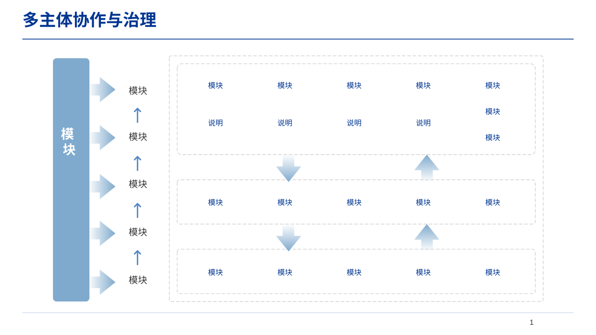

# 多主体协作与治理

来源为蓝色逻辑架构图.pptx#5。

## 结构与适用场景

左市场监管贯穿5阶段；右上5类使用主体、中间交易/运维机构、底层5类生产单位；上下双向流

多主体资产流通与治理

阶段与主体映射、上行下行箭头含义分别描述；监管为跨阶段角色

固定节点、圆弧、扇区、分面和连接表达定性关系。数量比较、趋势或占比使用数据驱动图表，源页中已登记的微图槽可接收实际数据。

## 预览



## 调用

将下列完整page对象放入schema_version=1、template_id=business-blue-v1的pages数组，替换各节点内容。nodes键对应原文本框或已明确拆分的语义分段，字段角色及source_ref、segment见下表。

```json
{
  "id": "architecture-05",
  "family": "source-architecture",
  "variant": "page-05",
  "content": {
    "title": "多主体协作与治理",
    "nodes": {
      "shape_108": "模块",
      "shape_109": "模块",
      "shape_110": "模块",
      "shape_111": "模块",
      "shape_112": "模块",
      "shape_113": "模块",
      "shape_114": "模块",
      "shape_115": "模块",
      "shape_116": "模块",
      "shape_117": "模块",
      "shape_118": "模块",
      "shape_119": "模块",
      "shape_120": "模块",
      "shape_121": "模块",
      "shape_122": "模块",
      "shape_123": "模块",
      "shape_124": "模块",
      "shape_125": "说明",
      "shape_126": "说明",
      "shape_127": "说明",
      "shape_128": "说明",
      "shape_12": "模块",
      "shape_152": "模块",
      "shape_153": "模块",
      "shape_154": "模块",
      "shape_155": "模块",
      "shape_156": "模块"
    }
  },
  "config": {
    "show_source": true,
    "show_page_number": true
  }
}
```

config支持show_source、show_page_number、image_fit与image_position。image_fit可选contain或cover，image_position为xMin/xMid/xMax与YMin/YMid/YMax组合的九个焦点，默认为xMidYMid。字体、颜色、全局区和固定字阶取自tokens，节点数与连接结构由variant确定。

## 字段合同

每个业务节点required=true、min=1，max按具体框体登记。字符按规范化后的Unicode码点计数，空格标点换行均计入。build会以实际字体测量宽高，字符数通过后仍可能需要调整文字。

| 字段 | 节点角色与源标签 | 最短/最长 | 字阶 | 框体px | 原框引用 | 分段 | 旋转° | 垂直锚点 |
|---|---|---|---|---|---|---|---|---|
| nodes.shape_108 | 上中节点，源标签“城市管理方” | 1/12 | caption | [416.0432, 175.3001, 93.4326, 20.0] | slide:108 |  | 0.0 | ctr |
| nodes.shape_109 | 中中节点，源标签“运维单位” | 1/10 | caption | [423.6859, 426.7002, 78.1377, 20.0] | slide:109 |  | 0.0 | ctr |
| nodes.shape_110 | 下中节点，源标签“规划单位” | 1/10 | caption | [423.6859, 577.0345, 78.1377, 20.0] | slide:110 |  | 0.0 | ctr |
| nodes.shape_111 | 上中节点，源标签“建筑使用者” | 1/12 | caption | [565.1038, 175.3001, 93.4326, 20.0] | slide:111 |  | 0.0 | ctr |
| nodes.shape_112 | 中中节点，源标签“城市档案方” | 1/12 | caption | [565.1038, 426.7002, 93.4326, 20.0] | slide:112 |  | 0.0 | ctr |
| nodes.shape_113 | 下中节点，源标签“设计单位” | 1/10 | caption | [572.7464, 577.0345, 78.1377, 20.0] | slide:113 |  | 0.0 | ctr |
| nodes.shape_114 | 上中节点，源标签“资源回收方” | 1/12 | caption | [713.7366, 175.3001, 93.4326, 20.0] | slide:114 |  | 0.0 | ctr |
| nodes.shape_115 | 中中节点，源标签“数据资产交易机构” | 1/19 | caption | [690.8086, 426.7002, 139.2981, 20.0] | slide:115 |  | 0.0 | ctr |
| nodes.shape_116 | 下中节点，源标签“生产单位” | 1/10 | caption | [721.3792, 577.0345, 78.1377, 20.0] | slide:116 |  | 0.0 | ctr |
| nodes.shape_117 | 上右节点，源标签“相关企业方” | 1/12 | caption | [862.3788, 175.3001, 93.4326, 20.0] | slide:117 |  | 0.0 | ctr |
| nodes.shape_118 | 中右节点，源标签“科研机构” | 1/10 | caption | [870.0215, 426.7002, 78.1377, 20.0] | slide:118 |  | 0.0 | ctr |
| nodes.shape_119 | 下右节点，源标签“施工单位” | 1/10 | caption | [870.0215, 577.0345, 78.1377, 20.0] | slide:119 |  | 0.0 | ctr |
| nodes.shape_120 | 上右节点，源标签“碳中和” | 1/8 | caption | [1026.7247, 175.3001, 62.8524, 20.0] | slide:120 |  | 0.0 | ctr |
| nodes.shape_121 | 中右节点，源标签“培训机构” | 1/10 | caption | [1019.0821, 426.7002, 78.1377, 20.0] | slide:121 |  | 0.0 | ctr |
| nodes.shape_122 | 下右节点，源标签“物流机构” | 1/10 | caption | [1019.0821, 577.0345, 78.1377, 20.0] | slide:122 |  | 0.0 | ctr |
| nodes.shape_123 | 上右节点，源标签“金融机构” | 1/10 | caption | [1019.0821, 231.3559, 78.1377, 20.0] | slide:123 |  | 0.0 | ctr |
| nodes.shape_124 | 中右节点，源标签“保险机构” | 1/10 | caption | [1019.0821, 287.4116, 78.1377, 20.0] | slide:124 |  | 0.0 | ctr |
| nodes.shape_125 | 上中节点，源标签“市政服务 / 应急保障 / CIM建设” | 1/30 | caption | [423.2581, 225.7996, 78.9932, 79.9914] | slide:125 |  | 0.0 | ctr |
| nodes.shape_126 | 上中节点，源标签“综合判断 / 装饰装修 / 需求服务” | 1/30 | caption | [572.7464, 225.7996, 78.1377, 79.9914] | slide:126 |  | 0.0 | ctr |
| nodes.shape_127 | 上中节点，源标签“资源回收 / 资源再造 / 资源再利用” | 1/36 | caption | [713.7366, 225.7996, 93.4326, 79.9914] | slide:127 |  | 0.0 | ctr |
| nodes.shape_128 | 上右节点，源标签“辅助管理 / 业务分析 / 人才培养” | 1/30 | caption | [870.0215, 225.7996, 78.1377, 79.9914] | slide:128 |  | 0.0 | ctr |
| nodes.shape_12 | 上左节点，源标签“市场监管” | 1/18 | heading | [126.5439, 273.3952, 44.3446, 212.065] | slide:12 |  | 0.0 | t |
| nodes.shape_152 | 上左节点，源标签“数据资产 / 使用” | 1/32 | compactBody | [222.7332, 170.8941, 147.0263, 52.1679] | slide:152 |  | 0.0 | ctr |
| nodes.shape_153 | 上左节点，源标签“数据资产 / 转移” | 1/32 | compactBody | [222.7332, 269.8685, 147.0263, 52.1679] | slide:153 |  | 0.0 | ctr |
| nodes.shape_154 | 中左节点，源标签“数据资产 / 持有” | 1/32 | compactBody | [222.7332, 371.4761, 147.0263, 52.1679] | slide:154 |  | 0.0 | ctr |
| nodes.shape_155 | 中左节点，源标签“数据资产 / 支付” | 1/32 | compactBody | [222.7332, 474.8042, 147.0263, 52.1679] | slide:155 |  | 0.0 | ctr |
| nodes.shape_156 | 下左节点，源标签“数据资产 / 生产” | 1/32 | compactBody | [222.7332, 577.8091, 147.0263, 52.1679] | slide:156 |  | 0.0 | ctr |

全局title必填、2至32码点，使用统一标题框。section_name可选0至24码点，source可选0至64码点。所有可编辑文本通过独立原生carrier导出，页码为派生文字。

## 来源处理

原生PPTX源件保存于用户材料目录，分发包仅含用户资产衍生的几何、字段和说明。原始逐框文字、源框与标准化框在page-catalog.json的variant.fields中。

源标题引用为`slide:72`，原文为“数据资产流通图”。模板默认标题依据真实结构设置。

密集全景中的diagramCompact为14px、diagramMicro为12px。适用于体系概览或附录局部标签，现场关键结论用统一标题与正常正文字阶表达。

源画布边界裁切已烘焙为可编辑Bezier几何，3D顶面、侧面与前面通过tokens配色的相对明暗保留。

