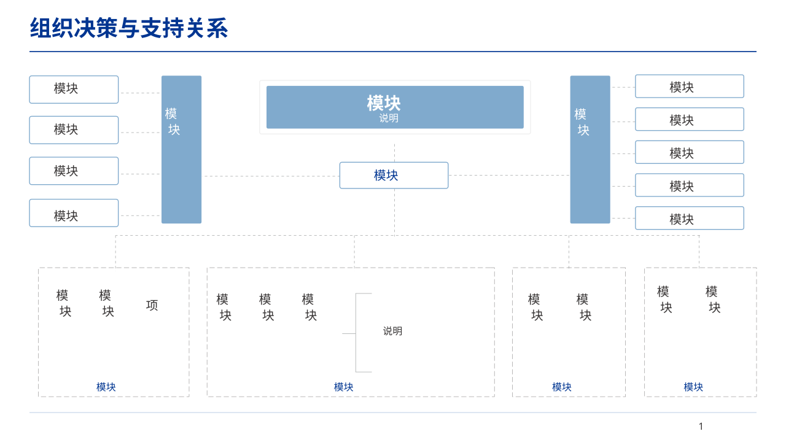

# 组织决策与支持关系

来源为蓝色逻辑架构图.pptx#6。

## 结构与适用场景

中央创新中心→主任→下属4大模块；左管理委员会与单位、右技术委员会与专家；虚线汇报/顾问连接

组织治理、决策与支持关系

治理、管理、顾问、执行角色不得混合成平级框；保留虚实线语义

固定节点、圆弧、扇区、分面和连接表达定性关系。数量比较、趋势或占比使用数据驱动图表，源页中已登记的微图槽可接收实际数据。

## 预览



## 调用

将下列完整page对象放入schema_version=1、template_id=business-blue-v1的pages数组，替换各节点内容。nodes键对应原文本框或已明确拆分的语义分段，字段角色及source_ref、segment见下表。

```json
{
  "id": "architecture-06",
  "family": "source-architecture",
  "variant": "page-06",
  "content": {
    "title": "组织决策与支持关系",
    "nodes": {
      "shape_187": "模块",
      "shape_188": "模块",
      "shape_189": "模块",
      "shape_190": "模块",
      "shape_201": "模块",
      "shape_202": "模块",
      "shape_203": "模块",
      "shape_204": "模块",
      "shape_205": "模块",
      "shape_206": "模块",
      "shape_207": "模块",
      "shape_185": "模块",
      "shape_208": "说明",
      "shape_191": "模块",
      "shape_192": "模块",
      "shape_193": "项",
      "shape_194": "模块",
      "shape_195": "模块",
      "shape_196": "模块",
      "shape_197": "模块",
      "shape_198": "模块",
      "shape_199": "模块",
      "shape_200": "模块",
      "shape_209": "模块",
      "shape_210": "模块",
      "shape_211": "模块",
      "shape_212": "模块",
      "shape_213": "说明",
      "shape_186": "模块"
    }
  },
  "config": {
    "show_source": true,
    "show_page_number": true
  }
}
```

config支持show_source、show_page_number、image_fit与image_position。image_fit可选contain或cover，image_position为xMin/xMid/xMax与YMin/YMid/YMax组合的九个焦点，默认为xMidYMid。字体、颜色、全局区和固定字阶取自tokens，节点数与连接结构由variant确定。

## 字段合同

每个业务节点required=true、min=1，max按具体框体登记。字符按规范化后的Unicode码点计数，空格标点换行均计入。build会以实际字体测量宽高，字符数通过后仍可能需要调整文字。

| 字段 | 节点角色与源标签 | 最短/最长 | 字阶 | 框体px | 原框引用 | 分段 | 旋转° | 垂直锚点 |
|---|---|---|---|---|---|---|---|---|
| nodes.shape_187 | 上右节点，源标签“数字科技专家” | 1/14 | compactBody | [1058.1503, 130.777, 129.8881, 25.0] | slide:187 |  | 0.0 | t |
| nodes.shape_188 | 上左节点，源标签“上级单位” | 1/10 | compactBody | [73.9173, 132.5347, 92.7698, 25.0] | slide:188 |  | 0.0 | t |
| nodes.shape_189 | 上左节点，源标签“主管单位” | 1/10 | compactBody | [73.9173, 199.3247, 92.7698, 25.0] | slide:189 |  | 0.0 | t |
| nodes.shape_190 | 上左节点，源标签“依托单位” | 1/10 | compactBody | [73.9173, 267.0508, 92.7698, 25.0] | slide:190 |  | 0.0 | t |
| nodes.shape_201 | 中左节点，源标签“……” | 1/6 | compactBody | [92.4712, 340.445, 55.6619, 25.0] | slide:201 |  | 0.0 | t |
| nodes.shape_202 | 上右节点，源标签“建筑行业专家” | 1/14 | compactBody | [1058.1503, 184.5773, 129.8881, 25.0] | slide:202 |  | 0.0 | t |
| nodes.shape_203 | 上右节点，源标签“金融领域专家” | 1/14 | compactBody | [1058.1503, 238.3879, 129.8881, 25.0] | slide:203 |  | 0.0 | t |
| nodes.shape_204 | 中右节点，源标签“合格评定专家” | 1/14 | compactBody | [1058.1503, 292.1985, 129.8881, 25.0] | slide:204 |  | 0.0 | t |
| nodes.shape_205 | 中右节点，源标签“标准领域专家” | 1/14 | compactBody | [1058.1503, 346.0091, 129.8881, 25.0] | slide:205 |  | 0.0 | t |
| nodes.shape_206 | 上右节点，源标签“技术委员会” | 1/8 | compactBody | [951.9445, 173.3336, 22.4, 111.9789] | slide:206 |  | 0.0 | t |
| nodes.shape_207 | 上左节点，源标签“管理委员会” | 1/8 | compactBody | [285.2555, 172.408, 22.4, 111.9789] | slide:207 |  | 0.0 | t |
| nodes.shape_185 | 上中节点，源标签“技术创新中心” | 1/14 | heading | [550.6623, 151.5435, 185.5499, 35.0] | slide:185 |  | 0.0 | t |
| nodes.shape_208 | 上中节点，源标签“建筑业数据资产检验检测认证技术” | 1/31 | caption | [529.7787, 182.1164, 227.2963, 20.0] | slide:208 |  | 0.0 | t |
| nodes.shape_191 | 中左节点，源标签“综合管理” | 1/6 | compactBody | [108.3221, 468.408, 22.4, 89.5873] | slide:191 |  | 0.0 | t |
| nodes.shape_192 | 中左节点，源标签“合作交流” | 1/6 | compactBody | [177.9099, 468.408, 22.4, 89.5873] | slide:192 |  | 0.0 | t |
| nodes.shape_193 | 下左节点，源标签“……” | 1/2 | compactBody | [249.3384, 486.0363, 22.4, 44.7936] | slide:193 |  | 0.0 | t |
| nodes.shape_194 | 中左节点，源标签“成果转化部” | 1/8 | compactBody | [369.0239, 474.9081, 22.4, 111.9789] | slide:194 |  | 0.0 | t |
| nodes.shape_195 | 中中节点，源标签“示范推广部” | 1/8 | compactBody | [438.6012, 474.9081, 22.4, 111.9789] | slide:195 |  | 0.0 | t |
| nodes.shape_196 | 中中节点，源标签“创新研究院” | 1/8 | compactBody | [508.1785, 474.9081, 22.4, 111.9789] | slide:196 |  | 0.0 | t |
| nodes.shape_197 | 中右节点，源标签“产业孵化器” | 1/8 | compactBody | [876.5015, 474.9081, 22.4, 111.9789] | slide:197 |  | 0.0 | t |
| nodes.shape_198 | 中右节点，源标签“众创空间” | 1/6 | compactBody | [955.3557, 474.9081, 22.4, 89.5873] | slide:198 |  | 0.0 | t |
| nodes.shape_199 | 中右节点，源标签“人才培养基地” | 1/10 | compactBody | [1086.7362, 462.2407, 22.4, 134.3809] | slide:199 |  | 0.0 | t |
| nodes.shape_200 | 中右节点，源标签“学生实践基地” | 1/10 | compactBody | [1165.6009, 462.2407, 22.4, 134.3809] | slide:200 |  | 0.0 | t |
| nodes.shape_209 | 下左节点，源标签“管理版块” | 1/21 | caption | [106.6051, 620.2612, 153.0805, 20.166] | slide:209 |  | 0.0 | t |
| nodes.shape_210 | 下中节点，源标签“业务板块” | 1/21 | caption | [493.482, 620.2612, 153.0805, 20.166] | slide:210 |  | 0.0 | t |
| nodes.shape_211 | 下右节点，源标签“众创平台” | 1/21 | caption | [848.8047, 620.2612, 153.0805, 20.166] | slide:211 |  | 0.0 | t |
| nodes.shape_212 | 下右节点，源标签“教育平台” | 1/21 | caption | [1063.1112, 620.2612, 153.0805, 20.166] | slide:212 |  | 0.0 | t |
| nodes.shape_213 | 中中节点，源标签“数字化合格评定研究 / 前沿建筑技术研究 / 智慧监管政策研究 / 资产金融化研究 / ……” | 1/126 | caption | [623.2869, 473.1609, 152.1549, 131.7081] | slide:213 |  | 0.0 | ctr |
| nodes.shape_186 | 上中节点，源标签“中心主任” | 1/15 | compactBody | [571.5667, 274.1542, 140.0906, 25.0] | slide:186 |  | 0.0 | t |

全局title必填、2至32码点，使用统一标题框。section_name可选0至24码点，source可选0至64码点。所有可编辑文本通过独立原生carrier导出，页码为派生文字。

## 来源处理

原生PPTX源件保存于用户材料目录，分发包仅含用户资产衍生的几何、字段和说明。原始逐框文字、源框与标准化框在page-catalog.json的variant.fields中。

源标题引用为`slide:90`，原文为“组织机制”。模板默认标题依据真实结构设置。

密集全景中的diagramCompact为14px、diagramMicro为12px。适用于体系概览或附录局部标签，现场关键结论用统一标题与正常正文字阶表达。

源画布边界裁切已烘焙为可编辑Bezier几何，3D顶面、侧面与前面通过tokens配色的相对明暗保留。

