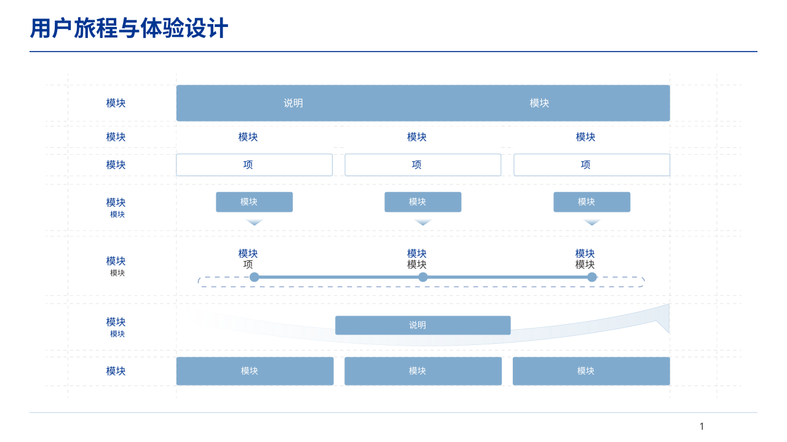

# 用户旅程与体验设计

来源为蓝色逻辑架构图.pptx#7。

## 结构与适用场景

3阶段时间轴与目标/视角/结构/内容/效果泳道；底部曲面感知带

用户旅程或体验设计

与house15近重复；原标题泛化，应以实际旅程选型

固定节点、圆弧、扇区、分面和连接表达定性关系。数量比较、趋势或占比使用数据驱动图表，源页中已登记的微图槽可接收实际数据。

## 预览



## 调用

将下列完整page对象放入schema_version=1、template_id=business-blue-v1的pages数组，替换各节点内容。nodes键对应原文本框或已明确拆分的语义分段，字段角色及source_ref、segment见下表。

```json
{
  "id": "architecture-07",
  "family": "source-architecture",
  "variant": "page-07",
  "content": {
    "title": "用户旅程与体验设计",
    "nodes": {
      "shape_239": "模块",
      "shape_240": "模块",
      "shape_241": "模块",
      "shape_242": "模块",
      "shape_243": "模块",
      "shape_246": "模块",
      "shape_247": "模块",
      "shape_249": "模块",
      "shape_250": "模块",
      "shape_251": "模块",
      "shape_252": "说明",
      "shape_257": "模块",
      "shape_258": "模块",
      "shape_259": "模块",
      "shape_260": "模块",
      "shape_261": "项",
      "shape_262": "项",
      "shape_263": "项",
      "shape_264": "模块",
      "shape_265": "模块",
      "shape_266": "模块",
      "shape_267": "说明",
      "shape_269": "模块",
      "shape_272": "项",
      "shape_273": "模块",
      "shape_274": "模块",
      "shape_275": "模块",
      "shape_276": "模块",
      "shape_277": "模块",
      "shape_278": "模块",
      "shape_279": "模块"
    }
  },
  "config": {
    "show_source": true,
    "show_page_number": true
  }
}
```

config支持show_source、show_page_number、image_fit与image_position。image_fit可选contain或cover，image_position为xMin/xMid/xMax与YMin/YMid/YMax组合的九个焦点，默认为xMidYMid。字体、颜色、全局区和固定字阶取自tokens，节点数与连接结构由variant确定。

## 字段合同

每个业务节点required=true、min=1，max按具体框体登记。字符按规范化后的Unicode码点计数，空格标点换行均计入。build会以实际字体测量宽高，字符数通过后仍可能需要调整文字。

| 字段 | 节点角色与源标签 | 最短/最长 | 字阶 | 框体px | 原框引用 | 分段 | 旋转° | 垂直锚点 |
|---|---|---|---|---|---|---|---|---|
| nodes.shape_239 | 上左节点，源标签“情境目标” | 1/9 | caption | [164.2733, 157.6467, 69.0501, 20.7121] | slide:239 |  | 0.0 | t |
| nodes.shape_240 | 上左节点，源标签“用户视角” | 1/9 | caption | [164.2733, 212.8788, 69.0501, 20.7121] | slide:240 |  | 0.0 | t |
| nodes.shape_241 | 上左节点，源标签“短广结构” | 1/9 | caption | [164.2733, 258.2481, 69.0501, 20.7121] | slide:241 |  | 0.0 | t |
| nodes.shape_242 | 中左节点，源标签“娱乐化包装” | 1/11 | caption | [155.6433, 319.6545, 86.3102, 20.7121] | slide:242 |  | 0.0 | t |
| nodes.shape_243 | 中左节点，源标签“视觉层面” | 1/8 | diagramMicro | [174.8957, 341.615, 47.8054, 15.0] | slide:243 |  | 0.0 | t |
| nodes.shape_246 | 中左节点，源标签“内容力增强” | 1/11 | caption | [155.6433, 414.9991, 86.3102, 20.7121] | slide:246 |  | 0.0 | t |
| nodes.shape_247 | 中左节点，源标签“逻辑层面” | 1/8 | diagramMicro | [174.8957, 436.9595, 47.8054, 15.0] | slide:247 |  | 0.0 | t |
| nodes.shape_249 | 下左节点，源标签“极致获得感” | 1/11 | caption | [155.6433, 514.2888, 86.3102, 20.7121] | slide:249 |  | 0.0 | t |
| nodes.shape_250 | 下左节点，源标签“体感层面” | 1/8 | diagramMicro | [174.8957, 536.2493, 47.8054, 15.0] | slide:250 |  | 0.0 | t |
| nodes.shape_251 | 下左节点，源标签“预期效果” | 1/9 | caption | [164.2733, 594.2473, 69.0501, 20.7121] | slide:251 |  | 0.0 | t |
| nodes.shape_252 | 上中节点，源标签“用短视频让更多用户感到价值” | 1/31 | caption | [375.0828, 157.6467, 224.4104, 20.7121] | slide:252 |  | 0.0 | t |
| nodes.shape_257 | 上中节点，源标签“完成下载并打开优酷的行为” | 1/28 | caption | [784.1462, 157.6467, 207.1503, 20.7121] | slide:257 |  | 0.0 | t |
| nodes.shape_258 | 上左节点，源标签“停留” | 1/4 | caption | [396.5444, 212.8788, 34.53, 20.7121] | slide:258 |  | 0.0 | t |
| nodes.shape_259 | 上中节点，源标签“观看” | 1/4 | caption | [671.0682, 212.8788, 34.53, 20.7121] | slide:259 |  | 0.0 | t |
| nodes.shape_260 | 上右节点，源标签“停留” | 1/4 | caption | [945.582, 212.8788, 34.53, 20.7121] | slide:260 |  | 0.0 | t |
| nodes.shape_261 | 上左节点，源标签“前” | 1/2 | caption | [404.8544, 258.2481, 17.92, 20.7121] | slide:261 |  | 0.0 | t |
| nodes.shape_262 | 上中节点，源标签“中” | 1/2 | caption | [679.0427, 258.2481, 17.92, 20.7121] | slide:262 |  | 0.0 | t |
| nodes.shape_263 | 上右节点，源标签“后” | 1/2 | caption | [953.8821, 258.2481, 17.92, 20.7121] | slide:263 |  | 0.0 | t |
| nodes.shape_264 | 中左节点，源标签“奠定主题基调” | 1/12 | diagramCompact | [373.9781, 320.3532, 79.6724, 17.5] | slide:264 |  | 0.0 | t |
| nodes.shape_265 | 中中节点，源标签“渲染视觉氛围” | 1/12 | diagramCompact | [648.1665, 320.3532, 79.6724, 17.5] | slide:265 |  | 0.0 | t |
| nodes.shape_266 | 中右节点，源标签“烘托产品价值” | 1/12 | diagramCompact | [923.0059, 320.3532, 79.6724, 17.5] | slide:266 |  | 0.0 | t |
| nodes.shape_267 | 下中节点，源标签“循序渐进 在转化的零界点推动用户行动” | 1/36 | diagramCompact | [572.7253, 521.2208, 230.555, 17.5] | slide:267 |  | 0.0 | t |
| nodes.shape_269 | 中左节点，源标签“吸睛开篇” | 1/8 | caption | [384.6005, 402.8736, 58.4278, 20.0] | slide:269 |  | 0.0 | t |
| nodes.shape_272 | 中左节点，源标签“1-3s” | 1/3 | caption | [399.7006, 420.6663, 28.2177, 20.0] | slide:272 |  | 0.0 | t |
| nodes.shape_273 | 中中节点，源标签“高能叙事” | 1/8 | caption | [659.1143, 402.8736, 58.4278, 20.0] | slide:273 |  | 0.0 | t |
| nodes.shape_274 | 中中节点，源标签“4-24s” | 1/5 | caption | [668.4939, 420.6663, 39.6685, 20.0] | slide:274 |  | 0.0 | t |
| nodes.shape_275 | 中右节点，源标签“强力号召” | 1/8 | caption | [932.6419, 402.8736, 58.4278, 20.0] | slide:275 |  | 0.0 | t |
| nodes.shape_276 | 中右节点，源标签“25-30s” | 1/6 | caption | [937.3761, 420.6663, 48.9693, 20.0] | slide:276 |  | 0.0 | t |
| nodes.shape_277 | 下中节点，源标签“结合优酷内容、可复制” | 1/21 | diagramCompact | [621.6058, 595.8533, 132.794, 17.5] | slide:277 |  | 0.0 | t |
| nodes.shape_278 | 下左节点，源标签“打破刻板印象：去广告心智” | 1/25 | diagramCompact | [335.1282, 595.8533, 159.3449, 17.5] | slide:278 |  | 0.0 | t |
| nodes.shape_279 | 下右节点，源标签“亮明钩子、指引行动” | 1/18 | diagramCompact | [902.1064, 595.8533, 119.5087, 17.5] | slide:279 |  | 0.0 | t |

全局title必填、2至32码点，使用统一标题框。section_name可选0至24码点，source可选0至64码点。所有可编辑文本通过独立原生carrier导出，页码为派生文字。

## 来源处理

原生PPTX源件保存于用户材料目录，分发包仅含用户资产衍生的几何、字段和说明。原始逐框文字、源框与标准化框在page-catalog.json的variant.fields中。

源标题引用为`slide:6`，原文为“产品功能矩阵”。模板默认标题依据真实结构设置。

密集全景中的diagramCompact为14px、diagramMicro为12px。适用于体系概览或附录局部标签，现场关键结论用统一标题与正常正文字阶表达。

源画布边界裁切已烘焙为可编辑Bezier几何，3D顶面、侧面与前面通过tokens配色的相对明暗保留。

