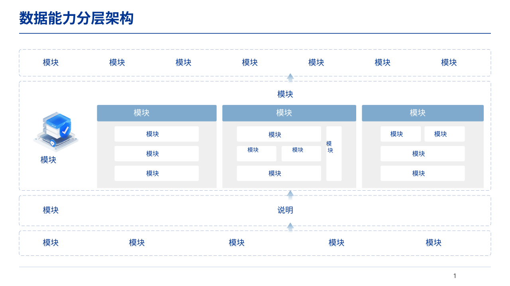

# 数据能力分层架构

来源为蓝色逻辑架构图.pptx#8。

## 结构与适用场景

前台7应用；中台开发/标准/治理3列；统一查询；基础设施；数据源4类；向上依赖箭头

数据能力架构

与house10近重复；保留中台列内ODS/DWD/ADS和元数据/资产/质量

固定节点、圆弧、扇区、分面和连接表达定性关系。数量比较、趋势或占比使用数据驱动图表，源页中已登记的微图槽可接收实际数据。

## 预览



## 调用

将下列完整page对象放入schema_version=1、template_id=business-blue-v1的pages数组，替换各节点内容。nodes键对应原文本框或已明确拆分的语义分段，字段角色及source_ref、segment见下表。

```json
{
  "id": "architecture-08",
  "family": "source-architecture",
  "variant": "page-08",
  "content": {
    "title": "数据能力分层架构",
    "nodes": {
      "shape_213": "模块",
      "shape_214": "模块",
      "shape_221": "模块",
      "shape_223": "模块",
      "shape_227": "模块",
      "shape_229": "模块",
      "shape_230": "模块",
      "shape_234": "模块",
      "shape_235": "模块",
      "shape_237": "模块",
      "shape_238": "模块",
      "shape_253": "模块",
      "shape_254": "模块",
      "shape_255": "模块",
      "shape_256": "说明",
      "shape_268": "模块",
      "shape_270": "模块",
      "shape_271": "模块",
      "shape_280": "模块",
      "shape_281": "模块",
      "shape_282": "模块",
      "shape_283": "模块",
      "shape_284": "模块",
      "shape_285": "模块",
      "shape_286": "模块",
      "shape_287": "模块",
      "shape_288": "模块",
      "shape_289": "模块",
      "shape_290": "模块",
      "shape_291": "模块",
      "shape_292": "模块"
    }
  },
  "config": {
    "show_source": true,
    "show_page_number": true
  }
}
```

config支持show_source、show_page_number、image_fit与image_position。image_fit可选contain或cover，image_position为xMin/xMid/xMax与YMin/YMid/YMax组合的九个焦点，默认为xMidYMid。字体、颜色、全局区和固定字阶取自tokens，节点数与连接结构由variant确定。

## 字段合同

每个业务节点required=true、min=1，max按具体框体登记。字符按规范化后的Unicode码点计数，空格标点换行均计入。build会以实际字体测量宽高，字符数通过后仍可能需要调整文字。

| 字段 | 节点角色与源标签 | 最短/最长 | 字阶 | 框体px | 原框引用 | 分段 | 旋转° | 垂直锚点 |
|---|---|---|---|---|---|---|---|---|
| nodes.shape_213 | 上左节点，源标签“业务前台” | 1/8 | compactBody | [104.0889, 145.7143, 72.2898, 25.0] | slide:213 |  | 0.0 | t |
| nodes.shape_214 | 上左节点，源标签“智能分析” | 1/8 | compactBody | [270.6828, 145.7143, 72.2898, 25.0] | slide:214 |  | 0.0 | t |
| nodes.shape_221 | 上中节点，源标签“标签系统” | 1/8 | compactBody | [437.2664, 145.7143, 72.2898, 25.0] | slide:221 |  | 0.0 | t |
| nodes.shape_223 | 上中节点，源标签“用户画像” | 1/8 | compactBody | [603.85, 145.7143, 72.2898, 25.0] | slide:223 |  | 0.0 | t |
| nodes.shape_227 | 上中节点，源标签“数字化运营” | 1/10 | compactBody | [761.4089, 145.7143, 90.3597, 25.0] | slide:227 |  | 0.0 | t |
| nodes.shape_229 | 上右节点，源标签“数字化管理” | 1/10 | compactBody | [927.9925, 145.7143, 90.3597, 25.0] | slide:229 |  | 0.0 | t |
| nodes.shape_230 | 上右节点，源标签“数字化供应链” | 1/12 | compactBody | [1085.5412, 145.7143, 108.4399, 25.0] | slide:230 |  | 0.0 | t |
| nodes.shape_234 | 中左节点，源标签“数据中台” | 1/8 | compactBody | [101.3113, 390.8864, 77.8553, 25.0] | slide:234 |  | 0.0 | t |
| nodes.shape_235 | 下左节点，源标签“数据后台” | 1/8 | compactBody | [104.0889, 517.4375, 72.2898, 25.0] | slide:235 |  | 0.0 | t |
| nodes.shape_237 | 下左节点，源标签“数据源” | 1/6 | compactBody | [113.1342, 599.3508, 54.2199, 25.0] | slide:237 |  | 0.0 | t |
| nodes.shape_238 | 下左节点，源标签“数据库” | 1/6 | compactBody | [329.2808, 599.3508, 54.2199, 25.0] | slide:238 |  | 0.0 | t |
| nodes.shape_253 | 下中节点，源标签“埋点采集” | 1/8 | compactBody | [570.8079, 599.3508, 72.2898, 25.0] | slide:253 |  | 0.0 | t |
| nodes.shape_254 | 下中节点，源标签“服务器日志” | 1/10 | compactBody | [812.3453, 599.3508, 90.3597, 25.0] | slide:254 |  | 0.0 | t |
| nodes.shape_255 | 下右节点，源标签“爬虫数据” | 1/8 | compactBody | [1065.0654, 599.3508, 72.2898, 25.0] | slide:255 |  | 0.0 | t |
| nodes.shape_256 | 下中节点，源标签“大数据基础设施（计算和储存平台）” | 1/32 | compactBody | [584.2209, 517.4375, 289.1593, 25.0] | slide:256 |  | 0.0 | t |
| nodes.shape_268 | 上中节点，源标签“统一查询服务” | 1/12 | compactBody | [674.5806, 225.5625, 108.4399, 25.0] | slide:268 |  | 0.0 | t |
| nodes.shape_270 | 上左节点，源标签“数据治理平台” | 1/12 | compactBody | [335.1768, 272.379, 116.7727, 25.0] | slide:270 |  | 0.0 | t |
| nodes.shape_271 | 上中节点，源标签“数据标准体系建设” | 1/17 | compactBody | [648.1986, 272.379, 155.7004, 25.0] | slide:271 |  | 0.0 | t |
| nodes.shape_280 | 上右节点，源标签“数据治理平台” | 1/12 | compactBody | [1002.8947, 272.379, 116.7727, 25.0] | slide:280 |  | 0.0 | t |
| nodes.shape_281 | 中中节点，源标签“（DWD） / 公共明细” | 1/20 | diagramCompact | [612.5029, 368.9297, 63.2549, 35.6544] | slide:281 |  | 0.0 | t |
| nodes.shape_282 | 中中节点，源标签“（DWD） / 公共汇总” | 1/20 | diagramCompact | [724.7116, 368.9297, 63.2549, 35.6544] | slide:282 |  | 0.0 | t |
| nodes.shape_283 | 中中节点，源标签“应用数据层(ADS)” | 1/17 | caption | [635.591, 328.8559, 129.2874, 20.0214] | slide:283 |  | 0.0 | t |
| nodes.shape_284 | 中中节点，源标签“操作数据(ODS)” | 1/15 | caption | [643.0564, 426.3093, 114.3462, 20.0214] | slide:284 |  | 0.0 | t |
| nodes.shape_285 | 中右节点，源标签“数据资产中心” | 1/13 | caption | [1010.8971, 426.3093, 100.0968, 20.0214] | slide:285 |  | 0.0 | t |
| nodes.shape_286 | 中右节点，源标签“数据质量中心” | 1/13 | caption | [1010.8971, 376.7462, 100.0968, 20.0214] | slide:286 |  | 0.0 | t |
| nodes.shape_287 | 中右节点，源标签“数据地图” | 1/9 | caption | [972.5064, 327.1832, 66.7243, 20.0214] | slide:287 |  | 0.0 | t |
| nodes.shape_288 | 中右节点，源标签“数据雪源” | 1/9 | caption | [1082.65, 327.1832, 66.7243, 20.0214] | slide:288 |  | 0.0 | t |
| nodes.shape_289 | 中左节点，源标签“自助查询系统” | 1/13 | caption | [343.1688, 327.1832, 100.0968, 20.0214] | slide:289 |  | 0.0 | t |
| nodes.shape_290 | 中左节点，源标签“敏捷开发平台” | 1/13 | caption | [343.1688, 376.7462, 100.0968, 20.0214] | slide:290 |  | 0.0 | t |
| nodes.shape_291 | 中左节点，源标签“数据集成工具” | 1/13 | caption | [343.1688, 426.3093, 100.0968, 20.0214] | slide:291 |  | 0.0 | t |
| nodes.shape_292 | 中中节点，源标签“指标系统” | 1/9 | diagramCompact | [827.3588, 353.3896, 21.7768, 66.7243] | slide:292 |  | 0.0 | t |

## 保留的原装饰

本页保留用户原模板的结构图标或装饰图片，逐项身份见source-field-coverage.json中本页retained_source_images。其中图片内固化的字形随整图编辑，可在PowerPoint中原生替换整图；nodes字段控制已登记的可编辑文字。参数图片替换使用本页image_slots列出的槽位。


全局title必填、2至32码点，使用统一标题框。section_name可选0至24码点，source可选0至64码点。所有可编辑文本通过独立原生carrier导出，页码为派生文字。

## 来源处理

原生PPTX源件保存于用户材料目录，分发包仅含用户资产衍生的几何、字段和说明。原始逐框文字、源框与标准化框在page-catalog.json的variant.fields中。

源标题引用为`slide:6`，原文为“产品功能矩阵”。模板默认标题依据真实结构设置。

密集全景中的diagramCompact为14px、diagramMicro为12px。适用于体系概览或附录局部标签，现场关键结论用统一标题与正常正文字阶表达。

源画布边界裁切已烘焙为可编辑Bezier几何，3D顶面、侧面与前面通过tokens配色的相对明暗保留。

