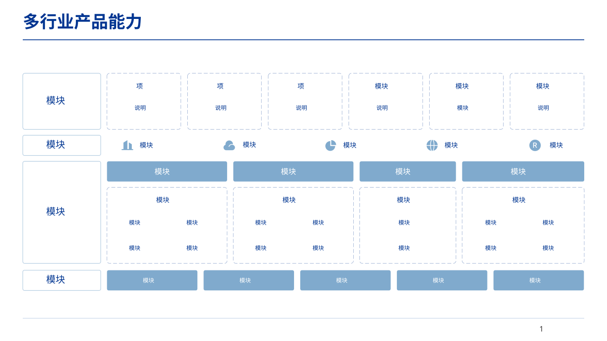

# 多行业产品能力

来源为蓝色逻辑架构图.pptx#9。

## 结构与适用场景

6行业列、应用行、SaaS/API/SDK/小程序行、4平台组、5数据模块

多行业产品能力地图

与architecture03及house05近重复，描边和例文略异

固定节点、圆弧、扇区、分面和连接表达定性关系。数量比较、趋势或占比使用数据驱动图表，源页中已登记的微图槽可接收实际数据。

## 预览



## 调用

将下列完整page对象放入schema_version=1、template_id=business-blue-v1的pages数组，替换各节点内容。nodes键对应原文本框或已明确拆分的语义分段，字段角色及source_ref、segment见下表。

```json
{
  "id": "architecture-09",
  "family": "source-architecture",
  "variant": "page-09",
  "content": {
    "title": "多行业产品能力",
    "nodes": {
      "shape_278": "模块",
      "shape_279": "模块",
      "shape_293": "模块",
      "shape_294": "模块",
      "shape_295": "项",
      "shape_296": "说明",
      "shape_297": "项",
      "shape_298": "说明",
      "shape_299": "项",
      "shape_300": "说明",
      "shape_301": "模块",
      "shape_302": "说明",
      "shape_303": "模块",
      "shape_304": "模块",
      "shape_305": "模块",
      "shape_306": "说明",
      "shape_307": "模块",
      "shape_308": "模块",
      "shape_309": "模块",
      "shape_310": "模块",
      "shape_311": "模块",
      "shape_312": "模块",
      "shape_313": "模块",
      "shape_314": "模块",
      "shape_315": "模块",
      "shape_316": "模块",
      "shape_317": "模块",
      "shape_318": "模块",
      "shape_319": "模块",
      "shape_320": "模块",
      "shape_321": "模块",
      "shape_322": "模块",
      "shape_323": "模块",
      "shape_324": "模块",
      "shape_325": "模块",
      "shape_326": "模块",
      "shape_327": "模块",
      "shape_328": "模块",
      "shape_329": "模块",
      "shape_330": "模块",
      "shape_331": "模块",
      "shape_332": "模块",
      "shape_333": "模块",
      "shape_334": "模块",
      "shape_335": "模块",
      "shape_336": "模块",
      "shape_338": "模块",
      "shape_339": "模块"
    }
  },
  "config": {
    "show_source": true,
    "show_page_number": true
  }
}
```

config支持show_source、show_page_number、image_fit与image_position。image_fit可选contain或cover，image_position为xMin/xMid/xMax与YMin/YMid/YMax组合的九个焦点，默认为xMidYMid。字体、颜色、全局区和固定字阶取自tokens，节点数与连接结构由variant确定。

## 字段合同

每个业务节点required=true、min=1，max按具体框体登记。字符按规范化后的Unicode码点计数，空格标点换行均计入。build会以实际字体测量宽高，字符数通过后仍可能需要调整文字。

| 字段 | 节点角色与源标签 | 最短/最长 | 字阶 | 框体px | 原框引用 | 分段 | 旋转° | 垂直锚点 |
|---|---|---|---|---|---|---|---|---|
| nodes.shape_278 | 上左节点，源标签“行业/场景” | 1/8 | compactBody | [90.0254, 200.6313, 80.4574, 25.0] | slide:278 |  | 0.0 | t |
| nodes.shape_279 | 中左节点，源标签“应用服务” | 1/8 | compactBody | [94.1143, 293.5621, 72.2898, 25.0] | slide:279 |  | 0.0 | t |
| nodes.shape_293 | 中左节点，源标签“平台服务” | 1/8 | compactBody | [94.1143, 435.0233, 72.2898, 25.0] | slide:293 |  | 0.0 | t |
| nodes.shape_294 | 下左节点，源标签“数据服务” | 1/8 | compactBody | [94.1143, 578.5498, 72.2898, 25.0] | slide:294 |  | 0.0 | t |
| nodes.shape_295 | 上左节点，源标签“金融” | 1/4 | diagramCompact | [289.4858, 173.5592, 27.807, 17.5] | slide:295 |  | 0.0 | t |
| nodes.shape_296 | 上左节点，源标签“网点布局/网店运营 / /保险出险” | 1/38 | diagramMicro | [250.7337, 219.9462, 105.3112, 32.1024] | slide:296 |  | 0.0 | t |
| nodes.shape_297 | 上中节点，源标签“家电” | 1/4 | diagramCompact | [459.5078, 173.5592, 27.807, 17.5] | slide:297 |  | 0.0 | t |
| nodes.shape_298 | 上中节点，源标签“区块派单/订单统计 / /路径规划” | 1/38 | diagramMicro | [420.7557, 219.9462, 105.3112, 32.1024] | slide:298 |  | 0.0 | t |
| nodes.shape_299 | 上中节点，源标签“零售” | 1/4 | diagramCompact | [629.5401, 173.5592, 27.807, 17.5] | slide:299 |  | 0.0 | t |
| nodes.shape_300 | 上中节点，源标签“业务拓展/营销片区 / /外勤管理” | 1/38 | diagramMicro | [590.788, 219.9462, 105.3112, 32.1024] | slide:300 |  | 0.0 | t |
| nodes.shape_301 | 上中节点，源标签“O2O” | 1/4 | diagramCompact | [798.2611, 173.5592, 30.409, 17.5] | slide:301 |  | 0.0 | t |
| nodes.shape_302 | 上中节点，源标签“社区作战/线下营销 / /竞品分析” | 1/38 | diagramMicro | [760.8204, 219.9462, 105.3112, 32.1024] | slide:302 |  | 0.0 | t |
| nodes.shape_303 | 上右节点，源标签“物流快递” | 1/8 | diagramCompact | [955.6962, 173.5592, 55.6036, 17.5] | slide:303 |  | 0.0 | t |
| nodes.shape_304 | 上右节点，源标签“（DWD） / 公共明细” | 1/20 | diagramMicro | [955.0044, 219.9462, 56.9975, 32.1024] | slide:304 |  | 0.0 | t |
| nodes.shape_305 | 上右节点，源标签“智能分析” | 1/8 | diagramCompact | [1125.7285, 173.5592, 55.6036, 17.5] | slide:305 |  | 0.0 | t |
| nodes.shape_306 | 上右节点，源标签“区块派单/订单统计 / /电子围栏” | 1/38 | diagramMicro | [1100.8747, 219.9462, 105.3112, 32.1024] | slide:306 |  | 0.0 | t |
| nodes.shape_307 | 中左节点，源标签“点位上图” | 1/8 | diagramCompact | [289.8472, 298.1588, 55.6036, 17.5] | slide:307 |  | 0.0 | t |
| nodes.shape_308 | 中中节点，源标签“区块上图” | 1/8 | diagramCompact | [507.2433, 297.1468, 55.6036, 17.5] | slide:308 |  | 0.0 | t |
| nodes.shape_309 | 中中节点，源标签“轨迹上图” | 1/8 | diagramCompact | [718.9396, 298.1588, 55.6036, 17.5] | slide:309 |  | 0.0 | t |
| nodes.shape_310 | 中右节点，源标签“空间检索” | 1/8 | diagramCompact | [932.7113, 298.1588, 55.6036, 17.5] | slide:310 |  | 0.0 | t |
| nodes.shape_311 | 中右节点，源标签“空间计算” | 1/8 | diagramCompact | [1149.6221, 298.1588, 55.6036, 17.5] | slide:311 |  | 0.0 | t |
| nodes.shape_312 | 中左节点，源标签“空间数据托管” | 1/13 | diagramCompact | [310.5501, 413.8059, 83.4105, 17.5] | slide:312 |  | 0.0 | t |
| nodes.shape_313 | 中左节点，源标签“数据储存” | 1/9 | diagramMicro | [266.6558, 462.258, 50.0484, 15.5814] | slide:313 |  | 0.0 | t |
| nodes.shape_314 | 中左节点，源标签“数据编辑” | 1/9 | diagramMicro | [387.8169, 462.258, 50.0484, 15.5814] | slide:314 |  | 0.0 | t |
| nodes.shape_315 | 下左节点，源标签“数据查询” | 1/9 | diagramMicro | [266.6558, 515.9514, 50.0484, 15.5814] | slide:315 |  | 0.0 | t |
| nodes.shape_316 | 下左节点，源标签“数据同步” | 1/9 | diagramMicro | [387.8169, 515.9514, 50.0484, 15.5814] | slide:316 |  | 0.0 | t |
| nodes.shape_317 | 中中节点，源标签“周边检索” | 1/9 | diagramMicro | [532.7166, 462.258, 50.0484, 15.5814] | slide:317 |  | 0.0 | t |
| nodes.shape_318 | 中中节点，源标签“多边检索” | 1/9 | diagramMicro | [653.8674, 462.258, 50.0484, 15.5814] | slide:318 |  | 0.0 | t |
| nodes.shape_319 | 下中节点，源标签“区块交易查询” | 1/13 | diagramMicro | [520.2019, 515.9514, 75.0674, 15.5814] | slide:319 |  | 0.0 | t |
| nodes.shape_320 | 下中节点，源标签“检索高德AOI” | 1/13 | diagramMicro | [642.8396, 515.9514, 72.1143, 15.5814] | slide:320 |  | 0.0 | t |
| nodes.shape_321 | 中中节点，源标签“业务数据运营” | 1/13 | diagramMicro | [822.4025, 462.258, 75.0674, 15.5814] | slide:321 |  | 0.0 | t |
| nodes.shape_322 | 下中节点，源标签“数据融合计算” | 1/13 | diagramMicro | [822.4025, 515.9514, 75.0674, 15.5814] | slide:322 |  | 0.0 | t |
| nodes.shape_323 | 中右节点，源标签“等时差/等距离” | 1/14 | diagramMicro | [1002.5539, 462.258, 80.2819, 15.5814] | slide:323 |  | 0.0 | t |
| nodes.shape_324 | 下右节点，源标签“智能分区” | 1/9 | diagramMicro | [1017.681, 515.9514, 50.0484, 15.5814] | slide:324 |  | 0.0 | t |
| nodes.shape_325 | 中右节点，源标签“自然街区” | 1/9 | diagramMicro | [1138.8318, 462.258, 50.0484, 15.5814] | slide:325 |  | 0.0 | t |
| nodes.shape_326 | 下右节点，源标签“线路排程服务” | 1/13 | diagramMicro | [1126.3171, 515.9514, 75.0674, 15.5814] | slide:326 |  | 0.0 | t |
| nodes.shape_327 | 中中节点，源标签“空间检索” | 1/8 | diagramCompact | [590.8603, 413.8059, 55.6036, 17.5] | slide:327 |  | 0.0 | t |
| nodes.shape_328 | 中中节点，源标签“空间计算” | 1/8 | diagramCompact | [832.1292, 413.8059, 55.6036, 17.5] | slide:328 |  | 0.0 | t |
| nodes.shape_329 | 中右节点，源标签“GIS模型服务” | 1/12 | diagramCompact | [1064.0948, 413.8059, 78.3716, 17.5] | slide:329 |  | 0.0 | t |
| nodes.shape_330 | 中左节点，源标签“在线SaaS+API产品” | 1/19 | caption | [280.6677, 351.9595, 143.1857, 20.0214] | slide:330 |  | 0.0 | t |
| nodes.shape_331 | 中中节点，源标签“IOS SDK” | 1/9 | caption | [584.2519, 351.9595, 68.8101, 20.0214] | slide:331 |  | 0.0 | t |
| nodes.shape_332 | 中中节点，源标签“Android SDK” | 1/14 | caption | [807.9776, 351.9595, 103.9173, 20.0214] | slide:332 |  | 0.0 | t |
| nodes.shape_333 | 中右节点，源标签“小程序” | 1/6 | caption | [1078.2512, 351.9595, 50.0484, 20.0214] | slide:333 |  | 0.0 | t |
| nodes.shape_334 | 下左节点，源标签“企业业务数据存储服务” | 1/23 | diagramMicro | [258.3746, 584.3794, 125.1158, 15.0135] | slide:334 |  | 0.0 | t |
| nodes.shape_335 | 下中节点，源标签“高德POI数据服务” | 1/17 | diagramMicro | [476.4728, 584.3794, 96.4415, 15.0135] | slide:335 |  | 0.0 | t |
| nodes.shape_336 | 下中节点，源标签“高德AOI数据服务” | 1/17 | diagramMicro | [679.888, 584.3794, 97.1436, 15.0135] | slide:336 |  | 0.0 | t |
| nodes.shape_338 | 下右节点，源标签“高德行政区划分数据服务” | 1/25 | diagramMicro | [863.4056, 584.3794, 137.6305, 15.0135] | slide:338 |  | 0.0 | t |
| nodes.shape_339 | 下右节点，源标签“高德地图数据服务” | 1/18 | diagramMicro | [1085.9232, 584.3794, 100.0968, 15.0135] | slide:339 |  | 0.0 | t |

全局title必填、2至32码点，使用统一标题框。section_name可选0至24码点，source可选0至64码点。所有可编辑文本通过独立原生carrier导出，页码为派生文字。

## 来源处理

原生PPTX源件保存于用户材料目录，分发包仅含用户资产衍生的几何、字段和说明。原始逐框文字、源框与标准化框在page-catalog.json的variant.fields中。

源标题引用为`slide:6`，原文为“产品功能矩阵”。模板默认标题依据真实结构设置。

密集全景中的diagramCompact为14px、diagramMicro为12px。适用于体系概览或附录局部标签，现场关键结论用统一标题与正常正文字阶表达。

源画布边界裁切已烘焙为可编辑Bezier几何，3D顶面、侧面与前面通过tokens配色的相对明暗保留。

