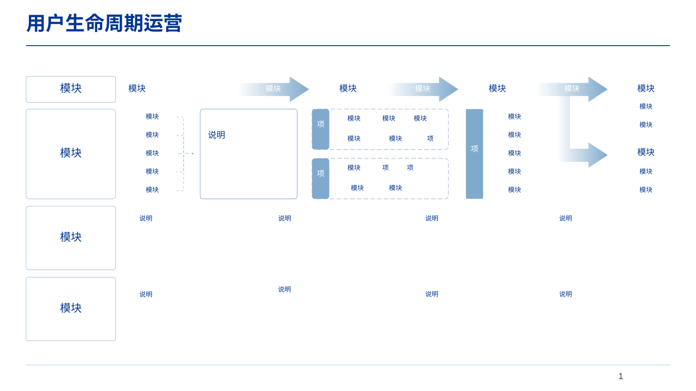

# 用户生命周期运营

来源为蓝色逻辑架构图.pptx#10。

## 结构与适用场景

新客迁入→沉淀→复购→分享/流失；4泳道用户路径/运营方法/工具/组织分工

生命周期运营与分工

阶段、方法、工具、职责按泳道绑定；含分享及流失分支，不能只保留正向链

固定节点、圆弧、扇区、分面和连接表达定性关系。数量比较、趋势或占比使用数据驱动图表，源页中已登记的微图槽可接收实际数据。

## 预览



## 调用

将下列完整page对象放入schema_version=1、template_id=business-blue-v1的pages数组，替换各节点内容。nodes键对应原文本框或已明确拆分的语义分段，字段角色及source_ref、segment见下表。

```json
{
  "id": "architecture-10",
  "family": "source-architecture",
  "variant": "page-10",
  "content": {
    "title": "用户生命周期运营",
    "nodes": {
      "shape_262": "模块",
      "shape_263": "模块",
      "shape_265": "模块",
      "shape_266": "模块",
      "shape_268": "模块",
      "shape_269": "模块",
      "shape_270": "模块",
      "shape_271": "模块",
      "shape_274": "模块",
      "shape_275": "模块",
      "shape_277": "模块",
      "shape_280": "模块",
      "shape_281": "模块",
      "shape_282": "模块",
      "shape_283": "模块",
      "shape_284": "说明",
      "shape_285": "模块",
      "shape_286": "模块",
      "shape_287": "模块",
      "shape_288": "模块",
      "shape_289": "模块",
      "shape_290": "模块",
      "shape_291": "模块",
      "shape_292": "项",
      "shape_337": "项",
      "shape_340": "模块",
      "shape_341": "模块",
      "shape_342": "模块",
      "shape_343": "模块",
      "shape_344": "模块",
      "shape_345": "模块",
      "shape_346": "项",
      "shape_347": "项",
      "shape_348": "项",
      "shape_349": "项",
      "shape_350": "模块",
      "shape_351": "模块",
      "shape_352": "模块",
      "shape_353": "模块",
      "shape_354": "模块",
      "shape_355": "模块",
      "shape_356": "说明",
      "shape_357": "说明",
      "shape_358": "说明",
      "shape_359": "说明",
      "shape_360": "说明",
      "shape_361": "说明",
      "shape_362": "说明",
      "shape_363": "说明"
    }
  },
  "config": {
    "show_source": true,
    "show_page_number": true
  }
}
```

config支持show_source、show_page_number、image_fit与image_position。image_fit可选contain或cover，image_position为xMin/xMid/xMax与YMin/YMid/YMax组合的九个焦点，默认为xMidYMid。字体、颜色、全局区和固定字阶取自tokens，节点数与连接结构由variant确定。

## 字段合同

每个业务节点required=true、min=1，max按具体框体登记。字符按规范化后的Unicode码点计数，空格标点换行均计入。build会以实际字体测量宽高，字符数通过后仍可能需要调整文字。

| 字段 | 节点角色与源标签 | 最短/最长 | 字阶 | 框体px | 原框引用 | 分段 | 旋转° | 垂直锚点 |
|---|---|---|---|---|---|---|---|---|
| nodes.shape_262 | 上左节点，源标签“运营方法” | 1/8 | compactBody | [94.1143, 271.0005, 72.2898, 25.0] | slide:262 |  | 0.0 | t |
| nodes.shape_263 | 上左节点，源标签“用户路径” | 1/8 | compactBody | [94.1143, 151.9046, 72.2898, 25.0] | slide:263 |  | 0.0 | t |
| nodes.shape_265 | 中左节点，源标签“系统工具” | 1/8 | compactBody | [94.1143, 425.8852, 72.2898, 25.0] | slide:265 |  | 0.0 | t |
| nodes.shape_266 | 下左节点，源标签“组织分工” | 1/8 | compactBody | [94.1143, 556.6697, 72.2898, 25.0] | slide:266 |  | 0.0 | t |
| nodes.shape_268 | 上左节点，源标签“新客引入历史客户迁入” | 1/23 | caption | [235.9267, 154.399, 166.8211, 20.0214] | slide:268 |  | 0.0 | t |
| nodes.shape_269 | 上中节点，源标签“客户沉淀” | 1/9 | caption | [606.5966, 154.399, 66.7243, 20.0214] | slide:269 |  | 0.0 | t |
| nodes.shape_270 | 上右节点，源标签“复购留存” | 1/9 | caption | [881.2586, 154.399, 66.7243, 20.0214] | slide:270 |  | 0.0 | t |
| nodes.shape_271 | 上中节点，源标签“活动运营” | 1/8 | diagramCompact | [474.8311, 155.6649, 55.6036, 17.5] | slide:271 |  | 0.0 | t |
| nodes.shape_274 | 上中节点，源标签“人群包运营” | 1/11 | diagramCompact | [742.5336, 155.6649, 69.5122, 17.5] | slide:274 |  | 0.0 | t |
| nodes.shape_275 | 上右节点，源标签“裂变运营” | 1/8 | diagramCompact | [1024.1552, 155.6649, 55.6036, 17.5] | slide:275 |  | 0.0 | t |
| nodes.shape_277 | 上左节点，源标签“公域平台迁入” | 1/13 | diagramMicro | [242.4422, 208.2473, 75.0674, 15.5814] | slide:277 |  | 0.0 | t |
| nodes.shape_280 | 上左节点，源标签“门店导流” | 1/9 | diagramMicro | [254.9568, 241.9708, 50.0484, 15.5814] | slide:280 |  | 0.0 | t |
| nodes.shape_281 | 上左节点，源标签“APP导航” | 1/9 | diagramMicro | [254.9568, 275.7047, 50.0484, 15.5814] | slide:281 |  | 0.0 | t |
| nodes.shape_282 | 中左节点，源标签“随单物料导流” | 1/13 | diagramMicro | [242.4422, 309.4385, 75.0674, 15.5814] | slide:282 |  | 0.0 | t |
| nodes.shape_283 | 中左节点，源标签“手机添加好友” | 1/13 | diagramMicro | [242.4422, 343.1621, 75.0674, 15.5814] | slide:283 |  | 0.0 | t |
| nodes.shape_284 | 上中节点，源标签“多渠道会员客户 / 分配规则渠道欢迎语 / 标记渠道标签” | 1/80 | caption | [382.1687, 240.0812, 150.1452, 86.8386] | slide:284 |  | 0.0 | t |
| nodes.shape_285 | 上右节点，源标签“热群玩法” | 1/9 | diagramMicro | [921.3015, 208.2473, 50.0484, 15.5814] | slide:285 |  | 0.0 | t |
| nodes.shape_286 | 上右节点，源标签“爆品营销” | 1/9 | diagramMicro | [921.3015, 241.9708, 50.0484, 15.5814] | slide:286 |  | 0.0 | t |
| nodes.shape_287 | 上右节点，源标签“节日活动” | 1/9 | diagramMicro | [921.3015, 275.7047, 50.0484, 15.5814] | slide:287 |  | 0.0 | t |
| nodes.shape_288 | 中右节点，源标签“线下活动” | 1/9 | diagramMicro | [921.3015, 309.4385, 50.0484, 15.5814] | slide:288 |  | 0.0 | t |
| nodes.shape_289 | 中右节点，源标签“会员福利” | 1/9 | diagramMicro | [921.3015, 343.1621, 50.0484, 15.5814] | slide:289 |  | 0.0 | t |
| nodes.shape_290 | 中中节点，源标签“关键词回复” | 1/11 | diagramMicro | [625.9262, 339.7236, 62.5631, 15.5814] | slide:290 |  | 0.0 | t |
| nodes.shape_291 | 中中节点，源标签“营销方案” | 1/9 | diagramMicro | [625.9881, 302.5513, 50.0484, 15.5814] | slide:291 |  | 0.0 | t |
| nodes.shape_292 | 中中节点，源标签“直播” | 1/4 | diagramMicro | [696.3264, 302.5513, 25.019, 15.5814] | slide:292 |  | 0.0 | t |
| nodes.shape_337 | 中中节点，源标签“任务” | 1/4 | diagramMicro | [741.7592, 302.5513, 25.019, 15.5814] | slide:337 |  | 0.0 | t |
| nodes.shape_340 | 中中节点，源标签“话术库” | 1/6 | diagramMicro | [708.6552, 339.7236, 37.5337, 15.5814] | slide:340 |  | 0.0 | t |
| nodes.shape_341 | 上中节点，源标签“营销方案” | 1/9 | diagramMicro | [625.9881, 248.858, 50.0484, 15.5814] | slide:341 |  | 0.0 | t |
| nodes.shape_342 | 上中节点，源标签“标签建群” | 1/9 | diagramMicro | [625.9881, 211.6857, 50.0484, 15.5814] | slide:342 |  | 0.0 | t |
| nodes.shape_343 | 上中节点，源标签“关键词回复” | 1/11 | diagramMicro | [696.1405, 248.858, 62.5631, 15.5814] | slide:343 |  | 0.0 | t |
| nodes.shape_344 | 上中节点，源标签“群直播” | 1/6 | diagramMicro | [696.2644, 211.6857, 37.5337, 15.5814] | slide:344 |  | 0.0 | t |
| nodes.shape_345 | 上中节点，源标签“话术库” | 1/6 | diagramMicro | [754.088, 211.6857, 37.5337, 15.5814] | slide:345 |  | 0.0 | t |
| nodes.shape_346 | 上中节点，源标签“任务” | 1/4 | diagramMicro | [778.9315, 248.858, 25.019, 15.5814] | slide:346 |  | 0.0 | t |
| nodes.shape_347 | 上中节点，源标签“群聊” | 1/2 | diagramCompact | [581.9051, 221.3815, 15.68, 33.3621] | slide:347 |  | 0.0 | t |
| nodes.shape_348 | 中中节点，源标签“私聊” | 1/2 | diagramCompact | [581.9051, 312.2471, 15.68, 33.3621] | slide:348 |  | 0.0 | t |
| nodes.shape_349 | 上右节点，源标签“群聊” | 1/2 | diagramCompact | [864.8277, 266.8143, 15.68, 33.3621] | slide:349 |  | 0.0 | t |
| nodes.shape_350 | 上右节点，源标签“品牌认同” | 1/9 | diagramMicro | [1162.9215, 189.6611, 50.0484, 15.5814] | slide:350 |  | 0.0 | t |
| nodes.shape_351 | 上右节点，源标签“分享得权益” | 1/11 | diagramMicro | [1156.6642, 223.3846, 62.5631, 15.5814] | slide:351 |  | 0.0 | t |
| nodes.shape_352 | 中右节点，源标签“流失预警” | 1/9 | diagramMicro | [1162.9215, 309.4385, 50.0484, 15.5814] | slide:352 |  | 0.0 | t |
| nodes.shape_353 | 中右节点，源标签“召回营销” | 1/9 | diagramMicro | [1162.9215, 343.1621, 50.0484, 15.5814] | slide:353 |  | 0.0 | t |
| nodes.shape_354 | 上右节点，源标签“分享裂变” | 1/9 | caption | [1154.5784, 154.399, 66.7243, 20.0214] | slide:354 |  | 0.0 | t |
| nodes.shape_355 | 上右节点，源标签“流失找回” | 1/9 | caption | [1154.5784, 271.7913, 66.7243, 20.0214] | slide:355 |  | 0.0 | t |
| nodes.shape_356 | 中左节点，源标签“1.渠道活码:根据规则分配门店员工和群 / 2.渠道好友自动添加标签 / 3.不同渠道不” | 1/170 | diagramMicro | [256.1753, 395.7609, 188.7218, 85.2485] | slide:356 |  | 0.0 | t |
| nodes.shape_357 | 中中节点，源标签“1.精准互动:标签匹配营销建议话术库 / 2.会话记录存档:关键词警报,聊天内容审计” | 1/185 | diagramMicro | [511.4871, 395.7609, 204.7058, 85.2485] | slide:357 |  | 0.0 | t |
| nodes.shape_358 | 下左节点，源标签“总部:系统、组织架构、方法论、设计渠道、客户分配规则、标签、欢迎语 / 门店员工:个” | 1/136 | diagramMicro | [256.1753, 535.694, 188.7218, 67.9014] | slide:358 |  | 0.0 | t |
| nodes.shape_359 | 下中节点，源标签“总部:营销方案、话术库、话术关键词、直播群规则、关键词自动回复、客户管理、聊天内” | 1/185 | diagramMicro | [511.2186, 526.5455, 204.9743, 85.2485] | slide:359 |  | 0.0 | t |
| nodes.shape_360 | 中中节点，源标签“小程序、H5嵌入企微客户可直接 / 打开特定页面门店员工离职转交接” | 1/60 | diagramMicro | [782.1015, 395.7609, 166.8211, 33.1969] | slide:360 |  | 0.0 | t |
| nodes.shape_361 | 中右节点，源标签“标签分层管理,精细化经营客户企微删好友提醒、统计客户生命周期触发任务” | 1/68 | diagramMicro | [1028.1925, 395.7609, 188.7218, 33.1969] | slide:361 |  | 0.0 | t |
| nodes.shape_362 | 下中节点，源标签“总部:系统准备、大型活动策划、日常活动策划 / 门店员工:活动传播、答疑” | 1/136 | diagramMicro | [782.1015, 535.2293, 188.7218, 67.9014] | slide:362 |  | 0.0 | t |
| nodes.shape_363 | 下右节点，源标签“总部:系统准备、裂变策划、召回策划 / 门店员工:建立客户信任” | 1/102 | diagramMicro | [1028.1925, 535.2293, 188.7218, 50.544] | slide:363 |  | 0.0 | t |

全局title必填、2至32码点，使用统一标题框。section_name可选0至24码点，source可选0至64码点。所有可编辑文本通过独立原生carrier导出，页码为派生文字。

## 来源处理

原生PPTX源件保存于用户材料目录，分发包仅含用户资产衍生的几何、字段和说明。原始逐框文字、源框与标准化框在page-catalog.json的variant.fields中。

源标题引用为`slide:6`，原文为“提供的私域流量运营方法及工具”。模板默认标题依据真实结构设置。

密集全景中的diagramCompact为14px、diagramMicro为12px。适用于体系概览或附录局部标签，现场关键结论用统一标题与正常正文字阶表达。

源画布边界裁切已烘焙为可编辑Bezier几何，3D顶面、侧面与前面通过tokens配色的相对明暗保留。

