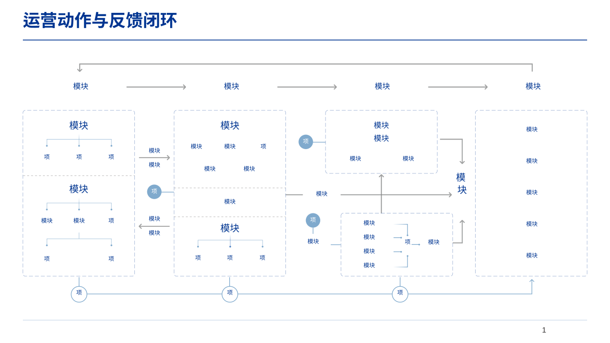

# 运营动作与反馈闭环

来源为蓝色逻辑架构图.pptx#11。

## 结构与适用场景

4阶段导入/沉淀/转化/持续运营；底部ABC回路与顶部反馈箭头；公私域与内容/CRM模块

运营闭环、动作及反馈机制

与house14近重复；回路、转化节点、输入/输出都应参数化

固定节点、圆弧、扇区、分面和连接表达定性关系。数量比较、趋势或占比使用数据驱动图表，源页中已登记的微图槽可接收实际数据。

## 预览



## 调用

将下列完整page对象放入schema_version=1、template_id=business-blue-v1的pages数组，替换各节点内容。nodes键对应原文本框或已明确拆分的语义分段，字段角色及source_ref、segment见下表。

```json
{
  "id": "architecture-11",
  "family": "source-architecture",
  "variant": "page-11",
  "content": {
    "title": "运营动作与反馈闭环",
    "nodes": {
      "shape_328": "模块",
      "shape_329": "模块",
      "shape_330": "模块",
      "shape_331": "模块",
      "shape_332": "模块",
      "shape_333": "模块",
      "shape_334": "项",
      "shape_335": "项",
      "shape_336": "项",
      "shape_338": "模块",
      "shape_339": "模块",
      "shape_364": "项",
      "shape_368": "项",
      "shape_369": "项",
      "shape_370": "模块",
      "shape_371": "模块",
      "shape_372": "项",
      "shape_373": "模块",
      "shape_374": "模块",
      "shape_375": "模块",
      "shape_376": "模块",
      "shape_377": "模块",
      "shape_378": "项",
      "shape_379": "项",
      "shape_380": "项",
      "shape_381": "模块",
      "shape_382": "模块",
      "shape_383": "模块",
      "shape_384": "模块",
      "shape_385": "模块",
      "shape_386": "模块",
      "shape_387": "模块",
      "shape_388": "模块",
      "shape_389": "模块",
      "shape_390": "模块",
      "shape_391": "项",
      "shape_392": "模块",
      "shape_393": "模块",
      "shape_394": "模块",
      "shape_395": "模块",
      "shape_396": "模块",
      "shape_397": "模块",
      "shape_398": "模块",
      "shape_399": "模块",
      "shape_400": "模块",
      "shape_401": "模块",
      "shape_402": "模块",
      "shape_403": "项",
      "shape_404": "项",
      "shape_405": "项",
      "shape_406": "项",
      "shape_407": "项",
      "shape_408": "项"
    }
  },
  "config": {
    "show_source": true,
    "show_page_number": true
  }
}
```

config支持show_source、show_page_number、image_fit与image_position。image_fit可选contain或cover，image_position为xMin/xMid/xMax与YMin/YMid/YMax组合的九个焦点，默认为xMidYMid。字体、颜色、全局区和固定字阶取自tokens，节点数与连接结构由variant确定。

## 字段合同

每个业务节点required=true、min=1，max按具体框体登记。字符按规范化后的Unicode码点计数，空格标点换行均计入。build会以实际字体测量宽高，字符数通过后仍可能需要调整文字。

| 字段 | 节点角色与源标签 | 最短/最长 | 字阶 | 框体px | 原框引用 | 分段 | 旋转° | 垂直锚点 |
|---|---|---|---|---|---|---|---|---|
| nodes.shape_328 | 上左节点，源标签“流量导入” | 1/9 | caption | [135.9351, 172.6331, 66.8356, 20.0548] | slide:328 |  | 0.0 | t |
| nodes.shape_329 | 上中节点，源标签“资产沉淀” | 1/9 | caption | [452.4269, 172.6331, 66.8356, 20.0548] | slide:329 |  | 0.0 | t |
| nodes.shape_330 | 上中节点，源标签“促进转化” | 1/9 | caption | [768.9187, 172.6331, 66.8356, 20.0548] | slide:330 |  | 0.0 | t |
| nodes.shape_331 | 上右节点，源标签“持续运营” | 1/9 | caption | [1085.4105, 172.6331, 66.8356, 20.0548] | slide:331 |  | 0.0 | t |
| nodes.shape_332 | 上左节点，源标签“公域（原生关注）” | 1/16 | compactBody | [92.8053, 252.8776, 144.8209, 25.0] | slide:332 |  | 0.0 | t |
| nodes.shape_333 | 中左节点，源标签“商域（推广广告）” | 1/16 | compactBody | [92.8053, 386.2696, 144.8209, 25.0] | slide:333 |  | 0.0 | t |
| nodes.shape_334 | 中左节点，源标签“内容” | 1/4 | diagramMicro | [85.8032, 323.1012, 25.0608, 15.6074] | slide:334 |  | 0.0 | t |
| nodes.shape_335 | 中左节点，源标签“服务” | 1/4 | diagramMicro | [153.3732, 323.1012, 25.0608, 15.6074] | slide:335 |  | 0.0 | t |
| nodes.shape_336 | 中左节点，源标签“社区” | 1/4 | diagramMicro | [220.9431, 323.1012, 25.0608, 15.6074] | slide:336 |  | 0.0 | t |
| nodes.shape_338 | 中左节点，源标签“第0屏” | 1/6 | diagramMicro | [81.7074, 456.8655, 33.242, 15.6074] | slide:338 |  | 0.0 | t |
| nodes.shape_339 | 中左节点，源标签“全场景” | 1/6 | diagramMicro | [147.1054, 456.8655, 37.5963, 15.6074] | slide:339 |  | 0.0 | t |
| nodes.shape_364 | 中左节点，源标签“联盟” | 1/4 | diagramMicro | [220.9431, 456.8655, 25.0608, 15.6074] | slide:364 |  | 0.0 | t |
| nodes.shape_368 | 下左节点，源标签“线上” | 1/4 | diagramMicro | [85.8032, 536.8573, 25.0608, 15.6074] | slide:368 |  | 0.0 | t |
| nodes.shape_369 | 下左节点，源标签“线下” | 1/4 | diagramMicro | [220.9431, 536.8573, 25.0608, 15.6074] | slide:369 |  | 0.0 | t |
| nodes.shape_370 | 中左节点，源标签“乐划锁屏” | 1/9 | diagramMicro | [386.9979, 301.0398, 50.1319, 15.6074] | slide:370 |  | 0.0 | t |
| nodes.shape_371 | 中中节点，源标签“小游戏” | 1/6 | diagramMicro | [463.5972, 301.0398, 37.5963, 15.6074] | slide:371 |  | 0.0 | t |
| nodes.shape_372 | 中中节点，源标签“视频” | 1/4 | diagramMicro | [540.1965, 301.0398, 25.0608, 15.6074] | slide:372 |  | 0.0 | t |
| nodes.shape_373 | 中中节点，源标签“智能短信” | 1/9 | diagramMicro | [415.2753, 347.9241, 50.1319, 15.6074] | slide:373 |  | 0.0 | t |
| nodes.shape_374 | 中中节点，源标签“OPPO+” | 1/8 | diagramMicro | [501.059, 347.9241, 44.0399, 15.6074] | slide:374 |  | 0.0 | t |
| nodes.shape_375 | 上中节点，源标签“私域流量” | 1/8 | compactBody | [446.1901, 252.8776, 72.4104, 25.0] | slide:375 |  | 0.0 | t |
| nodes.shape_376 | 中中节点，源标签“品牌自有” | 1/8 | compactBody | [446.1901, 468.4334, 72.4104, 25.0] | slide:376 |  | 0.0 | t |
| nodes.shape_377 | 中中节点，源标签“快应用” | 1/6 | diagramMicro | [463.5972, 416.88, 37.5963, 15.6074] | slide:377 |  | 0.0 | t |
| nodes.shape_378 | 下左节点，源标签“官网” | 1/4 | diagramMicro | [402.9776, 534.7887, 25.0608, 15.6074] | slide:378 |  | 0.0 | t |
| nodes.shape_379 | 下中节点，源标签“APP” | 1/4 | diagramMicro | [469.7822, 534.7887, 25.2366, 15.6074] | slide:379 |  | 0.0 | t |
| nodes.shape_380 | 下中节点，源标签“H5” | 1/3 | diagramMicro | [542.1306, 534.7887, 17.0554, 15.6074] | slide:380 |  | 0.0 | t |
| nodes.shape_381 | 中中节点，源标签“资产运营管理” | 1/13 | diagramMicro | [708.1957, 326.5454, 75.1927, 15.6074] | slide:381 |  | 0.0 | t |
| nodes.shape_382 | 中中节点，源标签“深度关系运维” | 1/13 | diagramMicro | [819.216, 326.5454, 75.1927, 15.6074] | slide:382 |  | 0.0 | t |
| nodes.shape_383 | 上中节点，源标签“内容自主生产” | 1/13 | caption | [750.136, 254.5176, 100.2638, 20.0548] | slide:383 |  | 0.0 | t |
| nodes.shape_384 | 中中节点，源标签“内容联合运营” | 1/13 | caption | [750.136, 281.9262, 100.2638, 20.0548] | slide:384 |  | 0.0 | t |
| nodes.shape_385 | 中中节点，源标签“直接转化” | 1/9 | diagramMicro | [650.0584, 400.3314, 50.1319, 15.6074] | slide:385 |  | 0.0 | t |
| nodes.shape_386 | 下中节点，源标签“粉丝关注 / 后反推” | 1/7 | diagramMicro | [637.6987, 500.44, 38.9926, 24.9987] | slide:386 |  | 0.0 | t |
| nodes.shape_387 | 中中节点，源标签“锁屏杂志” | 1/7 | diagramMicro | [755.2557, 461.658, 38.9926, 15.0] | slide:387 |  | 0.0 | t |
| nodes.shape_388 | 下中节点，源标签“主动Push” | 1/7 | diagramMicro | [753.694, 491.3007, 42.1265, 15.0] | slide:388 |  | 0.0 | t |
| nodes.shape_389 | 下中节点，源标签“全局搜索” | 1/7 | diagramMicro | [755.2557, 520.9537, 38.9926, 15.0] | slide:389 |  | 0.0 | t |
| nodes.shape_390 | 下中节点，源标签“应用分发” | 1/7 | diagramMicro | [755.2557, 550.6067, 38.9926, 15.0] | slide:390 |  | 0.0 | t |
| nodes.shape_391 | 下右节点，源标签“用户 / 关系” | 1/4 | diagramMicro | [844.2458, 501.3709, 22.2785, 26.7363] | slide:391 |  | 0.0 | t |
| nodes.shape_392 | 下右节点，源标签“商品 / 品牌详情” | 1/7 | diagramMicro | [890.7473, 501.8156, 38.9926, 24.9987] | slide:392 |  | 0.0 | t |
| nodes.shape_393 | 中左节点，源标签“消费者链路分析” | 1/12 | diagramMicro | [290.0335, 452.8108, 68.2319, 15.0] | slide:393 |  | 0.0 | t |
| nodes.shape_394 | 下左节点，源标签“转化数据分析” | 1/10 | diagramMicro | [294.905, 482.5052, 58.4889, 15.0] | slide:394 |  | 0.0 | t |
| nodes.shape_395 | 中左节点，源标签“有效流量导入” | 1/10 | diagramMicro | [294.905, 309.8207, 58.4889, 15.0] | slide:395 |  | 0.0 | t |
| nodes.shape_396 | 中左节点，源标签“拉新扩增” | 1/7 | diagramMicro | [304.6583, 339.515, 38.9926, 15.0] | slide:396 |  | 0.0 | t |
| nodes.shape_397 | 中右节点，源标签“转化成交” | 1/6 | compactBody | [957.283, 361.9283, 24.7298, 86.8904] | slide:397 |  | 0.0 | t |
| nodes.shape_398 | 上右节点，源标签“关系管理工具” | 1/13 | diagramMicro | [1078.4704, 265.1811, 75.1927, 15.6074] | slide:398 |  | 0.0 | t |
| nodes.shape_399 | 中右节点，源标签“品牌资产运营工具” | 1/18 | diagramMicro | [1065.9348, 331.3755, 100.2638, 15.6074] | slide:399 |  | 0.0 | t |
| nodes.shape_400 | 中右节点，源标签“内容运营工具” | 1/13 | diagramMicro | [1078.4704, 397.5698, 75.1927, 15.6074] | slide:400 |  | 0.0 | t |
| nodes.shape_401 | 中右节点，源标签“投放指导工具” | 1/13 | diagramMicro | [1078.4704, 463.7642, 75.1927, 15.6074] | slide:401 |  | 0.0 | t |
| nodes.shape_402 | 下右节点，源标签“数据评估体系” | 1/13 | diagramMicro | [1078.4704, 529.9586, 75.1927, 15.6074] | slide:402 |  | 0.0 | t |
| nodes.shape_403 | 中左节点，源标签“01” | 1/2 | diagramMicro | [316.5836, 395.0979, 14.449, 15.0385] | slide:403 |  | 0.0 | t |
| nodes.shape_404 | 中中节点，源标签“02” | 1/2 | diagramMicro | [633.6753, 290.2936, 16.0108, 15.0385] | slide:404 |  | 0.0 | t |
| nodes.shape_405 | 中中节点，源标签“03” | 1/2 | diagramMicro | [648.7552, 455.0865, 16.1866, 15.0385] | slide:405 |  | 0.0 | t |
| nodes.shape_406 | 下左节点，源标签“A” | 1/2 | diagramMicro | [159.1887, 607.7266, 13.44, 20.0548] | slide:406 |  | 0.0 | t |
| nodes.shape_407 | 下中节点，源标签“B” | 1/2 | diagramMicro | [475.6753, 607.7266, 13.44, 20.0548] | slide:407 |  | 0.0 | t |
| nodes.shape_408 | 下中节点，源标签“C” | 1/2 | diagramMicro | [832.856, 607.7266, 13.44, 20.0548] | slide:408 |  | 0.0 | t |

全局title必填、2至32码点，使用统一标题框。section_name可选0至24码点，source可选0至64码点。所有可编辑文本通过独立原生carrier导出，页码为派生文字。

## 来源处理

原生PPTX源件保存于用户材料目录，分发包仅含用户资产衍生的几何、字段和说明。原始逐框文字、源框与标准化框在page-catalog.json的variant.fields中。

源标题引用为`slide:6`，原文为“运营引擎 为用户提供终端顾问式服务 打造融合营销闭环”。模板默认标题依据真实结构设置。

密集全景中的diagramCompact为14px、diagramMicro为12px。适用于体系概览或附录局部标签，现场关键结论用统一标题与正常正文字阶表达。

源画布边界裁切已烘焙为可编辑Bezier几何，3D顶面、侧面与前面通过tokens配色的相对明暗保留。

