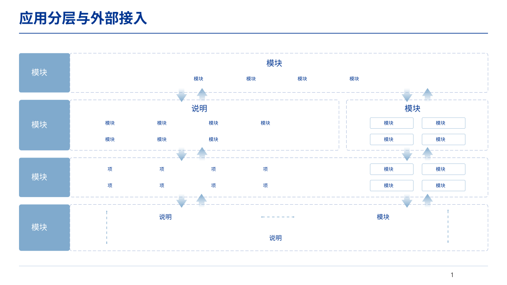

# 应用分层与外部接入

来源为蓝色逻辑架构图.pptx#12。

## 结构与适用场景

门户表现层；应用层分管理平台与第三方；服务层含共性模块和接口；系统层数据库/中间件/OS；双向依赖箭头

应用系统分层与外部接入

保留层内子模块、两列边界、接口和双向箭头；4行title/body不足以承接

固定节点、圆弧、扇区、分面和连接表达定性关系。数量比较、趋势或占比使用数据驱动图表，源页中已登记的微图槽可接收实际数据。

## 预览



## 调用

将下列完整page对象放入schema_version=1、template_id=business-blue-v1的pages数组，替换各节点内容。nodes键对应原文本框或已明确拆分的语义分段，字段角色及source_ref、segment见下表。

```json
{
  "id": "architecture-12",
  "family": "source-architecture",
  "variant": "page-12",
  "content": {
    "title": "应用分层与外部接入",
    "nodes": {
      "shape_282": "模块",
      "shape_283": "模块",
      "shape_284": "模块",
      "shape_285": "模块",
      "shape_286": "模块",
      "shape_287": "说明",
      "shape_288": "模块",
      "shape_289": "模块",
      "shape_290": "模块",
      "shape_291": "模块",
      "shape_292": "模块",
      "shape_293": "模块",
      "shape_294": "模块",
      "shape_296": "模块",
      "shape_307": "模块",
      "shape_308": "模块",
      "shape_309": "模块",
      "shape_310": "模块",
      "shape_317": "模块",
      "shape_318": "模块",
      "shape_319": "模块",
      "shape_320": "模块",
      "shape_321": "模块",
      "shape_322": "模块",
      "shape_323": "模块",
      "shape_327": "模块",
      "shape_337": "项",
      "shape_340": "项",
      "shape_341": "项",
      "shape_342": "项",
      "shape_343": "项",
      "shape_344": "项",
      "shape_345": "项",
      "shape_346": "项",
      "shape_347": "说明",
      "shape_348": "模块",
      "shape_349": "说明"
    }
  },
  "config": {
    "show_source": true,
    "show_page_number": true
  }
}
```

config支持show_source、show_page_number、image_fit与image_position。image_fit可选contain或cover，image_position为xMin/xMid/xMax与YMin/YMid/YMax组合的九个焦点，默认为xMidYMid。字体、颜色、全局区和固定字阶取自tokens，节点数与连接结构由variant确定。

## 字段合同

每个业务节点required=true、min=1，max按具体框体登记。字符按规范化后的Unicode码点计数，空格标点换行均计入。build会以实际字体测量宽高，字符数通过后仍可能需要调整文字。

| 字段 | 节点角色与源标签 | 最短/最长 | 字阶 | 框体px | 原框引用 | 分段 | 旋转° | 垂直锚点 |
|---|---|---|---|---|---|---|---|---|
| nodes.shape_282 | 上左节点，源标签“表现层” | 1/6 | compactBody | [84.9845, 171.433, 54.3384, 25.0] | slide:282 |  | 0.0 | t |
| nodes.shape_283 | 中左节点，源标签“应用层” | 1/6 | compactBody | [84.9845, 303.5485, 54.3384, 25.0] | slide:283 |  | 0.0 | t |
| nodes.shape_284 | 中左节点，源标签“服务层” | 1/6 | compactBody | [84.9845, 435.664, 54.3384, 25.0] | slide:284 |  | 0.0 | t |
| nodes.shape_285 | 下左节点，源标签“系统层” | 1/6 | compactBody | [84.9845, 562.5951, 54.3384, 25.0] | slide:285 |  | 0.0 | t |
| nodes.shape_286 | 上中节点，源标签“Portal（门户）” | 1/14 | compactBody | [641.5419, 148.1496, 127.8314, 25.0] | slide:286 |  | 0.0 | t |
| nodes.shape_287 | 上中节点，源标签“Elearning管理平台” | 1/17 | compactBody | [436.8441, 262.5696, 158.4827, 25.0] | slide:287 |  | 0.0 | t |
| nodes.shape_288 | 上右节点，源标签“第三方系统” | 1/10 | compactBody | [1009.255, 262.5696, 90.5571, 25.0] | slide:288 |  | 0.0 | t |
| nodes.shape_289 | 中左节点，源标签“培训实施” | 1/9 | diagramMicro | [391.312, 303.0615, 50.1577, 15.6154] | slide:289 |  | 0.0 | t |
| nodes.shape_290 | 上中节点，源标签“公众门户” | 1/9 | diagramMicro | [483.7628, 191.3009, 50.1577, 15.6154] | slide:290 |  | 0.0 | t |
| nodes.shape_291 | 上中节点，源标签“学习中心” | 1/9 | diagramMicro | [616.4579, 191.3009, 50.1577, 15.6154] | slide:291 |  | 0.0 | t |
| nodes.shape_292 | 上中节点，源标签“资源中心” | 1/9 | diagramMicro | [745.9139, 191.3009, 50.1577, 15.6154] | slide:292 |  | 0.0 | t |
| nodes.shape_293 | 上右节点，源标签“管理中心” | 1/9 | diagramMicro | [876.9946, 191.3009, 50.1577, 15.6154] | slide:293 |  | 0.0 | t |
| nodes.shape_294 | 中中节点，源标签“网络考试” | 1/9 | diagramMicro | [521.6994, 303.0615, 50.1577, 15.6154] | slide:294 |  | 0.0 | t |
| nodes.shape_296 | 中中节点，源标签“人才管理” | 1/9 | diagramMicro | [652.7801, 303.0615, 50.1577, 15.6154] | slide:296 |  | 0.0 | t |
| nodes.shape_307 | 中左节点，源标签“系统管理” | 1/9 | diagramMicro | [260.2417, 303.0615, 50.1577, 15.6154] | slide:307 |  | 0.0 | t |
| nodes.shape_308 | 中左节点，源标签“课件制作” | 1/9 | diagramMicro | [391.312, 344.4543, 50.1577, 15.6154] | slide:308 |  | 0.0 | t |
| nodes.shape_309 | 中中节点，源标签“只是管理” | 1/9 | diagramMicro | [521.6994, 344.4543, 50.1577, 15.6154] | slide:309 |  | 0.0 | t |
| nodes.shape_310 | 中左节点，源标签“教学辅助” | 1/9 | diagramMicro | [260.2417, 344.4543, 50.1577, 15.6154] | slide:310 |  | 0.0 | t |
| nodes.shape_317 | 中右节点，源标签“即时通讯” | 1/9 | diagramMicro | [963.9195, 303.0615, 50.1577, 15.6154] | slide:317 |  | 0.0 | t |
| nodes.shape_318 | 中右节点，源标签“档案管理” | 1/9 | diagramMicro | [1094.9898, 303.0615, 50.1577, 15.6154] | slide:318 |  | 0.0 | t |
| nodes.shape_319 | 中右节点，源标签“人力资源” | 1/9 | diagramMicro | [963.9195, 344.4543, 50.1577, 15.6154] | slide:319 |  | 0.0 | t |
| nodes.shape_320 | 中右节点，源标签“外部邮件” | 1/9 | diagramMicro | [1094.9898, 344.4543, 50.1577, 15.6154] | slide:320 |  | 0.0 | t |
| nodes.shape_321 | 中右节点，源标签“HR接口” | 1/7 | diagramMicro | [967.6552, 419.6547, 42.6656, 15.6154] | slide:321 |  | 0.0 | t |
| nodes.shape_322 | 中右节点，源标签“档案接口” | 1/9 | diagramMicro | [1094.9898, 419.6547, 50.1577, 15.6154] | slide:322 |  | 0.0 | t |
| nodes.shape_323 | 中右节点，源标签“邮件接口” | 1/9 | diagramMicro | [963.9195, 461.0476, 50.1577, 15.6154] | slide:323 |  | 0.0 | t |
| nodes.shape_327 | 中右节点，源标签“门户接口” | 1/9 | diagramMicro | [1094.9898, 461.0476, 50.1577, 15.6154] | slide:327 |  | 0.0 | t |
| nodes.shape_337 | 中左节点，源标签“组织” | 1/4 | diagramMicro | [403.854, 419.6547, 25.0737, 15.6154] | slide:337 |  | 0.0 | t |
| nodes.shape_340 | 中中节点，源标签“用户” | 1/4 | diagramMicro | [534.2414, 419.6547, 25.0737, 15.6154] | slide:340 |  | 0.0 | t |
| nodes.shape_341 | 中中节点，源标签“配置” | 1/4 | diagramMicro | [665.3221, 419.6547, 25.0737, 15.6154] | slide:341 |  | 0.0 | t |
| nodes.shape_342 | 中左节点，源标签“单位” | 1/4 | diagramMicro | [272.7733, 419.6547, 25.0737, 15.6154] | slide:342 |  | 0.0 | t |
| nodes.shape_343 | 中左节点，源标签“权限” | 1/4 | diagramMicro | [403.854, 461.0476, 25.0737, 15.6154] | slide:343 |  | 0.0 | t |
| nodes.shape_344 | 中中节点，源标签“日志” | 1/4 | diagramMicro | [534.2414, 461.0476, 25.0737, 15.6154] | slide:344 |  | 0.0 | t |
| nodes.shape_345 | 中中节点，源标签“安全” | 1/4 | diagramMicro | [665.3221, 461.0476, 25.0737, 15.6154] | slide:345 |  | 0.0 | t |
| nodes.shape_346 | 中左节点，源标签“角色” | 1/4 | diagramMicro | [272.7733, 461.0476, 25.0737, 15.6154] | slide:346 |  | 0.0 | t |
| nodes.shape_347 | 下左节点，源标签“数据库mysql/sql2005/oracle” | 1/32 | caption | [309.7889, 537.7795, 235.9804, 20.8206] | slide:347 |  | 0.0 | t |
| nodes.shape_348 | 下右节点，源标签“中间件weblogic等” | 1/19 | caption | [905.7729, 537.7795, 143.6745, 20.8206] | slide:348 |  | 0.0 | t |
| nodes.shape_349 | 下中节点，源标签“操作系统linux、windows2003等” | 1/36 | caption | [576.0481, 590.9072, 259.4915, 20.8206] | slide:349 |  | 0.0 | t |

全局title必填、2至32码点，使用统一标题框。section_name可选0至24码点，source可选0至64码点。所有可编辑文本通过独立原生carrier导出，页码为派生文字。

## 来源处理

原生PPTX源件保存于用户材料目录，分发包仅含用户资产衍生的几何、字段和说明。原始逐框文字、源框与标准化框在page-catalog.json的variant.fields中。

源标题引用为`slide:278`，原文为“系统架构图”。模板默认标题依据真实结构设置。

密集全景中的diagramCompact为14px、diagramMicro为12px。适用于体系概览或附录局部标签，现场关键结论用统一标题与正常正文字阶表达。

源画布边界裁切已烘焙为可编辑Bezier几何，3D顶面、侧面与前面通过tokens配色的相对明暗保留。

