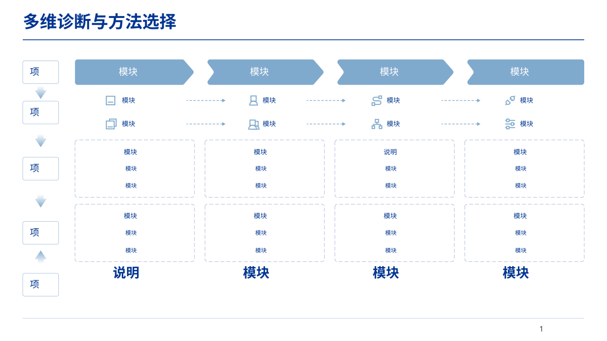

# 多维诊断与方法选择

来源为蓝色逻辑架构图.pptx#13。

## 结构与适用场景

阶段性/驱动性/流程性/抽象性4横向箭头；左特征→判断→定位→编排→工具；4列内角色与模块

设计分析框架，多维诊断

横向维度不必然是时间流程，源箭头需要解释；C/M/T/D为原框架标签

固定节点、圆弧、扇区、分面和连接表达定性关系。数量比较、趋势或占比使用数据驱动图表，源页中已登记的微图槽可接收实际数据。

## 预览



## 调用

将下列完整page对象放入schema_version=1、template_id=business-blue-v1的pages数组，替换各节点内容。nodes键对应原文本框或已明确拆分的语义分段，字段角色及source_ref、segment见下表。

```json
{
  "id": "architecture-13",
  "family": "source-architecture",
  "variant": "page-13",
  "content": {
    "title": "多维诊断与方法选择",
    "nodes": {
      "shape_311": "项",
      "shape_312": "项",
      "shape_313": "项",
      "shape_314": "项",
      "shape_315": "项",
      "shape_316": "模块",
      "shape_324": "模块",
      "shape_325": "模块",
      "shape_326": "模块",
      "shape_328": "模块",
      "shape_329": "模块",
      "shape_330": "模块",
      "shape_331": "模块",
      "shape_332": "模块",
      "shape_333": "模块",
      "shape_334": "模块",
      "shape_335": "模块",
      "shape_336": "模块",
      "shape_338": "模块",
      "shape_339": "说明",
      "shape_350": "模块",
      "shape_351": "模块",
      "shape_352": "模块",
      "shape_353": "模块",
      "shape_354": "模块",
      "shape_355": "模块",
      "shape_356": "模块",
      "shape_357": "模块",
      "shape_358": "模块",
      "shape_359": "模块",
      "shape_360": "模块",
      "shape_361": "模块",
      "shape_362": "模块",
      "shape_363": "模块",
      "shape_364": "模块",
      "shape_365": "模块",
      "shape_366": "模块",
      "shape_367": "模块",
      "shape_368": "模块",
      "shape_369": "模块",
      "shape_370": "模块",
      "shape_372": "说明",
      "shape_373": "模块",
      "shape_374": "模块",
      "shape_375": "模块"
    }
  },
  "config": {
    "show_source": true,
    "show_page_number": true
  }
}
```

config支持show_source、show_page_number、image_fit与image_position。image_fit可选contain或cover，image_position为xMin/xMid/xMax与YMin/YMid/YMax组合的九个焦点，默认为xMidYMid。字体、颜色、全局区和固定字阶取自tokens，节点数与连接结构由variant确定。

## 字段合同

每个业务节点required=true、min=1，max按具体框体登记。字符按规范化后的Unicode码点计数，空格标点换行均计入。build会以实际字体测量宽高，字符数通过后仍可能需要调整文字。

| 字段 | 节点角色与源标签 | 最短/最长 | 字阶 | 框体px | 原框引用 | 分段 | 旋转° | 垂直锚点 |
|---|---|---|---|---|---|---|---|---|
| nodes.shape_311 | 上左节点，源标签“特征” | 1/4 | compactBody | [67.7839, 139.8287, 36.1501, 25.0] | slide:311 |  | 0.0 | t |
| nodes.shape_312 | 上左节点，源标签“判断” | 1/4 | compactBody | [67.7839, 225.1908, 36.1501, 25.0] | slide:312 |  | 0.0 | t |
| nodes.shape_313 | 中左节点，源标签“定位” | 1/4 | compactBody | [67.7839, 343.4091, 36.1501, 25.0] | slide:313 |  | 0.0 | t |
| nodes.shape_314 | 下左节点，源标签“编排” | 1/4 | compactBody | [67.7839, 479.2016, 36.1501, 25.0] | slide:314 |  | 0.0 | t |
| nodes.shape_315 | 下左节点，源标签“工具” | 1/4 | compactBody | [67.7839, 588.6534, 36.1501, 25.0] | slide:315 |  | 0.0 | t |
| nodes.shape_316 | 上左节点，源标签“阶段性” | 1/6 | compactBody | [256.103, 139.8287, 54.2199, 25.0] | slide:316 |  | 0.0 | t |
| nodes.shape_324 | 上中节点，源标签“驱动性” | 1/6 | compactBody | [532.7992, 139.8287, 54.2199, 25.0] | slide:324 |  | 0.0 | t |
| nodes.shape_325 | 上中节点，源标签“流程性” | 1/6 | compactBody | [806.7695, 139.8287, 54.2199, 25.0] | slide:325 |  | 0.0 | t |
| nodes.shape_326 | 上右节点，源标签“抽象性” | 1/6 | compactBody | [1081.6381, 139.8287, 54.2199, 25.0] | slide:326 |  | 0.0 | t |
| nodes.shape_328 | 上左节点，源标签“单阶段：单场景” | 1/15 | diagramCompact | [256.991, 203.4675, 97.3088, 17.5] | slide:328 |  | 0.0 | t |
| nodes.shape_329 | 上左节点，源标签“跨阶段：多场景” | 1/15 | diagramCompact | [256.991, 253.0305, 97.3088, 17.5] | slide:329 |  | 0.0 | t |
| nodes.shape_330 | 上中节点，源标签“单角色” | 1/6 | diagramCompact | [553.7603, 203.4675, 41.7053, 17.5] | slide:330 |  | 0.0 | t |
| nodes.shape_331 | 上中节点，源标签“多角色” | 1/6 | diagramCompact | [553.7603, 253.0305, 41.7053, 17.5] | slide:331 |  | 0.0 | t |
| nodes.shape_332 | 上中节点，源标签“单线任务流” | 1/11 | diagramCompact | [815.4224, 203.4675, 69.5122, 17.5] | slide:332 |  | 0.0 | t |
| nodes.shape_333 | 上中节点，源标签“多线任务流” | 1/11 | diagramCompact | [815.4224, 253.0305, 69.5122, 17.5] | slide:333 |  | 0.0 | t |
| nodes.shape_334 | 上右节点，源标签“单一功能” | 1/8 | diagramCompact | [1096.445, 203.4675, 55.6036, 17.5] | slide:334 |  | 0.0 | t |
| nodes.shape_335 | 上右节点，源标签“聚合功能” | 1/8 | diagramCompact | [1096.445, 253.0305, 55.6036, 17.5] | slide:335 |  | 0.0 | t |
| nodes.shape_336 | 中左节点，源标签“每个阶段的目标是什么” | 1/22 | diagramCompact | [214.6042, 312.6198, 139.0244, 17.5] | slide:336 |  | 0.0 | t |
| nodes.shape_338 | 中中节点，源标签“用户角色目标是什么” | 1/19 | diagramCompact | [495.5237, 312.6198, 125.1158, 17.5] | slide:338 |  | 0.0 | t |
| nodes.shape_339 | 中中节点，源标签“Elearning管理平台” | 1/18 | diagramCompact | [773.0563, 312.6198, 117.9911, 17.5] | slide:339 |  | 0.0 | t |
| nodes.shape_350 | 中右节点，源标签“功能底层如何实现” | 1/17 | diagramCompact | [1050.4236, 312.6198, 111.2175, 17.5] | slide:350 |  | 0.0 | t |
| nodes.shape_351 | 中左节点，源标签“上下游场景” | 1/11 | diagramCompact | [249.35, 447.4934, 69.5122, 17.5] | slide:351 |  | 0.0 | t |
| nodes.shape_352 | 中中节点，源标签“角色定义” | 1/8 | diagramCompact | [530.2798, 447.4934, 55.6036, 17.5] | slide:352 |  | 0.0 | t |
| nodes.shape_353 | 中中节点，源标签“任务流编排” | 1/11 | diagramCompact | [797.3009, 447.4934, 69.5122, 17.5] | slide:353 |  | 0.0 | t |
| nodes.shape_354 | 中右节点，源标签“界面编排” | 1/8 | diagramCompact | [1078.2306, 447.4934, 55.6036, 17.5] | slide:354 |  | 0.0 | t |
| nodes.shape_355 | 中左节点，源标签“应用的构建部署” | 1/16 | diagramMicro | [240.3151, 348.2991, 87.5821, 15.5814] | slide:355 |  | 0.0 | t |
| nodes.shape_356 | 中左节点，源标签“应用间服务调用” | 1/16 | diagramMicro | [240.3151, 384.2943, 87.5821, 15.5814] | slide:356 |  | 0.0 | t |
| nodes.shape_357 | 中中节点，源标签“角色职责” | 1/9 | diagramMicro | [533.0574, 348.2991, 50.0484, 15.5814] | slide:357 |  | 0.0 | t |
| nodes.shape_358 | 中中节点，源标签“角色任务” | 1/9 | diagramMicro | [533.0574, 384.2943, 50.0484, 15.5814] | slide:358 |  | 0.0 | t |
| nodes.shape_359 | 中中节点，源标签“应用、资源、配置” | 1/18 | diagramMicro | [782.0086, 348.2991, 100.0968, 15.5814] | slide:359 |  | 0.0 | t |
| nodes.shape_360 | 中中节点，源标签“信息流、规则” | 1/13 | diagramMicro | [794.5233, 384.2943, 75.0674, 15.5814] | slide:360 |  | 0.0 | t |
| nodes.shape_361 | 中右节点，源标签“技术架构、接口” | 1/16 | diagramMicro | [1062.2362, 348.2991, 87.5821, 15.5814] | slide:361 |  | 0.0 | t |
| nodes.shape_362 | 中右节点，源标签“物理映射关系” | 1/13 | diagramMicro | [1068.4935, 384.2943, 75.0674, 15.5814] | slide:362 |  | 0.0 | t |
| nodes.shape_363 | 下左节点，源标签“各阶段侧重” | 1/11 | diagramMicro | [252.8298, 483.9057, 62.5631, 15.5814] | slide:363 |  | 0.0 | t |
| nodes.shape_364 | 下左节点，源标签“前后置条件” | 1/11 | diagramMicro | [252.8298, 521.0781, 62.5631, 15.5814] | slide:364 |  | 0.0 | t |
| nodes.shape_365 | 下中节点，源标签“角色权限分配” | 1/13 | diagramMicro | [520.553, 483.9057, 75.0674, 15.695] | slide:365 |  | 0.0 | t |
| nodes.shape_366 | 下中节点，源标签“角色协作触点” | 1/13 | diagramMicro | [520.553, 521.0781, 75.0674, 15.5814] | slide:366 |  | 0.0 | t |
| nodes.shape_367 | 下中节点，源标签“任务起点、过程、结果” | 1/23 | diagramMicro | [769.4939, 483.9057, 125.1158, 15.5814] | slide:367 |  | 0.0 | t |
| nodes.shape_368 | 下中节点，源标签“下一任务承接” | 1/13 | diagramMicro | [794.5233, 521.0781, 75.0674, 15.5814] | slide:368 |  | 0.0 | t |
| nodes.shape_369 | 下右节点，源标签“功能层级、信息架构” | 1/20 | diagramMicro | [1049.7318, 483.9057, 112.6011, 15.5814] | slide:369 |  | 0.0 | t |
| nodes.shape_370 | 下右节点，源标签“交互逻辑、信息编排” | 1/20 | diagramMicro | [1049.7318, 521.0781, 112.6011, 15.5814] | slide:370 |  | 0.0 | t |
| nodes.shape_372 | 下左节点，源标签“Collaboration” | 1/34 | heading | [174.2826, 559.1074, 219.647, 83.4105] | slide:372 |  | 0.0 | t |
| nodes.shape_373 | 下中节点，源标签“Mulit-Roles” | 1/30 | heading | [459.5801, 559.1074, 197.9322, 83.4105] | slide:373 |  | 0.0 | t |
| nodes.shape_374 | 下中节点，源标签“Task Flow” | 1/26 | heading | [746.9943, 559.1074, 170.1253, 83.4105] | slide:374 |  | 0.0 | t |
| nodes.shape_375 | 下右节点，源标签“Deep” | 1/16 | heading | [1052.685, 559.1074, 106.6949, 83.4105] | slide:375 |  | 0.0 | t |

全局title必填、2至32码点，使用统一标题框。section_name可选0至24码点，source可选0至64码点。所有可编辑文本通过独立原生carrier导出，页码为派生文字。

## 来源处理

原生PPTX源件保存于用户材料目录，分发包仅含用户资产衍生的几何、字段和说明。原始逐框文字、源框与标准化框在page-catalog.json的variant.fields中。

源标题引用为`slide:278`，原文为“企业级技术产品设计探索”。模板默认标题依据真实结构设置。

密集全景中的diagramCompact为14px、diagramMicro为12px。适用于体系概览或附录局部标签，现场关键结论用统一标题与正常正文字阶表达。

源画布边界裁切已烘焙为可编辑Bezier几何，3D顶面、侧面与前面通过tokens配色的相对明暗保留。

