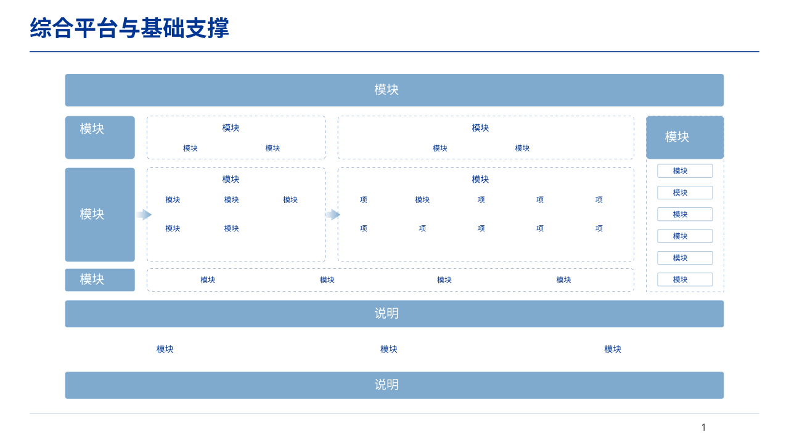

# 综合平台与基础支撑

来源为蓝色逻辑架构图.pptx#14。

## 结构与适用场景

顶层规划；园区/企业2模型入口；2能力平台与保障右栏；信息汇聚、云设施、接入设备3层

园区/企业综合平台

能力平台与系统接入层分别参数；源同名模块多，应靠source-ref区分

固定节点、圆弧、扇区、分面和连接表达定性关系。数量比较、趋势或占比使用数据驱动图表，源页中已登记的微图槽可接收实际数据。

## 预览



## 调用

将下列完整page对象放入schema_version=1、template_id=business-blue-v1的pages数组，替换各节点内容。nodes键对应原文本框或已明确拆分的语义分段，字段角色及source_ref、segment见下表。

```json
{
  "id": "architecture-14",
  "family": "source-architecture",
  "variant": "page-14",
  "content": {
    "title": "综合平台与基础支撑",
    "nodes": {
      "shape_289": "模块",
      "shape_290": "模块",
      "shape_291": "模块",
      "shape_292": "模块",
      "shape_293": "说明",
      "shape_294": "说明",
      "shape_296": "模块",
      "shape_299": "模块",
      "shape_307": "模块",
      "shape_308": "模块",
      "shape_309": "模块",
      "shape_310": "模块",
      "shape_317": "模块",
      "shape_318": "模块",
      "shape_319": "模块",
      "shape_320": "模块",
      "shape_321": "模块",
      "shape_322": "模块",
      "shape_323": "模块",
      "shape_327": "项",
      "shape_337": "项",
      "shape_340": "项",
      "shape_341": "项",
      "shape_342": "项",
      "shape_343": "项",
      "shape_344": "项",
      "shape_345": "项",
      "shape_346": "项",
      "shape_347": "模块",
      "shape_348": "模块",
      "shape_349": "模块",
      "shape_376": "模块",
      "shape_377": "模块",
      "shape_378": "模块",
      "shape_379": "模块",
      "shape_380": "模块",
      "shape_381": "模块",
      "shape_382": "模块",
      "shape_383": "模块",
      "shape_384": "模块",
      "shape_385": "模块",
      "shape_386": "模块",
      "shape_387": "模块"
    }
  },
  "config": {
    "show_source": true,
    "show_page_number": true
  }
}
```

config支持show_source、show_page_number、image_fit与image_position。image_fit可选contain或cover，image_position为xMin/xMid/xMax与YMin/YMid/YMax组合的九个焦点，默认为xMidYMid。字体、颜色、全局区和固定字阶取自tokens，节点数与连接结构由variant确定。

## 字段合同

每个业务节点required=true、min=1，max按具体框体登记。字符按规范化后的Unicode码点计数，空格标点换行均计入。build会以实际字体测量宽高，字符数通过后仍可能需要调整文字。

| 字段 | 节点角色与源标签 | 最短/最长 | 字阶 | 框体px | 原框引用 | 分段 | 旋转° | 垂直锚点 |
|---|---|---|---|---|---|---|---|---|
| nodes.shape_289 | 上中节点，源标签“智慧园区整体顶层设计规划” | 1/24 | compactBody | [528.6535, 134.006, 222.6824, 25.0] | slide:289 |  | 0.0 | t |
| nodes.shape_290 | 上左节点，源标签“价值观 / 设计原则” | 1/16 | compactBody | [125.0728, 197.8005, 74.2275, 51.4959] | slide:290 |  | 0.0 | t |
| nodes.shape_291 | 中左节点，源标签“设计模式” | 1/8 | compactBody | [125.0728, 336.5121, 74.2275, 25.0] | slide:291 |  | 0.0 | t |
| nodes.shape_292 | 中左节点，源标签“信息汇聚层” | 1/10 | compactBody | [115.7957, 442.5362, 92.7817, 25.0] | slide:292 |  | 0.0 | t |
| nodes.shape_293 | 下中节点，源标签“云基础设备（政务云、5G边缘MEC）” | 1/34 | compactBody | [484.8549, 497.6687, 310.2901, 25.0] | slide:293 |  | 0.0 | t |
| nodes.shape_294 | 下中节点，源标签“光纤/4G/5G/6G/NB-IOT数据采集设备” | 1/36 | compactBody | [475.8429, 613.5848, 328.3142, 25.0] | slide:294 |  | 0.0 | t |
| nodes.shape_296 | 上右节点，源标签“保障体系” | 1/8 | compactBody | [1074.3383, 211.0431, 74.2275, 25.0] | slide:296 |  | 0.0 | t |
| nodes.shape_299 | 下左节点，源标签“有线网络全覆盖” | 1/15 | diagramCompact | [226.7287, 559.2366, 99.9171, 17.7696] | slide:299 |  | 0.0 | t |
| nodes.shape_307 | 下中节点，源标签“无限网络全覆盖” | 1/15 | diagramCompact | [590.0415, 559.2366, 99.9171, 17.7696] | slide:307 |  | 0.0 | t |
| nodes.shape_308 | 下右节点，源标签“物联网应用全覆盖” | 1/18 | diagramCompact | [946.2082, 559.2366, 114.1986, 17.7696] | slide:308 |  | 0.0 | t |
| nodes.shape_309 | 上中节点，源标签“企业经营者模型” | 1/15 | diagramCompact | [738.4752, 199.4651, 99.9171, 17.7696] | slide:309 |  | 0.0 | t |
| nodes.shape_310 | 上左节点，源标签“园区管理服务” | 1/13 | diagramCompact | [340.5986, 199.4651, 85.6463, 17.7696] | slide:310 |  | 0.0 | t |
| nodes.shape_317 | 中中节点，源标签“智慧企业服务平台” | 1/18 | diagramCompact | [731.3398, 283.1287, 114.1986, 17.7696] | slide:317 |  | 0.0 | t |
| nodes.shape_318 | 中左节点，源标签“智慧企业服务平台” | 1/18 | diagramCompact | [326.3277, 283.1287, 114.1986, 17.7696] | slide:318 |  | 0.0 | t |
| nodes.shape_319 | 上左节点，源标签“园区门户” | 1/7 | diagramMicro | [296.641, 233.3622, 39.9711, 15.0] | slide:319 |  | 0.0 | t |
| nodes.shape_320 | 上中节点，源标签“园区APP” | 1/7 | diagramMicro | [430.6766, 233.1439, 39.0805, 15.0] | slide:320 |  | 0.0 | t |
| nodes.shape_321 | 上中节点，源标签“园区门户” | 1/7 | diagramMicro | [701.653, 233.3622, 39.9711, 15.0] | slide:321 |  | 0.0 | t |
| nodes.shape_322 | 上中节点，源标签“园区APP” | 1/7 | diagramMicro | [835.6887, 233.1439, 39.0805, 15.0] | slide:322 |  | 0.0 | t |
| nodes.shape_323 | 中中节点，源标签“服务 / 云子系统” | 1/7 | diagramMicro | [673.0265, 317.1094, 39.9711, 25.626] | slide:323 |  | 0.0 | t |
| nodes.shape_327 | 中中节点，源标签“智慧 / 环卫” | 1/3 | diagramMicro | [587.6029, 317.1094, 19.9855, 25.626] | slide:327 |  | 0.0 | t |
| nodes.shape_337 | 中中节点，源标签“智慧 / 管理” | 1/3 | diagramMicro | [778.4463, 317.1094, 19.9855, 25.626] | slide:337 |  | 0.0 | t |
| nodes.shape_340 | 中右节点，源标签“智慧 / 用水” | 1/3 | diagramMicro | [873.868, 317.1094, 19.9855, 25.626] | slide:340 |  | 0.0 | t |
| nodes.shape_341 | 中右节点，源标签“智慧 / 用电” | 1/3 | diagramMicro | [969.6077, 317.1094, 19.9855, 25.626] | slide:341 |  | 0.0 | t |
| nodes.shape_342 | 中中节点，源标签“智慧 / 消防” | 1/3 | diagramMicro | [683.0246, 363.76, 19.9855, 25.626] | slide:342 |  | 0.0 | t |
| nodes.shape_343 | 中中节点，源标签“智慧 / 环保” | 1/3 | diagramMicro | [587.6029, 363.76, 19.9855, 25.626] | slide:343 |  | 0.0 | t |
| nodes.shape_344 | 中中节点，源标签“智慧 / 停车” | 1/3 | diagramMicro | [778.4463, 363.76, 19.9855, 25.626] | slide:344 |  | 0.0 | t |
| nodes.shape_345 | 中右节点，源标签“智慧 / 停车” | 1/3 | diagramMicro | [873.868, 363.76, 19.9855, 25.626] | slide:345 |  | 0.0 | t |
| nodes.shape_346 | 中右节点，源标签“智慧 / 路灯” | 1/3 | diagramMicro | [969.6077, 363.76, 19.9855, 25.626] | slide:346 |  | 0.0 | t |
| nodes.shape_347 | 中左节点，源标签“生产云 / 子系统” | 1/5 | diagramMicro | [368.4299, 317.1094, 29.973, 25.626] | slide:347 |  | 0.0 | t |
| nodes.shape_348 | 中左节点，源标签“服务云 / 子系统” | 1/5 | diagramMicro | [273.0082, 317.1094, 29.973, 25.626] | slide:348 |  | 0.0 | t |
| nodes.shape_349 | 中中节点，源标签“管理云 / 子系统” | 1/5 | diagramMicro | [463.8516, 317.1094, 29.973, 25.626] | slide:349 |  | 0.0 | t |
| nodes.shape_376 | 中左节点，源标签“产融云 / 子系统” | 1/5 | diagramMicro | [368.4299, 363.76, 29.973, 25.626] | slide:376 |  | 0.0 | t |
| nodes.shape_377 | 中左节点，源标签“政策云 / 子系统” | 1/5 | diagramMicro | [273.0082, 363.76, 29.973, 25.626] | slide:377 |  | 0.0 | t |
| nodes.shape_378 | 中左节点，源标签“大数据共享中心” | 1/12 | diagramMicro | [309.9258, 447.3125, 69.9441, 15.0] | slide:378 |  | 0.0 | t |
| nodes.shape_379 | 中中节点，源标签“企业基础信息库” | 1/12 | diagramMicro | [503.6, 447.3125, 69.9441, 15.0] | slide:379 |  | 0.0 | t |
| nodes.shape_380 | 中中节点，源标签“企业运行数据库” | 1/12 | diagramMicro | [693.733, 447.3125, 69.9441, 15.0] | slide:380 |  | 0.0 | t |
| nodes.shape_381 | 中右节点，源标签“工业项目数据库” | 1/12 | diagramMicro | [887.4072, 447.3125, 69.9441, 15.0] | slide:381 |  | 0.0 | t |
| nodes.shape_382 | 上右节点，源标签“政策保障” | 1/7 | diagramMicro | [1091.4718, 270.1207, 39.9711, 15.0] | slide:382 |  | 0.0 | t |
| nodes.shape_383 | 中右节点，源标签“标准保障” | 1/7 | diagramMicro | [1091.4718, 305.4586, 39.9711, 15.0] | slide:383 |  | 0.0 | t |
| nodes.shape_384 | 中右节点，源标签“资金保障” | 1/7 | diagramMicro | [1091.4718, 340.7964, 39.9711, 15.0] | slide:384 |  | 0.0 | t |
| nodes.shape_385 | 中右节点，源标签“运维保障” | 1/7 | diagramMicro | [1091.4718, 376.1448, 39.9711, 15.0] | slide:385 |  | 0.0 | t |
| nodes.shape_386 | 中右节点，源标签“安全保障” | 1/7 | diagramMicro | [1091.4718, 411.4827, 39.9711, 15.0] | slide:386 |  | 0.0 | t |
| nodes.shape_387 | 中右节点，源标签“组织保障” | 1/7 | diagramMicro | [1091.4718, 446.8205, 39.9711, 15.0] | slide:387 |  | 0.0 | t |

全局title必填、2至32码点，使用统一标题框。section_name可选0至24码点，source可选0至64码点。所有可编辑文本通过独立原生carrier导出，页码为派生文字。

## 来源处理

原生PPTX源件保存于用户材料目录，分发包仅含用户资产衍生的几何、字段和说明。原始逐框文字、源框与标准化框在page-catalog.json的variant.fields中。

源标题引用为`slide:278`，原文为“解决方案”。模板默认标题依据真实结构设置。

密集全景中的diagramCompact为14px、diagramMicro为12px。适用于体系概览或附录局部标签，现场关键结论用统一标题与正常正文字阶表达。

源画布边界裁切已烘焙为可编辑Bezier几何，3D顶面、侧面与前面通过tokens配色的相对明暗保留。

