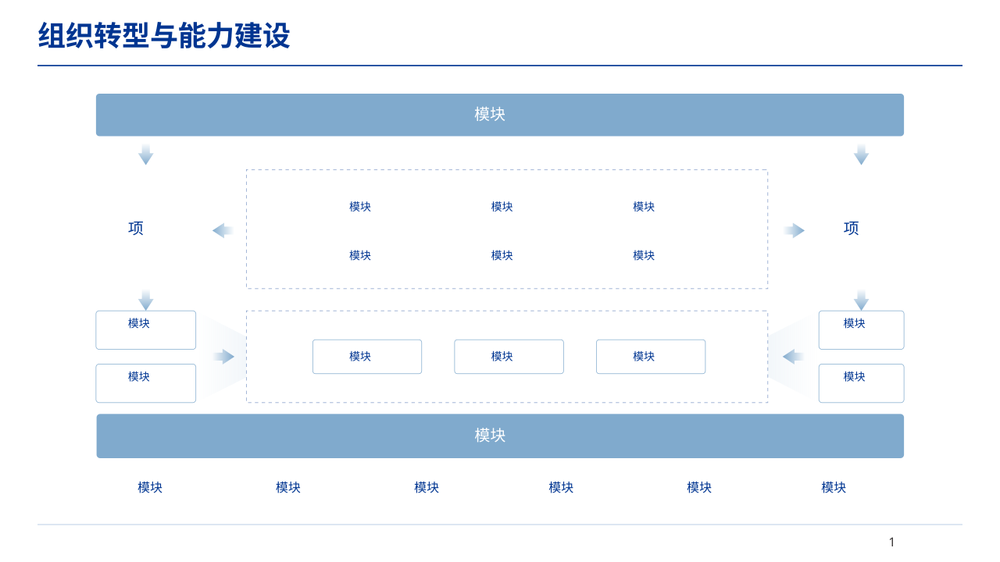

# 组织转型与能力建设

来源为蓝色逻辑架构图.pptx#15。

## 结构与适用场景

传统组织→多种环境变化→节能/增效两翼→新组织能力底座；中心改造项目

组织转型诊断与路径

两翼语义为降本/增效，底部新能力是结果；箭头方向避免误作循环

固定节点、圆弧、扇区、分面和连接表达定性关系。数量比较、趋势或占比使用数据驱动图表，源页中已登记的微图槽可接收实际数据。

## 预览



## 调用

将下列完整page对象放入schema_version=1、template_id=business-blue-v1的pages数组，替换各节点内容。nodes键对应原文本框或已明确拆分的语义分段，字段角色及source_ref、segment见下表。

```json
{
  "id": "architecture-15",
  "family": "source-architecture",
  "variant": "page-15",
  "content": {
    "title": "组织转型与能力建设",
    "nodes": {
      "shape_192": "模块",
      "shape_194": "项",
      "shape_195": "项",
      "shape_196": "模块",
      "shape_198": "模块",
      "shape_199": "模块",
      "shape_204": "模块",
      "shape_206": "模块",
      "shape_207": "模块",
      "shape_210": "模块",
      "shape_211": "模块",
      "shape_213": "模块",
      "shape_214": "模块",
      "shape_215": "模块",
      "shape_217": "模块",
      "shape_218": "模块",
      "shape_219": "模块",
      "shape_220": "模块",
      "shape_221": "模块",
      "shape_223": "模块",
      "shape_224": "模块",
      "shape_225": "模块",
      "shape_226": "模块"
    }
  },
  "config": {
    "show_source": true,
    "show_page_number": true
  }
}
```

config支持show_source、show_page_number、image_fit与image_position。image_fit可选contain或cover，image_position为xMin/xMid/xMax与YMin/YMid/YMax组合的九个焦点，默认为xMidYMid。字体、颜色、全局区和固定字阶取自tokens，节点数与连接结构由variant确定。

## 字段合同

每个业务节点required=true、min=1，max按具体框体登记。字符按规范化后的Unicode码点计数，空格标点换行均计入。build会以实际字体测量宽高，字符数通过后仍可能需要调整文字。

| 字段 | 节点角色与源标签 | 最短/最长 | 字阶 | 框体px | 原框引用 | 分段 | 旋转° | 垂直锚点 |
|---|---|---|---|---|---|---|---|---|
| nodes.shape_192 | 上中节点，源标签“传统旧组织现状” | 1/14 | compactBody | [573.2619, 134.7356, 133.4762, 25.0] | slide:192 |  | 0.0 | t |
| nodes.shape_194 | 中左节点，源标签“节能” | 1/4 | compactBody | [167.7349, 281.0778, 38.1407, 25.0] | slide:194 |  | 0.0 | t |
| nodes.shape_195 | 中右节点，源标签“增效” | 1/4 | compactBody | [1083.5696, 281.0778, 38.1407, 25.0] | slide:195 |  | 0.0 | t |
| nodes.shape_196 | 上中节点，源标签“用户消费计划” | 1/12 | diagramCompact | [793.5869, 256.5028, 79.2011, 17.5] | slide:196 |  | 0.0 | t |
| nodes.shape_198 | 上中节点，源标签“产业机构变化” | 1/12 | diagramCompact | [612.0236, 256.5028, 79.2011, 17.5] | slide:198 |  | 0.0 | t |
| nodes.shape_199 | 上中节点，源标签“信息技术变化” | 1/12 | diagramCompact | [430.4494, 256.5028, 79.2011, 17.5] | slide:199 |  | 0.0 | t |
| nodes.shape_204 | 中中节点，源标签“团队能力变化” | 1/12 | diagramCompact | [793.5869, 318.9595, 79.2011, 17.5] | slide:204 |  | 0.0 | t |
| nodes.shape_206 | 中中节点，源标签“产能品类变化” | 1/12 | diagramCompact | [612.0236, 318.9595, 79.2011, 17.5] | slide:206 |  | 0.0 | t |
| nodes.shape_207 | 中中节点，源标签“营销模式变化” | 1/12 | diagramCompact | [430.4494, 318.9595, 79.2011, 17.5] | slide:207 |  | 0.0 | t |
| nodes.shape_210 | 中右节点，源标签“产品及品类 / 竞争力升级” | 1/10 | diagramCompact | [1069.6359, 474.1934, 66.0082, 33.8702] | slide:210 |  | 0.0 | t |
| nodes.shape_211 | 中右节点，源标签“营销内容 / 价值升级” | 1/8 | diagramCompact | [1076.2378, 405.9192, 52.8044, 33.8702] | slide:211 |  | 0.0 | t |
| nodes.shape_213 | 中左节点，源标签“组织内部结构 / 及人效升级” | 1/12 | diagramCompact | [147.1993, 474.1934, 79.2011, 33.8702] | slide:213 |  | 0.0 | t |
| nodes.shape_214 | 中左节点，源标签“组织内部信息化 / 数据升级” | 1/14 | diagramCompact | [140.5974, 405.9192, 92.4049, 33.8702] | slide:214 |  | 0.0 | t |
| nodes.shape_215 | 中中节点，源标签“新商业项目运营规划” | 1/18 | diagramCompact | [410.6437, 448.2414, 118.8016, 17.5] | slide:215 |  | 0.0 | t |
| nodes.shape_217 | 中中节点，源标签“新消费品牌孵化” | 1/14 | diagramCompact | [605.4217, 448.2414, 92.4049, 17.5] | slide:217 |  | 0.0 | t |
| nodes.shape_218 | 中中节点，源标签“商业架构顶层设计” | 1/16 | diagramCompact | [780.3831, 448.2414, 105.6087, 17.5] | slide:218 |  | 0.0 | t |
| nodes.shape_219 | 下中节点，源标签“先进组织的新生产力” | 1/19 | compactBody | [554.5565, 546.1673, 171.606, 25.0] | slide:219 |  | 0.0 | t |
| nodes.shape_220 | 下中节点，源标签“组织关系迭代” | 1/14 | caption | [503.6695, 614.2061, 105.6087, 21.1239] | slide:220 |  | 0.0 | t |
| nodes.shape_221 | 下中节点，源标签“用户关系迭代” | 1/14 | caption | [675.7984, 614.2061, 105.6087, 21.1239] | slide:221 |  | 0.0 | t |
| nodes.shape_223 | 下右节点，源标签“交叉综合创新” | 1/14 | caption | [852.6554, 614.2061, 105.6087, 21.1239] | slide:223 |  | 0.0 | t |
| nodes.shape_224 | 下右节点，源标签“生产资源重构” | 1/14 | caption | [1024.7843, 614.2061, 105.6087, 21.1239] | slide:224 |  | 0.0 | t |
| nodes.shape_225 | 下左节点，源标签“团队能力迭代” | 1/14 | caption | [326.4639, 614.2061, 105.6087, 21.1239] | slide:225 |  | 0.0 | t |
| nodes.shape_226 | 下左节点，源标签“信息技术赋能” | 1/14 | caption | [149.6069, 614.2061, 105.6087, 21.1239] | slide:226 |  | 0.0 | t |

全局title必填、2至32码点，使用统一标题框。section_name可选0至24码点，source可选0至64码点。所有可编辑文本通过独立原生carrier导出，页码为派生文字。

## 来源处理

原生PPTX源件保存于用户材料目录，分发包仅含用户资产衍生的几何、字段和说明。原始逐框文字、源框与标准化框在page-catalog.json的variant.fields中。

源标题引用为`slide:278`，原文为“组织现状”。模板默认标题依据真实结构设置。

密集全景中的diagramCompact为14px、diagramMicro为12px。适用于体系概览或附录局部标签，现场关键结论用统一标题与正常正文字阶表达。

源画布边界裁切已烘焙为可编辑Bezier几何，3D顶面、侧面与前面通过tokens配色的相对明暗保留。

