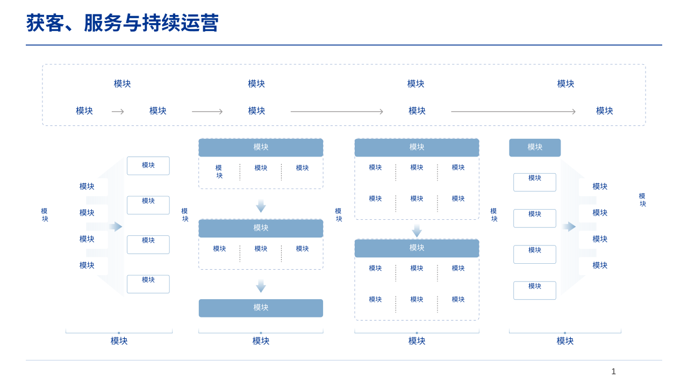

# 获客、服务与持续运营

来源为蓝色逻辑架构图.pptx#16。

## 结构与适用场景

上方用户旅程；下方公域入口、创意生产/转化、教务教学/学员服务、持续运营4区；内部向下与横向流

拉新-服务-留存运营链

场景、系统、渠道、结果的角色需独立；可拆旅程和能力两页

固定节点、圆弧、扇区、分面和连接表达定性关系。数量比较、趋势或占比使用数据驱动图表，源页中已登记的微图槽可接收实际数据。

## 预览



## 调用

将下列完整page对象放入schema_version=1、template_id=business-blue-v1的pages数组，替换各节点内容。nodes键对应原文本框或已明确拆分的语义分段，字段角色及source_ref、segment见下表。

```json
{
  "id": "architecture-16",
  "family": "source-architecture",
  "variant": "page-16",
  "content": {
    "title": "获客、服务与持续运营",
    "nodes": {
      "shape_294": "模块",
      "shape_295": "模块",
      "shape_296": "模块",
      "shape_297": "模块",
      "shape_298": "模块",
      "shape_299": "模块",
      "shape_300": "模块",
      "shape_301": "模块",
      "shape_302": "模块",
      "shape_303": "模块",
      "shape_304": "模块",
      "shape_305": "模块",
      "shape_306": "模块",
      "shape_307": "模块",
      "shape_308": "模块",
      "shape_309": "模块",
      "shape_310": "模块",
      "shape_311": "模块",
      "shape_312": "模块",
      "shape_313": "模块",
      "shape_314": "模块",
      "shape_315": "模块",
      "shape_316": "模块",
      "shape_317": "模块",
      "shape_318": "模块",
      "shape_319": "模块",
      "shape_320": "模块",
      "shape_321": "模块",
      "shape_322": "模块",
      "shape_323": "模块",
      "shape_324": "模块",
      "shape_325": "模块",
      "shape_326": "模块",
      "shape_327": "模块",
      "shape_328": "模块",
      "shape_329": "模块",
      "shape_330": "模块",
      "shape_331": "模块",
      "shape_332": "模块",
      "shape_335": "模块",
      "shape_344": "模块",
      "shape_345": "模块",
      "shape_349": "模块",
      "shape_350": "模块",
      "shape_351": "模块",
      "shape_358": "模块",
      "shape_359": "模块",
      "shape_360": "模块",
      "shape_363": "模块",
      "shape_364": "模块",
      "shape_365": "模块",
      "shape_368": "模块",
      "shape_369": "模块",
      "shape_370": "模块",
      "shape_374": "模块",
      "shape_375": "模块",
      "shape_376": "模块",
      "shape_377": "模块"
    }
  },
  "config": {
    "show_source": true,
    "show_page_number": true
  }
}
```

config支持show_source、show_page_number、image_fit与image_position。image_fit可选contain或cover，image_position为xMin/xMid/xMax与YMin/YMid/YMax组合的九个焦点，默认为xMidYMid。字体、颜色、全局区和固定字阶取自tokens，节点数与连接结构由variant确定。

## 字段合同

每个业务节点required=true、min=1，max按具体框体登记。字符按规范化后的Unicode码点计数，空格标点换行均计入。build会以实际字体测量宽高，字符数通过后仍可能需要调整文字。

| 字段 | 节点角色与源标签 | 最短/最长 | 字阶 | 框体px | 原框引用 | 分段 | 旋转° | 垂直锚点 |
|---|---|---|---|---|---|---|---|---|
| nodes.shape_294 | 上左节点，源标签“传播裂变” | 1/8 | caption | [196.3852, 147.8427, 62.2809, 20.0] | slide:294 |  | 0.0 | t |
| nodes.shape_295 | 上中节点，源标签“网校管理” | 1/8 | caption | [445.8978, 147.8427, 62.2809, 20.0] | slide:295 |  | 0.0 | t |
| nodes.shape_296 | 上中节点，源标签“互动教学” | 1/8 | caption | [742.3735, 147.8427, 62.2809, 20.0] | slide:296 |  | 0.0 | t |
| nodes.shape_297 | 上右节点，源标签“用户运营” | 1/8 | caption | [1021.3339, 147.8427, 62.2809, 20.0] | slide:297 |  | 0.0 | t |
| nodes.shape_298 | 中左节点，源标签“个人微信” | 1/8 | diagramCompact | [136.1649, 340.4404, 50.9581, 17.5] | slide:298 |  | 0.0 | t |
| nodes.shape_299 | 中左节点，源标签“机构公众号” | 1/10 | diagramCompact | [129.7938, 389.5061, 63.7002, 17.5] | slide:299 |  | 0.0 | t |
| nodes.shape_300 | 中左节点，源标签“微信社群” | 1/8 | diagramCompact | [136.1649, 438.5612, 50.9581, 17.5] | slide:300 |  | 0.0 | t |
| nodes.shape_301 | 下左节点，源标签“微信朋友圈” | 1/10 | diagramCompact | [129.7938, 487.6269, 63.7002, 17.5] | slide:301 |  | 0.0 | t |
| nodes.shape_302 | 中右节点，源标签“持续运营” | 1/8 | diagramCompact | [1090.7744, 340.4404, 50.9581, 17.5] | slide:302 |  | 0.0 | t |
| nodes.shape_303 | 中右节点，源标签“增购复购” | 1/8 | diagramCompact | [1090.7744, 389.5061, 50.9581, 17.5] | slide:303 |  | 0.0 | t |
| nodes.shape_304 | 中右节点，源标签“口碑传播” | 1/8 | diagramCompact | [1090.7744, 438.5612, 50.9581, 17.5] | slide:304 |  | 0.0 | t |
| nodes.shape_305 | 下右节点，源标签“老带新裂变” | 1/10 | diagramCompact | [1084.4033, 487.6269, 63.7002, 17.5] | slide:305 |  | 0.0 | t |
| nodes.shape_306 | 中左节点，源标签“公域流量” | 1/10 | diagramMicro | [77.1253, 387.522, 13.44, 74.7392] | slide:306 |  | 0.0 | t |
| nodes.shape_307 | 中右节点，源标签“高质量私域流量” | 1/18 | diagramMicro | [1189.4347, 359.4934, 13.44, 130.7857] | slide:307 |  | 0.0 | t |
| nodes.shape_308 | 中左节点，源标签“成交变现” | 1/10 | diagramMicro | [338.087, 387.522, 13.44, 74.7392] | slide:308 |  | 0.0 | t |
| nodes.shape_309 | 中中节点，源标签“高效管理” | 1/10 | diagramMicro | [624.0493, 387.522, 13.44, 74.7392] | slide:309 |  | 0.0 | t |
| nodes.shape_310 | 中右节点，源标签“口碑提升” | 1/10 | diagramMicro | [913.071, 387.522, 13.44, 74.7392] | slide:310 |  | 0.0 | t |
| nodes.shape_311 | 上左节点，源标签“流量入口” | 1/8 | caption | [125.7672, 198.3066, 62.2809, 20.0] | slide:311 |  | 0.0 | t |
| nodes.shape_312 | 上左节点，源标签“转化裂变” | 1/8 | caption | [262.6191, 198.3066, 62.2809, 20.0] | slide:312 |  | 0.0 | t |
| nodes.shape_313 | 上中节点，源标签“教务教学管理” | 1/12 | caption | [430.685, 198.3066, 93.4214, 20.0] | slide:313 |  | 0.0 | t |
| nodes.shape_314 | 上中节点，源标签“学生服务” | 1/8 | caption | [744.8336, 198.3066, 62.2809, 20.0] | slide:314 |  | 0.0 | t |
| nodes.shape_315 | 上右节点，源标签“转化留存” | 1/8 | caption | [1093.6761, 198.3066, 62.2809, 20.0] | slide:315 |  | 0.0 | t |
| nodes.shape_316 | 中左节点，源标签“机构官网” | 1/8 | diagramMicro | [253.2412, 301.745, 45.2914, 15.0] | slide:316 |  | 0.0 | t |
| nodes.shape_317 | 中左节点，源标签“营销 / 裂变模版” | 1/8 | diagramMicro | [253.2412, 368.3141, 45.2914, 29.0483] | slide:317 |  | 0.0 | t |
| nodes.shape_318 | 中左节点，源标签“线上 / 营销活动” | 1/8 | diagramMicro | [253.2412, 441.9074, 45.2914, 29.0483] | slide:318 |  | 0.0 | t |
| nodes.shape_319 | 下左节点，源标签“机构 / 电子名片” | 1/8 | diagramMicro | [253.2412, 515.5006, 45.2914, 29.0483] | slide:319 |  | 0.0 | t |
| nodes.shape_320 | 中右节点，源标签“线索 / 信息获取” | 1/8 | diagramMicro | [972.3524, 325.5564, 45.2914, 29.0483] | slide:320 |  | 0.0 | t |
| nodes.shape_321 | 中右节点，源标签“线索 / 数据分析” | 1/8 | diagramMicro | [972.3524, 392.8417, 45.2914, 29.0483] | slide:321 |  | 0.0 | t |
| nodes.shape_322 | 中右节点，源标签“线索 / 维护跟进” | 1/8 | diagramMicro | [972.3524, 460.127, 45.2914, 29.0483] | slide:322 |  | 0.0 | t |
| nodes.shape_323 | 下右节点，源标签“线索 / 状态变更” | 1/8 | diagramMicro | [972.3524, 527.4122, 45.2914, 29.0483] | slide:323 |  | 0.0 | t |
| nodes.shape_324 | 下左节点，源标签“营销方案、模版” | 1/16 | caption | [162.1223, 627.6147, 118.8951, 20.3853] | slide:324 |  | 0.0 | t |
| nodes.shape_325 | 下中节点，源标签“数据服务支持” | 1/14 | caption | [434.4909, 627.6147, 101.9161, 20.3853] | slide:325 |  | 0.0 | t |
| nodes.shape_326 | 下中节点，源标签“海量精选课程” | 1/14 | caption | [724.6585, 627.6147, 101.9161, 20.3853] | slide:326 |  | 0.0 | t |
| nodes.shape_327 | 下右节点，源标签“KOL分析复盘” | 1/14 | caption | [998.9616, 627.6147, 104.9229, 20.3853] | slide:327 |  | 0.0 | t |
| nodes.shape_328 | 上中节点，源标签“创课入班” | 1/8 | diagramCompact | [457.1471, 266.8471, 56.6142, 17.5] | slide:328 |  | 0.0 | t |
| nodes.shape_329 | 上中节点，源标签“高清直播/录播系列课” | 1/21 | diagramCompact | [708.7413, 266.8471, 133.761, 17.5] | slide:329 |  | 0.0 | t |
| nodes.shape_330 | 中中节点，源标签“传统旧组织现状” | 1/15 | diagramCompact | [435.9102, 417.5451, 99.0775, 17.5] | slide:330 |  | 0.0 | t |
| nodes.shape_331 | 下中节点，源标签“学生服务” | 1/8 | diagramCompact | [457.1471, 566.1299, 56.6142, 17.5] | slide:331 |  | 0.0 | t |
| nodes.shape_332 | 中中节点，源标签“课后讨论学习” | 1/13 | diagramCompact | [733.1533, 454.6887, 84.9266, 17.5] | slide:332 |  | 0.0 | t |
| nodes.shape_335 | 中左节点，源标签“开班 / 报课” | 1/8 | diagramMicro | [397.0319, 306.8427, 22.6457, 31.4243] | slide:335 |  | 0.0 | t |
| nodes.shape_344 | 中中节点，源标签“课程 / 资源管理” | 1/16 | diagramMicro | [462.8032, 306.8427, 45.2914, 31.4243] | slide:344 |  | 0.0 | t |
| nodes.shape_345 | 中中节点，源标签“学生 / 入学管理” | 1/16 | diagramMicro | [539.8974, 306.8427, 45.2914, 31.4243] | slide:345 |  | 0.0 | t |
| nodes.shape_349 | 中左节点，源标签“日活 / 学生数” | 1/12 | diagramMicro | [391.3652, 457.5407, 33.9685, 31.4243] | slide:349 |  | 0.0 | t |
| nodes.shape_350 | 中中节点，源标签“直播/录播 / 学习时长” | 1/18 | diagramMicro | [460.238, 457.5407, 50.4219, 31.4243] | slide:350 |  | 0.0 | t |
| nodes.shape_351 | 中中节点，源标签“作业/考试 / 成绩” | 1/18 | diagramMicro | [537.3322, 457.5407, 50.4219, 31.4243] | slide:351 |  | 0.0 | t |
| nodes.shape_358 | 中中节点，源标签“PPT、人像 / 双屏目录” | 1/20 | diagramMicro | [669.821, 305.9491, 56.9717, 31.4243] | slide:358 |  | 0.0 | t |
| nodes.shape_359 | 中中节点，源标签“直播 / 互动答疑” | 1/16 | diagramMicro | [752.7606, 305.9491, 45.2914, 31.4243] | slide:359 |  | 0.0 | t |
| nodes.shape_360 | 中中节点，源标签“师生 / 在线讨论” | 1/16 | diagramMicro | [829.8548, 305.9491, 45.2914, 31.4243] | slide:360 |  | 0.0 | t |
| nodes.shape_363 | 中中节点，源标签“师生 / 语音连麦” | 1/16 | diagramMicro | [675.6664, 364.1193, 45.2914, 31.4243] | slide:363 |  | 0.0 | t |
| nodes.shape_364 | 中中节点，源标签“白板 / 涂鸦工具” | 1/16 | diagramMicro | [752.7606, 364.1193, 45.2914, 31.4243] | slide:364 |  | 0.0 | t |
| nodes.shape_365 | 中中节点，源标签“课件 / 资料上传” | 1/16 | diagramMicro | [829.8548, 364.1193, 45.2914, 31.4243] | slide:365 |  | 0.0 | t |
| nodes.shape_368 | 下中节点，源标签“班级 / 互动交流” | 1/16 | diagramMicro | [675.6664, 493.9798, 45.2914, 31.4243] | slide:368 |  | 0.0 | t |
| nodes.shape_369 | 下中节点，源标签“倍速 / 高清展示” | 1/16 | diagramMicro | [752.7606, 493.9798, 45.2914, 31.4243] | slide:369 |  | 0.0 | t |
| nodes.shape_370 | 下中节点，源标签“课后 / 精准刷题” | 1/16 | diagramMicro | [829.8548, 493.9798, 45.2914, 31.4243] | slide:370 |  | 0.0 | t |
| nodes.shape_374 | 下中节点，源标签“教学 / 资料下载” | 1/16 | diagramMicro | [675.6664, 552.1606, 45.2914, 31.4243] | slide:374 |  | 0.0 | t |
| nodes.shape_375 | 下中节点，源标签“作业 / 自动批改” | 1/16 | diagramMicro | [752.7606, 552.1606, 45.2914, 31.4243] | slide:375 |  | 0.0 | t |
| nodes.shape_376 | 下中节点，源标签“在线 / 考试报读” | 1/16 | diagramMicro | [829.8548, 552.1606, 45.2914, 31.4243] | slide:376 |  | 0.0 | t |
| nodes.shape_377 | 上右节点，源标签“线索维护管理” | 1/13 | diagramCompact | [952.8817, 266.8471, 84.9266, 17.5] | slide:377 |  | 0.0 | t |

全局title必填、2至32码点，使用统一标题框。section_name可选0至24码点，source可选0至64码点。所有可编辑文本通过独立原生carrier导出，页码为派生文字。

## 来源处理

原生PPTX源件保存于用户材料目录，分发包仅含用户资产衍生的几何、字段和说明。原始逐框文字、源框与标准化框在page-catalog.json的variant.fields中。

源标题引用为`slide:278`，原文为“教育机构私域裂变流量”。模板默认标题依据真实结构设置。

密集全景中的diagramCompact为14px、diagramMicro为12px。适用于体系概览或附录局部标签，现场关键结论用统一标题与正常正文字阶表达。

源画布边界裁切已烘焙为可编辑Bezier几何，3D顶面、侧面与前面通过tokens配色的相对明暗保留。

