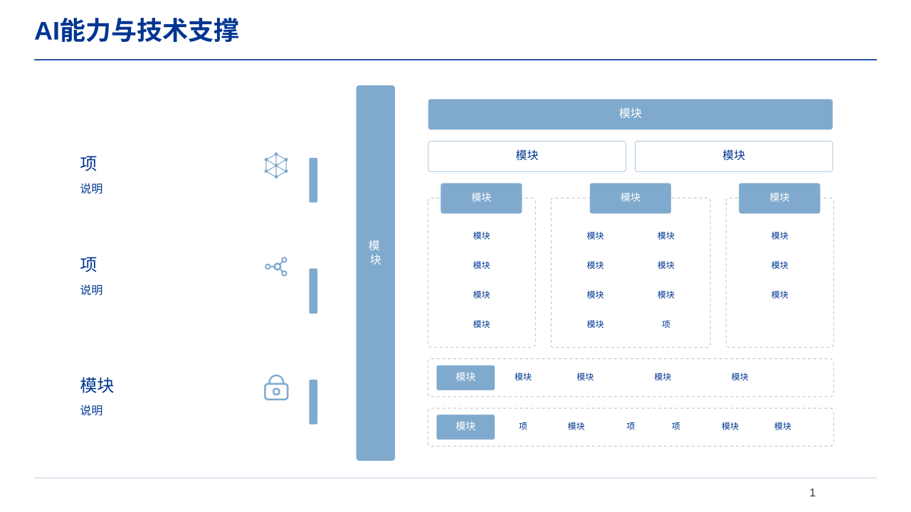

# AI能力与技术支撑

来源为蓝色逻辑架构图.pptx#17。

## 结构与适用场景

左全面/开放/隐私3原则；右联邦学习、多模态/图学习、图像/文本/语音视频3能力、应用模型、算法底座

AI能力分层地图

AI模型与能力类别按材料填写；不能借源模板宣称本报告已具备联邦学习等

固定节点、圆弧、扇区、分面和连接表达定性关系。数量比较、趋势或占比使用数据驱动图表，源页中已登记的微图槽可接收实际数据。

## 预览



## 调用

将下列完整page对象放入schema_version=1、template_id=business-blue-v1的pages数组，替换各节点内容。nodes键对应原文本框或已明确拆分的语义分段，字段角色及source_ref、segment见下表。

```json
{
  "id": "architecture-17",
  "family": "source-architecture",
  "variant": "page-17",
  "content": {
    "title": "AI能力与技术支撑",
    "nodes": {
      "shape_256": "项",
      "shape_258": "说明",
      "shape_259": "项",
      "shape_261": "说明",
      "shape_262": "模块",
      "shape_264": "说明",
      "shape_265": "模块",
      "shape_267": "模块",
      "shape_268": "模块",
      "shape_269": "模块",
      "shape_270": "模块",
      "shape_271": "模块",
      "shape_272": "模块",
      "shape_274": "模块",
      "shape_275": "模块",
      "shape_277": "模块",
      "shape_279": "模块",
      "shape_282": "模块",
      "shape_283": "模块",
      "shape_333": "模块",
      "shape_334": "模块",
      "shape_336": "模块",
      "shape_337": "模块",
      "shape_338": "模块",
      "shape_339": "模块",
      "shape_340": "模块",
      "shape_341": "项",
      "shape_342": "模块",
      "shape_343": "模块",
      "shape_346": "模块",
      "shape_352": "模块",
      "shape_353": "模块",
      "shape_354": "模块",
      "shape_355": "模块",
      "shape_356": "模块",
      "shape_357": "模块",
      "shape_378": "项",
      "shape_379": "项",
      "shape_380": "模块",
      "shape_381": "项"
    }
  },
  "config": {
    "show_source": true,
    "show_page_number": true
  }
}
```

config支持show_source、show_page_number、image_fit与image_position。image_fit可选contain或cover，image_position为xMin/xMid/xMax与YMin/YMid/YMax组合的九个焦点，默认为xMidYMid。字体、颜色、全局区和固定字阶取自tokens，节点数与连接结构由variant确定。

## 字段合同

每个业务节点required=true、min=1，max按具体框体登记。字符按规范化后的Unicode码点计数，空格标点换行均计入。build会以实际字体测量宽高，字符数通过后仍可能需要调整文字。

| 字段 | 节点角色与源标签 | 最短/最长 | 字阶 | 框体px | 原框引用 | 分段 | 旋转° | 垂直锚点 |
|---|---|---|---|---|---|---|---|---|
| nodes.shape_256 | 上左节点，源标签“全面” | 1/4 | body | [112.3503, 217.5966, 44.5424, 30.0] | slide:256 |  | 0.0 | t |
| nodes.shape_258 | 上左节点，源标签“包括处理多模态数据的算法模型” | 1/30 | caption | [112.3503, 256.9521, 220.0754, 20.0] | slide:258 |  | 0.0 | t |
| nodes.shape_259 | 中左节点，源标签“开放” | 1/4 | body | [112.3503, 359.6401, 44.5424, 30.0] | slide:259 |  | 0.0 | t |
| nodes.shape_261 | 中左节点，源标签“直接赋能给业务应用开发者，支持模型开发 / 者向平台输出模型” | 1/82 | caption | [112.3503, 399.5626, 298.6717, 43.6278] | slide:261 |  | 0.0 | t |
| nodes.shape_262 | 下左节点，源标签“隐私学习” | 1/8 | body | [112.3503, 529.4812, 89.0751, 30.0] | slide:262 |  | 0.0 | t |
| nodes.shape_264 | 下左节点，源标签“支持联邦学习和同态加密等技术” | 1/30 | caption | [112.3503, 568.8367, 220.0754, 20.0] | slide:264 |  | 0.0 | t |
| nodes.shape_265 | 中中节点，源标签“算 / 法 / 层” | 1/12 | caption | [515.6354, 336.8452, 24.3047, 94.3194] | slide:265 |  | 0.0 | t |
| nodes.shape_267 | 上右节点，源标签“联邦学习” | 1/8 | caption | [854.3933, 150.8695, 62.8731, 20.0] | slide:267 |  | 0.0 | t |
| nodes.shape_268 | 上右节点，源标签“文本AI能力” | 1/10 | diagramCompact | [851.202, 270.1647, 69.2655, 17.5] | slide:268 |  | 0.0 | t |
| nodes.shape_269 | 上右节点，源标签“语音视频能力” | 1/13 | diagramCompact | [1054.0851, 270.1647, 82.5271, 17.5] | slide:269 |  | 0.0 | t |
| nodes.shape_270 | 上中节点，源标签“图像AI能力” | 1/10 | diagramCompact | [641.693, 270.1647, 69.2655, 17.5] | slide:270 |  | 0.0 | t |
| nodes.shape_271 | 下中节点，源标签“应用模型” | 1/8 | diagramCompact | [626.7579, 522.494, 55.0213, 17.5] | slide:271 |  | 0.0 | t |
| nodes.shape_272 | 下中节点，源标签“基础算法” | 1/8 | diagramCompact | [626.7579, 591.8957, 55.0213, 17.5] | slide:272 |  | 0.0 | t |
| nodes.shape_274 | 上中节点，源标签“多模态学习” | 1/10 | caption | [701.2386, 209.8994, 78.5963, 20.0] | slide:274 |  | 0.0 | t |
| nodes.shape_275 | 上右节点，源标签“图分析” | 1/6 | caption | [1007.5578, 209.8994, 47.1597, 20.0] | slide:275 |  | 0.0 | t |
| nodes.shape_277 | 中中节点，源标签“人脸识别” | 1/8 | diagramMicro | [653.067, 325.2587, 47.1597, 15.0] | slide:277 |  | 0.0 | t |
| nodes.shape_279 | 中中节点，源标签“图像识别” | 1/8 | diagramMicro | [653.067, 366.7752, 47.1597, 15.0] | slide:279 |  | 0.0 | t |
| nodes.shape_282 | 中中节点，源标签“物体检测” | 1/8 | diagramMicro | [653.067, 408.282, 47.1597, 15.0] | slide:282 |  | 0.0 | t |
| nodes.shape_283 | 中中节点，源标签“通用OCR识别” | 1/13 | diagramMicro | [639.8054, 449.7985, 73.6828, 15.0] | slide:283 |  | 0.0 | t |
| nodes.shape_333 | 中中节点，源标签“句法分析” | 1/8 | diagramMicro | [812.9644, 325.2587, 47.1597, 15.0] | slide:333 |  | 0.0 | t |
| nodes.shape_334 | 中中节点，源标签“词法分析” | 1/8 | diagramMicro | [812.9644, 366.7752, 47.1597, 15.0] | slide:334 |  | 0.0 | t |
| nodes.shape_336 | 中中节点，源标签“文档翻译” | 1/8 | diagramMicro | [812.9644, 408.282, 47.1597, 15.0] | slide:336 |  | 0.0 | t |
| nodes.shape_337 | 中中节点，源标签“语义分析” | 1/8 | diagramMicro | [812.9644, 449.7985, 47.1597, 15.0] | slide:337 |  | 0.0 | t |
| nodes.shape_338 | 中右节点，源标签“词性标注” | 1/8 | diagramMicro | [912.207, 325.2587, 47.1597, 15.0] | slide:338 |  | 0.0 | t |
| nodes.shape_339 | 中右节点，源标签“关系抽取” | 1/8 | diagramMicro | [912.207, 366.7752, 47.1597, 15.0] | slide:339 |  | 0.0 | t |
| nodes.shape_340 | 中右节点，源标签“拼写校正” | 1/8 | diagramMicro | [912.207, 408.282, 47.1597, 15.0] | slide:340 |  | 0.0 | t |
| nodes.shape_341 | 中右节点，源标签“NER” | 1/4 | diagramMicro | [923.4156, 449.7985, 24.7231, 15.0] | slide:341 |  | 0.0 | t |
| nodes.shape_342 | 中右节点，源标签“语音识别” | 1/8 | diagramMicro | [1072.0947, 325.2587, 47.1597, 15.0] | slide:342 |  | 0.0 | t |
| nodes.shape_343 | 中右节点，源标签“视频分析” | 1/8 | diagramMicro | [1072.0947, 366.7752, 47.1597, 15.0] | slide:343 |  | 0.0 | t |
| nodes.shape_346 | 中右节点，源标签“语音合成” | 1/8 | diagramMicro | [1072.0947, 408.282, 47.1597, 15.0] | slide:346 |  | 0.0 | t |
| nodes.shape_352 | 下中节点，源标签“资产沉淀” | 1/7 | diagramMicro | [714.0623, 523.7488, 41.9154, 15.0] | slide:352 |  | 0.0 | t |
| nodes.shape_353 | 下中节点，源标签“计算机视觉” | 1/9 | diagramMicro | [796.0737, 523.7488, 52.3943, 15.0] | slide:353 |  | 0.0 | t |
| nodes.shape_354 | 下右节点，源标签“音视频模型” | 1/9 | diagramMicro | [905.046, 523.7488, 52.3943, 15.0] | slide:354 |  | 0.0 | t |
| nodes.shape_355 | 下右节点，源标签“表单预测” | 1/7 | diagramMicro | [1018.601, 523.7488, 41.9154, 15.0] | slide:355 |  | 0.0 | t |
| nodes.shape_356 | 下右节点，源标签“Transformer” | 1/12 | diagramMicro | [992.7881, 593.1506, 66.3174, 15.0] | slide:356 |  | 0.0 | t |
| nodes.shape_357 | 下右节点，源标签“迁移学习” | 1/7 | diagramMicro | [1078.9249, 593.1506, 41.9154, 15.0] | slide:357 |  | 0.0 | t |
| nodes.shape_378 | 下右节点，源标签“CNN” | 1/4 | diagramMicro | [937.7766, 593.1506, 23.9058, 15.0] | slide:378 |  | 0.0 | t |
| nodes.shape_379 | 下右节点，源标签“CNN” | 1/4 | diagramMicro | [874.3197, 593.1506, 23.9058, 15.0] | slide:379 |  | 0.0 | t |
| nodes.shape_380 | 下中节点，源标签“集成学习” | 1/7 | diagramMicro | [788.6597, 593.1506, 41.9154, 15.0] | slide:380 |  | 0.0 | t |
| nodes.shape_381 | 下中节点，源标签“SVM” | 1/4 | diagramMicro | [722.6633, 593.1506, 24.7231, 15.0] | slide:381 |  | 0.0 | t |

全局title必填、2至32码点，使用统一标题框。section_name可选0至24码点，source可选0至64码点。所有可编辑文本通过独立原生carrier导出，页码为派生文字。

## 来源处理

原生PPTX源件保存于用户材料目录，分发包仅含用户资产衍生的几何、字段和说明。原始逐框文字、源框与标准化框在page-catalog.json的variant.fields中。

源标题引用为`slide:278`，原文为“AI中台架构—算法层”。模板默认标题依据真实结构设置。

密集全景中的diagramCompact为14px、diagramMicro为12px。适用于体系概览或附录局部标签，现场关键结论用统一标题与正常正文字阶表达。

源画布边界裁切已烘焙为可编辑Bezier几何，3D顶面、侧面与前面通过tokens配色的相对明暗保留。

