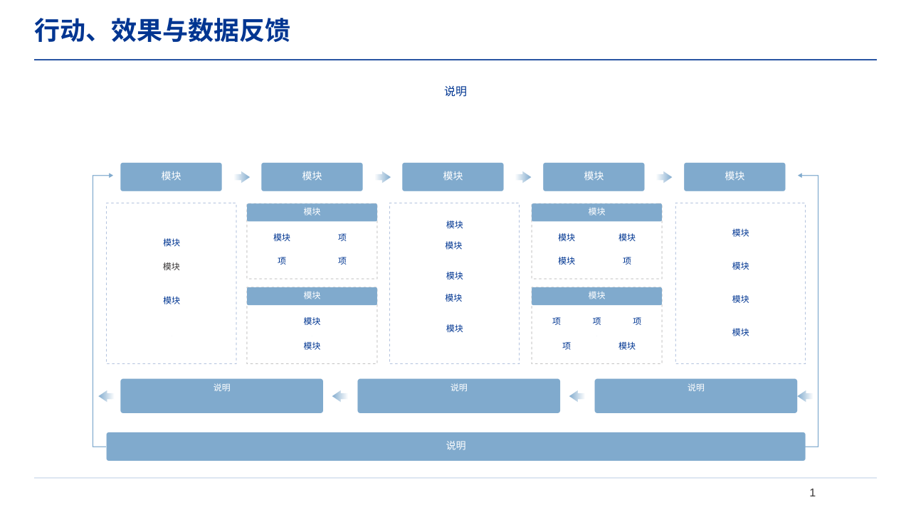

# 行动、效果与数据反馈

来源为蓝色逻辑架构图.pptx#18。

## 结构与适用场景

创意→定向→投放→转化→线索5阶段；底部全域数据/跨方资源/转化链3块向左回流；外部总回路

动作-效果-数据反馈闭环

实际闭环箭头保留；阶段可重新命名但必须有工作流程来源

固定节点、圆弧、扇区、分面和连接表达定性关系。数量比较、趋势或占比使用数据驱动图表，源页中已登记的微图槽可接收实际数据。

## 预览



## 调用

将下列完整page对象放入schema_version=1、template_id=business-blue-v1的pages数组，替换各节点内容。nodes键对应原文本框或已明确拆分的语义分段，字段角色及source_ref、segment见下表。

```json
{
  "id": "architecture-18",
  "family": "source-architecture",
  "variant": "page-18",
  "content": {
    "title": "行动、效果与数据反馈",
    "nodes": {
      "shape_280": "说明",
      "shape_303": "模块",
      "shape_304": "模块",
      "shape_305": "模块",
      "shape_306": "模块",
      "shape_307": "模块",
      "shape_308": "模块",
      "shape_309": "模块",
      "shape_310": "模块",
      "shape_311": "模块",
      "shape_312": "说明",
      "shape_314": "模块",
      "shape_315": "模块",
      "shape_316": "模块",
      "shape_317": "模块",
      "shape_318": "模块",
      "shape_319": "模块",
      "shape_320": "模块",
      "shape_321": "模块",
      "shape_322": "模块",
      "shape_325": "说明",
      "shape_326": "说明",
      "shape_329": "说明",
      "shape_330": "模块",
      "shape_331": "项",
      "shape_332": "项",
      "shape_335": "项",
      "shape_344": "模块",
      "shape_345": "模块",
      "shape_347": "模块",
      "shape_348": "模块",
      "shape_350": "模块",
      "shape_358": "模块",
      "shape_359": "模块",
      "shape_360": "模块",
      "shape_361": "项",
      "shape_362": "项",
      "shape_363": "模块",
      "shape_364": "项",
      "shape_365": "项",
      "shape_366": "项"
    }
  },
  "config": {
    "show_source": true,
    "show_page_number": true
  }
}
```

config支持show_source、show_page_number、image_fit与image_position。image_fit可选contain或cover，image_position为xMin/xMid/xMax与YMin/YMid/YMax组合的九个焦点，默认为xMidYMid。字体、颜色、全局区和固定字阶取自tokens，节点数与连接结构由variant确定。

## 字段合同

每个业务节点required=true、min=1，max按具体框体登记。字符按规范化后的Unicode码点计数，空格标点换行均计入。build会以实际字体测量宽高，字符数通过后仍可能需要调整文字。

| 字段 | 节点角色与源标签 | 最短/最长 | 字阶 | 框体px | 原框引用 | 分段 | 旋转° | 垂直锚点 |
|---|---|---|---|---|---|---|---|---|
| nodes.shape_280 | 上中节点，源标签“Build The Closed-loop Capability Of The ” | 1/98 | caption | [286.2567, 120, 707.4866, 26.0869] | slide:280 |  | 0.0 | t |
| nodes.shape_303 | 上左节点，源标签“创意生产” | 1/8 | diagramCompact | [213.9345, 240.0474, 53.1427, 17.5] | slide:303 |  | 0.0 | t |
| nodes.shape_304 | 上左节点，源标签“精准定向” | 1/8 | diagramCompact | [411.883, 240.0474, 53.1427, 17.5] | slide:304 |  | 0.0 | t |
| nodes.shape_305 | 上中节点，源标签“智能投放” | 1/8 | diagramCompact | [609.8403, 240.0474, 53.1427, 17.5] | slide:305 |  | 0.0 | t |
| nodes.shape_306 | 上中节点，源标签“深度转化” | 1/8 | diagramCompact | [807.7977, 240.0474, 53.1427, 17.5] | slide:306 |  | 0.0 | t |
| nodes.shape_307 | 上右节点，源标签“线索管理” | 1/8 | diagramCompact | [1005.7461, 240.0474, 53.1427, 17.5] | slide:307 |  | 0.0 | t |
| nodes.shape_308 | 中左节点，源标签“搜索场景” | 1/8 | diagramMicro | [416.7182, 291.2421, 43.4812, 15.0] | slide:308 |  | 0.0 | t |
| nodes.shape_309 | 中中节点，源标签“目标转化” | 1/8 | diagramMicro | [816.8133, 291.2421, 43.4812, 15.0] | slide:309 |  | 0.0 | t |
| nodes.shape_310 | 中左节点，源标签“推荐场景” | 1/8 | diagramMicro | [416.7182, 409.0548, 43.4812, 15.0] | slide:310 |  | 0.0 | t |
| nodes.shape_311 | 中中节点，源标签“联邦学习” | 1/8 | diagramMicro | [816.8133, 409.0548, 43.4812, 15.0] | slide:311 |  | 0.0 | t |
| nodes.shape_312 | 下中节点，源标签“观星盘、创意中心、慧合平台、一站式投放平台（数据报告，诊断优化）、基木鱼、百度统” | 1/94 | diagramCompact | [341.6689, 619.2138, 597.8552, 17.5] | slide:312 |  | 0.0 | t |
| nodes.shape_314 | 中左节点，源标签“创意中心” | 1/8 | diagramMicro | [219.3618, 334.8982, 43.4812, 15.0] | slide:314 |  | 0.0 | t |
| nodes.shape_315 | 中左节点，源标签“慧合平台” | 1/8 | diagramMicro | [219.3618, 416.2269, 43.4812, 15.0] | slide:315 |  | 0.0 | t |
| nodes.shape_316 | 中中节点，源标签“定向优化” | 1/8 | diagramMicro | [617.0618, 309.7801, 43.4812, 15.0] | slide:316 |  | 0.0 | t |
| nodes.shape_317 | 中中节点，源标签“智能创意” | 1/8 | diagramMicro | [617.0618, 381.546, 43.4812, 15.0] | slide:317 |  | 0.0 | t |
| nodes.shape_318 | 中中节点，源标签“智能出价” | 1/8 | diagramMicro | [617.0618, 455.6982, 43.4812, 15.0] | slide:318 |  | 0.0 | t |
| nodes.shape_319 | 中右节点，源标签“线索运营” | 1/8 | diagramMicro | [1018.9511, 461.0807, 43.4812, 15.0] | slide:319 |  | 0.0 | t |
| nodes.shape_320 | 中右节点，源标签“页面洞察” | 1/8 | diagramMicro | [1018.9511, 414.4328, 43.4812, 15.0] | slide:320 |  | 0.0 | t |
| nodes.shape_321 | 中右节点，源标签“线索分析” | 1/8 | diagramMicro | [1018.9511, 367.7849, 43.4812, 15.0] | slide:321 |  | 0.0 | t |
| nodes.shape_322 | 中右节点，源标签“线索沉淀” | 1/8 | diagramMicro | [1018.9511, 321.1371, 43.4812, 15.0] | slide:322 |  | 0.0 | t |
| nodes.shape_325 | 下左节点，源标签“全链路数据 / 打通驱动投放效果持续优化” | 1/52 | diagramMicro | [239.2051, 538.7722, 144.9313, 36.0534] | slide:325 |  | 0.0 | t |
| nodes.shape_326 | 下中节点，源标签“全方位智能引擎 / 触达海量用户” | 1/30 | diagramMicro | [602.5112, 538.7722, 84.5403, 36.0534] | slide:326 |  | 0.0 | t |
| nodes.shape_329 | 下右节点，源标签“全环节优化赋能 / 提高诊断优化决策效率” | 1/44 | diagramMicro | [917.5099, 538.7722, 120.7821, 36.0534] | slide:329 |  | 0.0 | t |
| nodes.shape_330 | 中左节点，源标签“关键词” | 1/6 | diagramMicro | [379.687, 327.7171, 32.6087, 15.0] | slide:330 |  | 0.0 | t |
| nodes.shape_331 | 中中节点，源标签“词包” | 1/4 | diagramMicro | [470.0493, 327.7171, 21.7361, 15.0] | slide:331 |  | 0.0 | t |
| nodes.shape_332 | 中左节点，源标签“网址” | 1/4 | diagramMicro | [385.1232, 360.6128, 21.7361, 15.0] | slide:332 |  | 0.0 | t |
| nodes.shape_335 | 中中节点，源标签“商品” | 1/4 | diagramMicro | [470.0493, 360.6128, 21.7361, 15.0] | slide:335 |  | 0.0 | t |
| nodes.shape_344 | 中左节点，源标签“用户标签” | 1/8 | diagramMicro | [416.7182, 445.5388, 43.4812, 15.0] | slide:344 |  | 0.0 | t |
| nodes.shape_345 | 下左节点，源标签“定制人群包” | 1/10 | diagramMicro | [411.2819, 480.2197, 54.3537, 15.0] | slide:345 |  | 0.0 | t |
| nodes.shape_347 | 中左节点，源标签“（标题、图片、视频）” | 1/20 | diagramMicro | [186.4482, 368.5699, 108.6985, 15.0] | slide:347 |  | 0.0 | t |
| nodes.shape_348 | 中中节点，源标签“（关键词推荐、自动定向）” | 1/24 | diagramMicro | [572.0915, 338.9754, 130.4436, 15.0] | slide:348 |  | 0.0 | t |
| nodes.shape_350 | 中中节点，源标签“（动态创意、程序化创意）” | 1/24 | diagramMicro | [572.0915, 412.6431, 130.4436, 15.0] | slide:350 |  | 0.0 | t |
| nodes.shape_358 | 中中节点，源标签“APP下载” | 1/8 | diagramMicro | [773.5923, 327.7171, 44.9883, 15.0] | slide:358 |  | 0.0 | t |
| nodes.shape_359 | 中中节点，源标签“APP激活” | 1/8 | diagramMicro | [773.5923, 360.6128, 44.9883, 15.0] | slide:359 |  | 0.0 | t |
| nodes.shape_360 | 中右节点，源标签“表单提交” | 1/8 | diagramMicro | [859.2719, 327.7171, 43.4812, 15.0] | slide:360 |  | 0.0 | t |
| nodes.shape_361 | 中右节点，源标签“咨询” | 1/4 | diagramMicro | [870.1444, 360.6128, 21.7361, 15.0] | slide:361 |  | 0.0 | t |
| nodes.shape_362 | 下中节点，源标签“授信” | 1/4 | diagramMicro | [785.2184, 480.2197, 21.7361, 15.0] | slide:362 |  | 0.0 | t |
| nodes.shape_363 | 下右节点，源标签“下单等” | 1/6 | diagramMicro | [864.7081, 480.2197, 32.6087, 15.0] | slide:363 |  | 0.0 | t |
| nodes.shape_364 | 中右节点，源标签“ROI” | 1/3 | diagramMicro | [885.3498, 445.5388, 19.628, 15.0] | slide:364 |  | 0.0 | t |
| nodes.shape_365 | 中中节点，源标签“付费” | 1/4 | diagramMicro | [827.6859, 445.5388, 21.7361, 15.0] | slide:365 |  | 0.0 | t |
| nodes.shape_366 | 中中节点，源标签“留存” | 1/4 | diagramMicro | [771.0625, 445.5388, 21.7361, 15.0] | slide:366 |  | 0.0 | t |

全局title必填、2至32码点，使用统一标题框。section_name可选0至24码点，source可选0至64码点。所有可编辑文本通过独立原生carrier导出，页码为派生文字。

## 来源处理

原生PPTX源件保存于用户材料目录，分发包仅含用户资产衍生的几何、字段和说明。原始逐框文字、源框与标准化框在page-catalog.json的variant.fields中。

源标题引用为`slide:278`，原文为“构建全链闭环能力，投放效果持续优化”。模板默认标题依据真实结构设置。

密集全景中的diagramCompact为14px、diagramMicro为12px。适用于体系概览或附录局部标签，现场关键结论用统一标题与正常正文字阶表达。

源画布边界裁切已烘焙为可编辑Bezier几何，3D顶面、侧面与前面通过tokens配色的相对明暗保留。

