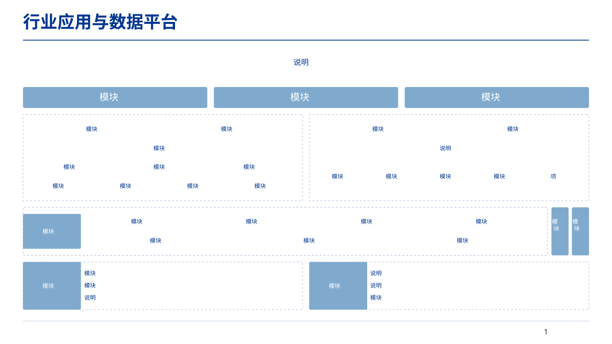

# 行业应用与数据平台

来源为蓝色逻辑架构图.pptx#19。

## 结构与适用场景

上方3业务域；中间数据平台/APIs/数据治理与右安全标准竖栏；底部数据及行业赋能2块

行业解决方案全景

源重复写旅客服务，应按实际角色修正示例；缺资料不得推断三业务域含义

固定节点、圆弧、扇区、分面和连接表达定性关系。数量比较、趋势或占比使用数据驱动图表，源页中已登记的微图槽可接收实际数据。

## 预览



## 调用

将下列完整page对象放入schema_version=1、template_id=business-blue-v1的pages数组，替换各节点内容。nodes键对应原文本框或已明确拆分的语义分段，字段角色及source_ref、segment见下表。

```json
{
  "id": "architecture-19",
  "family": "source-architecture",
  "variant": "page-19",
  "content": {
    "title": "行业应用与数据平台",
    "nodes": {
      "shape_226": "说明",
      "shape_227": "模块",
      "shape_228": "模块",
      "shape_229": "模块",
      "shape_230": "模块",
      "shape_231": "模块",
      "shape_233": "模块",
      "shape_234": "模块",
      "shape_235": "模块",
      "shape_236": "模块",
      "shape_237": "模块",
      "shape_238": "模块",
      "shape_239": "模块",
      "shape_241": "模块",
      "shape_242": "说明",
      "shape_244": "模块",
      "shape_245": "模块",
      "shape_246": "模块",
      "shape_247": "模块",
      "shape_248": "模块",
      "shape_250": "模块",
      "shape_251": "模块",
      "shape_252": "模块",
      "shape_253": "模块",
      "shape_254": "模块",
      "shape_255": "模块",
      "shape_256": "项",
      "shape_257": "模块",
      "shape_258": "模块",
      "shape_259": "模块",
      "shape_261": "模块",
      "shape_262": "模块",
      "shape_263": "模块",
      "shape_264": "模块",
      "shape_265": "模块",
      "shape_266": "模块",
      "shape_267": "说明",
      "shape_268": "说明",
      "shape_269": "说明",
      "shape_270": "模块"
    }
  },
  "config": {
    "show_source": true,
    "show_page_number": true
  }
}
```

config支持show_source、show_page_number、image_fit与image_position。image_fit可选contain或cover，image_position为xMin/xMid/xMax与YMin/YMid/YMax组合的九个焦点，默认为xMidYMid。字体、颜色、全局区和固定字阶取自tokens，节点数与连接结构由variant确定。

## 字段合同

每个业务节点required=true、min=1，max按具体框体登记。字符按规范化后的Unicode码点计数，空格标点换行均计入。build会以实际字体测量宽高，字符数通过后仍可能需要调整文字。

| 字段 | 节点角色与源标签 | 最短/最长 | 字阶 | 框体px | 原框引用 | 分段 | 旋转° | 垂直锚点 |
|---|---|---|---|---|---|---|---|---|
| nodes.shape_226 | 上中节点，源标签“基于腾讯特色的C端触达、商业运营及数字孪生等能力,面向旅客全流程服芻、商业运营及” | 1/318 | caption | [64.6448, 120, 1150.7001, 45.6415] | slide:226 |  | 0.0 | t |
| nodes.shape_227 | 上左节点，源标签“旅客服务” | 1/8 | compactBody | [204.6767, 191.577, 72.2769, 25.0] | slide:227 |  | 0.0 | t |
| nodes.shape_228 | 上中节点，源标签“旅客服务” | 1/8 | compactBody | [603.8564, 191.577, 72.2769, 25.0] | slide:228 |  | 0.0 | t |
| nodes.shape_229 | 上右节点，源标签“旅客服务” | 1/8 | compactBody | [1003.0465, 191.577, 72.2769, 25.0] | slide:229 |  | 0.0 | t |
| nodes.shape_230 | 下左节点，源标签“旅客服务” | 1/9 | diagramMicro | [83.6509, 476.687, 50.0394, 15.0108] | slide:230 |  | 0.0 | t |
| nodes.shape_231 | 下左节点，源标签“旅客服务” | 1/9 | diagramMicro | [83.6509, 590.5997, 50.0394, 15.0108] | slide:231 |  | 0.0 | t |
| nodes.shape_233 | 下中节点，源标签“旅客服务” | 1/9 | diagramMicro | [682.4308, 590.5997, 50.0394, 15.0108] | slide:233 |  | 0.0 | t |
| nodes.shape_234 | 中右节点，源标签“安全体系” | 1/9 | diagramMicro | [1162.6213, 457.5054, 17.4059, 53.374] | slide:234 |  | 0.0 | t |
| nodes.shape_235 | 中右节点，源标签“标准体系” | 1/9 | diagramMicro | [1205.2999, 457.5054, 17.4059, 53.374] | slide:235 |  | 0.0 | t |
| nodes.shape_236 | 上左节点，源标签“数据与治理赋能” | 1/16 | diagramMicro | [155.7316, 262.3548, 87.5664, 15.5786] | slide:236 |  | 0.0 | t |
| nodes.shape_237 | 上中节点，源标签“行业应用赋能” | 1/13 | diagramMicro | [444.1783, 262.3548, 75.054, 15.5786] | slide:237 |  | 0.0 | t |
| nodes.shape_238 | 上中节点，源标签“集成赋能” | 1/9 | diagramMicro | [773.2802, 262.3548, 50.0394, 15.5786] | slide:238 |  | 0.0 | t |
| nodes.shape_239 | 上右节点，源标签“运研一体赋能” | 1/13 | diagramMicro | [1042.9583, 262.3548, 75.054, 15.5786] | slide:239 |  | 0.0 | t |
| nodes.shape_241 | 中左节点，源标签“OneID 链接人与服务” | 1/22 | diagramMicro | [281.1863, 302.5659, 118.8372, 15.0108] | slide:241 |  | 0.0 | t |
| nodes.shape_242 | 中右节点，源标签“OnePort 链接组织与职能” | 1/26 | diagramMicro | [866.6795, 302.5659, 145.4209, 15.0108] | slide:242 |  | 0.0 | t |
| nodes.shape_244 | 中左节点，源标签“OneID全流程旅客服务” | 1/23 | diagramMicro | [89.9381, 341.6312, 125.0934, 16.7039] | slide:244 |  | 0.0 | t |
| nodes.shape_245 | 中左节点，源标签“高舱服务” | 1/9 | diagramMicro | [315.5955, 341.6312, 50.0394, 16.7039] | slide:245 |  | 0.0 | t |
| nodes.shape_246 | 中中节点，源标签“综合信息系统” | 1/13 | diagramMicro | [491.2032, 341.6312, 75.054, 16.7039] | slide:246 |  | 0.0 | t |
| nodes.shape_247 | 中左节点，源标签“室内外导航” | 1/11 | diagramMicro | [98.2178, 381.5533, 62.5519, 16.7039] | slide:247 |  | 0.0 | t |
| nodes.shape_248 | 中左节点，源标签“智能客服” | 1/9 | diagramMicro | [245.2182, 381.5533, 50.0394, 16.7039] | slide:248 |  | 0.0 | t |
| nodes.shape_250 | 中左节点，源标签“贵宾服务” | 1/9 | diagramMicro | [385.9625, 381.5533, 50.0394, 16.7039] | slide:250 |  | 0.0 | t |
| nodes.shape_251 | 中中节点，源标签“商业运营服务” | 1/13 | diagramMicro | [514.2046, 381.5533, 75.054, 16.7039] | slide:251 |  | 0.0 | t |
| nodes.shape_252 | 中中节点，源标签“移动办公” | 1/9 | diagramMicro | [688.6251, 361.5974, 50.0394, 16.7039] | slide:252 |  | 0.0 | t |
| nodes.shape_253 | 中中节点，源标签“生产管理” | 1/9 | diagramMicro | [801.4951, 361.5974, 50.0394, 16.7039] | slide:253 |  | 0.0 | t |
| nodes.shape_254 | 中右节点，源标签“工作协同” | 1/9 | diagramMicro | [914.3754, 361.5974, 50.0394, 16.7039] | slide:254 |  | 0.0 | t |
| nodes.shape_255 | 中右节点，源标签“生活服务” | 1/9 | diagramMicro | [1027.2454, 361.5974, 50.0394, 16.7039] | slide:255 |  | 0.0 | t |
| nodes.shape_256 | 中右节点，源标签“...” | 1/2 | diagramMicro | [1158.4152, 361.5974, 13.44, 16.7039] | slide:256 |  | 0.0 | t |
| nodes.shape_257 | 中左节点，源标签“API集成” | 1/8 | diagramMicro | [270.8729, 455.8846, 45.3421, 16.7039] | slide:257 |  | 0.0 | t |
| nodes.shape_258 | 中中节点，源标签“数据集成” | 1/9 | diagramMicro | [508.9085, 455.8846, 50.0394, 16.7039] | slide:258 |  | 0.0 | t |
| nodes.shape_259 | 中中节点，源标签“策略引擎” | 1/9 | diagramMicro | [749.2774, 455.8846, 50.0394, 16.7039] | slide:259 |  | 0.0 | t |
| nodes.shape_261 | 中右节点，源标签“开发平台” | 1/9 | diagramMicro | [989.6462, 455.8846, 50.0394, 16.7039] | slide:261 |  | 0.0 | t |
| nodes.shape_262 | 下左节点，源标签“物联平台” | 1/9 | diagramMicro | [308.1314, 495.8067, 50.0394, 16.7039] | slide:262 |  | 0.0 | t |
| nodes.shape_263 | 下中节点，源标签“大数据平台” | 1/11 | diagramMicro | [622.8316, 495.8067, 62.5519, 16.7039] | slide:263 |  | 0.0 | t |
| nodes.shape_264 | 下右节点，源标签“算法平台” | 1/9 | diagramMicro | [950.0441, 495.8067, 50.0394, 16.7039] | slide:264 |  | 0.0 | t |
| nodes.shape_265 | 下左节点，源标签“服务断链，个性化不足” | 1/23 | diagramMicro | [176.1211, 564.2534, 125.0934, 16.7039] | slide:265 |  | 0.0 | t |
| nodes.shape_266 | 下左节点，源标签“非航收入增长乏力” | 1/18 | diagramMicro | [176.1211, 589.7532, 100.0788, 16.7039] | slide:266 |  | 0.0 | t |
| nodes.shape_267 | 下左节点，源标签“安全风险绝对值增大，态势感知弱” | 1/34 | diagramMicro | [176.1211, 615.2426, 187.6452, 16.7039] | slide:267 |  | 0.0 | t |
| nodes.shape_268 | 下中节点，源标签“广泛的C端触达，精益的数字化运营，持续拓展的生态” | 1/54 | diagramMicro | [774.2919, 564.2534, 296.7574, 16.7039] | slide:268 |  | 0.0 | t |
| nodes.shape_269 | 下中节点，源标签“从粗放的职能管理向基于工作流的作业单元的管理模式转变” | 1/60 | diagramMicro | [774.2919, 589.7532, 325.2511, 16.7039] | slide:269 |  | 0.0 | t |
| nodes.shape_270 | 下中节点，源标签“工业物联，全局协同” | 1/20 | diagramMicro | [774.2919, 615.2426, 112.5809, 16.7039] | slide:270 |  | 0.0 | t |

全局title必填、2至32码点，使用统一标题框。section_name可选0至24码点，source可选0至64码点。所有可编辑文本通过独立原生carrier导出，页码为派生文字。

## 来源处理

原生PPTX源件保存于用户材料目录，分发包仅含用户资产衍生的几何、字段和说明。原始逐框文字、源框与标准化框在page-catalog.json的variant.fields中。

源标题引用为`slide:278`，原文为“智慧民航解决方案”。模板默认标题依据真实结构设置。

密集全景中的diagramCompact为14px、diagramMicro为12px。适用于体系概览或附录局部标签，现场关键结论用统一标题与正常正文字阶表达。

源画布边界裁切已烘焙为可编辑Bezier几何，3D顶面、侧面与前面通过tokens配色的相对明暗保留。

