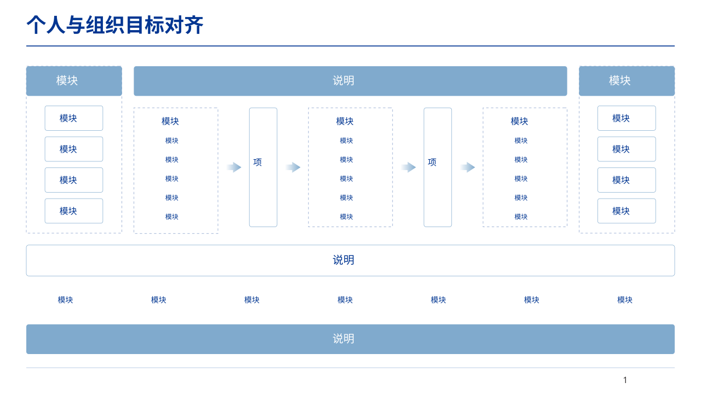

# 个人与组织目标对齐

来源为蓝色逻辑架构图.pptx#20。

## 结构与适用场景

左个人成长4项、中央3个个体目标串联、右企业成长4项；数据设施支撑；底部反馈/协同标签

个人-团队-企业目标对齐

中央各目标盒有子KR，保留嵌套；底部标签为能力非量化指标

固定节点、圆弧、扇区、分面和连接表达定性关系。数量比较、趋势或占比使用数据驱动图表，源页中已登记的微图槽可接收实际数据。

## 预览



## 调用

将下列完整page对象放入schema_version=1、template_id=business-blue-v1的pages数组，替换各节点内容。nodes键对应原文本框或已明确拆分的语义分段，字段角色及source_ref、segment见下表。

```json
{
  "id": "architecture-20",
  "family": "source-architecture",
  "variant": "page-20",
  "content": {
    "title": "个人与组织目标对齐",
    "nodes": {
      "shape_284": "模块",
      "shape_285": "说明",
      "shape_287": "模块",
      "shape_288": "说明",
      "shape_289": "说明",
      "shape_290": "模块",
      "shape_291": "模块",
      "shape_292": "模块",
      "shape_293": "模块",
      "shape_294": "模块",
      "shape_295": "模块",
      "shape_296": "模块",
      "shape_297": "模块",
      "shape_298": "模块",
      "shape_299": "模块",
      "shape_300": "模块",
      "shape_301": "模块",
      "shape_302": "模块",
      "shape_303": "模块",
      "shape_304": "模块",
      "shape_305": "模块",
      "shape_306": "模块",
      "shape_307": "模块",
      "shape_308": "模块",
      "shape_309": "模块",
      "shape_310": "模块",
      "shape_311": "模块",
      "shape_312": "模块",
      "shape_313": "模块",
      "shape_314": "模块",
      "shape_315": "模块",
      "shape_316": "模块",
      "shape_317": "模块",
      "shape_318": "模块",
      "shape_319": "模块",
      "shape_320": "模块",
      "shape_321": "模块",
      "shape_322": "模块",
      "shape_324": "项",
      "shape_325": "项"
    }
  },
  "config": {
    "show_source": true,
    "show_page_number": true
  }
}
```

config支持show_source、show_page_number、image_fit与image_position。image_fit可选contain或cover，image_position为xMin/xMid/xMax与YMin/YMid/YMax组合的九个焦点，默认为xMidYMid。字体、颜色、全局区和固定字阶取自tokens，节点数与连接结构由variant确定。

## 字段合同

每个业务节点required=true、min=1，max按具体框体登记。字符按规范化后的Unicode码点计数，空格标点换行均计入。build会以实际字体测量宽高，字符数通过后仍可能需要调整文字。

| 字段 | 节点角色与源标签 | 最短/最长 | 字阶 | 框体px | 原框引用 | 分段 | 旋转° | 垂直锚点 |
|---|---|---|---|---|---|---|---|---|
| nodes.shape_284 | 上左节点，源标签“个体成长” | 1/8 | compactBody | [97.269, 135.6435, 76.0936, 25.0] | slide:284 |  | 0.0 | t |
| nodes.shape_285 | 上中节点，源标签“去中心化组织目标协同管理系统” | 1/29 | compactBody | [506.8334, 135.6435, 266.3331, 25.0] | slide:285 |  | 0.0 | t |
| nodes.shape_287 | 上右节点，源标签“企业成长” | 1/8 | compactBody | [1106.6373, 135.6435, 76.0936, 25.0] | slide:287 |  | 0.0 | t |
| nodes.shape_288 | 下中节点，源标签“去中心化组织目标协同管理系统” | 1/29 | compactBody | [506.8334, 607.3566, 266.3331, 25.0] | slide:288 |  | 0.0 | t |
| nodes.shape_289 | 中中节点，源标签“大数据基础设施（计算和储存平台）” | 1/33 | compactBody | [487.8127, 463.5221, 304.3745, 25.0] | slide:289 |  | 0.0 | t |
| nodes.shape_290 | 上左节点，源标签“共振对话” | 1/8 | caption | [105.6925, 205.8897, 58.5294, 20.0] | slide:290 |  | 0.0 | t |
| nodes.shape_291 | 上左节点，源标签“协同挑战” | 1/8 | caption | [105.6925, 262.4083, 58.5294, 20.0] | slide:291 |  | 0.0 | t |
| nodes.shape_292 | 中左节点，源标签“团队赋能” | 1/8 | caption | [105.6925, 318.927, 58.5294, 20.0] | slide:292 |  | 0.0 | t |
| nodes.shape_293 | 中左节点，源标签“肯定认可” | 1/8 | caption | [105.6925, 375.4456, 58.5294, 20.0] | slide:293 |  | 0.0 | t |
| nodes.shape_294 | 上右节点，源标签“去中心” | 1/6 | caption | [1122.3646, 205.8897, 43.8998, 20.0] | slide:294 |  | 0.0 | t |
| nodes.shape_295 | 上右节点，源标签“目标协同” | 1/8 | caption | [1115.0498, 262.4083, 58.5294, 20.0] | slide:295 |  | 0.0 | t |
| nodes.shape_296 | 中右节点，源标签“信息同频” | 1/8 | caption | [1115.0498, 318.927, 58.5294, 20.0] | slide:296 |  | 0.0 | t |
| nodes.shape_297 | 中右节点，源标签“成果展现” | 1/8 | caption | [1115.0498, 375.4456, 58.5294, 20.0] | slide:297 |  | 0.0 | t |
| nodes.shape_298 | 下左节点，源标签“目标驱动” | 1/8 | diagramCompact | [102.0948, 539.7301, 52.6819, 17.5] | slide:298 |  | 0.0 | t |
| nodes.shape_299 | 下左节点，源标签“快速反馈” | 1/8 | diagramCompact | [272.3789, 539.7301, 52.6819, 17.5] | slide:299 |  | 0.0 | t |
| nodes.shape_300 | 下中节点，源标签“信息同频” | 1/8 | diagramCompact | [442.6521, 539.7301, 52.6819, 17.5] | slide:300 |  | 0.0 | t |
| nodes.shape_301 | 下中节点，源标签“进度协同” | 1/8 | diagramCompact | [612.9362, 539.7301, 52.6819, 17.5] | slide:301 |  | 0.0 | t |
| nodes.shape_302 | 下中节点，源标签“激发潜能” | 1/8 | diagramCompact | [783.2203, 539.7301, 52.6819, 17.5] | slide:302 |  | 0.0 | t |
| nodes.shape_303 | 下右节点，源标签“集体赋能” | 1/8 | diagramCompact | [953.4935, 539.7301, 52.6819, 17.5] | slide:303 |  | 0.0 | t |
| nodes.shape_304 | 下右节点，源标签“动态优化” | 1/8 | diagramCompact | [1123.7776, 539.7301, 52.6819, 17.5] | slide:304 |  | 0.0 | t |
| nodes.shape_305 | 上左节点，源标签“组织超级个体” | 1/12 | caption | [277.2808, 211.3242, 87.7995, 20.0] | slide:305 |  | 0.0 | t |
| nodes.shape_306 | 上右节点，源标签“组织超级个体” | 1/12 | caption | [914.9196, 211.3242, 87.7995, 20.0] | slide:306 |  | 0.0 | t |
| nodes.shape_307 | 上中节点，源标签“组织超级个体” | 1/12 | caption | [596.1002, 211.3242, 87.7995, 20.0] | slide:307 |  | 0.0 | t |
| nodes.shape_308 | 上左节点，源标签“目标对齐” | 1/7 | diagramMicro | [301.0513, 249.3277, 40.976, 15.0] | slide:308 |  | 0.0 | t |
| nodes.shape_309 | 中左节点，源标签“同步协同” | 1/7 | diagramMicro | [301.0513, 284.1084, 40.976, 15.0] | slide:309 |  | 0.0 | t |
| nodes.shape_310 | 中左节点，源标签“动态沟通” | 1/7 | diagramMicro | [301.0513, 318.8891, 40.976, 15.0] | slide:310 |  | 0.0 | t |
| nodes.shape_311 | 中左节点，源标签“执行优化” | 1/7 | diagramMicro | [301.0513, 353.6697, 40.976, 15.0] | slide:311 |  | 0.0 | t |
| nodes.shape_312 | 中左节点，源标签“结果反馈” | 1/7 | diagramMicro | [301.0513, 388.4504, 40.976, 15.0] | slide:312 |  | 0.0 | t |
| nodes.shape_313 | 上中节点，源标签“关键目标KR1” | 1/11 | diagramMicro | [609.6321, 249.3277, 61.464, 15.0] | slide:313 |  | 0.0 | t |
| nodes.shape_314 | 中中节点，源标签“关键目标KR2” | 1/11 | diagramMicro | [609.6321, 284.1084, 61.464, 15.0] | slide:314 |  | 0.0 | t |
| nodes.shape_315 | 中中节点，源标签“关键目标KR3” | 1/11 | diagramMicro | [609.6321, 318.8891, 61.464, 15.0] | slide:315 |  | 0.0 | t |
| nodes.shape_316 | 中中节点，源标签“关键目标KR4” | 1/11 | diagramMicro | [609.6321, 353.6697, 61.464, 15.0] | slide:316 |  | 0.0 | t |
| nodes.shape_317 | 中中节点，源标签“关键目标KR5” | 1/11 | diagramMicro | [609.6321, 388.4504, 61.464, 15.0] | slide:317 |  | 0.0 | t |
| nodes.shape_318 | 上右节点，源标签“目标拆解” | 1/7 | diagramMicro | [938.7009, 249.3277, 40.976, 15.0] | slide:318 |  | 0.0 | t |
| nodes.shape_319 | 中右节点，源标签“进展跟踪” | 1/7 | diagramMicro | [938.7009, 284.1084, 40.976, 15.0] | slide:319 |  | 0.0 | t |
| nodes.shape_320 | 中右节点，源标签“同频调整” | 1/7 | diagramMicro | [938.7009, 318.8891, 40.976, 15.0] | slide:320 |  | 0.0 | t |
| nodes.shape_321 | 中右节点，源标签“执行优化” | 1/7 | diagramMicro | [938.7009, 353.6697, 40.976, 15.0] | slide:321 |  | 0.0 | t |
| nodes.shape_322 | 中右节点，源标签“结果反馈” | 1/7 | diagramMicro | [938.7009, 388.4504, 40.976, 15.0] | slide:322 |  | 0.0 | t |
| nodes.shape_324 | 中中节点，源标签“目标” | 1/4 | caption | [465.7704, 286.4184, 29.6288, 38.6283] | slide:324 |  | 0.0 | t |
| nodes.shape_325 | 中中节点，源标签“目标” | 1/4 | caption | [784.5898, 286.4184, 29.6288, 38.6283] | slide:325 |  | 0.0 | t |

全局title必填、2至32码点，使用统一标题框。section_name可选0至24码点，source可选0至64码点。所有可编辑文本通过独立原生carrier导出，页码为派生文字。

## 来源处理

原生PPTX源件保存于用户材料目录，分发包仅含用户资产衍生的几何、字段和说明。原始逐框文字、源框与标准化框在page-catalog.json的variant.fields中。

源标题引用为`slide:273`，原文为“解决方案”。模板默认标题依据真实结构设置。

密集全景中的diagramCompact为14px、diagramMicro为12px。适用于体系概览或附录局部标签，现场关键结论用统一标题与正常正文字阶表达。

源画布边界裁切已烘焙为可编辑Bezier几何，3D顶面、侧面与前面通过tokens配色的相对明暗保留。

