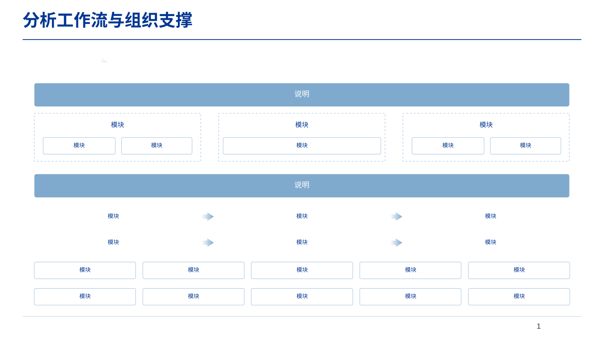

# 分析工作流与组织支撑

来源为蓝色逻辑架构图.pptx#21。

## 结构与适用场景

上方组织/流程/能力3条件；中部生成→探索分析→输出；下方10类业务数据2行

分析工作流与组织支撑

条件、流程、输入数据分类不同；优先拆图，避免文字矩阵

固定节点、圆弧、扇区、分面和连接表达定性关系。数量比较、趋势或占比使用数据驱动图表，源页中已登记的微图槽可接收实际数据。

## 预览



## 调用

将下列完整page对象放入schema_version=1、template_id=business-blue-v1的pages数组，替换各节点内容。nodes键对应原文本框或已明确拆分的语义分段，字段角色及source_ref、segment见下表。

```json
{
  "id": "architecture-21",
  "family": "source-architecture",
  "variant": "page-21",
  "content": {
    "title": "分析工作流与组织支撑",
    "nodes": {
      "shape_199": "说明",
      "shape_203": "说明",
      "shape_204": "模块",
      "shape_208": "模块",
      "shape_209": "模块",
      "shape_211": "模块",
      "shape_213": "模块",
      "shape_215": "模块",
      "shape_216": "模块",
      "shape_217": "模块",
      "shape_218": "模块",
      "shape_220": "模块",
      "shape_221": "模块",
      "shape_222": "模块",
      "shape_223": "模块",
      "shape_224": "模块",
      "shape_225": "模块",
      "shape_226": "模块",
      "shape_228": "模块",
      "shape_229": "模块",
      "shape_230": "模块",
      "shape_231": "模块",
      "shape_232": "模块",
      "shape_233": "模块",
      "shape_234": "模块",
      "shape_236": "模块"
    }
  },
  "config": {
    "show_source": true,
    "show_page_number": true
  }
}
```

config支持show_source、show_page_number、image_fit与image_position。image_fit可选contain或cover，image_position为xMin/xMid/xMax与YMin/YMid/YMax组合的九个焦点，默认为xMidYMid。字体、颜色、全局区和固定字阶取自tokens，节点数与连接结构由variant确定。

## 字段合同

每个业务节点required=true、min=1，max按具体框体登记。字符按规范化后的Unicode码点计数，空格标点换行均计入。build会以实际字体测量宽高，字符数通过后仍可能需要调整文字。

| 字段 | 节点角色与源标签 | 最短/最长 | 字阶 | 框体px | 原框引用 | 分段 | 旋转° | 垂直锚点 |
|---|---|---|---|---|---|---|---|---|
| nodes.shape_199 | 上中节点，源标签“企业数据分析新基建：数据业务流程” | 1/38 | caption | [501.222, 191.0328, 276.8935, 20.764] | slide:199 |  | 0.0 | t |
| nodes.shape_203 | 中中节点，源标签“企业数据分析新基建：数据业务流程” | 1/38 | caption | [501.222, 384.1681, 276.8935, 20.764] | slide:203 |  | 0.0 | t |
| nodes.shape_204 | 上左节点，源标签“部门及分工模式” | 1/14 | diagramCompact | [202.5164, 257.597, 93.1811, 17.5] | slide:204 |  | 0.0 | t |
| nodes.shape_208 | 上中节点，源标签“业务流程及运营模型” | 1/19 | diagramCompact | [579.7596, 257.597, 119.8085, 17.5] | slide:208 |  | 0.0 | t |
| nodes.shape_209 | 上右节点，源标签“组织架构及组织能力” | 1/19 | diagramCompact | [970.3213, 257.597, 119.8085, 17.5] | slide:209 |  | 0.0 | t |
| nodes.shape_211 | 中左节点，源标签“数据源生成” | 1/11 | diagramMicro | [210.2584, 452.6348, 59.9092, 15.0] | slide:211 |  | 0.0 | t |
| nodes.shape_213 | 中中节点，源标签“数据探索式分析” | 1/15 | diagramMicro | [598.0616, 452.6348, 83.867, 15.0] | slide:213 |  | 0.0 | t |
| nodes.shape_215 | 中右节点，源标签“数据输出分析” | 1/13 | diagramMicro | [1003.8503, 452.6348, 71.8831, 15.0] | slide:215 |  | 0.0 | t |
| nodes.shape_216 | 下左节点，源标签“工作工具及表单/应用” | 1/21 | diagramMicro | [183.2948, 508.0056, 113.8166, 15.0] | slide:216 |  | 0.0 | t |
| nodes.shape_217 | 下中节点，源标签“公司个体” | 1/8 | diagramMicro | [616.0373, 508.0056, 47.9254, 15.0] | slide:217 |  | 0.0 | t |
| nodes.shape_218 | 下右节点，源标签“沟通数据及信息” | 1/15 | diagramMicro | [997.8584, 508.0056, 83.867, 15.0] | slide:218 |  | 0.0 | t |
| nodes.shape_220 | 中左节点，源标签“工作流程” | 1/8 | diagramMicro | [143.7344, 302.3476, 47.9254, 15.0] | slide:220 |  | 0.0 | t |
| nodes.shape_221 | 中左节点，源标签“工作协同” | 1/8 | diagramMicro | [308.2054, 302.3476, 47.9254, 15.0] | slide:221 |  | 0.0 | t |
| nodes.shape_222 | 中中节点，源标签“自定义自主指标设定” | 1/19 | diagramMicro | [586.0876, 302.3476, 107.8247, 15.0] | slide:222 |  | 0.0 | t |
| nodes.shape_223 | 中右节点，源标签“提供工作资源” | 1/13 | diagramMicro | [913.5366, 302.3476, 71.8831, 15.0] | slide:223 |  | 0.0 | t |
| nodes.shape_224 | 中右节点，源标签“提供工作资源” | 1/13 | diagramMicro | [1078.0076, 302.3476, 71.8831, 15.0] | slide:224 |  | 0.0 | t |
| nodes.shape_225 | 下左节点，源标签“营销数据” | 1/8 | diagramMicro | [156.262, 566.6739, 47.9254, 15.0] | slide:225 |  | 0.0 | t |
| nodes.shape_226 | 下左节点，源标签“销售数据” | 1/8 | diagramMicro | [386.3178, 566.6739, 47.9254, 15.0] | slide:226 |  | 0.0 | t |
| nodes.shape_228 | 下中节点，源标签“财务数据” | 1/8 | diagramMicro | [616.3636, 566.6739, 47.9254, 15.0] | slide:228 |  | 0.0 | t |
| nodes.shape_229 | 下右节点，源标签“管理数据” | 1/8 | diagramMicro | [846.4193, 566.6739, 47.9254, 15.0] | slide:229 |  | 0.0 | t |
| nodes.shape_230 | 下右节点，源标签“用户数据” | 1/8 | diagramMicro | [1076.475, 566.6739, 47.9254, 15.0] | slide:230 |  | 0.0 | t |
| nodes.shape_231 | 下左节点，源标签“内容数据” | 1/8 | diagramMicro | [156.262, 622.7072, 47.9254, 15.0] | slide:231 |  | 0.0 | t |
| nodes.shape_232 | 下左节点，源标签“私域数据” | 1/8 | diagramMicro | [386.3178, 622.7072, 47.9254, 15.0] | slide:232 |  | 0.0 | t |
| nodes.shape_233 | 下中节点，源标签“电商数据” | 1/8 | diagramMicro | [616.3636, 622.7072, 47.9254, 15.0] | slide:233 |  | 0.0 | t |
| nodes.shape_234 | 下右节点，源标签“人力数据” | 1/8 | diagramMicro | [846.4193, 622.7072, 47.9254, 15.0] | slide:234 |  | 0.0 | t |
| nodes.shape_236 | 下右节点，源标签“售后数据” | 1/8 | diagramMicro | [1076.475, 622.7072, 47.9254, 15.0] | slide:236 |  | 0.0 | t |

全局title必填、2至32码点，使用统一标题框。section_name可选0至24码点，source可选0至64码点。所有可编辑文本通过独立原生carrier导出，页码为派生文字。

## 来源处理

原生PPTX源件保存于用户材料目录，分发包仅含用户资产衍生的几何、字段和说明。原始逐框文字、源框与标准化框在page-catalog.json的variant.fields中。

源标题引用为`slide:273`，原文为“解决方案”。模板默认标题依据真实结构设置。

密集全景中的diagramCompact为14px、diagramMicro为12px。适用于体系概览或附录局部标签，现场关键结论用统一标题与正常正文字阶表达。

源画布边界裁切已烘焙为可编辑Bezier几何，3D顶面、侧面与前面通过tokens配色的相对明暗保留。

