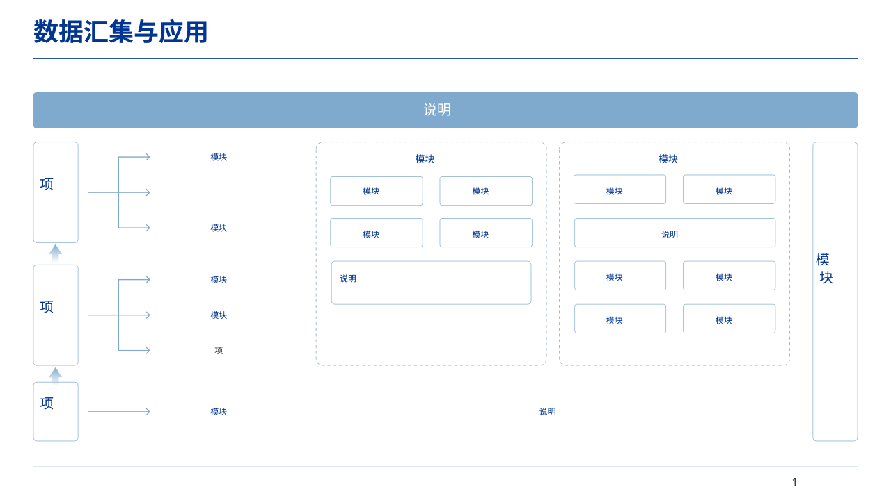

# 数据汇集与应用

来源为蓝色逻辑架构图.pptx#22。

## 结构与适用场景

左汇集→集成→应用3层；中部数据/应用模块2列；右开放共享贯穿；底部仓库

数据到应用价值链

保留数据层、应用层、共享横切能力及接口方向

固定节点、圆弧、扇区、分面和连接表达定性关系。数量比较、趋势或占比使用数据驱动图表，源页中已登记的微图槽可接收实际数据。

## 预览



## 调用

将下列完整page对象放入schema_version=1、template_id=business-blue-v1的pages数组，替换各节点内容。nodes键对应原文本框或已明确拆分的语义分段，字段角色及source_ref、segment见下表。

```json
{
  "id": "architecture-22",
  "family": "source-architecture",
  "variant": "page-22",
  "content": {
    "title": "数据汇集与应用",
    "nodes": {
      "shape_197": "说明",
      "shape_200": "项",
      "shape_201": "项",
      "shape_202": "项",
      "shape_206": "模块",
      "shape_210": "模块",
      "shape_212": "模块",
      "shape_214": "模块",
      "shape_219": "模块",
      "shape_227": "项",
      "shape_235": "模块",
      "shape_237": "说明",
      "shape_238": "模块",
      "shape_239": "模块",
      "shape_240": "模块",
      "shape_241": "模块",
      "shape_242": "模块",
      "shape_243": "模块",
      "shape_244": "说明",
      "shape_245": "模块",
      "shape_246": "模块",
      "shape_247": "说明",
      "shape_248": "模块",
      "shape_249": "模块",
      "shape_250": "模块",
      "shape_251": "模块"
    }
  },
  "config": {
    "show_source": true,
    "show_page_number": true
  }
}
```

config支持show_source、show_page_number、image_fit与image_position。image_fit可选contain或cover，image_position为xMin/xMid/xMax与YMin/YMid/YMax组合的九个焦点，默认为xMidYMid。字体、颜色、全局区和固定字阶取自tokens，节点数与连接结构由variant确定。

## 字段合同

每个业务节点required=true、min=1，max按具体框体登记。字符按规范化后的Unicode码点计数，空格标点换行均计入。build会以实际字体测量宽高，字符数通过后仍可能需要调整文字。

| 字段 | 节点角色与源标签 | 最短/最长 | 字阶 | 框体px | 原框引用 | 分段 | 旋转° | 垂直锚点 |
|---|---|---|---|---|---|---|---|---|
| nodes.shape_197 | 上中节点，源标签“数据汇集—数据洞察—业务重塑” | 1/28 | compactBody | [514.2343, 146.3877, 253.424, 25.0] | slide:197 |  | 0.0 | t |
| nodes.shape_200 | 上左节点，源标签“数据 / 应用” | 1/4 | compactBody | [61.9516, 253.9113, 36.2079, 46.4259] | slide:200 |  | 0.0 | t |
| nodes.shape_201 | 中左节点，源标签“集成 / 应用” | 1/4 | compactBody | [61.9516, 430.4207, 36.2079, 46.4259] | slide:201 |  | 0.0 | t |
| nodes.shape_202 | 下左节点，源标签“数据 / 汇集” | 1/4 | compactBody | [61.9516, 569.3468, 36.2079, 46.4259] | slide:202 |  | 0.0 | t |
| nodes.shape_206 | 中右节点，源标签“开放/共享” | 1/8 | compactBody | [1188.7445, 360.7974, 22.4, 118.1073] | slide:206 |  | 0.0 | t |
| nodes.shape_210 | 上左节点，源标签“BI工具” | 1/6 | diagramMicro | [303.1821, 218.5929, 37.7695, 15.0375] | slide:210 |  | 0.0 | t |
| nodes.shape_212 | 中左节点，源标签“智能应用” | 1/9 | diagramMicro | [296.9975, 320.6285, 50.1284, 15.0375] | slide:212 |  | 0.0 | t |
| nodes.shape_214 | 中左节点，源标签“泛CIS” | 1/6 | diagramMicro | [305.1782, 395.092, 33.7671, 15.0375] | slide:214 |  | 0.0 | t |
| nodes.shape_219 | 中左节点，源标签“泛HIIS” | 1/7 | diagramMicro | [303.0891, 446.1201, 37.9453, 15.0375] | slide:219 |  | 0.0 | t |
| nodes.shape_227 | 下左节点，源标签“其他” | 1/4 | diagramMicro | [309.5322, 497.1379, 25.059, 15.0375] | slide:227 |  | 0.0 | t |
| nodes.shape_235 | 下左节点，源标签“数据仓库” | 1/9 | diagramMicro | [296.9975, 585.0462, 50.1284, 15.0375] | slide:235 |  | 0.0 | t |
| nodes.shape_237 | 下中节点，源标签“汇集包括基于临床时间的数据、基于文献积累的数据、经过清洗、转化构建数据仓库” | 1/85 | diagramMicro | [562.5218, 585.0462, 463.6798, 15.0375] | slide:237 |  | 0.0 | t |
| nodes.shape_238 | 上中节点，源标签“辅助诊断” | 1/9 | diagramMicro | [515.9098, 267.5423, 50.1284, 15.0375] | slide:238 |  | 0.0 | t |
| nodes.shape_239 | 上中节点，源标签“数据源生成” | 1/11 | diagramCompact | [584.7574, 220.6401, 69.6233, 17.5] | slide:239 |  | 0.0 | t |
| nodes.shape_240 | 上右节点，源标签“数据源生成” | 1/11 | diagramCompact | [934.322, 220.6401, 69.6233, 17.5] | slide:240 |  | 0.0 | t |
| nodes.shape_241 | 上中节点，源标签“人脸识别” | 1/9 | diagramMicro | [673.1104, 267.5423, 50.1284, 15.0375] | slide:241 |  | 0.0 | t |
| nodes.shape_242 | 中中节点，源标签“智能语音录入” | 1/13 | diagramMicro | [503.3751, 329.9364, 75.1874, 15.0375] | slide:242 |  | 0.0 | t |
| nodes.shape_243 | 中中节点，源标签“大数据屏” | 1/9 | diagramMicro | [673.1104, 329.9364, 50.1284, 15.0375] | slide:243 |  | 0.0 | t |
| nodes.shape_244 | 中中节点，源标签“围绕电子病历展开、集成医院综合信息管理系统 / 包括HIS、CIS、HRP、LIS、” | 1/96 | diagramMicro | [487.986, 393.4372, 263.1663, 32.1537] | slide:244 |  | 0.0 | t |
| nodes.shape_245 | 上右节点，源标签“运营管理高效便携” | 1/18 | diagramMicro | [840.405, 267.5423, 100.2568, 15.0375] | slide:245 |  | 0.0 | t |
| nodes.shape_246 | 上右节点，源标签“医疗服务省时省力” | 1/18 | diagramMicro | [997.6056, 267.5423, 100.2568, 15.0375] | slide:246 |  | 0.0 | t |
| nodes.shape_247 | 中右节点，源标签“科学研究效率与效果全面提升” | 1/30 | diagramMicro | [888.3718, 329.9364, 162.9095, 15.0375] | slide:247 |  | 0.0 | t |
| nodes.shape_248 | 中右节点，源标签“数据批量分析处理” | 1/18 | diagramMicro | [840.405, 391.648, 100.2568, 15.0375] | slide:248 |  | 0.0 | t |
| nodes.shape_249 | 中右节点，源标签“数据实时共享” | 1/13 | diagramMicro | [1010.1403, 391.648, 75.1874, 15.0375] | slide:249 |  | 0.0 | t |
| nodes.shape_250 | 中右节点，源标签“统一数据标准” | 1/13 | diagramMicro | [852.9396, 453.7009, 75.1874, 15.0375] | slide:250 |  | 0.0 | t |
| nodes.shape_251 | 中右节点，源标签“业务统计管理” | 1/13 | diagramMicro | [1010.1403, 453.7009, 75.1874, 15.0375] | slide:251 |  | 0.0 | t |

全局title必填、2至32码点，使用统一标题框。section_name可选0至24码点，source可选0至64码点。所有可编辑文本通过独立原生carrier导出，页码为派生文字。

## 来源处理

原生PPTX源件保存于用户材料目录，分发包仅含用户资产衍生的几何、字段和说明。原始逐框文字、源框与标准化框在page-catalog.json的variant.fields中。

源标题引用为`slide:273`，原文为“解决方案”。模板默认标题依据真实结构设置。

密集全景中的diagramCompact为14px、diagramMicro为12px。适用于体系概览或附录局部标签，现场关键结论用统一标题与正常正文字阶表达。

源画布边界裁切已烘焙为可编辑Bezier几何，3D顶面、侧面与前面通过tokens配色的相对明暗保留。

