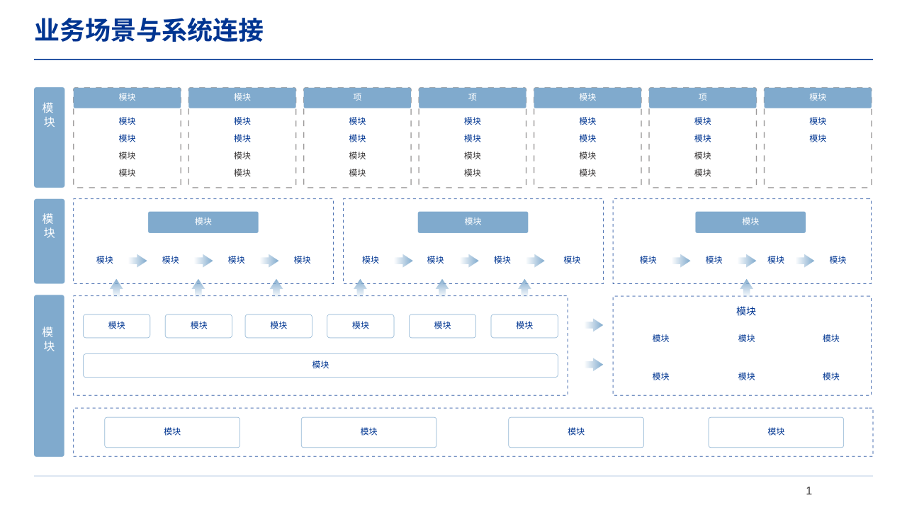

# 业务场景与系统连接

来源为蓝色逻辑架构图.pptx#23。

## 结构与适用场景

顶部7行业应用；中部HR/采购供应链/物流3流程；底部签约平台与企业系统双向连接；基础部署4方式

行业-业务场景-平台-系统架构

每场景步骤数可不同；行业、流程、能力、部署分别参数

固定节点、圆弧、扇区、分面和连接表达定性关系。数量比较、趋势或占比使用数据驱动图表，源页中已登记的微图槽可接收实际数据。

## 预览



## 调用

将下列完整page对象放入schema_version=1、template_id=business-blue-v1的pages数组，替换各节点内容。nodes键对应原文本框或已明确拆分的语义分段，字段角色及source_ref、segment见下表。

```json
{
  "id": "architecture-23",
  "family": "source-architecture",
  "variant": "page-23",
  "content": {
    "title": "业务场景与系统连接",
    "nodes": {
      "shape_322": "模块",
      "shape_323": "模块",
      "shape_324": "模块",
      "shape_325": "模块",
      "shape_326": "模块",
      "shape_327": "项",
      "shape_328": "项",
      "shape_329": "模块",
      "shape_330": "项",
      "shape_331": "模块",
      "shape_337": "模块",
      "shape_338": "模块",
      "shape_339": "模块",
      "shape_340": "模块",
      "shape_341": "模块",
      "shape_342": "模块",
      "shape_343": "模块",
      "shape_344": "模块",
      "shape_345": "模块",
      "shape_346": "模块",
      "shape_347": "模块",
      "shape_348": "模块",
      "shape_349": "模块",
      "shape_350": "模块",
      "shape_351": "模块",
      "shape_352": "模块",
      "shape_353": "模块",
      "shape_354": "模块",
      "shape_355": "模块",
      "shape_356": "模块",
      "shape_357": "模块",
      "shape_358": "模块",
      "shape_359": "模块",
      "shape_360": "模块",
      "shape_361": "模块",
      "shape_362": "模块",
      "shape_363": "模块",
      "shape_364": "模块",
      "shape_365": "模块",
      "shape_366": "模块",
      "shape_367": "模块",
      "shape_368": "模块",
      "shape_369": "模块",
      "shape_370": "模块",
      "shape_371": "模块",
      "shape_375": "模块",
      "shape_376": "模块",
      "shape_377": "模块",
      "shape_378": "模块",
      "shape_379": "模块",
      "shape_380": "模块",
      "shape_381": "模块",
      "shape_382": "模块",
      "shape_383": "模块",
      "shape_384": "模块",
      "shape_385": "模块",
      "shape_386": "模块",
      "shape_387": "模块",
      "shape_388": "模块",
      "shape_389": "模块",
      "shape_390": "模块",
      "shape_391": "模块",
      "shape_392": "模块",
      "shape_393": "模块",
      "shape_394": "模块",
      "shape_395": "模块",
      "shape_396": "模块",
      "shape_397": "模块",
      "shape_398": "模块"
    }
  },
  "config": {
    "show_source": true,
    "show_page_number": true
  }
}
```

config支持show_source、show_page_number、image_fit与image_position。image_fit可选contain或cover，image_position为xMin/xMid/xMax与YMin/YMid/YMax组合的九个焦点，默认为xMidYMid。字体、颜色、全局区和固定字阶取自tokens，节点数与连接结构由variant确定。

## 字段合同

每个业务节点required=true、min=1，max按具体框体登记。字符按规范化后的Unicode码点计数，空格标点换行均计入。build会以实际字体测量宽高，字符数通过后仍可能需要调整文字。

| 字段 | 节点角色与源标签 | 最短/最长 | 字阶 | 框体px | 原框引用 | 分段 | 旋转° | 垂直锚点 |
|---|---|---|---|---|---|---|---|---|
| nodes.shape_322 | 上左节点，源标签“行业化应用” | 1/15 | caption | [57.9539, 143.9598, 23.4599, 100.0968] | slide:322 |  | 0.0 | t |
| nodes.shape_323 | 中左节点，源标签“通用场景” | 1/12 | caption | [57.9539, 300.5895, 23.4599, 80.0754] | slide:323 |  | 0.0 | t |
| nodes.shape_324 | 中左节点，源标签“在线化签约平台” | 1/21 | caption | [57.6028, 460.5543, 23.4599, 140.1293] | slide:324 |  | 0.0 | t |
| nodes.shape_325 | 上左节点，源标签“房地产” | 1/6 | diagramMicro | [160.7044, 130.743, 37.5337, 15.0135] | slide:325 |  | 0.0 | t |
| nodes.shape_326 | 上左节点，源标签“制造业” | 1/6 | diagramMicro | [323.168, 130.743, 37.5337, 15.0135] | slide:326 |  | 0.0 | t |
| nodes.shape_327 | 上中节点，源标签“金融” | 1/4 | diagramMicro | [491.8787, 130.712, 25.019, 15.0135] | slide:327 |  | 0.0 | t |
| nodes.shape_328 | 上中节点，源标签“政务” | 1/4 | diagramMicro | [654.332, 130.743, 25.019, 15.0135] | slide:328 |  | 0.0 | t |
| nodes.shape_329 | 上中节点，源标签“连锁零售” | 1/9 | diagramMicro | [804.281, 130.743, 50.0484, 15.0135] | slide:329 |  | 0.0 | t |
| nodes.shape_330 | 上右节点，源标签“汽车” | 1/4 | diagramMicro | [979.249, 130.743, 25.019, 15.0135] | slide:330 |  | 0.0 | t |
| nodes.shape_331 | 上右节点，源标签“互联网” | 1/6 | diagramMicro | [1135.445, 130.743, 37.5337, 15.0135] | slide:331 |  | 0.0 | t |
| nodes.shape_337 | 中左节点，源标签“人力资源场景” | 1/13 | diagramMicro | [249.3294, 306.2789, 75.0674, 15.0135] | slide:337 |  | 0.0 | t |
| nodes.shape_338 | 中中节点，源标签“采购供应链场景” | 1/16 | diagramMicro | [623.7475, 306.2789, 87.5821, 15.0135] | slide:338 |  | 0.0 | t |
| nodes.shape_339 | 中右节点，源标签“数据汇集” | 1/9 | diagramMicro | [1034.2021, 306.2789, 50.0484, 15.0135] | slide:339 |  | 0.0 | t |
| nodes.shape_340 | 中左节点，源标签“入职场景” | 1/8 | diagramMicro | [125.5662, 360.6656, 44.4829, 15.0] | slide:340 |  | 0.0 | t |
| nodes.shape_341 | 中左节点，源标签“转岗场景” | 1/8 | diagramMicro | [218.497, 360.6656, 44.4829, 15.0] | slide:341 |  | 0.0 | t |
| nodes.shape_342 | 中左节点，源标签“调岗场景” | 1/8 | diagramMicro | [311.4278, 360.6656, 44.4829, 15.0] | slide:342 |  | 0.0 | t |
| nodes.shape_343 | 中左节点，源标签“离职场景” | 1/8 | diagramMicro | [404.3586, 360.6656, 44.4829, 15.0] | slide:343 |  | 0.0 | t |
| nodes.shape_344 | 中中节点，源标签“战略合作” | 1/8 | diagramMicro | [500.7278, 360.6656, 44.4829, 15.0] | slide:344 |  | 0.0 | t |
| nodes.shape_345 | 中中节点，源标签“采集协议” | 1/8 | diagramMicro | [592.2853, 360.6656, 44.4829, 15.0] | slide:345 |  | 0.0 | t |
| nodes.shape_346 | 中中节点，源标签“采购协议” | 1/8 | diagramMicro | [686.5997, 360.6656, 44.4829, 15.0] | slide:346 |  | 0.0 | t |
| nodes.shape_347 | 中中节点，源标签“供应链金融” | 1/10 | diagramMicro | [779.4685, 360.6656, 55.6036, 15.0] | slide:347 |  | 0.0 | t |
| nodes.shape_348 | 中右节点，源标签“销售协议” | 1/8 | diagramMicro | [892.4207, 360.6656, 44.4829, 15.0] | slide:348 |  | 0.0 | t |
| nodes.shape_349 | 中右节点，源标签“销售订单” | 1/8 | diagramMicro | [985.3515, 360.6656, 44.4829, 15.0] | slide:349 |  | 0.0 | t |
| nodes.shape_350 | 中右节点，源标签“对账单” | 1/6 | diagramMicro | [1078.3339, 360.6656, 33.3622, 15.0] | slide:350 |  | 0.0 | t |
| nodes.shape_351 | 中右节点，源标签“物流场景” | 1/8 | diagramMicro | [1160.1956, 360.6656, 44.4829, 15.0] | slide:351 |  | 0.0 | t |
| nodes.shape_352 | 中左节点，源标签“实名认证” | 1/9 | diagramMicro | [139.6504, 452.903, 50.0484, 15.0135] | slide:352 |  | 0.0 | t |
| nodes.shape_353 | 中左节点，源标签“电子文件” | 1/9 | diagramMicro | [255.69, 452.903, 50.0484, 15.0135] | slide:353 |  | 0.0 | t |
| nodes.shape_354 | 中左节点，源标签“签署服务” | 1/9 | diagramMicro | [368.1982, 452.903, 50.0484, 15.0135] | slide:354 |  | 0.0 | t |
| nodes.shape_355 | 中中节点，源标签“存证出征” | 1/9 | diagramMicro | [483.8454, 452.903, 50.0484, 15.0135] | slide:355 |  | 0.0 | t |
| nodes.shape_356 | 中中节点，源标签“印章管理” | 1/9 | diagramMicro | [599.4926, 452.903, 50.0484, 15.0135] | slide:356 |  | 0.0 | t |
| nodes.shape_357 | 中中节点，源标签“法律服务” | 1/9 | diagramMicro | [715.1397, 452.903, 50.0484, 15.0135] | slide:357 |  | 0.0 | t |
| nodes.shape_358 | 下中节点，源标签“电子合同签约服务平台” | 1/23 | diagramMicro | [389.8614, 508.6615, 125.1158, 15.0135] | slide:358 |  | 0.0 | t |
| nodes.shape_359 | 中右节点，源标签“ERP系统” | 1/9 | diagramMicro | [907.5374, 471.4892, 50.0484, 15.0135] | slide:359 |  | 0.0 | t |
| nodes.shape_360 | 中右节点，源标签“OA系统” | 1/8 | diagramMicro | [1031.8169, 471.4892, 43.791, 15.0135] | slide:360 |  | 0.0 | t |
| nodes.shape_361 | 中右节点，源标签“SRM系统” | 1/9 | diagramMicro | [1146.6483, 471.4892, 52.3097, 15.0135] | slide:361 |  | 0.0 | t |
| nodes.shape_362 | 下右节点，源标签“HR系统” | 1/7 | diagramMicro | [911.2753, 525.1825, 42.5726, 15.0135] | slide:362 |  | 0.0 | t |
| nodes.shape_363 | 下右节点，源标签“CRM系统” | 1/9 | diagramMicro | [1026.9535, 525.1825, 53.5178, 15.0135] | slide:363 |  | 0.0 | t |
| nodes.shape_364 | 下右节点，源标签“其他系统” | 1/9 | diagramMicro | [1147.7842, 525.1825, 50.0484, 15.0135] | slide:364 |  | 0.0 | t |
| nodes.shape_365 | 中右节点，源标签“企业业务系统” | 1/13 | diagramCompact | [1011.3205, 432.072, 83.4105, 17.5] | slide:365 |  | 0.0 | t |
| nodes.shape_366 | 下中节点，源标签“可信电子签（独立存储）” | 1/25 | diagramMicro | [744.3097, 602.9656, 137.6305, 15.0135] | slide:366 |  | 0.0 | t |
| nodes.shape_367 | 下中节点，源标签“可信电子签约平台” | 1/18 | diagramMicro | [470.515, 602.9656, 100.0968, 15.0135] | slide:367 |  | 0.0 | t |
| nodes.shape_368 | 下左节点，源标签“SAAS” | 1/6 | diagramMicro | [225.4255, 602.9656, 35.4479, 15.0135] | slide:368 |  | 0.0 | t |
| nodes.shape_369 | 下右节点，源标签“私有化部署” | 1/11 | diagramMicro | [1064.0845, 602.9656, 62.5631, 15.0135] | slide:369 |  | 0.0 | t |
| nodes.shape_370 | 上右节点，源标签“入驻协议” | 1/8 | diagramMicro | [1131.9756, 164.7469, 44.4829, 15.0] | slide:370 |  | 0.0 | t |
| nodes.shape_371 | 上右节点，源标签“B2B电商” | 1/8 | diagramMicro | [1131.7175, 189.1257, 45.0095, 15.0] | slide:371 |  | 0.0 | t |
| nodes.shape_375 | 上右节点，源标签“分期贷款” | 1/8 | diagramMicro | [969.5223, 164.7469, 44.4829, 15.0] | slide:375 |  | 0.0 | t |
| nodes.shape_376 | 上右节点，源标签“汽车金融” | 1/8 | diagramMicro | [969.5223, 189.1257, 44.4829, 15.0] | slide:376 |  | 0.0 | t |
| nodes.shape_377 | 上右节点，源标签“经销商” | 1/6 | diagramMicro | [975.0775, 213.4943, 33.3622, 15.0] | slide:377 |  | 0.0 | t |
| nodes.shape_378 | 上右节点，源标签“采购供应链” | 1/10 | diagramMicro | [963.9567, 237.8731, 55.6036, 15.0] | slide:378 |  | 0.0 | t |
| nodes.shape_379 | 上中节点，源标签“经销商” | 1/6 | diagramMicro | [812.6241, 164.7469, 33.3622, 15.0] | slide:379 |  | 0.0 | t |
| nodes.shape_380 | 上中节点，源标签“采购供应链” | 1/10 | diagramMicro | [801.5034, 189.1257, 55.6036, 15.0] | slide:380 |  | 0.0 | t |
| nodes.shape_381 | 上中节点，源标签“人力资源” | 1/8 | diagramMicro | [807.0586, 213.4943, 44.4829, 15.0] | slide:381 |  | 0.0 | t |
| nodes.shape_382 | 上中节点，源标签“连锁加盟” | 1/8 | diagramMicro | [807.0586, 237.8731, 44.4829, 15.0] | slide:382 |  | 0.0 | t |
| nodes.shape_383 | 上中节点，源标签“电子证照” | 1/8 | diagramMicro | [644.6053, 164.7469, 44.4829, 15.0] | slide:383 |  | 0.0 | t |
| nodes.shape_384 | 上中节点，源标签“公文流转” | 1/8 | diagramMicro | [644.6053, 189.1257, 44.4829, 15.0] | slide:384 |  | 0.0 | t |
| nodes.shape_385 | 上中节点，源标签“政务服务” | 1/8 | diagramMicro | [644.6053, 213.4943, 44.4829, 15.0] | slide:385 |  | 0.0 | t |
| nodes.shape_386 | 上中节点，源标签“政府采购” | 1/8 | diagramMicro | [644.6053, 237.8731, 44.4829, 15.0] | slide:386 |  | 0.0 | t |
| nodes.shape_387 | 上中节点，源标签“投资协议” | 1/8 | diagramMicro | [482.152, 164.7469, 44.4829, 15.0] | slide:387 |  | 0.0 | t |
| nodes.shape_388 | 上中节点，源标签“担保函” | 1/6 | diagramMicro | [487.7072, 189.1257, 33.3622, 15.0] | slide:388 |  | 0.0 | t |
| nodes.shape_389 | 上中节点，源标签“借贷协议” | 1/8 | diagramMicro | [482.152, 213.4943, 44.4829, 15.0] | slide:389 |  | 0.0 | t |
| nodes.shape_390 | 上中节点，源标签“抵押合同” | 1/8 | diagramMicro | [482.152, 237.8731, 44.4829, 15.0] | slide:390 |  | 0.0 | t |
| nodes.shape_391 | 上左节点，源标签“生产质检” | 1/8 | diagramMicro | [319.6883, 164.7469, 44.4829, 15.0] | slide:391 |  | 0.0 | t |
| nodes.shape_392 | 上左节点，源标签“仓储管理” | 1/8 | diagramMicro | [319.6883, 189.1257, 44.4829, 15.0] | slide:392 |  | 0.0 | t |
| nodes.shape_393 | 上左节点，源标签“物流配送” | 1/8 | diagramMicro | [319.6883, 213.4943, 44.4829, 15.0] | slide:393 |  | 0.0 | t |
| nodes.shape_394 | 上左节点，源标签“人力资源” | 1/8 | diagramMicro | [319.6883, 237.8731, 44.4829, 15.0] | slide:394 |  | 0.0 | t |
| nodes.shape_395 | 上左节点，源标签“地产开发” | 1/8 | diagramMicro | [157.235, 164.7469, 44.4829, 15.0] | slide:395 |  | 0.0 | t |
| nodes.shape_396 | 上左节点，源标签“地产销售” | 1/8 | diagramMicro | [157.235, 189.1257, 44.4829, 15.0] | slide:396 |  | 0.0 | t |
| nodes.shape_397 | 上左节点，源标签“地产租赁” | 1/8 | diagramMicro | [157.235, 213.4943, 44.4829, 15.0] | slide:397 |  | 0.0 | t |
| nodes.shape_398 | 上左节点，源标签“物业服务” | 1/8 | diagramMicro | [157.235, 237.8731, 44.4829, 15.0] | slide:398 |  | 0.0 | t |

全局title必填、2至32码点，使用统一标题框。section_name可选0至24码点，source可选0至64码点。所有可编辑文本通过独立原生carrier导出，页码为派生文字。

## 来源处理

原生PPTX源件保存于用户材料目录，分发包仅含用户资产衍生的几何、字段和说明。原始逐框文字、源框与标准化框在page-catalog.json的variant.fields中。

源标题引用为`slide:273`，原文为“解决方案”。模板默认标题依据真实结构设置。

密集全景中的diagramCompact为14px、diagramMicro为12px。适用于体系概览或附录局部标签，现场关键结论用统一标题与正常正文字阶表达。

源画布边界裁切已烘焙为可编辑Bezier几何，3D顶面、侧面与前面通过tokens配色的相对明暗保留。

