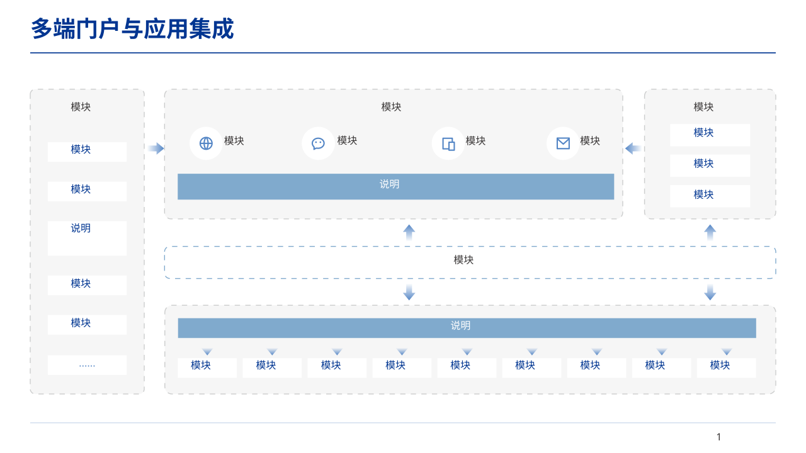

# 多端门户与应用集成

来源为蓝色逻辑架构图.pptx#24。

## 结构与适用场景

左开发平台、中央多端门户、右BI；流程运营横梁；下方ESB及8系统；上下双向箭头

统一门户与系统接入

与house06近重复；不能把左栏与右栏映射成普通4层架构

固定节点、圆弧、扇区、分面和连接表达定性关系。数量比较、趋势或占比使用数据驱动图表，源页中已登记的微图槽可接收实际数据。

## 预览



## 调用

将下列完整page对象放入schema_version=1、template_id=business-blue-v1的pages数组，替换各节点内容。nodes键对应原文本框或已明确拆分的语义分段，字段角色及source_ref、segment见下表。

```json
{
  "id": "architecture-24",
  "family": "source-architecture",
  "variant": "page-24",
  "content": {
    "title": "多端门户与应用集成",
    "nodes": {
      "shape_91": "模块",
      "shape_92": "模块",
      "shape_93": "模块",
      "shape_94": "模块",
      "shape_95": "模块",
      "shape_96": "模块",
      "shape_97": "说明",
      "shape_98": "模块",
      "shape_99": "模块",
      "shape_100": "模块",
      "shape_101": "模块",
      "shape_102": "模块",
      "shape_103": "模块",
      "shape_104": "模块",
      "shape_105": "模块",
      "shape_106": "模块",
      "shape_107": "模块",
      "shape_108": "模块",
      "shape_109": "模块",
      "shape_110": "模块",
      "shape_111": "模块",
      "shape_112": "说明",
      "shape_113": "说明",
      "shape_114": "模块",
      "shape_115": "模块",
      "shape_116": "模块",
      "shape_117": "模块"
    }
  },
  "config": {
    "show_source": true,
    "show_page_number": true
  }
}
```

config支持show_source、show_page_number、image_fit与image_position。image_fit可选contain或cover，image_position为xMin/xMid/xMax与YMin/YMid/YMax组合的九个焦点，默认为xMidYMid。字体、颜色、全局区和固定字阶取自tokens，节点数与连接结构由variant确定。

## 字段合同

每个业务节点required=true、min=1，max按具体框体登记。字符按规范化后的Unicode码点计数，空格标点换行均计入。build会以实际字体测量宽高，字符数通过后仍可能需要调整文字。

| 字段 | 节点角色与源标签 | 最短/最长 | 字阶 | 框体px | 原框引用 | 分段 | 旋转° | 垂直锚点 |
|---|---|---|---|---|---|---|---|---|
| nodes.shape_91 | 上左节点，源标签“敏捷开发平台应用” | 1/20 | caption | [66.0909, 159.6197, 144.9266, 28.876] | slide:91 |  | 0.0 | t |
| nodes.shape_92 | 上中节点，源标签“全方位用户接入” | 1/17 | caption | [567.0742, 159.6197, 129.3586, 28.876] | slide:92 |  | 0.0 | t |
| nodes.shape_93 | 上右节点，源标签“流程监控预警平台（BI）” | 1/26 | caption | [1032.4224, 159.6197, 190.7372, 28.876] | slide:93 |  | 0.0 | t |
| nodes.shape_94 | 中中节点，源标签“统一流程运营平台” | 1/20 | caption | [674.2108, 402.6848, 144.9266, 28.876] | slide:94 |  | 0.0 | t |
| nodes.shape_95 | 上左节点，源标签“集团用户” | 1/11 | caption | [97.2269, 227.0741, 82.6545, 28.876] | slide:95 |  | 0.0 | t |
| nodes.shape_96 | 中左节点，源标签“子公司门户” | 1/13 | caption | [89.4481, 290.3448, 98.2225, 28.876] | slide:96 |  | 0.0 | t |
| nodes.shape_97 | 中左节点，源标签“公告/会议/车辆/设备点检...” | 1/30 | caption | [81.0282, 352.3541, 114.7577, 53.9467] | slide:97 |  | 0.0 | t |
| nodes.shape_98 | 中左节点，源标签“流程中心” | 1/11 | caption | [97.2269, 440.2015, 82.6545, 28.876] | slide:98 |  | 0.0 | t |
| nodes.shape_99 | 下左节点，源标签“应用敏捷开发” | 1/15 | caption | [81.6589, 502.8415, 113.7906, 28.876] | slide:99 |  | 0.0 | t |
| nodes.shape_100 | 下左节点，源标签“SAP” | 1/6 | caption | [304.2364, 570.0226, 49.9207, 28.876] | slide:100 |  | 0.0 | t |
| nodes.shape_101 | 下左节点，源标签“浪潮财务” | 1/11 | caption | [391.411, 570.0226, 82.6545, 28.876] | slide:101 |  | 0.0 | t |
| nodes.shape_102 | 下中节点，源标签“浪潮财务” | 1/11 | caption | [494.6056, 570.0226, 82.6545, 28.876] | slide:102 |  | 0.0 | t |
| nodes.shape_103 | 下中节点，源标签“CRM” | 1/7 | caption | [610.9716, 570.0226, 54.8718, 28.876] | slide:103 |  | 0.0 | t |
| nodes.shape_104 | 下中节点，源标签“人力系统” | 1/11 | caption | [700.154, 570.0226, 82.6545, 28.876] | slide:104 |  | 0.0 | t |
| nodes.shape_105 | 下中节点，源标签“研发系统” | 1/11 | caption | [803.0543, 570.0226, 82.6545, 28.876] | slide:105 |  | 0.0 | t |
| nodes.shape_106 | 下右节点，源标签“工程系统” | 1/11 | caption | [906.291, 570.0226, 82.6545, 28.876] | slide:106 |  | 0.0 | t |
| nodes.shape_107 | 下右节点，源标签“MES” | 1/7 | caption | [1024.3178, 570.0226, 52.7589, 28.876] | slide:107 |  | 0.0 | t |
| nodes.shape_108 | 下右节点，源标签“SRM…” | 1/9 | caption | [1119.3342, 570.0226, 68.8525, 28.876] | slide:108 |  | 0.0 | t |
| nodes.shape_109 | 中右节点，源标签“统计分析” | 1/11 | caption | [1086.4637, 298.9015, 82.6545, 28.876] | slide:109 |  | 0.0 | t |
| nodes.shape_110 | 上右节点，源标签“系统预警” | 1/11 | caption | [1086.4637, 249.5274, 82.6545, 28.876] | slide:110 |  | 0.0 | t |
| nodes.shape_111 | 上右节点，源标签“流程监控” | 1/11 | caption | [1086.4637, 200.3636, 82.6545, 28.876] | slide:111 |  | 0.0 | t |
| nodes.shape_112 | 中中节点，源标签“统一信息门户（单点登录、审批集成、消息推送）” | 1/50 | caption | [447.3655, 282.2822, 362.8789, 28.876] | slide:112 |  | 0.0 | t |
| nodes.shape_113 | 下中节点，源标签“统一业务集成平台（ESB）” | 1/28 | caption | [638.9015, 507.0462, 205.7796, 28.876] | slide:113 |  | 0.0 | t |
| nodes.shape_114 | 上左节点，源标签“浏览器” | 1/9 | caption | [355.6813, 213.4508, 67.0865, 28.876] | slide:114 |  | 0.0 | t |
| nodes.shape_115 | 上中节点，源标签“微信/APP” | 1/12 | caption | [535.339, 212.9462, 87.6056, 28.876] | slide:115 |  | 0.0 | t |
| nodes.shape_116 | 上中节点，源标签“智能设备” | 1/11 | caption | [739.3631, 213.4508, 82.6545, 28.876] | slide:116 |  | 0.0 | t |
| nodes.shape_117 | 上右节点，源标签“邮件” | 1/7 | caption | [921.0916, 213.4508, 51.5185, 28.876] | slide:117 |  | 0.0 | t |

全局title必填、2至32码点，使用统一标题框。section_name可选0至24码点，source可选0至64码点。所有可编辑文本通过独立原生carrier导出，页码为派生文字。

## 来源处理

原生PPTX源件保存于用户材料目录，分发包仅含用户资产衍生的几何、字段和说明。原始逐框文字、源框与标准化框在page-catalog.json的variant.fields中。

源标题引用为`slide:89`，原文为“设计优化”。模板默认标题依据真实结构设置。

密集全景中的diagramCompact为14px、diagramMicro为12px。适用于体系概览或附录局部标签，现场关键结论用统一标题与正常正文字阶表达。

源画布边界裁切已烘焙为可编辑Bezier几何，3D顶面、侧面与前面通过tokens配色的相对明暗保留。

