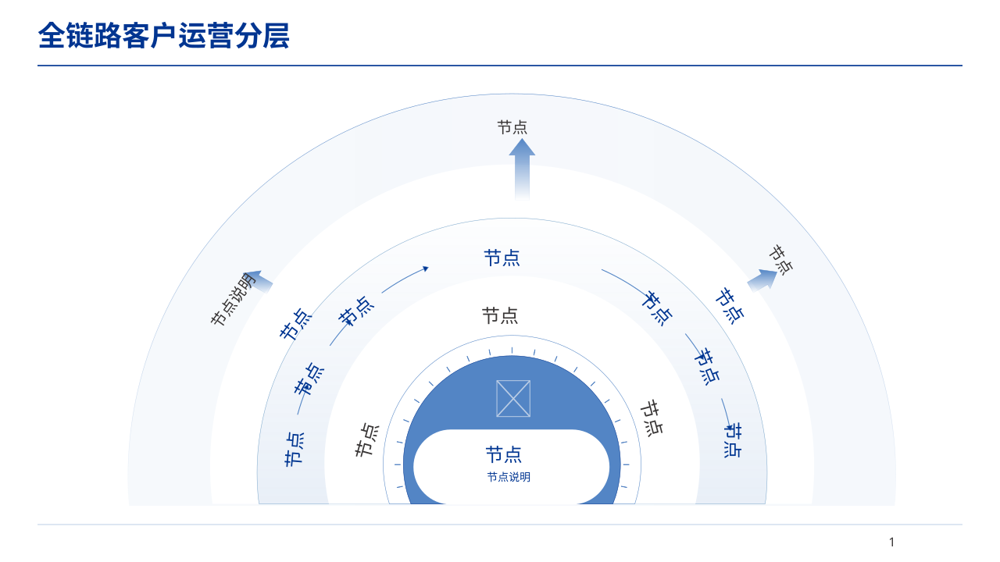

# 全链路客户运营分层

来源为圆形逻辑图PPT模版.pptx#2。

## 结构与适用场景

半圆同心3层；中心运营、内层人货场、中层6步触点与定向箭头、外层3价值；下沿有意裁圆

全链路客户运营分层

保留半圆裁切与弧线文字方向；源下部文本需重排但不能自动改成整圆

固定节点、圆弧、扇区、分面和连接表达定性关系。数量比较、趋势或占比使用数据驱动图表，源页中已登记的微图槽可接收实际数据。

## 预览



## 调用

将下列完整page对象放入schema_version=1、template_id=business-blue-v1的pages数组，替换各节点内容。nodes键对应原文本框或已明确拆分的语义分段，字段角色及source_ref、segment见下表。

```json
{
  "id": "circular-02",
  "family": "source-circular",
  "variant": "page-02",
  "content": {
    "title": "全链路客户运营分层",
    "nodes": {
      "shape_121": "节点",
      "shape_123": "节点说明",
      "shape_125": "节点",
      "shape_127": "节点",
      "shape_129": "节点",
      "shape_131": "节点",
      "shape_133": "节点",
      "shape_134": "节点",
      "shape_135": "节点",
      "shape_136": "节点",
      "shape_137": "节点",
      "shape_138": "节点",
      "shape_139": "节点",
      "shape_140": "节点",
      "shape_141": "节点",
      "shape_142": "节点",
      "shape_144": "节点说明"
    }
  },
  "config": {
    "show_source": true,
    "show_page_number": true
  }
}
```

config支持show_source、show_page_number、image_fit与image_position。image_fit可选contain或cover，image_position为xMin/xMid/xMax与YMin/YMid/YMax组合的九个焦点，默认为xMidYMid。字体、颜色、全局区和固定字阶取自tokens，节点数与连接结构由variant确定。

## 字段合同

每个业务节点required=true、min=1，max按具体框体登记。字符按规范化后的Unicode码点计数，空格标点换行均计入。build会以实际字体测量宽高，字符数通过后仍可能需要调整文字。

| 字段 | 节点角色与源标签 | 最短/最长 | 字阶 | 框体px | 原框引用 | 分段 | 旋转° | 垂直锚点 |
|---|---|---|---|---|---|---|---|---|
| nodes.shape_121 | 下中节点，源标签“客户运营精准化” | 1/17 | body | [563.3741, 568.6105, 193.6961, 34.6042] | slide:121 |  | 0.0 | t |
| nodes.shape_123 | 下中节点，源标签“以规模化方式满足客户个性化需求” | 1/34 | diagramCompact | [550.4336, 602.877, 219.5772, 23.9536] | slide:123 |  | 0.0 | t |
| nodes.shape_125 | 中中节点，源标签“货（产品）” | 1/13 | body | [581.3805, 388.5304, 148.2683, 32.9485] | slide:125 |  | 0 | ctr |
| nodes.shape_127 | 下中节点，源标签“人（产品）” | 1/13 | body | [400.1636, 533.5039, 148.2683, 32.9485] | slide:127 |  | -74.79 | ctr |
| nodes.shape_129 | 下中节点，源标签“场（环保）” | 1/13 | body | [763.421, 534.3276, 148.2683, 32.9485] | slide:129 |  | 75 | ctr |
| nodes.shape_131 | 下左节点，源标签“需求” | 1/6 | body | [341.68, 545.0359, 74.1342, 31.3011] | slide:131 |  | -85.19 | ctr |
| nodes.shape_133 | 中左节点，源标签“推荐” | 1/6 | body | [366.3914, 458.546, 74.1342, 31.3011] | slide:133 |  | -60.11 | ctr |
| nodes.shape_134 | 中中节点，源标签“配置” | 1/6 | body | [430.641, 374.5273, 74.1342, 31.3011] | slide:134 |  | -40.8 | ctr |
| nodes.shape_135 | 中中节点，源标签“体验” | 1/6 | body | [812.8438, 391.0016, 74.1342, 31.3011] | slide:135 |  | 47.97 | ctr |
| nodes.shape_136 | 中右节点，源标签“购买” | 1/6 | body | [872.9749, 468.4306, 74.1342, 31.3011] | slide:136 |  | 67.56 | ctr |
| nodes.shape_137 | 下右节点，源标签“使用” | 1/6 | body | [900.1574, 563.9813, 74.1342, 31.3011] | slide:137 |  | 90 | ctr |
| nodes.shape_138 | 中中节点，源标签“直达全链路客户触点” | 1/22 | body | [534.4288, 314.3963, 247.1139, 32.9485] | slide:138 |  | 0 | ctr |
| nodes.shape_139 | 中左节点，源标签“通过柔性化建造” | 1/19 | body | [280.7253, 389.3541, 214.1654, 31.3011] | slide:139 |  | -53.5 | ctr |
| nodes.shape_140 | 中中节点，源标签“实现个性化用户体验” | 1/25 | body | [805.4304, 389.3541, 271.8253, 31.3011] | slide:140 |  | 57.12 | ctr |
| nodes.shape_141 | 中右节点，源标签“创造极致用户体验” | 1/30 | compactBody | [869.68, 328.3994, 271.8253, 31.3011] | slide:141 |  | 57.12 | ctr |
| nodes.shape_142 | 上中节点，源标签“识别无盲区无盲点” | 1/30 | compactBody | [532.7814, 148.0062, 271.8253, 31.3011] | slide:142 |  | 0 | ctr |
| nodes.shape_144 | 中左节点，源标签“敏捷供应链精准反应柔性生产力” | 1/38 | compactBody | [133.2806, 359.7005, 345.9594, 31.3011] | slide:144 |  | -54 | ctr |

## 可替换图片

在content.visuals提供下列槽位对象，省略时显示中性空槽。每项含path和可选alt，path为--assets目录下的相对本地路径，1至260码点，alt为0至200码点。原案例照片、界面或品牌保留来源引用，默认页使用空槽。

- `visuals.brand_mark`用于品牌标识，替换原矢量品牌或应用标识，框体为`[636.0421, 487.6725, 42.24, 46.0126]`，源引用为`['slide:95']`。

```json
{
  "visuals": {
    "brand_mark": {
      "path": "assets/replacement.png",
      "alt": "品牌标识，替换原矢量品牌或应用标识"
    }
  }
}
```


全局title必填、2至32码点，使用统一标题框。section_name可选0至24码点，source可选0至64码点。所有可编辑文本通过独立原生carrier导出，页码为派生文字。

## 来源处理

原生PPTX源件保存于用户材料目录，分发包仅含用户资产衍生的几何、字段和说明。原始逐框文字、源框与标准化框在page-catalog.json的variant.fields中。

源标题引用为`slide:119`，原文为“Concept extraction”。模板默认标题依据真实结构设置。

密集全景中的diagramCompact为14px、diagramMicro为12px。适用于体系概览或附录局部标签，现场关键结论用统一标题与正常正文字阶表达。

源画布边界裁切已烘焙为可编辑Bezier几何，3D顶面、侧面与前面通过tokens配色的相对明暗保留。

