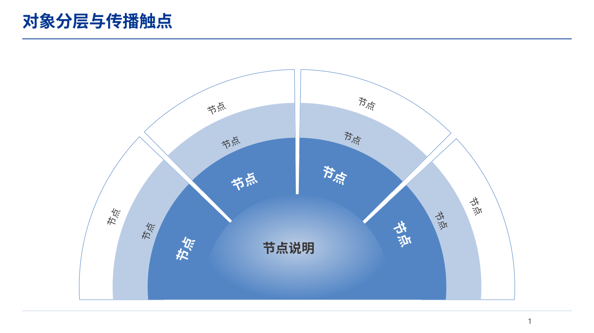

# 对象分层与传播触点

来源为圆形逻辑图PPT模版.pptx#3。

## 结构与适用场景

从底部中心向外3重环与4扇区，分对象/目标/传播工具；多处标签重叠、外圆延伸画布

分人群传播策略

导入预览白字标签明显重叠，必须核对原shape位置/旋转/组合变换；原页不宜直接交付

固定节点、圆弧、扇区、分面和连接表达定性关系。数量比较、趋势或占比使用数据驱动图表，源页中已登记的微图槽可接收实际数据。

## 预览



## 调用

将下列完整page对象放入schema_version=1、template_id=business-blue-v1的pages数组，替换各节点内容。nodes键对应原文本框或已明确拆分的语义分段，字段角色及source_ref、segment见下表。

```json
{
  "id": "circular-03",
  "family": "source-circular",
  "variant": "page-03",
  "content": {
    "title": "对象分层与传播触点",
    "nodes": {
      "shape_4": "节点",
      "shape_31": "节点",
      "shape_32": "节点",
      "shape_33": "节点",
      "shape_34": "节点",
      "shape_35": "节点",
      "shape_37": "节点",
      "shape_36": "节点",
      "shape_39": "节点",
      "shape_40": "节点",
      "shape_41": "节点",
      "shape_42": "节点",
      "shape_7": "节点说明"
    }
  },
  "config": {
    "show_source": true,
    "show_page_number": true
  }
}
```

config支持show_source、show_page_number、image_fit与image_position。image_fit可选contain或cover，image_position为xMin/xMid/xMax与YMin/YMid/YMax组合的九个焦点，默认为xMidYMid。字体、颜色、全局区和固定字阶取自tokens，节点数与连接结构由variant确定。

## 字段合同

每个业务节点required=true、min=1，max按具体框体登记。字符按规范化后的Unicode码点计数，空格标点换行均计入。build会以实际字体测量宽高，字符数通过后仍可能需要调整文字。

| 字段 | 节点角色与源标签 | 最短/最长 | 字阶 | 框体px | 原框引用 | 分段 | 旋转° | 垂直锚点 |
|---|---|---|---|---|---|---|---|---|
| nodes.shape_4 | 下左节点，源标签“现有客户” | 1/10 | heading | [339.4693, 501.5951, 134.9333, 42.5333] | slide:4 |  | -67.5 | ctr |
| nodes.shape_31 | 中中节点，源标签“潜在客户” | 1/10 | heading | [475.9951, 365.0693, 134.9333, 42.5333] | slide:31 |  | -22.5 | ctr |
| nodes.shape_32 | 中中节点，源标签“经销商” | 1/10 | heading | [669.0716, 365.0693, 134.9333, 42.5333] | slide:32 |  | 22.5 | ctr |
| nodes.shape_33 | 下中节点，源标签“其它单位” | 1/10 | heading | [805.5973, 501.5951, 134.9333, 42.5333] | slide:33 |  | 67.5 | ctr |
| nodes.shape_34 | 中左节点，源标签“加强忠诚度” | 1/15 | compactBody | [255.2904, 472.7716, 139.3333, 32.2667] | slide:34 |  | -67.5 | ctr |
| nodes.shape_35 | 中中节点，源标签“提升偏好度” | 1/15 | compactBody | [439.8383, 288.2237, 139.3333, 32.2667] | slide:35 |  | -22.5 | ctr |
| nodes.shape_37 | 中中节点，源标签“加强协作” | 1/15 | compactBody | [700.8284, 288.2237, 139.3333, 32.2667] | slide:37 |  | 22.5 | ctr |
| nodes.shape_36 | 中右节点，源标签“舆论支持” | 1/15 | compactBody | [885.3763, 472.7716, 139.3333, 32.2667] | slide:36 |  | 67.5 | ctr |
| nodes.shape_39 | 中右节点，源标签“公关、 广告、网站” | 1/18 | compactBody | [945.2359, 441.9018, 168.6667, 32.2667] | slide:39 |  | 67.5 | ctr |
| nodes.shape_40 | 上中节点，源标签“公关、终端、广告” | 1/18 | compactBody | [717.0315, 213.6975, 168.6667, 32.2667] | slide:40 |  | 22.5 | ctr |
| nodes.shape_41 | 上中节点，源标签“公关、终端、网站” | 1/18 | compactBody | [394.3018, 213.6975, 168.6667, 32.2667] | slide:41 |  | -22.5 | ctr |
| nodes.shape_42 | 中左节点，源标签“广告、促销、公关” | 1/18 | compactBody | [166.0975, 441.9018, 168.6667, 32.2667] | slide:42 |  | -67.5 | ctr |
| nodes.shape_7 | 下中节点，源标签“不同的对象运用 / 不同的传播工具” | 1/36 | heading | [522.0727, 519.894, 235.8547, 82.9327] | slide:7 |  | 0.0 | t |

全局title必填、2至32码点，使用统一标题框。section_name可选0至24码点，source可选0至64码点。所有可编辑文本通过独立原生carrier导出，页码为派生文字。

## 来源处理

原生PPTX源件保存于用户材料目录，分发包仅含用户资产衍生的几何、字段和说明。原始逐框文字、源框与标准化框在page-catalog.json的variant.fields中。

源标题引用为`slide:2`，原文为“品牌之路”。模板默认标题依据真实结构设置。

密集全景中的diagramCompact为14px、diagramMicro为12px。适用于体系概览或附录局部标签，现场关键结论用统一标题与正常正文字阶表达。

源画布边界裁切已烘焙为可编辑Bezier几何，3D顶面、侧面与前面通过tokens配色的相对明暗保留。

