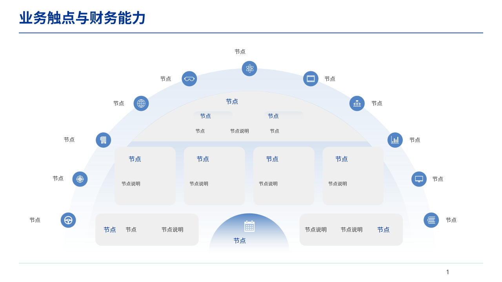

# 业务触点与财务能力

来源为圆形逻辑图PPT模版.pptx#4。

## 结构与适用场景

底数据服务，管理会计两翼，4核心财务模块，中交换服务，顶半圆10业务触点

财务平台能力全景

业务触点、服务能力、横切数据分开；半圆不是趋势或占比图

固定节点、圆弧、扇区、分面和连接表达定性关系。数量比较、趋势或占比使用数据驱动图表，源页中已登记的微图槽可接收实际数据。

## 预览



## 调用

将下列完整page对象放入schema_version=1、template_id=business-blue-v1的pages数组，替换各节点内容。nodes键对应原文本框或已明确拆分的语义分段，字段角色及source_ref、segment见下表。

```json
{
  "id": "circular-04",
  "family": "source-circular",
  "variant": "page-04",
  "content": {
    "title": "业务触点与财务能力",
    "nodes": {
      "shape_255": "节点",
      "shape_257": "节点说明",
      "shape_258": "节点说明",
      "shape_259": "节点",
      "shape_260": "节点",
      "shape_261": "节点",
      "shape_262": "节点说明",
      "shape_263": "节点",
      "shape_264": "节点说明",
      "shape_265": "节点",
      "shape_266": "节点说明",
      "shape_267": "节点",
      "shape_268": "节点说明",
      "shape_269": "节点",
      "shape_270": "节点说明",
      "shape_271": "节点",
      "shape_274": "节点",
      "shape_275": "节点",
      "shape_276": "节点",
      "shape_277": "节点说明",
      "shape_278": "节点",
      "shape_290": "节点",
      "shape_291": "节点",
      "shape_292": "节点",
      "shape_293": "节点",
      "shape_294": "节点",
      "shape_295": "节点",
      "shape_296": "节点",
      "shape_297": "节点",
      "shape_298": "节点",
      "shape_299": "节点",
      "shape_300": "节点"
    }
  },
  "config": {
    "show_source": true,
    "show_page_number": true
  }
}
```

config支持show_source、show_page_number、image_fit与image_position。image_fit可选contain或cover，image_position为xMin/xMid/xMax与YMin/YMid/YMax组合的九个焦点，默认为xMidYMid。字体、颜色、全局区和固定字阶取自tokens，节点数与连接结构由variant确定。

## 字段合同

每个业务节点required=true、min=1，max按具体框体登记。字符按规范化后的Unicode码点计数，空格标点换行均计入。build会以实际字体测量宽高，字符数通过后仍可能需要调整文字。

| 字段 | 节点角色与源标签 | 最短/最长 | 字阶 | 框体px | 原框引用 | 分段 | 旋转° | 垂直锚点 |
|---|---|---|---|---|---|---|---|---|
| nodes.shape_255 | 下中节点，源标签“数据服务” | 1/11 | caption | [594.9963, 599.7008, 84.1775, 29.315] | slide:255 |  | 0.0 | ctr |
| nodes.shape_257 | 下中节点，源标签“成本中心 / 产品成本 / 专项成本” | 1/39 | diagramCompact | [777.0279, 556.1042, 85.4517, 60.665] | slide:257 |  | 0.0 | ctr |
| nodes.shape_258 | 下右节点，源标签“成本估算 / 盈利分析 / 责任会计” | 1/39 | diagramCompact | [868.4104, 556.1042, 85.4517, 60.665] | slide:258 |  | 0.0 | ctr |
| nodes.shape_259 | 下右节点，源标签“管理 / 会计” | 1/12 | caption | [961.5621, 560.0275, 44.99, 52.8275] | slide:259 |  | 0.0 | ctr |
| nodes.shape_260 | 下左节点，源标签“管理 / 会计” | 1/12 | caption | [263.8779, 560.0275, 44.99, 52.8275] | slide:260 |  | 0.0 | ctr |
| nodes.shape_261 | 下左节点，源标签“总账 / 固定资产” | 1/26 | diagramCompact | [320.0971, 565.2525, 85.4517, 42.3775] | slide:261 |  | 0.0 | ctr |
| nodes.shape_262 | 下中节点，源标签“应收管理 / 应付管理 / 存货核算” | 1/39 | diagramCompact | [411.4796, 556.1042, 85.4517, 60.665] | slide:262 |  | 0.0 | ctr |
| nodes.shape_263 | 中左节点，源标签“全球司库” | 1/11 | caption | [327.8154, 391.3333, 84.1775, 29.315] | slide:263 |  | 0.0 | ctr |
| nodes.shape_264 | 中左节点，源标签“账户管理/资金计划 / 现金管理/资金结算 / 商业汇票/资金调度 / 结算中心/投融资管理” | 1/92 | diagramMicro | [309.5829, 434.7558, 128.4433, 68.5025] | slide:264 |  | 0.0 | ctr |
| nodes.shape_265 | 中中节点，源标签“费控服务” | 1/11 | caption | [501.1296, 391.3333, 84.1775, 29.315] | slide:265 |  | 0.0 | ctr |
| nodes.shape_266 | 中中节点，源标签“账户管理/资金计划 / 现金管理/资金结算 / 商业汇票/资金调度 / 结算中心/投融资管理” | 1/92 | diagramMicro | [482.8879, 434.7558, 128.4433, 68.5025] | slide:266 |  | 0.0 | ctr |
| nodes.shape_267 | 中中节点，源标签“税务服务” | 1/11 | caption | [678.0004, 391.3333, 84.1775, 29.315] | slide:267 |  | 0.0 | ctr |
| nodes.shape_268 | 中中节点，源标签“账户管理/资金计划 / 现金管理/资金结算 / 商业汇票/资金调度 / 结算中心/投融资管理” | 1/92 | diagramMicro | [659.7588, 434.7558, 128.4433, 68.5025] | slide:268 |  | 0.0 | ctr |
| nodes.shape_269 | 中右节点，源标签“档案服务” | 1/11 | caption | [854.8713, 391.3333, 84.1775, 29.315] | slide:269 |  | 0.0 | ctr |
| nodes.shape_270 | 中中节点，源标签“账户管理/资金计划 / 现金管理/资金结算 / 商业汇票/资金调度 / 结算中心/投融资管理” | 1/92 | diagramMicro | [836.6388, 434.7558, 128.4433, 68.5025] | slide:270 |  | 0.0 | ctr |
| nodes.shape_271 | 上中节点，源标签“企业绩效服务” | 1/17 | caption | [575.3979, 244.3733, 123.365, 29.315] | slide:271 |  | 0.0 | ctr |
| nodes.shape_274 | 中中节点，源标签“计划预算” | 1/10 | diagramCompact | [509.8012, 284.5417, 66.7608, 24.09] | slide:274 |  | 0.0 | ctr |
| nodes.shape_275 | 中中节点，源标签“报告及合并” | 1/13 | diagramCompact | [682.6846, 284.5417, 82.005, 24.09] | slide:275 |  | 0.0 | ctr |
| nodes.shape_276 | 中中节点，源标签“计划预算 / 预算执行控制” | 1/30 | diagramMicro | [498.2421, 315.8642, 84.1775, 37.1525] | slide:276 |  | 0.0 | ctr |
| nodes.shape_277 | 中中节点，源标签“多维报告与合并 / EPM数据集成” | 1/36 | diagramMicro | [586.6821, 315.8642, 97.24, 37.1525] | slide:277 |  | 0.0 | ctr |
| nodes.shape_278 | 中中节点，源标签“企业报告 / 企业绩效平台” | 1/30 | diagramMicro | [688.1113, 315.8642, 84.1775, 37.1525] | slide:278 |  | 0.0 | ctr |
| nodes.shape_290 | 下左节点，源标签“监管机构” | 1/10 | diagramCompact | [74.9896, 550.0083, 66.7608, 24.09] | slide:290 |  | 0.0 | ctr |
| nodes.shape_291 | 下右节点，源标签“TMC平台” | 1/10 | diagramCompact | [1136.2512, 550.0083, 68.7592, 24.09] | slide:291 |  | 0.0 | ctr |
| nodes.shape_292 | 中右节点，源标签“影像服务” | 1/10 | diagramCompact | [1102.1971, 445.2333, 66.7608, 24.09] | slide:292 |  | 0.0 | ctr |
| nodes.shape_293 | 中右节点，源标签“制造” | 1/5 | diagramCompact | [1043.7046, 345.5275, 36.2817, 24.09] | slide:293 |  | 0.0 | ctr |
| nodes.shape_294 | 上右节点，源标签“资产/项目” | 1/11 | diagramCompact | [946.8587, 252.0183, 74.3783, 24.09] | slide:294 |  | 0.0 | ctr |
| nodes.shape_295 | 上中节点，源标签“供应链” | 1/8 | diagramCompact | [827.0871, 189.5017, 51.5258, 24.09] | slide:295 |  | 0.0 | ctr |
| nodes.shape_296 | 上中节点，源标签“营销/采购” | 1/11 | diagramCompact | [598.0213, 120, 74.3783, 24.09] | slide:296 |  | 0.0 | ctr |
| nodes.shape_297 | 上左节点，源标签“电商” | 1/5 | diagramCompact | [408.3538, 189.5017, 36.2817, 24.09] | slide:297 |  | 0.0 | ctr |
| nodes.shape_298 | 上左节点，源标签“商旅” | 1/5 | diagramCompact | [288.5821, 252.0183, 36.2817, 24.09] | slide:298 |  | 0.0 | ctr |
| nodes.shape_299 | 中左节点，源标签“银行/金融” | 1/11 | diagramCompact | [162.3846, 344.7392, 74.3783, 24.09] | slide:299 |  | 0.0 | ctr |
| nodes.shape_300 | 中左节点，源标签“税务” | 1/5 | diagramCompact | [133.9588, 443.5742, 36.2817, 24.09] | slide:300 |  | 0.0 | ctr |

全局title必填、2至32码点，使用统一标题框。section_name可选0至24码点，source可选0至64码点。所有可编辑文本通过独立原生carrier导出，页码为派生文字。

## 来源处理

原生PPTX源件保存于用户材料目录，分发包仅含用户资产衍生的几何、字段和说明。原始逐框文字、源框与标准化框在page-catalog.json的variant.fields中。

源标题引用为`slide:229`，原文为“企业数智化管理专家”。模板默认标题依据真实结构设置。

密集全景中的diagramCompact为14px、diagramMicro为12px。适用于体系概览或附录局部标签，现场关键结论用统一标题与正常正文字阶表达。

源画布边界裁切已烘焙为可编辑Bezier几何，3D顶面、侧面与前面通过tokens配色的相对明暗保留。

