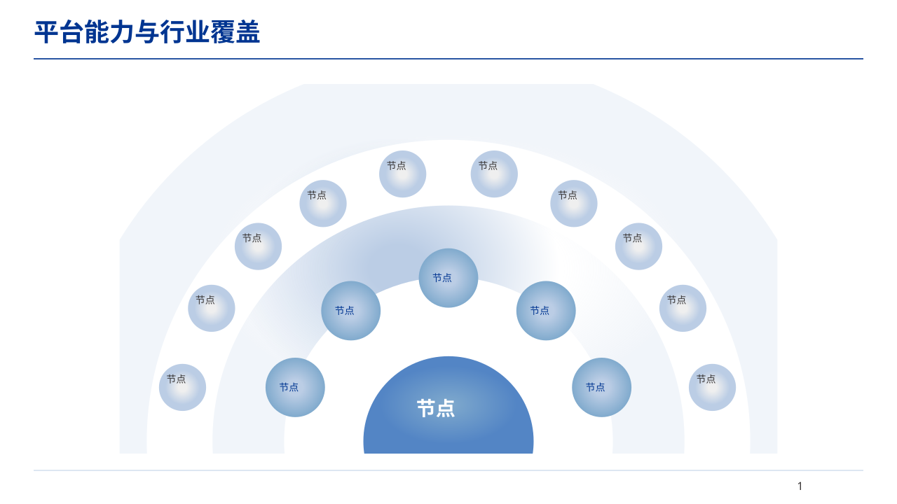

# 平台能力与行业覆盖

来源为圆形逻辑图PPT模版.pptx#5。

## 结构与适用场景

底中心云图组织；内半圆5定向能力；外半圆10行业；同心分层

平台能力到行业覆盖

保留能力与行业两层不同节点数，内节点球体、外节点圈均是分类

固定节点、圆弧、扇区、分面和连接表达定性关系。数量比较、趋势或占比使用数据驱动图表，源页中已登记的微图槽可接收实际数据。

## 预览



## 调用

将下列完整page对象放入schema_version=1、template_id=business-blue-v1的pages数组，替换各节点内容。nodes键对应原文本框或已明确拆分的语义分段，字段角色及source_ref、segment见下表。

```json
{
  "id": "circular-05",
  "family": "source-circular",
  "variant": "page-05",
  "content": {
    "title": "平台能力与行业覆盖",
    "nodes": {
      "shape_96": "节点",
      "shape_105": "节点",
      "shape_109": "节点",
      "shape_113": "节点",
      "shape_117": "节点",
      "shape_4": "节点",
      "shape_14": "节点",
      "shape_47": "节点",
      "shape_48": "节点",
      "shape_49": "节点",
      "shape_50": "节点",
      "shape_51": "节点",
      "shape_52": "节点",
      "shape_53": "节点",
      "shape_54": "节点",
      "shape_55": "节点"
    }
  },
  "config": {
    "show_source": true,
    "show_page_number": true
  }
}
```

config支持show_source、show_page_number、image_fit与image_position。image_fit可选contain或cover，image_position为xMin/xMid/xMax与YMin/YMid/YMax组合的九个焦点，默认为xMidYMid。字体、颜色、全局区和固定字阶取自tokens，节点数与连接结构由variant确定。

## 字段合同

每个业务节点required=true、min=1，max按具体框体登记。字符按规范化后的Unicode码点计数，空格标点换行均计入。build会以实际字体测量宽高，字符数通过后仍可能需要调整文字。

| 字段 | 节点角色与源标签 | 最短/最长 | 字阶 | 框体px | 原框引用 | 分段 | 旋转° | 垂直锚点 |
|---|---|---|---|---|---|---|---|---|
| nodes.shape_96 | 中中节点，源标签“互动行为定向” | 1/65 | diagramCompact | [736.7927, 401.4533, 84.8833, 84.8833] | slide:96 |  | 0.0 | ctr |
| nodes.shape_105 | 下中节点，源标签“自定义人群定向” | 1/65 | diagramCompact | [816.2273, 510.9987, 84.8833, 84.8833] | slide:105 |  | 0.0 | ctr |
| nodes.shape_109 | 中中节点，源标签“环境终端定向” | 1/65 | diagramCompact | [597.562, 354.696, 84.8833, 84.8833] | slide:109 |  | 0.0 | ctr |
| nodes.shape_113 | 中中节点，源标签“观看兴趣定向” | 1/65 | diagramCompact | [458.324, 401.4533, 84.8833, 84.8833] | slide:113 |  | 0.0 | ctr |
| nodes.shape_117 | 下左节点，源标签“用户基础属性定向” | 1/65 | diagramCompact | [378.8893, 510.9987, 84.8833, 84.8833] | slide:117 |  | 0.0 | ctr |
| nodes.shape_4 | 下中节点，源标签“云图组织” | 1/13 | heading | [552.9827, 566.952, 174.0347, 40.282] | slide:4 |  | 0.0 | t |
| nodes.shape_14 | 下左节点，源标签“汽车 / 行业” | 1/14 | diagramCompact | [235.508, 533.2993, 49.9473, 40.282] | slide:14 |  | 0.0 | t |
| nodes.shape_47 | 下右节点，源标签“美妆 / 行业” | 1/16 | diagramCompact | [990.9147, 533.2993, 51.304, 40.282] | slide:47 |  | 0.0 | t |
| nodes.shape_48 | 中左节点，源标签“快消 / 行业” | 1/14 | diagramCompact | [279.6327, 420.2707, 44.506, 40.282] | slide:48 |  | 0.0 | t |
| nodes.shape_49 | 中右节点，源标签“服装 / 服饰行业” | 1/24 | diagramCompact | [934.536, 420.2707, 79.9407, 40.282] | slide:49 |  | 0.0 | t |
| nodes.shape_50 | 中左节点，源标签“房地产 / 行业” | 1/18 | diagramCompact | [337.9327, 331.926, 61.16, 40.282] | slide:50 |  | 0.0 | t |
| nodes.shape_51 | 中右节点，源标签“汽车 / 行业” | 1/14 | diagramCompact | [888.82, 331.926, 45.3347, 40.282] | slide:51 |  | 0.0 | t |
| nodes.shape_52 | 上中节点，源标签“3C / 行业” | 1/16 | diagramCompact | [792.6067, 270.6193, 52.6973, 40.282] | slide:52 |  | 0.0 | t |
| nodes.shape_53 | 上中节点，源标签“家居 / 装修” | 1/16 | diagramCompact | [434.3293, 270.6193, 53.438, 40.282] | slide:53 |  | 0.0 | t |
| nodes.shape_54 | 上中节点，源标签“游戏 / 行业” | 1/14 | diagramCompact | [551.8093, 228.4747, 45.7527, 40.282] | slide:54 |  | 0.0 | t |
| nodes.shape_55 | 上中节点，源标签“母婴 / 行业” | 1/16 | diagramCompact | [679.402, 228.4747, 51.832, 40.282] | slide:55 |  | 0.0 | t |

全局title必填、2至32码点，使用统一标题框。section_name可选0至24码点，source可选0至64码点。所有可编辑文本通过独立原生carrier导出，页码为派生文字。

## 来源处理

原生PPTX源件保存于用户材料目录，分发包仅含用户资产衍生的几何、字段和说明。原始逐框文字、源框与标准化框在page-catalog.json的variant.fields中。

源标题引用为`slide:2`，原文为“基于云图大数据平台人群精细化投放”。模板默认标题依据真实结构设置。

密集全景中的diagramCompact为14px、diagramMicro为12px。适用于体系概览或附录局部标签，现场关键结论用统一标题与正常正文字阶表达。

源画布边界裁切已烘焙为可编辑Bezier几何，3D顶面、侧面与前面通过tokens配色的相对明暗保留。

