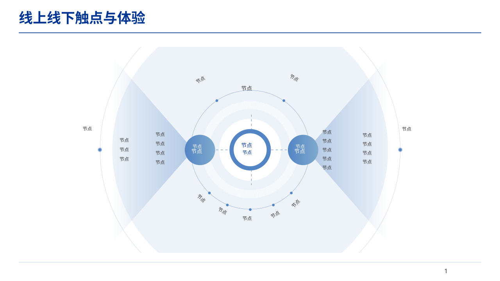

# 线上线下触点与体验

来源为圆形逻辑图PPT模版.pptx#6。

## 结构与适用场景

中心品牌；左右物理/数字触点两圈及列表；内体验闭环，外品牌印迹弧；对角分区

线上线下触点与用户体验

触点清单、体验阶段、效果回路分别字段，不能混成一个节点列表

固定节点、圆弧、扇区、分面和连接表达定性关系。数量比较、趋势或占比使用数据驱动图表，源页中已登记的微图槽可接收实际数据。

## 预览



## 调用

将下列完整page对象放入schema_version=1、template_id=business-blue-v1的pages数组，替换各节点内容。nodes键对应原文本框或已明确拆分的语义分段，字段角色及source_ref、segment见下表。

```json
{
  "id": "circular-06",
  "family": "source-circular",
  "variant": "page-06",
  "content": {
    "title": "线上线下触点与体验",
    "nodes": {
      "shape_65": "节点",
      "shape_66": "节点",
      "shape_67": "节点",
      "shape_68": "节点",
      "shape_69": "节点",
      "shape_70": "节点",
      "shape_71": "节点",
      "shape_72": "节点",
      "shape_73": "节点",
      "shape_74": "节点",
      "shape_75": "节点",
      "shape_76": "节点",
      "shape_77": "节点",
      "shape_78": "节点",
      "shape_79": "节点",
      "shape_80": "节点",
      "shape_81": "节点",
      "shape_82": "节点",
      "shape_84": "节点",
      "shape_85": "节点",
      "shape_86": "节点",
      "shape_87": "节点",
      "shape_88": "节点",
      "shape_89": "节点",
      "shape_90": "节点",
      "shape_91": "节点",
      "shape_92": "节点",
      "shape_93": "节点",
      "shape_94": "节点",
      "shape_95": "节点",
      "shape_96": "节点",
      "shape_97": "节点"
    }
  },
  "config": {
    "show_source": true,
    "show_page_number": true
  }
}
```

config支持show_source、show_page_number、image_fit与image_position。image_fit可选contain或cover，image_position为xMin/xMid/xMax与YMin/YMid/YMax组合的九个焦点，默认为xMidYMid。字体、颜色、全局区和固定字阶取自tokens，节点数与连接结构由variant确定。

## 字段合同

每个业务节点required=true、min=1，max按具体框体登记。字符按规范化后的Unicode码点计数，空格标点换行均计入。build会以实际字体测量宽高，字符数通过后仍可能需要调整文字。

| 字段 | 节点角色与源标签 | 最短/最长 | 字阶 | 框体px | 原框引用 | 分段 | 旋转° | 垂直锚点 |
|---|---|---|---|---|---|---|---|---|
| nodes.shape_65 | 中左节点，源标签“品牌印迹” | 1/40 | diagramMicro | [217.006, 322.1653, 28.4387, 123.904] | slide:65 |  | 0.0 | t |
| nodes.shape_66 | 中左节点，源标签“线下体验” | 1/14 | diagramMicro | [287.362, 351.4253, 77.066, 18.9567] | slide:66 |  | 0.0 | t |
| nodes.shape_67 | 中右节点，源标签“品牌印迹” | 1/40 | diagramMicro | [1034.5553, 322.774, 28.4387, 123.904] | slide:67 |  | 0.0 | t |
| nodes.shape_68 | 中左节点，源标签“车身广告” | 1/14 | diagramMicro | [287.362, 375.6473, 77.066, 18.9567] | slide:68 |  | 0.0 | t |
| nodes.shape_69 | 中左节点，源标签“地铁/公交” | 1/14 | diagramMicro | [287.362, 399.8693, 77.066, 18.9567] | slide:69 |  | 0.0 | t |
| nodes.shape_70 | 中左节点，源标签“机场投屏” | 1/14 | diagramMicro | [377.4887, 336.7293, 80.4907, 18.9567] | slide:70 |  | 0.0 | t |
| nodes.shape_71 | 中左节点，源标签“电梯屏幕” | 1/14 | diagramMicro | [377.4887, 360.57, 80.4907, 18.9567] | slide:71 |  | 0.0 | t |
| nodes.shape_72 | 中左节点，源标签“橱窗广告” | 1/14 | diagramMicro | [377.4887, 384.4107, 80.4907, 18.9567] | slide:72 |  | 0.0 | t |
| nodes.shape_73 | 中左节点，源标签“楼宇广告” | 1/14 | diagramMicro | [377.4887, 408.2513, 80.4907, 18.9567] | slide:73 |  | 0.0 | t |
| nodes.shape_74 | 中中节点，源标签“APP启动屏” | 1/18 | diagramMicro | [825.02, 330.9727, 99.0587, 18.9567] | slide:74 |  | 0.0 | t |
| nodes.shape_75 | 中中节点，源标签“直播/第三方直播” | 1/18 | diagramMicro | [825.02, 353.7133, 99.0587, 18.9567] | slide:75 |  | 0.0 | t |
| nodes.shape_76 | 中中节点，源标签“抖音/快手/微博” | 1/18 | diagramMicro | [825.02, 376.4613, 99.0587, 18.9567] | slide:76 |  | 0.0 | t |
| nodes.shape_77 | 中中节点，源标签“站外广告banner” | 1/18 | diagramMicro | [825.02, 399.202, 99.0587, 18.9567] | slide:77 |  | 0.0 | t |
| nodes.shape_78 | 中中节点，源标签“朋友圈/分享” | 1/18 | diagramMicro | [825.02, 421.9427, 99.0587, 18.9567] | slide:78 |  | 0.0 | t |
| nodes.shape_79 | 中右节点，源标签“短视频” | 1/13 | diagramMicro | [927.8773, 338.7827, 71.368, 18.9567] | slide:79 |  | 0.0 | t |
| nodes.shape_80 | 中右节点，源标签“门户网站” | 1/13 | diagramMicro | [927.8773, 361.5307, 71.368, 18.9567] | slide:80 |  | 0.0 | t |
| nodes.shape_81 | 中右节点，源标签“电视投放” | 1/13 | diagramMicro | [927.8773, 384.2713, 71.368, 18.9567] | slide:81 |  | 0.0 | t |
| nodes.shape_82 | 中右节点，源标签“院线投放” | 1/13 | diagramMicro | [927.8773, 407.012, 71.368, 18.9567] | slide:82 |  | 0.0 | t |
| nodes.shape_84 | 中中节点，源标签“物理触点” | 1/13 | diagramCompact | [470.754, 379.336, 83.666, 23.694] | slide:84 |  | 0.0 | t |
| nodes.shape_85 | 中中节点，源标签“意象投射” | 1/15 | diagramMicro | [470.754, 367.6907, 83.666, 15.4] | slide:85 |  | 0.0 | t |
| nodes.shape_86 | 中中节点，源标签“数字触点” | 1/13 | diagramCompact | [734.4167, 379.336, 83.666, 23.694] | slide:86 |  | 0.0 | t |
| nodes.shape_87 | 中中节点，源标签“意象投射” | 1/15 | diagramMicro | [734.4167, 367.6907, 83.666, 15.4] | slide:87 |  | 0.0 | t |
| nodes.shape_88 | 中中节点，源标签“品牌触点” | 1/13 | diagramCompact | [598.596, 363.804, 83.666, 23.694] | slide:88 |  | 0.0 | t |
| nodes.shape_89 | 中中节点，源标签“效果验证” | 1/15 | diagramMicro | [598.596, 382.966, 83.666, 15.4] | slide:89 |  | 0.0 | t |
| nodes.shape_90 | 上中节点，源标签“品牌体验” | 1/13 | diagramCompact | [598.596, 218.12, 83.666, 23.694] | slide:90 |  | 0.0 | t |
| nodes.shape_91 | 上中节点，源标签“被吸引” | 1/20 | diagramMicro | [517.9293, 189.9967, 27.2507, 61.842] | slide:91 |  | -30.0 | t |
| nodes.shape_92 | 上中节点，源标签“被动感知” | 1/20 | diagramMicro | [734.358, 192.7687, 27.2507, 61.842] | slide:92 |  | 30.0 | t |
| nodes.shape_93 | 下中节点，源标签“记忆” | 1/20 | diagramMicro | [490.6713, 499.4193, 27.2507, 61.842] | slide:93 |  | 45.0 | t |
| nodes.shape_94 | 下中节点，源标签“决策” | 1/20 | diagramMicro | [550.988, 533.754, 27.2507, 61.842] | slide:94 |  | 30.0 | t |
| nodes.shape_95 | 下中节点，源标签“拥护” | 1/20 | diagramMicro | [626.8073, 551.9407, 27.2507, 61.842] | slide:95 |  | 0.0 | t |
| nodes.shape_96 | 下中节点，源标签“购买” | 1/20 | diagramMicro | [709.278, 535.0447, 27.2507, 61.842] | slide:96 |  | -30.0 | t |
| nodes.shape_97 | 下中节点，源标签“复购” | 1/20 | diagramMicro | [765.4953, 501.6487, 27.2507, 61.842] | slide:97 |  | -45.0 | t |

## 保留的原装饰

本页保留用户原模板的结构图标或装饰图片，逐项身份见source-field-coverage.json中本页retained_source_images。其中图片内固化的字形随整图编辑，可在PowerPoint中原生替换整图；nodes字段控制已登记的可编辑文字。参数图片替换使用本页image_slots列出的槽位。


全局title必填、2至32码点，使用统一标题框。section_name可选0至24码点，source可选0至64码点。所有可编辑文本通过独立原生carrier导出，页码为派生文字。

## 来源处理

原生PPTX源件保存于用户材料目录，分发包仅含用户资产衍生的几何、字段和说明。原始逐框文字、源框与标准化框在page-catalog.json的variant.fields中。

源标题引用为`None`，原文为“无独立源标题”。模板默认标题依据真实结构设置。

密集全景中的diagramCompact为14px、diagramMicro为12px。适用于体系概览或附录局部标签，现场关键结论用统一标题与正常正文字阶表达。

源画布边界裁切已烘焙为可编辑Bezier几何，3D顶面、侧面与前面通过tokens配色的相对明暗保留。

