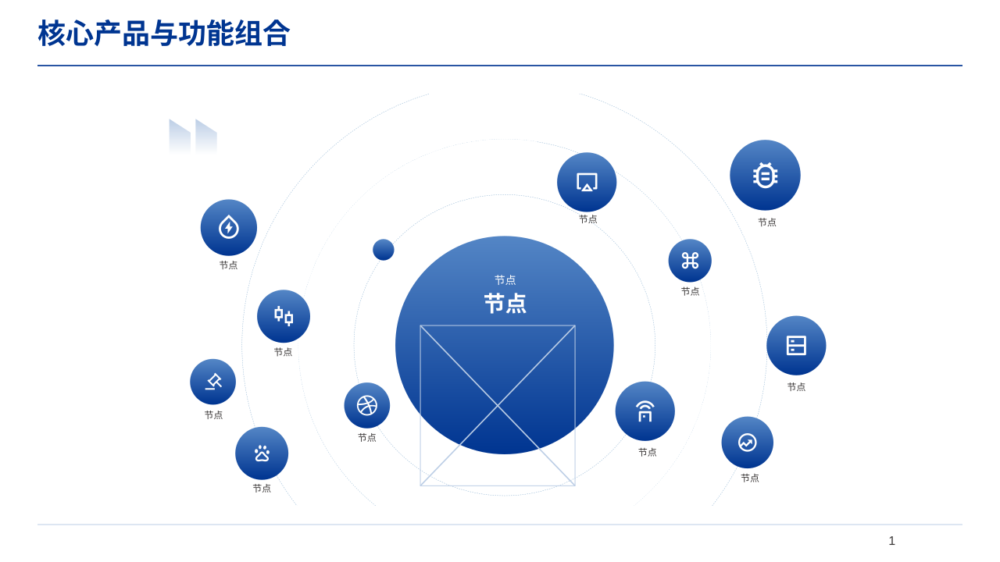

# 核心产品与功能组合

来源为圆形逻辑图PPT模版.pptx#7。

## 结构与适用场景

中心球体、内外3环轨道、10个功能图标球与大小节点

核心产品与多项功能

中心优质私人家具明显残留错例文，应按实际检测船功能说明；轨道不是时间顺序

固定节点、圆弧、扇区、分面和连接表达定性关系。数量比较、趋势或占比使用数据驱动图表，源页中已登记的微图槽可接收实际数据。

## 预览



## 调用

将下列完整page对象放入schema_version=1、template_id=business-blue-v1的pages数组，替换各节点内容。nodes键对应原文本框或已明确拆分的语义分段，字段角色及source_ref、segment见下表。

```json
{
  "id": "circular-07",
  "family": "source-circular",
  "variant": "page-07",
  "content": {
    "title": "核心产品与功能组合",
    "nodes": {
      "shape_59": "节点",
      "shape_60": "节点",
      "shape_61": "节点",
      "shape_62": "节点",
      "shape_63": "节点",
      "shape_64": "节点",
      "shape_65": "节点",
      "shape_66": "节点",
      "shape_67": "节点",
      "shape_68": "节点",
      "shape_69": "节点",
      "shape_70": "节点",
      "shape_71": "节点"
    }
  },
  "config": {
    "show_source": true,
    "show_page_number": true
  }
}
```

config支持show_source、show_page_number、image_fit与image_position。image_fit可选contain或cover，image_position为xMin/xMid/xMax与YMin/YMid/YMax组合的九个焦点，默认为xMidYMid。字体、颜色、全局区和固定字阶取自tokens，节点数与连接结构由variant确定。

## 字段合同

每个业务节点required=true、min=1，max按具体框体登记。字符按规范化后的Unicode码点计数，空格标点换行均计入。build会以实际字体测量宽高，字符数通过后仍可能需要调整文字。

| 字段 | 节点角色与源标签 | 最短/最长 | 字阶 | 框体px | 原框引用 | 分段 | 旋转° | 垂直锚点 |
|---|---|---|---|---|---|---|---|---|
| nodes.shape_59 | 中中节点，源标签“优质的私人家具” | 1/15 | heading | [549.8843, 374.486, 193.5193, 35.0] | slide:59 |  | 0.0 | t |
| nodes.shape_60 | 中中节点，源标签“集众多功能于一身的” | 1/18 | diagramCompact | [588.883, 351.6367, 115.5147, 17.5] | slide:60 |  | 0.0 | t |
| nodes.shape_61 | 上中节点，源标签“雷达探测” | 1/16 | diagramMicro | [708.7537, 274.6657, 88.0, 15.0] | slide:61 |  | 0.0 | t |
| nodes.shape_62 | 中中节点，源标签“水下与你探测” | 1/16 | diagramMicro | [839.551, 367.1683, 88.0, 15.0] | slide:62 |  | 0.0 | t |
| nodes.shape_63 | 上右节点，源标签“水下群落检测” | 1/16 | diagramMicro | [937.979, 278.7063, 88.0, 15.0] | slide:63 |  | 0.0 | t |
| nodes.shape_64 | 下右节点，源标签“雷达探测” | 1/16 | diagramMicro | [975.379, 489.6643, 88.0, 15.0] | slide:64 |  | 0.0 | t |
| nodes.shape_65 | 下右节点，源标签“气象预警” | 1/16 | diagramMicro | [915.979, 606.279, 88.0, 15.0] | slide:65 |  | 0.0 | t |
| nodes.shape_66 | 下中节点，源标签“湖库水质检测” | 1/16 | diagramMicro | [784.7563, 573.2277, 88.0, 15.0] | slide:66 |  | 0.0 | t |
| nodes.shape_67 | 下中节点，源标签“多连平数据处理” | 1/16 | diagramMicro | [425.7897, 554.447, 88.0, 15.0] | slide:67 |  | 0.0 | t |
| nodes.shape_68 | 下左节点，源标签“水下可视” | 1/16 | diagramMicro | [291.179, 619.479, 88.0, 15.0] | slide:68 |  | 0.0 | t |
| nodes.shape_69 | 下左节点，源标签“沉积物取样” | 1/16 | diagramMicro | [229.3883, 525.5903, 88.0, 15.0] | slide:69 |  | 0.0 | t |
| nodes.shape_70 | 中左节点，源标签“水动力检测” | 1/16 | diagramMicro | [318.3637, 444.887, 88.0, 15.0] | slide:70 |  | 0.0 | t |
| nodes.shape_71 | 中左节点，源标签“无人机探测” | 1/16 | diagramMicro | [248.3963, 333.6623, 88.0, 15.0] | slide:71 |  | 0.0 | t |

## 可替换图片

在content.visuals提供下列槽位对象，省略时显示中性空槽。每项含path和可选alt，path为--assets目录下的相对本地路径，1至260码点，alt为0至200码点。原案例照片、界面或品牌保留来源引用，默认页使用空槽。

- `visuals.product_image`用于中心产品图，原两张同产品透明裁片合并为一个可替换图片槽，框体为`[538.063, 417.0, 198.0, 205.3333]`，源引用为`['slide:56', 'slide:58']`。

```json
{
  "visuals": {
    "product_image": {
      "path": "assets/replacement.png",
      "alt": "中心产品图，原两张同产品透明裁片合并为一个可替换图片槽"
    }
  }
}
```


全局title必填、2至32码点，使用统一标题框。section_name可选0至24码点，source可选0至64码点。所有可编辑文本通过独立原生carrier导出，页码为派生文字。

## 来源处理

原生PPTX源件保存于用户材料目录，分发包仅含用户资产衍生的几何、字段和说明。原始逐框文字、源框与标准化框在page-catalog.json的variant.fields中。

源标题引用为`slide:74`，原文为“湖库检测预警船的主要功能”。模板默认标题依据真实结构设置。

密集全景中的diagramCompact为14px、diagramMicro为12px。适用于体系概览或附录局部标签，现场关键结论用统一标题与正常正文字阶表达。

源画布边界裁切已烘焙为可编辑Bezier几何，3D顶面、侧面与前面通过tokens配色的相对明暗保留。

