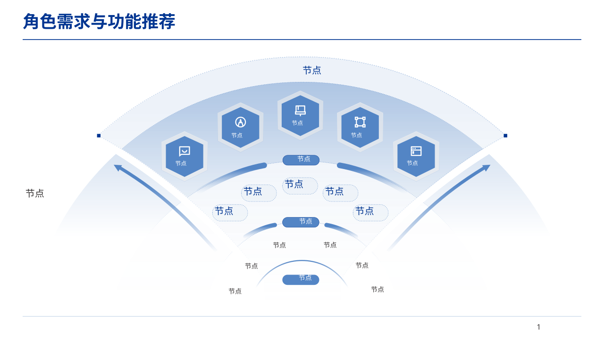

# 角色需求与功能推荐

来源为圆形逻辑图PPT模版.pptx#8。

## 结构与适用场景

扇形同心层，从职业角色→岗位领域→趋势→5推荐功能；两侧径向上箭头

角色需求到产品推荐体系

保持扇形扩张、层内节点数不同与角色关系；图中边缘曲线文字需实测防重叠

固定节点、圆弧、扇区、分面和连接表达定性关系。数量比较、趋势或占比使用数据驱动图表，源页中已登记的微图槽可接收实际数据。

## 预览



## 调用

将下列完整page对象放入schema_version=1、template_id=business-blue-v1的pages数组，替换各节点内容。nodes键对应原文本框或已明确拆分的语义分段，字段角色及source_ref、segment见下表。

```json
{
  "id": "circular-08",
  "family": "source-circular",
  "variant": "page-08",
  "content": {
    "title": "角色需求与功能推荐",
    "nodes": {
      "shape_84": "节点",
      "shape_159": "节点",
      "shape_160": "节点",
      "shape_161": "节点",
      "shape_162": "节点",
      "shape_163": "节点",
      "shape_164": "节点",
      "shape_165": "节点",
      "shape_166": "节点",
      "shape_167": "节点",
      "shape_168": "节点",
      "shape_169": "节点",
      "shape_170": "节点",
      "shape_171": "节点",
      "shape_172": "节点",
      "shape_173": "节点",
      "shape_174": "节点",
      "shape_175": "节点",
      "shape_176": "节点",
      "shape_177": "节点",
      "shape_178": "节点"
    }
  },
  "config": {
    "show_source": true,
    "show_page_number": true
  }
}
```

config支持show_source、show_page_number、image_fit与image_position。image_fit可选contain或cover，image_position为xMin/xMid/xMax与YMin/YMid/YMax组合的九个焦点，默认为xMidYMid。字体、颜色、全局区和固定字阶取自tokens，节点数与连接结构由variant确定。

## 字段合同

每个业务节点required=true、min=1，max按具体框体登记。字符按规范化后的Unicode码点计数，空格标点换行均计入。build会以实际字体测量宽高，字符数通过后仍可能需要调整文字。

| 字段 | 节点角色与源标签 | 最短/最长 | 字阶 | 框体px | 原框引用 | 分段 | 旋转° | 垂直锚点 |
|---|---|---|---|---|---|---|---|---|
| nodes.shape_84 | 上中节点，源标签“·” | 1/2340 | compactBody | [53.7776, 174.2324, 1174.1486, 473.7676] | slide:84 |  | 0.0 | ctr |
| nodes.shape_159 | 下中节点，源标签“船员经理” | 1/12 | diagramCompact | [453.7226, 610.2839, 76.5453, 24.8986] | slide:159 |  | 0.0 | t |
| nodes.shape_160 | 下中节点，源标签“机务主管” | 1/12 | diagramCompact | [488.3821, 556.8648, 76.5453, 24.8986] | slide:160 |  | 0.0 | t |
| nodes.shape_161 | 下中节点，源标签“采购专员” | 1/12 | diagramCompact | [547.786, 512.4531, 76.5453, 24.8986] | slide:161 |  | 0.0 | t |
| nodes.shape_162 | 下中节点，源标签“操作经理” | 1/12 | diagramCompact | [655.1978, 512.085, 76.5453, 24.8986] | slide:162 |  | 0.0 | t |
| nodes.shape_163 | 下中节点，源标签“机务助理” | 1/12 | diagramCompact | [722.8299, 555.4178, 76.5453, 24.8986] | slide:163 |  | 0.0 | t |
| nodes.shape_164 | 下中节点，源标签“船员主管” | 1/12 | diagramCompact | [755.6742, 606.4737, 76.5453, 24.8986] | slide:164 |  | 0.0 | t |
| nodes.shape_165 | 中中节点，源标签“岗位领域” | 1/12 | diagramCompact | [603.6024, 461.5514, 76.5453, 24.8986] | slide:165 |  | 0.0 | t |
| nodes.shape_166 | 下中节点，源标签“就业机会” | 1/12 | diagramCompact | [602.4466, 581.3268, 76.5453, 24.8986] | slide:166 |  | 0.0 | t |
| nodes.shape_167 | 中中节点，源标签“趋势影响” | 1/12 | diagramCompact | [599.5526, 329.1554, 76.5453, 24.8986] | slide:167 |  | 0.0 | t |
| nodes.shape_168 | 中中节点，源标签“开发” | 1/6 | compactBody | [459.699, 436.7127, 55.7907, 30.4298] | slide:168 |  | 0.0 | t |
| nodes.shape_169 | 中中节点，源标签“运营” | 1/6 | compactBody | [520.7725, 395.0408, 55.7907, 30.4298] | slide:169 |  | 0.0 | t |
| nodes.shape_170 | 中中节点，源标签“销售” | 1/6 | compactBody | [608.1061, 379.629, 55.7907, 30.4298] | slide:170 |  | 0.0 | t |
| nodes.shape_171 | 中中节点，源标签“服务” | 1/6 | compactBody | [693.7273, 395.0408, 55.7907, 30.4298] | slide:171 |  | 0.0 | t |
| nodes.shape_172 | 中中节点，源标签“管理” | 1/6 | compactBody | [757.6606, 436.7127, 55.7907, 30.4298] | slide:172 |  | 0.0 | t |
| nodes.shape_173 | 中左节点，源标签“船员经理” | 1/12 | diagramMicro | [357.4673, 339.31, 67.3239, 22.1331] | slide:173 |  | 0.0 | t |
| nodes.shape_174 | 上中节点，源标签“现场检查” | 1/12 | diagramMicro | [476.1211, 279.8804, 67.3239, 22.1331] | slide:174 |  | 0.0 | t |
| nodes.shape_175 | 上中节点，源标签“船员管理” | 1/12 | diagramMicro | [604.3388, 253.569, 67.3239, 22.1331] | slide:175 |  | 0.0 | t |
| nodes.shape_176 | 上中节点，源标签“船员管理” | 1/12 | diagramMicro | [729.5169, 279.5465, 67.3239, 22.1331] | slide:176 |  | 0.0 | t |
| nodes.shape_177 | 中右节点，源标签“清单管理” | 1/12 | diagramMicro | [847.9395, 338.7364, 67.3239, 22.1331] | slide:177 |  | 0.0 | t |
| nodes.shape_178 | 上中节点，源标签“首页推荐优化” | 1/14 | compactBody | [572.9073, 137.9034, 134.1855, 30.4298] | slide:178 |  | 0.0 | t |

全局title必填、2至32码点，使用统一标题框。section_name可选0至24码点，source可选0至64码点。所有可编辑文本通过独立原生carrier导出，页码为派生文字。

## 来源处理

原生PPTX源件保存于用户材料目录，分发包仅含用户资产衍生的几何、字段和说明。原始逐框文字、源框与标准化框在page-catalog.json的variant.fields中。

源标题引用为`slide:147`，原文为“Concept extraction”。模板默认标题依据真实结构设置。

密集全景中的diagramCompact为14px、diagramMicro为12px。适用于体系概览或附录局部标签，现场关键结论用统一标题与正常正文字阶表达。

源画布边界裁切已烘焙为可编辑Bezier几何，3D顶面、侧面与前面通过tokens配色的相对明暗保留。

