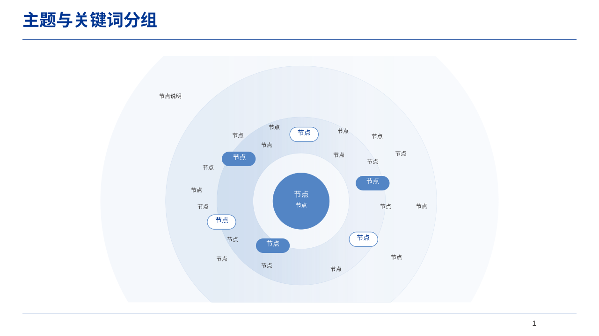

# 主题与关键词分组

来源为圆形逻辑图PPT模版.pptx#9。

## 结构与适用场景

中心主题，3同心圆环上散布6重点词与约20联想词，无箭头

概念发散、关键词分组

属于探索词场，缺业务结论时不用于领导汇报结论页；词权重无数据支持

固定节点、圆弧、扇区、分面和连接表达定性关系。数量比较、趋势或占比使用数据驱动图表，源页中已登记的微图槽可接收实际数据。

## 预览



## 调用

将下列完整page对象放入schema_version=1、template_id=business-blue-v1的pages数组，替换各节点内容。nodes键对应原文本框或已明确拆分的语义分段，字段角色及source_ref、segment见下表。

```json
{
  "id": "circular-09",
  "family": "source-circular",
  "variant": "page-09",
  "content": {
    "title": "主题与关键词分组",
    "nodes": {
      "shape_14": "节点说明",
      "shape_15": "节点",
      "shape_16": "节点",
      "shape_22": "节点",
      "shape_23": "节点",
      "shape_24": "节点",
      "shape_25": "节点",
      "shape_26": "节点",
      "shape_27": "节点",
      "shape_28": "节点",
      "shape_29": "节点",
      "shape_30": "节点",
      "shape_31": "节点",
      "shape_32": "节点",
      "shape_33": "节点",
      "shape_34": "节点",
      "shape_35": "节点",
      "shape_36": "节点",
      "shape_37": "节点",
      "shape_38": "节点",
      "shape_40": "节点",
      "shape_41": "节点",
      "shape_42": "节点",
      "shape_43": "节点",
      "shape_44": "节点",
      "shape_45": "节点",
      "shape_46": "节点"
    }
  },
  "config": {
    "show_source": true,
    "show_page_number": true
  }
}
```

config支持show_source、show_page_number、image_fit与image_position。image_fit可选contain或cover，image_position为xMin/xMid/xMax与YMin/YMid/YMax组合的九个焦点，默认为xMidYMid。字体、颜色、全局区和固定字阶取自tokens，节点数与连接结构由variant确定。

## 字段合同

每个业务节点required=true、min=1，max按具体框体登记。字符按规范化后的Unicode码点计数，空格标点换行均计入。build会以实际字体测量宽高，字符数通过后仍可能需要调整文字。

| 字段 | 节点角色与源标签 | 最短/最长 | 字阶 | 框体px | 原框引用 | 分段 | 旋转° | 垂直锚点 |
|---|---|---|---|---|---|---|---|---|
| nodes.shape_14 | 上中节点，源标签“在理念发散阶段，以时间为单位并从日常管理流程出发” | 1/63 | diagramMicro | [339.8906, 199.6033, 340.4867, 20.1447] | slide:14 |  | 0.0 | t |
| nodes.shape_15 | 中中节点，源标签“关键词风暴” | 1/19 | caption | [575.1806, 408.112, 137.3827, 28.4387] | slide:15 |  | 0.0 | t |
| nodes.shape_16 | 中中节点，源标签“色彩情绪版” | 1/25 | diagramMicro | [575.1806, 433.1553, 137.3827, 20.1447] | slide:16 |  | 0.0 | t |
| nodes.shape_22 | 中中节点，源标签“活力” | 1/9 | diagramCompact | [482.4433, 329.506, 58.234, 23.694] | slide:22 |  | 0.0 | t |
| nodes.shape_23 | 中中节点，源标签“突破” | 1/9 | diagramCompact | [444.86, 464.564, 58.234, 23.694] | slide:23 |  | 0.0 | t |
| nodes.shape_24 | 下中节点，源标签“成长” | 1/9 | diagramCompact | [553.914, 514.5993, 58.234, 23.694] | slide:24 |  | 0.0 | t |
| nodes.shape_25 | 中中节点，源标签“童趣” | 1/9 | diagramCompact | [767.182, 380.7, 58.234, 23.694] | slide:25 |  | 0.0 | t |
| nodes.shape_26 | 上中节点，源标签“突破” | 1/9 | diagramCompact | [620.6693, 276.904, 58.234, 23.694] | slide:26 |  | 0.0 | t |
| nodes.shape_27 | 下中节点，源标签“朝气” | 1/9 | diagramCompact | [747.162, 501.9567, 58.234, 23.694] | slide:27 |  | 0.0 | t |
| nodes.shape_28 | 中中节点，源标签“卡通” | 1/10 | diagramMicro | [794.9313, 435.9567, 58.234, 21.3253] | slide:28 |  | 0.0 | t |
| nodes.shape_29 | 中中节点，源标签“童真” | 1/10 | diagramMicro | [767.182, 340.1687, 58.234, 21.3253] | slide:29 |  | 0.0 | t |
| nodes.shape_30 | 中中节点，源标签“糖果” | 1/10 | diagramMicro | [694.9633, 325.8247, 58.234, 21.3253] | slide:30 |  | 0.0 | t |
| nodes.shape_31 | 上中节点，源标签“未来” | 1/10 | diagramMicro | [703.91, 274.3447, 58.234, 21.3253] | slide:31 |  | 0.0 | t |
| nodes.shape_32 | 中中节点，源标签“花朵” | 1/10 | diagramMicro | [540.6773, 304.4407, 58.234, 21.3253] | slide:32 |  | 0.0 | t |
| nodes.shape_33 | 中中节点，源标签“生命力” | 1/10 | diagramMicro | [415.732, 352.7527, 58.234, 21.3253] | slide:33 |  | 0.0 | t |
| nodes.shape_34 | 中左节点，源标签“朝阳” | 1/10 | diagramMicro | [390.982, 401.006, 58.234, 21.3253] | slide:34 |  | 0.0 | t |
| nodes.shape_35 | 中左节点，源标签“棉花糖” | 1/10 | diagramMicro | [404.6513, 436.624, 58.234, 21.3253] | slide:35 |  | 0.0 | t |
| nodes.shape_36 | 下中节点，源标签“俏皮” | 1/10 | diagramMicro | [467.674, 507.1047, 58.234, 21.3253] | slide:36 |  | 0.0 | t |
| nodes.shape_37 | 下中节点，源标签“甜甜圈” | 1/10 | diagramMicro | [688.7446, 570.1273, 58.234, 21.3253] | slide:37 |  | 0.0 | t |
| nodes.shape_38 | 中中节点，源标签“贴心” | 1/10 | diagramMicro | [776.752, 285.8287, 58.234, 21.3253] | slide:38 |  | 0.0 | t |
| nodes.shape_40 | 中中节点，源标签“好奇心” | 1/10 | diagramMicro | [827.3373, 322.686, 58.234, 21.3253] | slide:40 |  | 0.0 | t |
| nodes.shape_41 | 中右节点，源标签“后浪” | 1/10 | diagramMicro | [871.8213, 435.392, 58.234, 21.3253] | slide:41 |  | 0.0 | t |
| nodes.shape_42 | 下中节点，源标签“嫩芽” | 1/10 | diagramMicro | [818.112, 544.9593, 58.234, 21.3253] | slide:42 |  | 0.0 | t |
| nodes.shape_43 | 下中节点，源标签“希望” | 1/10 | diagramMicro | [540.6773, 562.8673, 58.234, 21.3253] | slide:43 |  | 0.0 | t |
| nodes.shape_44 | 下中节点，源标签“爆米花” | 1/10 | diagramMicro | [444.86, 548.3767, 58.234, 21.3253] | slide:44 |  | 0.0 | t |
| nodes.shape_45 | 上中节点，源标签“活力” | 1/10 | diagramMicro | [556.95, 266.2413, 58.234, 21.3253] | slide:45 |  | 0.0 | t |
| nodes.shape_46 | 中中节点，源标签“种子” | 1/10 | diagramMicro | [479.2166, 283.6433, 58.234, 21.3253] | slide:46 |  | 0.0 | t |

全局title必填、2至32码点，使用统一标题框。section_name可选0至24码点，source可选0至64码点。所有可编辑文本通过独立原生carrier导出，页码为派生文字。

## 来源处理

原生PPTX源件保存于用户材料目录，分发包仅含用户资产衍生的几何、字段和说明。原始逐框文字、源框与标准化框在page-catalog.json的variant.fields中。

源标题引用为`slide:10`，原文为“Concept extraction”。模板默认标题依据真实结构设置。

密集全景中的diagramCompact为14px、diagramMicro为12px。适用于体系概览或附录局部标签，现场关键结论用统一标题与正常正文字阶表达。

源画布边界裁切已烘焙为可编辑Bezier几何，3D顶面、侧面与前面通过tokens配色的相对明暗保留。

