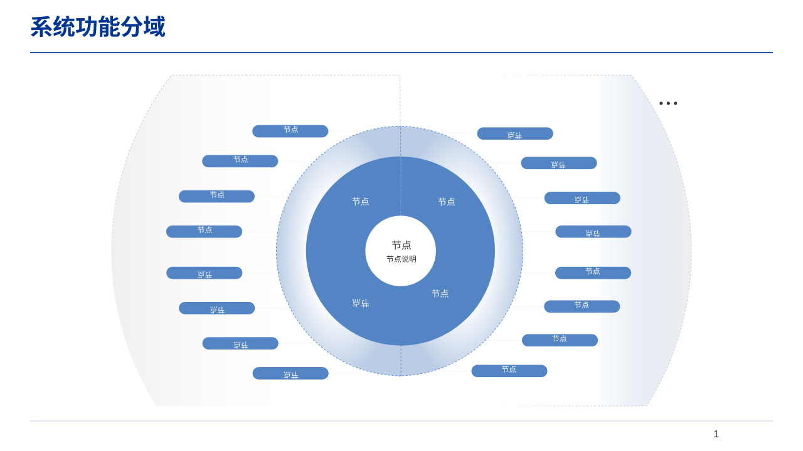

# 系统功能分域

来源为圆形逻辑图PPT模版.pptx#10。

## 结构与适用场景

中心系统；4扇区商品/库存/物流/设备；每区4外围小条；外围圈

系统功能分域

保留4扇区和每区子模块，源左右条需与对应象限绑定

固定节点、圆弧、扇区、分面和连接表达定性关系。数量比较、趋势或占比使用数据驱动图表，源页中已登记的微图槽可接收实际数据。

## 预览



## 调用

将下列完整page对象放入schema_version=1、template_id=business-blue-v1的pages数组，替换各节点内容。nodes键对应原文本框或已明确拆分的语义分段，字段角色及source_ref、segment见下表。

```json
{
  "id": "circular-10",
  "family": "source-circular",
  "variant": "page-10",
  "content": {
    "title": "系统功能分域",
    "nodes": {
      "shape_233": "节点",
      "shape_237": "节点",
      "shape_240": "节点",
      "shape_247": "节点",
      "shape_287": "节点",
      "shape_54": "节点",
      "shape_57": "节点",
      "shape_270": "节点",
      "shape_279": "节点",
      "shape_10": "节点",
      "shape_16": "节点",
      "shape_20": "节点",
      "shape_24": "节点",
      "shape_29": "节点",
      "shape_31": "节点",
      "shape_286": "节点",
      "shape_297": "节点说明",
      "shape_39": "节点",
      "shape_42": "节点",
      "shape_45": "节点",
      "shape_50": "节点",
      "shape_53": "节点"
    }
  },
  "config": {
    "show_source": true,
    "show_page_number": true
  }
}
```

config支持show_source、show_page_number、image_fit与image_position。image_fit可选contain或cover，image_position为xMin/xMid/xMax与YMin/YMid/YMax组合的九个焦点，默认为xMidYMid。字体、颜色、全局区和固定字阶取自tokens，节点数与连接结构由variant确定。

## 字段合同

每个业务节点required=true、min=1，max按具体框体登记。字符按规范化后的Unicode码点计数，空格标点换行均计入。build会以实际字体测量宽高，字符数通过后仍可能需要调整文字。

| 字段 | 节点角色与源标签 | 最短/最长 | 字阶 | 框体px | 原框引用 | 分段 | 旋转° | 垂直锚点 |
|---|---|---|---|---|---|---|---|---|
| nodes.shape_233 | 下中节点，源标签“型号管理” | 1/9 | diagramMicro | [784.3045, 583.3053, 53.7387, 19.1913] | slide:233 |  | 0.0 | t |
| nodes.shape_237 | 下右节点，源标签“设备位置” | 1/9 | diagramMicro | [864.8099, 534.2893, 53.8633, 19.1913] | slide:237 |  | 0.0 | t |
| nodes.shape_240 | 中右节点，源标签“设备台账” | 1/9 | diagramMicro | [917.8152, 426.7387, 53.8633, 19.1913] | slide:240 |  | 0.0 | t |
| nodes.shape_247 | 下右节点，源标签“设备分类” | 1/9 | diagramMicro | [900.0832, 480.3673, 53.8633, 19.1913] | slide:247 |  | 0.0 | t |
| nodes.shape_287 | 中中节点，源标签“设备管理” | 1/11 | diagramCompact | [666.1572, 461.616, 70.642, 24.266] | slide:287 |  | 0.0 | t |
| nodes.shape_54 | 上中节点，源标签“入库管理” | 1/9 | diagramMicro | [793.5005, 202.9547, 53.7387, 19.1913] | slide:54 |  | -180.0 | t |
| nodes.shape_57 | 上右节点，源标签“出库管理” | 1/9 | diagramMicro | [863.2625, 250.0127, 53.8633, 19.1913] | slide:57 |  | -180.0 | t |
| nodes.shape_270 | 中右节点，源标签“月结管理” | 1/9 | diagramMicro | [918.2185, 359.514, 53.8633, 19.1913] | slide:270 |  | -180.0 | t |
| nodes.shape_279 | 中右节点，源标签“库存查询” | 1/9 | diagramMicro | [900.4865, 305.8927, 53.8633, 19.1913] | slide:279 |  | -180.0 | t |
| nodes.shape_10 | 上中节点，源标签“商品基础资料” | 1/13 | diagramMicro | [427.0465, 200.564, 73.1133, 19.1913] | slide:10 |  | 0.0 | t |
| nodes.shape_16 | 上左节点，源标签“商品类目” | 1/9 | diagramMicro | [356.6832, 248.3847, 53.8633, 19.1913] | slide:16 |  | 0.0 | t |
| nodes.shape_20 | 中左节点，源标签“属性管理” | 1/9 | diagramMicro | [299.4025, 360.8487, 53.8633, 19.1913] | slide:20 |  | 0.0 | t |
| nodes.shape_24 | 中左节点，源标签“品牌管理” | 1/9 | diagramMicro | [319.3052, 304.6167, 53.8633, 19.1913] | slide:24 |  | 0.0 | t |
| nodes.shape_29 | 中中节点，源标签“商品管理” | 1/11 | diagramCompact | [539.3492, 314.5607, 70.642, 24.266] | slide:29 |  | 0.0 | t |
| nodes.shape_31 | 中中节点，源标签“智能进销存” | 1/14 | caption | [588.3212, 383.1347, 103.0773, 29.744] | slide:31 |  | 0.0 | t |
| nodes.shape_286 | 中中节点，源标签“库存管理” | 1/11 | diagramCompact | [676.5119, 315.0887, 70.642, 24.266] | slide:286 |  | 0.0 | t |
| nodes.shape_297 | 中中节点，源标签“Intelligent invoicing” | 1/37 | diagramMicro | [539.3272, 407.298, 201.0727, 20.1447] | slide:297 |  | 0.0 | t |
| nodes.shape_39 | 下中节点，源标签“智能租单” | 1/9 | diagramMicro | [436.9832, 585.696, 53.8633, 19.1913] | slide:39 |  | -180.0 | t |
| nodes.shape_42 | 下左节点，源标签“运输单据” | 1/9 | diagramMicro | [356.9985, 537.868, 53.8633, 19.1913] | slide:42 |  | -180.0 | t |
| nodes.shape_45 | 中左节点，源标签“车辆信息” | 1/9 | diagramMicro | [299.7179, 425.4113, 53.8633, 19.1913] | slide:45 |  | -180.0 | t |
| nodes.shape_50 | 下左节点，源标签“物流单据” | 1/9 | diagramMicro | [319.6279, 481.6433, 53.8633, 19.1913] | slide:50 |  | -180.0 | t |
| nodes.shape_53 | 中中节点，源标签“物流管理” | 1/11 | diagramCompact | [539.6719, 466.6247, 70.642, 24.266] | slide:53 |  | -180.0 | t |

全局title必填、2至32码点，使用统一标题框。section_name可选0至24码点，source可选0至64码点。所有可编辑文本通过独立原生carrier导出，页码为派生文字。

## 来源处理

原生PPTX源件保存于用户材料目录，分发包仅含用户资产衍生的几何、字段和说明。原始逐框文字、源框与标准化框在page-catalog.json的variant.fields中。

源标题引用为`slide:30`，原文为“智能进销存系统构成”。模板默认标题依据真实结构设置。

密集全景中的diagramCompact为14px、diagramMicro为12px。适用于体系概览或附录局部标签，现场关键结论用统一标题与正常正文字阶表达。

源画布边界裁切已烘焙为可编辑Bezier几何，3D顶面、侧面与前面通过tokens配色的相对明暗保留。

