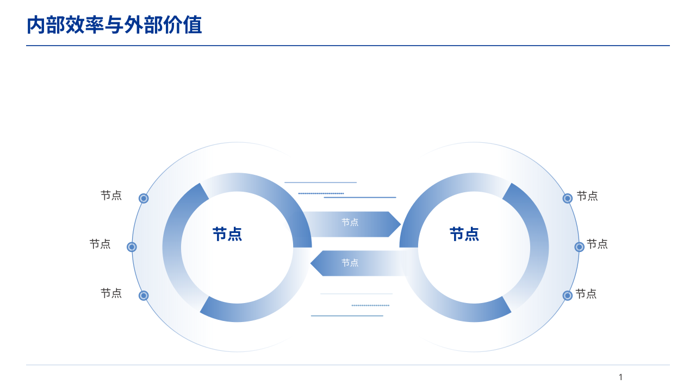

# 内部效率与外部价值

来源为圆形逻辑图PPT模版.pptx#11。

## 结构与适用场景

两个并列环形箭头，内部/外部驱动；中双向横箭头；左右各3收益

内部效率与外部价值双循环

两环与连接方向不可只保留两卡；原箭头表示机制非量化比例

固定节点、圆弧、扇区、分面和连接表达定性关系。数量比较、趋势或占比使用数据驱动图表，源页中已登记的微图槽可接收实际数据。

## 预览



## 调用

将下列完整page对象放入schema_version=1、template_id=business-blue-v1的pages数组，替换各节点内容。nodes键对应原文本框或已明确拆分的语义分段，字段角色及source_ref、segment见下表。

```json
{
  "id": "circular-11",
  "family": "source-circular",
  "variant": "page-11",
  "content": {
    "title": "内部效率与外部价值",
    "nodes": {
      "shape_7": "节点",
      "shape_8": "节点",
      "shape_11": "节点",
      "shape_20": "节点",
      "shape_25": "节点",
      "shape_30": "节点",
      "shape_34": "节点",
      "shape_35": "节点",
      "shape_36": "节点",
      "shape_55": "节点"
    }
  },
  "config": {
    "show_source": true,
    "show_page_number": true
  }
}
```

config支持show_source、show_page_number、image_fit与image_position。image_fit可选contain或cover，image_position为xMin/xMid/xMax与YMin/YMid/YMax组合的九个焦点，默认为xMidYMid。字体、颜色、全局区和固定字阶取自tokens，节点数与连接结构由variant确定。

## 字段合同

每个业务节点required=true、min=1，max按具体框体登记。字符按规范化后的Unicode码点计数，空格标点换行均计入。build会以实际字体测量宽高，字符数通过后仍可能需要调整文字。

| 字段 | 节点角色与源标签 | 最短/最长 | 字阶 | 框体px | 原框引用 | 分段 | 旋转° | 垂直锚点 |
|---|---|---|---|---|---|---|---|---|
| nodes.shape_7 | 中中节点，源标签“新秀项目孵化” | 1/16 | caption | [593.0598, 399.1926, 121.946, 29.7409] | slide:7 |  | 0.0 | t |
| nodes.shape_8 | 中中节点，源标签“服务技术创新” | 1/16 | caption | [593.0598, 473.8072, 121.946, 29.7409] | slide:8 |  | 0.0 | t |
| nodes.shape_11 | 中左节点，源标签“内部 / 驱动” | 1/12 | heading | [397.3737, 414.7488, 77.33, 80.3032] | slide:11 |  | 0.0 | t |
| nodes.shape_20 | 中左节点，源标签“减少重复投入” | 1/15 | compactBody | [113.5694, 348.4554, 136.821, 32.7141] | slide:20 |  | 0.0 | t |
| nodes.shape_25 | 中左节点，源标签“提升研发效率” | 1/15 | compactBody | [92.9874, 437.9727, 136.821, 32.7141] | slide:25 |  | 0.0 | t |
| nodes.shape_30 | 下左节点，源标签“降低运营成本” | 1/15 | compactBody | [113.5694, 528.613, 136.821, 32.7141] | slide:30 |  | 0.0 | t |
| nodes.shape_34 | 中右节点，源标签“创造社会价值” | 1/15 | compactBody | [1060.05, 349.5876, 136.821, 32.7141] | slide:34 |  | 0.0 | t |
| nodes.shape_35 | 中右节点，源标签“促进技术发展” | 1/15 | compactBody | [1078.2572, 437.9727, 136.821, 32.7141] | slide:35 |  | 0.0 | t |
| nodes.shape_36 | 下右节点，源标签“提高研发质量” | 1/15 | compactBody | [1057.6751, 529.7544, 136.821, 32.7141] | slide:36 |  | 0.0 | t |
| nodes.shape_55 | 中中节点，源标签“外部 / 驱动” | 1/12 | heading | [833.3619, 414.7488, 77.33, 80.3032] | slide:55 |  | 0.0 | t |

## 保留的原装饰

本页保留用户原模板的结构图标或装饰图片，逐项身份见source-field-coverage.json中本页retained_source_images。其中图片内固化的字形随整图编辑，可在PowerPoint中原生替换整图；nodes字段控制已登记的可编辑文字。参数图片替换使用本页image_slots列出的槽位。


全局title必填、2至32码点，使用统一标题框。section_name可选0至24码点，source可选0至64码点。所有可编辑文本通过独立原生carrier导出，页码为派生文字。

## 来源处理

原生PPTX源件保存于用户材料目录，分发包仅含用户资产衍生的几何、字段和说明。原始逐框文字、源框与标准化框在page-catalog.json的variant.fields中。

源标题引用为`slide:66`，原文为“双循环驱动战略”。模板默认标题依据真实结构设置。

密集全景中的diagramCompact为14px、diagramMicro为12px。适用于体系概览或附录局部标签，现场关键结论用统一标题与正常正文字阶表达。

源画布边界裁切已烘焙为可编辑Bezier几何，3D顶面、侧面与前面通过tokens配色的相对明暗保留。

