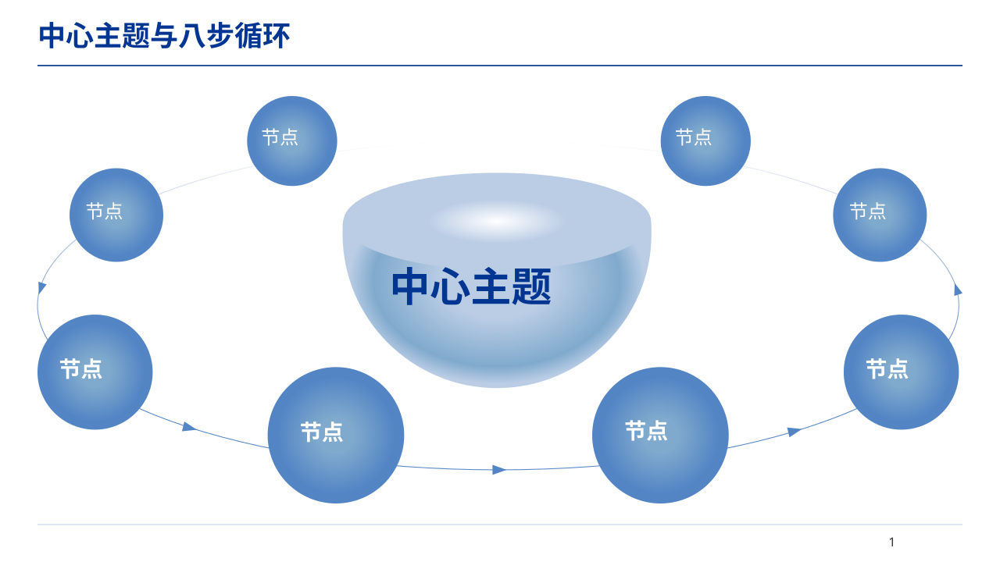

# 中心主题与八步循环

来源为圆形逻辑图PPT模版.pptx#12。

## 结构与适用场景

中心危机球；外围8球沿椭圆按箭头循环；大背景环

8阶段管理闭环

8节点与完整有向边必须保留；先理清阶段顺序，不能改为4节点循环

固定节点、圆弧、扇区、分面和连接表达定性关系。数量比较、趋势或占比使用数据驱动图表，源页中已登记的微图槽可接收实际数据。

## 预览



## 调用

将下列完整page对象放入schema_version=1、template_id=business-blue-v1的pages数组，替换各节点内容。nodes键对应原文本框或已明确拆分的语义分段，字段角色及source_ref、segment见下表。

```json
{
  "id": "circular-12",
  "family": "source-circular",
  "variant": "page-12",
  "content": {
    "title": "中心主题与八步循环",
    "nodes": {
      "shape_42": "节点",
      "shape_33": "节点",
      "shape_36": "节点",
      "shape_39": "节点",
      "shape_45": "节点",
      "shape_53": "节点",
      "shape_61": "中心主题",
      "shape_50": "节点",
      "shape_30": "节点"
    }
  },
  "config": {
    "show_source": true,
    "show_page_number": true
  }
}
```

config支持show_source、show_page_number、image_fit与image_position。image_fit可选contain或cover，image_position为xMin/xMid/xMax与YMin/YMid/YMax组合的九个焦点，默认为xMidYMid。字体、颜色、全局区和固定字阶取自tokens，节点数与连接结构由variant确定。

## 字段合同

每个业务节点required=true、min=1，max按具体框体登记。字符按规范化后的Unicode码点计数，空格标点换行均计入。build会以实际字体测量宽高，字符数通过后仍可能需要调整文字。

| 字段 | 节点角色与源标签 | 最短/最长 | 字阶 | 框体px | 原框引用 | 分段 | 旋转° | 垂直锚点 |
|---|---|---|---|---|---|---|---|---|
| nodes.shape_42 | 下左节点，源标签“危机预警” | 1/10 | heading | [360.6923, 537.197, 138.5746, 44.3207] | slide:42 |  | 0.0 | t |
| nodes.shape_33 | 上右节点，源标签“策略制定” | 1/10 | body | [1070.5511, 256.735, 111.5982, 37.4948] | slide:33 |  | 0.0 | t |
| nodes.shape_36 | 中右节点，源标签“制定目标” | 1/10 | heading | [1090.2269, 456.3099, 126.843, 40.913] | slide:36 |  | 0.0 | t |
| nodes.shape_39 | 下中节点，源标签“分析判断” | 1/11 | heading | [774.3801, 535.4984, 142.0034, 44.3207] | slide:39 |  | 0.0 | t |
| nodes.shape_45 | 中左节点，源标签“危机预防” | 1/10 | heading | [55.5433, 456.3099, 132.3396, 40.913] | slide:45 |  | 0.0 | t |
| nodes.shape_53 | 上左节点，源标签“管理实施” | 1/11 | body | [309.3454, 161.8902, 129.1535, 37.4948] | slide:53 |  | 0.0 | t |
| nodes.shape_61 | 中中节点，源标签“CRISIS” | 1/15 | metric | [459.5989, 335.5121, 353.1517, 84.4002] | slide:61 |  | 0.0 | t |
| nodes.shape_50 | 上右节点，源标签“组织策划” | 1/10 | body | [847.534, 161.8902, 111.5982, 37.4948] | slide:50 |  | 0.0 | t |
| nodes.shape_30 | 上左节点，源标签“危机恢复” | 1/11 | body | [84.4398, 256.735, 129.1535, 37.4948] | slide:30 |  | 0.0 | t |

全局title必填、2至32码点，使用统一标题框。section_name可选0至24码点，source可选0至64码点。所有可编辑文本通过独立原生carrier导出，页码为派生文字。

## 来源处理

原生PPTX源件保存于用户材料目录，分发包仅含用户资产衍生的几何、字段和说明。原始逐框文字、源框与标准化框在page-catalog.json的variant.fields中。

源标题引用为`slide:11`，原文为“危机处理整个过程”。模板默认标题依据真实结构设置。

密集全景中的diagramCompact为14px、diagramMicro为12px。适用于体系概览或附录局部标签，现场关键结论用统一标题与正常正文字阶表达。

源画布边界裁切已烘焙为可编辑Bezier几何，3D顶面、侧面与前面通过tokens配色的相对明暗保留。

