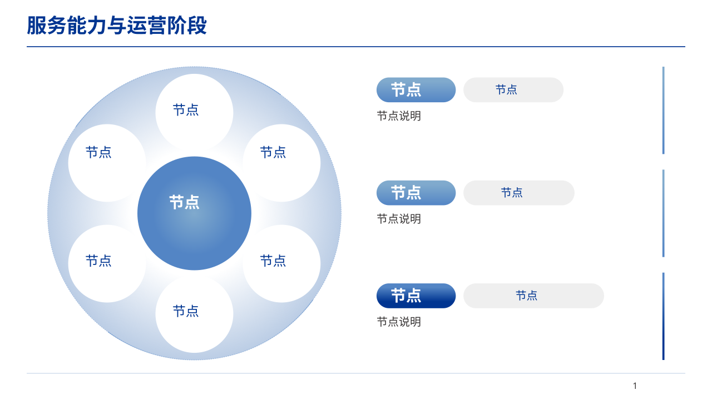

# 服务能力与运营阶段

来源为圆形逻辑图PPT模版.pptx#13。

## 结构与适用场景

左中心主题+6外围功能圈，右触达/激活/沉淀3说明行

6能力与3阶段运营

左右结构为能力与阶段两种分类，需明确联系，不能强行一对一

固定节点、圆弧、扇区、分面和连接表达定性关系。数量比较、趋势或占比使用数据驱动图表，源页中已登记的微图槽可接收实际数据。

## 预览



## 调用

将下列完整page对象放入schema_version=1、template_id=business-blue-v1的pages数组，替换各节点内容。nodes键对应原文本框或已明确拆分的语义分段，字段角色及source_ref、segment见下表。

```json
{
  "id": "circular-13",
  "family": "source-circular",
  "variant": "page-13",
  "content": {
    "title": "服务能力与运营阶段",
    "nodes": {
      "shape_8": "节点",
      "shape_17": "节点",
      "shape_18": "节点",
      "shape_19": "节点",
      "shape_20": "节点",
      "shape_21": "节点",
      "shape_22": "节点",
      "shape_23": "节点",
      "shape_34": "节点",
      "shape_37": "节点说明",
      "shape_40": "节点",
      "shape_41": "节点说明",
      "shape_43": "节点",
      "shape_44": "节点说明",
      "shape_45": "节点",
      "shape_46": "节点",
      "shape_47": "节点"
    }
  },
  "config": {
    "show_source": true,
    "show_page_number": true
  }
}
```

config支持show_source、show_page_number、image_fit与image_position。image_fit可选contain或cover，image_position为xMin/xMid/xMax与YMin/YMid/YMax组合的九个焦点，默认为xMidYMid。字体、颜色、全局区和固定字阶取自tokens，节点数与连接结构由variant确定。

## 字段合同

每个业务节点required=true、min=1，max按具体框体登记。字符按规范化后的Unicode码点计数，空格标点换行均计入。build会以实际字体测量宽高，字符数通过后仍可能需要调整文字。

| 字段 | 节点角色与源标签 | 最短/最长 | 字阶 | 框体px | 原框引用 | 分段 | 旋转° | 垂直锚点 |
|---|---|---|---|---|---|---|---|---|
| nodes.shape_8 | 上左节点，源标签“广泛 / 曝光”，原fontRef为lt1白色，保留白底上的源重复标签及独立参数，主要可见标签对应slide:22 | 1/48 | body | [122.6404, 223.4806, 139.8994, 139.8994] | slide:8 |  | -60.0 | ctr |
| nodes.shape_17 | 中左节点，源标签“全维度 / 种草” | 1/16 | heading | [296.1402, 347.6508, 106.6315, 72.6984] | slide:17 |  | 0.0 | t |
| nodes.shape_18 | 上左节点，源标签“DMP” | 1/6 | body | [313.0628, 183.9034, 72.7766, 37.9338] | slide:18 |  | 0.0 | t |
| nodes.shape_19 | 上中节点，源标签“LINK计划” | 1/12 | body | [469.9336, 260.2406, 72.7766, 66.3793] | slide:19 |  | 0.0 | t |
| nodes.shape_20 | 中中节点，源标签“星图” | 1/6 | body | [469.9336, 455.6028, 72.7766, 37.9338] | slide:20 |  | 0.0 | t |
| nodes.shape_21 | 中左节点，源标签“云图” | 1/6 | body | [156.2017, 455.6028, 72.7766, 37.9338] | slide:21 |  | 0.0 | t |
| nodes.shape_22 | 上左节点，源标签“广泛 / 曝光” | 1/12 | body | [156.2017, 260.2406, 72.7766, 66.3793] | slide:22 |  | 0.0 | t |
| nodes.shape_23 | 下左节点，源标签“挑战赛” | 1/9 | body | [296.1402, 546.1725, 106.6315, 37.9338] | slide:23 |  | 0.0 | t |
| nodes.shape_34 | 上中节点，源标签“触达” | 1/11 | heading | [676.9068, 139.4549, 142.4916, 44.6833] | slide:34 |  | 0.0 | ctr |
| nodes.shape_37 | 上中节点，源标签“聚合多方数据整合纳入抖音DMP，实现数据标准化和细分实现对用户的洞察分析、精细化” | 1/108 | compactBody | [676.9068, 197.1577, 491.7411, 60.7352] | slide:37 |  | 0.0 | t |
| nodes.shape_40 | 中中节点，源标签“激活” | 1/11 | heading | [676.9068, 324.7809, 142.4916, 44.6833] | slide:40 |  | 0.0 | ctr |
| nodes.shape_41 | 中中节点，源标签“通过抖音的系列产品，多维度实现广泛曝光和强效互动 / 并通过附加创意等形式增加转化触” | 1/108 | compactBody | [676.9068, 382.4838, 491.7411, 60.7352] | slide:41 |  | 0.0 | t |
| nodes.shape_43 | 下中节点，源标签“沉淀” | 1/11 | heading | [676.9068, 510.107, 142.4916, 44.6833] | slide:43 |  | 0.0 | ctr |
| nodes.shape_44 | 下中节点，源标签“打造品牌长效传播阵地，发布品牌信息，表达品牌理念 / 通过平台级的营销活动入口作用” | 1/108 | compactBody | [676.9068, 567.8099, 491.7411, 60.7352] | slide:44 |  | 0.0 | t |
| nodes.shape_45 | 上中节点，源标签“精准圈层定位” | 1/20 | compactBody | [833.1418, 139.4549, 180.083, 44.6833] | slide:45 |  | 0.0 | ctr |
| nodes.shape_46 | 中中节点，源标签“内容的商业转化” | 1/22 | compactBody | [833.1418, 324.7809, 199.7934, 44.6833] | slide:46 |  | 0.0 | ctr |
| nodes.shape_47 | 下中节点，源标签“粉丝沉淀品牌长效沟通” | 1/28 | compactBody | [833.1418, 510.107, 252.8499, 44.6833] | slide:47 |  | 0.0 | ctr |

全局title必填、2至32码点，使用统一标题框。section_name可选0至24码点，source可选0至64码点。所有可编辑文本通过独立原生carrier导出，页码为派生文字。

## 来源处理

原生PPTX源件保存于用户材料目录，分发包仅含用户资产衍生的几何、字段和说明。原始逐框文字、源框与标准化框在page-catalog.json的variant.fields中。

源标题引用为`slide:10`，原文为“全维度精准种草，实现流量收尾”。模板默认标题依据真实结构设置。

密集全景中的diagramCompact为14px、diagramMicro为12px。适用于体系概览或附录局部标签，现场关键结论用统一标题与正常正文字阶表达。

源画布边界裁切已烘焙为可编辑Bezier几何，3D顶面、侧面与前面通过tokens配色的相对明暗保留。

