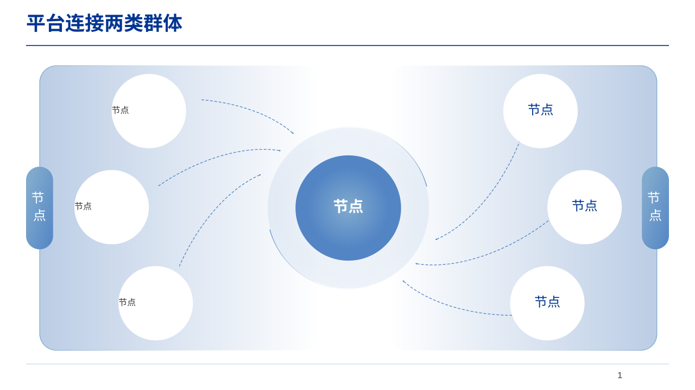

# 平台连接两类群体

来源为圆形逻辑图PPT模版.pptx#14。

## 结构与适用场景

中心平台，左3营销节点，右3目标人群，左右容器，虚线多对一/一对多连接

双边平台连接两组实体

可衍生公司-平台-3伙伴结构，左原3节点需能按实体数量调整；不能编造内部3组织

固定节点、圆弧、扇区、分面和连接表达定性关系。数量比较、趋势或占比使用数据驱动图表，源页中已登记的微图槽可接收实际数据。

## 预览



## 调用

将下列完整page对象放入schema_version=1、template_id=business-blue-v1的pages数组，替换各节点内容。nodes键对应原文本框或已明确拆分的语义分段，字段角色及source_ref、segment见下表。

```json
{
  "id": "circular-14",
  "family": "source-circular",
  "variant": "page-14",
  "content": {
    "title": "平台连接两类群体",
    "nodes": {
      "shape_7": "节点",
      "shape_8": "节点",
      "shape_11": "节点",
      "shape_12": "节点",
      "shape_23": "节点",
      "shape_24": "节点",
      "shape_25": "节点",
      "shape_30": "节点",
      "shape_35": "节点"
    }
  },
  "config": {
    "show_source": true,
    "show_page_number": true
  }
}
```

config支持show_source、show_page_number、image_fit与image_position。image_fit可选contain或cover，image_position为xMin/xMid/xMax与YMin/YMid/YMax组合的九个焦点，默认为xMidYMid。字体、颜色、全局区和固定字阶取自tokens，节点数与连接结构由variant确定。

## 字段合同

每个业务节点required=true、min=1，max按具体框体登记。字符按规范化后的Unicode码点计数，空格标点换行均计入。build会以实际字体测量宽高，字符数通过后仍可能需要调整文字。

| 字段 | 节点角色与源标签 | 最短/最长 | 字阶 | 框体px | 原框引用 | 分段 | 旋转° | 垂直锚点 |
|---|---|---|---|---|---|---|---|---|
| nodes.shape_7 | 中中节点，源标签“云图 / 平台” | 1/75 | heading | [544.2232, 286.7749, 194.4401, 194.4401] | slide:7 |  | 0.0 | ctr |
| nodes.shape_8 | 下右节点，源标签“社会 / 精英” | 1/48 | body | [939.4779, 491.2277, 137.1605, 137.1605] | slide:8 |  | 0.0 | ctr |
| nodes.shape_11 | 中右节点，源标签“家庭 / 亲子” | 1/48 | body | [1008.0631, 313.8462, 137.1605, 137.1605] | slide:11 |  | 0.0 | ctr |
| nodes.shape_12 | 上右节点，源标签“高校 / 学生” | 1/48 | body | [926.9094, 136.4747, 137.1605, 137.1605] | slide:12 |  | 0.0 | ctr |
| nodes.shape_23 | 上左节点，源标签“短途 / 春游” | 1/114 | caption | [205.5867, 136.4747, 137.1605, 137.1605] | slide:23 |  | 0.0 | ctr |
| nodes.shape_24 | 中左节点，源标签“暑假 / 出游” | 1/114 | caption | [137.0115, 313.8462, 137.1605, 137.1605] | slide:24 |  | 0.0 | ctr |
| nodes.shape_25 | 下左节点，源标签“国庆 / 出游” | 1/114 | caption | [218.1551, 491.2277, 137.1605, 137.1605] | slide:25 |  | 0.0 | ctr |
| nodes.shape_30 | 中右节点，源标签“目标人群” | 1/16 | body | [1182.2674, 307.7023, 49.7326, 152.5854] | slide:30 |  | 0.0 | ctr |
| nodes.shape_35 | 中左节点，源标签“营销节点” | 1/16 | body | [48, 307.7023, 49.7326, 152.5854] | slide:35 |  | 0.0 | ctr |

全局title必填、2至32码点，使用统一标题框。section_name可选0至24码点，source可选0至64码点。所有可编辑文本通过独立原生carrier导出，页码为派生文字。

## 来源处理

原生PPTX源件保存于用户材料目录，分发包仅含用户资产衍生的几何、字段和说明。原始逐框文字、源框与标准化框在page-catalog.json的variant.fields中。

源标题引用为`slide:3`，原文为“传播策略概览”。模板默认标题依据真实结构设置。

密集全景中的diagramCompact为14px、diagramMicro为12px。适用于体系概览或附录局部标签，现场关键结论用统一标题与正常正文字阶表达。

源画布边界裁切已烘焙为可编辑Bezier几何，3D顶面、侧面与前面通过tokens配色的相对明暗保留。

