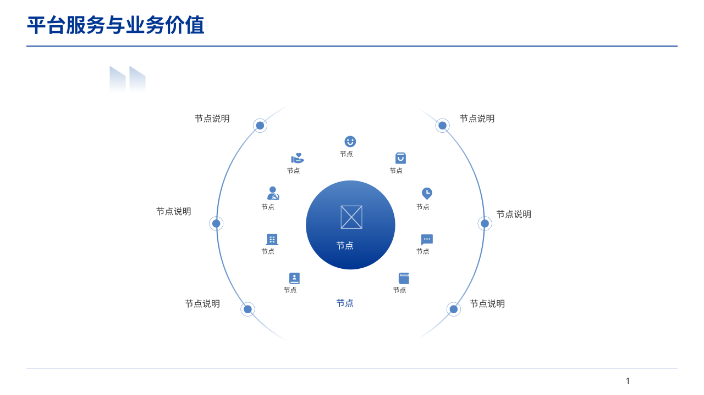

# 平台服务与业务价值

来源为圆形逻辑图PPT模版.pptx#15。

## 结构与适用场景

中心积分平台，内圈9应用图标，外圈6管理价值说明点

平台服务与业务价值

内应用与外收益不必一一匹配，保留两圈；原主标题与实际内容不同

固定节点、圆弧、扇区、分面和连接表达定性关系。数量比较、趋势或占比使用数据驱动图表，源页中已登记的微图槽可接收实际数据。

## 预览



## 调用

将下列完整page对象放入schema_version=1、template_id=business-blue-v1的pages数组，替换各节点内容。nodes键对应原文本框或已明确拆分的语义分段，字段角色及source_ref、segment见下表。

```json
{
  "id": "circular-15",
  "family": "source-circular",
  "variant": "page-15",
  "content": {
    "title": "平台服务与业务价值",
    "nodes": {
      "shape_66": "节点说明",
      "shape_67": "节点说明",
      "shape_68": "节点说明",
      "shape_69": "节点说明",
      "shape_70": "节点说明",
      "shape_71": "节点说明",
      "shape_72": "节点",
      "shape_73": "节点",
      "shape_74": "节点",
      "shape_75": "节点",
      "shape_76": "节点",
      "shape_77": "节点",
      "shape_78": "节点",
      "shape_79": "节点",
      "shape_80": "节点",
      "shape_81": "节点",
      "shape_82": "节点"
    }
  },
  "config": {
    "show_source": true,
    "show_page_number": true
  }
}
```

config支持show_source、show_page_number、image_fit与image_position。image_fit可选contain或cover，image_position为xMin/xMid/xMax与YMin/YMid/YMax组合的九个焦点，默认为xMidYMid。字体、颜色、全局区和固定字阶取自tokens，节点数与连接结构由variant确定。

## 字段合同

每个业务节点required=true、min=1，max按具体框体登记。字符按规范化后的Unicode码点计数，空格标点换行均计入。build会以实际字体测量宽高，字符数通过后仍可能需要调整文字。

| 字段 | 节点角色与源标签 | 最短/最长 | 字阶 | 框体px | 原框引用 | 分段 | 旋转° | 垂直锚点 |
|---|---|---|---|---|---|---|---|---|
| nodes.shape_66 | 上左节点，源标签“整合多方资源，为公司提供有效低成本的管理工具” | 1/60 | caption | [220.4821, 206.0031, 217.8312, 54.2684] | slide:66 |  | 0.0 | t |
| nodes.shape_67 | 中左节点，源标签“更加数据化、科学化地评价员工的表现” | 1/44 | caption | [202.8613, 375.1974, 165.4686, 54.2684] | slide:67 |  | 0.0 | t |
| nodes.shape_68 | 下左节点，源标签“隐性激励资源显性化，保证激励效果最大化” | 1/52 | caption | [228.6364, 543.3998, 192.0561, 54.2684] | slide:68 |  | 0.0 | t |
| nodes.shape_69 | 下右节点，源标签“员工行为积分化，营造组织内部的正能量” | 1/50 | caption | [854.0978, 543.3998, 180.4339, 54.2684] | slide:69 |  | 0.0 | t |
| nodes.shape_70 | 中右节点，源标签“组织内部建立透明、有趣的、共同认可的管理文化和管理规则” | 1/96 | caption | [902.0083, 380.2978, 178.5124, 82.6601] | slide:70 |  | 0.0 | t |
| nodes.shape_71 | 上中节点，源标签“无缝对接各类主流员工应用平台” | 1/44 | caption | [835.36, 206.0031, 164.9688, 54.2684] | slide:71 |  | 0.0 | t |
| nodes.shape_72 | 下中节点，源标签“小金家园” | 1/9 | caption | [603.743, 542.3078, 67.3044, 20.0] | slide:72 |  | 0.0 | t |
| nodes.shape_73 | 中中节点，源标签“小金积分” | 1/9 | caption | [601.6419, 437.542, 71.5065, 20.1905] | slide:73 |  | 0.0 | t |
| nodes.shape_74 | 下中节点，源标签“跨部门项目” | 1/9 | diagramMicro | [709.0071, 521.1937, 50.4724, 15.0] | slide:74 |  | 0.0 | t |
| nodes.shape_75 | 下中节点，源标签“培训分享” | 1/7 | diagramMicro | [515.1467, 521.1937, 40.3811, 15.0] | slide:75 |  | 0.0 | t |
| nodes.shape_76 | 中中节点，源标签“内部推荐” | 1/7 | diagramMicro | [474.6329, 450.5542, 40.3811, 15.0] | slide:76 |  | 0.0 | t |
| nodes.shape_77 | 中中节点，源标签“员工论坛” | 1/7 | diagramMicro | [756.2303, 450.5542, 40.3811, 15.0] | slide:77 |  | 0.0 | t |
| nodes.shape_78 | 中中节点，源标签“意见征集” | 1/7 | diagramMicro | [756.3475, 369.4797, 40.3811, 15.0] | slide:78 |  | 0.0 | t |
| nodes.shape_79 | 中中节点，源标签“党建活动” | 1/7 | diagramMicro | [474.6329, 369.4797, 40.3811, 15.0] | slide:79 |  | 0.0 | t |
| nodes.shape_80 | 中中节点，源标签“微创新” | 1/5 | diagramMicro | [526.191, 303.4406, 30.2897, 15.0] | slide:80 |  | 0.0 | t |
| nodes.shape_81 | 中中节点，源标签“积分商城” | 1/7 | diagramMicro | [707.8121, 303.4406, 40.3811, 15.0] | slide:81 |  | 0.0 | t |
| nodes.shape_82 | 上中节点，源标签“文体活动” | 1/7 | diagramMicro | [617.4819, 273.1509, 40.3811, 15.0] | slide:82 |  | 0.0 | t |

## 可替换图片

在content.visuals提供下列槽位对象，省略时显示中性空槽。每项含path和可选alt，path为--assets目录下的相对本地路径，1至260码点，alt为0至200码点。原案例照片、界面或品牌保留来源引用，默认页使用空槽。

- `visuals.brand_mark`用于品牌标识，替换原矢量品牌或应用标识，框体为`[620.2078, 375.1505, 37.7879, 41.1621]`，源引用为`['slide:25']`。

```json
{
  "visuals": {
    "brand_mark": {
      "path": "assets/replacement.png",
      "alt": "品牌标识，替换原矢量品牌或应用标识"
    }
  }
}
```


全局title必填、2至32码点，使用统一标题框。section_name可选0至24码点，source可选0至64码点。所有可编辑文本通过独立原生carrier导出，页码为派生文字。

## 来源处理

原生PPTX源件保存于用户材料目录，分发包仅含用户资产衍生的几何、字段和说明。原始逐框文字、源框与标准化框在page-catalog.json的variant.fields中。

源标题引用为`slide:60`，原文为“建设路线与预期目标”。模板默认标题依据真实结构设置。

密集全景中的diagramCompact为14px、diagramMicro为12px。适用于体系概览或附录局部标签，现场关键结论用统一标题与正常正文字阶表达。

源画布边界裁切已烘焙为可编辑Bezier几何，3D顶面、侧面与前面通过tokens配色的相对明暗保留。

