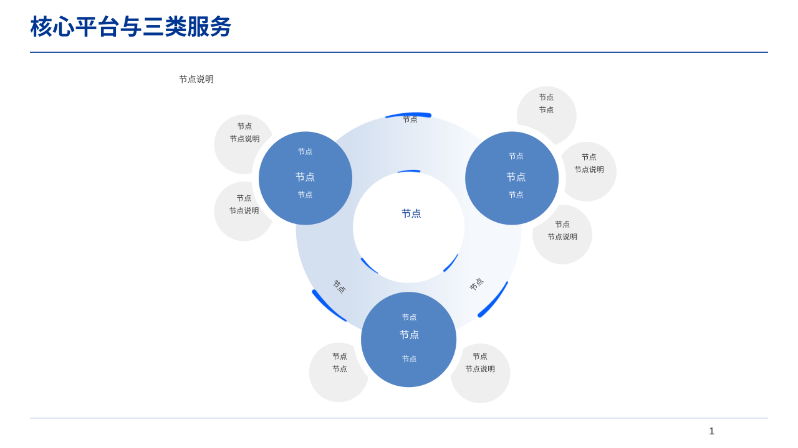

# 核心平台与三类服务

来源为圆形逻辑图PPT模版.pptx#16。

## 结构与适用场景

中心一致性；3大卫星圈各带2小触点；外一环；形成3簇嵌套关系

核心平台与3类服务及入口

适合Copilot3大类服务，中心/大类/具体服务可独立参数；外围触点可扩但需真实材料

固定节点、圆弧、扇区、分面和连接表达定性关系。数量比较、趋势或占比使用数据驱动图表，源页中已登记的微图槽可接收实际数据。

## 预览



## 调用

将下列完整page对象放入schema_version=1、template_id=business-blue-v1的pages数组，替换各节点内容。nodes键对应原文本框或已明确拆分的语义分段，字段角色及source_ref、segment见下表。

```json
{
  "id": "circular-16",
  "family": "source-circular",
  "variant": "page-16",
  "content": {
    "title": "核心平台与三类服务",
    "nodes": {
      "shape_27": "节点说明",
      "shape_28": "节点",
      "shape_29": "节点",
      "shape_30": "节点",
      "shape_31": "节点",
      "shape_32": "节点",
      "shape_33": "节点",
      "shape_34": "节点",
      "shape_35": "节点",
      "shape_36": "节点",
      "shape_46": "节点",
      "shape_47": "节点",
      "shape_48": "节点说明",
      "shape_49": "节点",
      "shape_50": "节点说明",
      "shape_51": "节点",
      "shape_53": "节点",
      "shape_54": "节点",
      "shape_62": "节点说明",
      "shape_63": "节点",
      "shape_64": "节点说明",
      "shape_65": "节点",
      "shape_66": "节点",
      "shape_67": "节点",
      "shape_68": "节点说明",
      "shape_69": "节点",
      "shape_70": "节点",
      "shape_71": "节点"
    }
  },
  "config": {
    "show_source": true,
    "show_page_number": true
  }
}
```

config支持show_source、show_page_number、image_fit与image_position。image_fit可选contain或cover，image_position为xMin/xMid/xMax与YMin/YMid/YMax组合的九个焦点，默认为xMidYMid。字体、颜色、全局区和固定字阶取自tokens，节点数与连接结构由variant确定。

## 字段合同

每个业务节点required=true、min=1，max按具体框体登记。字符按规范化后的Unicode码点计数，空格标点换行均计入。build会以实际字体测量宽高，字符数通过后仍可能需要调整文字。

| 字段 | 节点角色与源标签 | 最短/最长 | 字阶 | 框体px | 原框引用 | 分段 | 旋转° | 垂直锚点 |
|---|---|---|---|---|---|---|---|---|
| nodes.shape_27 | 上中节点，源标签“在理念发散阶段，以时间为单位并从日常管理流程出发” | 1/67 | diagramCompact | [286.7268, 120, 422.7606, 25.0123] | slide:27 |  | 0.0 | t |
| nodes.shape_28 | 中中节点，源标签“品牌一致性 / 持续传递” | 1/57 | caption | [590.6992, 334.9223, 137.9094, 60.6597] | slide:28 |  | 0.0 | t |
| nodes.shape_29 | 上中节点，源标签“品牌心智强化” | 1/23 | caption | [742.394, 276.3386, 170.5793, 29.4193] | slide:29 |  | 0.0 | t |
| nodes.shape_30 | 中中节点，源标签“提升认同” | 1/31 | diagramMicro | [742.394, 306.7959, 170.5793, 22.0622] | slide:30 |  | 0.0 | t |
| nodes.shape_31 | 上中节点，源标签“用像用户” | 1/31 | diagramMicro | [742.394, 244.8432, 170.5793, 22.0622] | slide:31 |  | 0.0 | t |
| nodes.shape_32 | 上中节点，源标签“品牌形象建立” | 1/23 | caption | [403.9943, 276.3386, 170.5793, 29.4193] | slide:32 |  | 0.0 | t |
| nodes.shape_33 | 中中节点，源标签“建立认知” | 1/31 | diagramMicro | [403.9943, 306.7959, 170.5793, 22.0622] | slide:33 |  | 0.0 | t |
| nodes.shape_34 | 上中节点，源标签“新用户& / 潜在用户” | 1/62 | diagramMicro | [403.9943, 237.4497, 170.5793, 35.3105] | slide:34 |  | 0.0 | t |
| nodes.shape_35 | 下中节点，源标签“品牌价值全链路透传” | 1/23 | caption | [571.1956, 529.8492, 170.5793, 29.4193] | slide:35 |  | 0.0 | t |
| nodes.shape_36 | 下中节点，源标签“合作顺畅” | 1/31 | diagramMicro | [571.1956, 570.6866, 170.5793, 22.0622] | slide:36 |  | 0.0 | t |
| nodes.shape_46 | 下中节点，源标签“签约用户” | 1/31 | diagramMicro | [571.1956, 503.726, 170.5793, 22.0622] | slide:46 |  | 0.0 | t |
| nodes.shape_47 | 中右节点，源标签“大型活动” | 1/17 | diagramMicro | [853.561, 354.4077, 97.0264, 22.0622] | slide:47 |  | 0.0 | t |
| nodes.shape_48 | 中中节点，源标签“行业峰会/专业论坛 / KV物料” | 1/46 | diagramMicro | [838.6647, 374.5214, 126.8373, 34.7459] | slide:48 |  | 0.0 | t |
| nodes.shape_49 | 上右节点，源标签“签约” | 1/17 | diagramMicro | [896.2468, 246.1726, 97.0264, 22.0622] | slide:49 |  | 0.0 | t |
| nodes.shape_50 | 上右节点，源标签“签约洽谈物料 / 主题背景/PPT模板” | 1/34 | diagramMicro | [896.2468, 266.2863, 97.0264, 34.7459] | slide:50 |  | 0.0 | t |
| nodes.shape_51 | 上中节点，源标签“BD环节” | 1/17 | diagramMicro | [827.7747, 150.1751, 97.0264, 22.0622] | slide:51 |  | 0.0 | t |
| nodes.shape_53 | 上中节点，源标签“商务洽谈 / 宣讲物料” | 1/34 | diagramMicro | [827.7747, 170.2888, 97.0264, 34.7459] | slide:53 |  | 0.0 | t |
| nodes.shape_54 | 上左节点，源标签“线上” | 1/17 | diagramMicro | [343.8809, 196.7397, 97.0264, 22.0622] | slide:54 |  | 0.0 | t |
| nodes.shape_62 | 上左节点，源标签“PC页面/H5 / 新媒体/公众号 / 活动邀请函 / ……” | 1/68 | diagramMicro | [343.8809, 216.8534, 97.0264, 61.5247] | slide:62 |  | 0.0 | t |
| nodes.shape_63 | 中左节点，源标签“线下” | 1/17 | diagramMicro | [342.761, 312.2409, 97.0264, 22.0622] | slide:63 |  | 0.0 | t |
| nodes.shape_64 | 中左节点，源标签“宣传册/视频 / 峰会活动KV物料 / ……” | 1/51 | diagramMicro | [342.761, 332.3546, 97.0264, 48.1308] | slide:64 |  | 0.0 | t |
| nodes.shape_65 | 下中节点，源标签“前台” | 1/17 | diagramMicro | [496.3133, 566.6257, 97.0264, 22.0622] | slide:65 |  | 0.0 | t |
| nodes.shape_66 | 下中节点，源标签“门户型页面 / 影显企业实力” | 1/34 | diagramMicro | [496.3133, 586.7393, 97.0264, 34.7459] | slide:66 |  | 0.0 | t |
| nodes.shape_67 | 下中节点，源标签“后台” | 1/17 | diagramMicro | [721.4882, 566.6257, 97.0264, 22.0622] | slide:67 |  | 0.0 | t |
| nodes.shape_68 | 下中节点，源标签“工具型后台体验优化 / 提升体验愉悦度” | 1/42 | diagramMicro | [712.2372, 586.7393, 115.5467, 34.7459] | slide:68 |  | 0.0 | t |
| nodes.shape_69 | 上中节点，源标签“价值有效传递 / 产生认同” | 1/34 | diagramMicro | [609.2923, 185.6768, 97.0264, 42.1486] | slide:69 |  | 0.0 | t |
| nodes.shape_70 | 中中节点，源标签“影响力撬开 / 托盘潜在用户” | 1/34 | diagramMicro | [484.7281, 450.2218, 97.0264, 42.1486] | slide:70 |  | 45.0 | t |
| nodes.shape_71 | 中中节点，源标签“体现专业 / 增强信任” | 1/34 | diagramMicro | [726.3563, 446.7917, 97.0264, 42.1486] | slide:71 |  | -45.0 | t |

## 保留的原装饰

本页保留用户原模板的结构图标或装饰图片，逐项身份见source-field-coverage.json中本页retained_source_images。其中图片内固化的字形随整图编辑，可在PowerPoint中原生替换整图；nodes字段控制已登记的可编辑文字。参数图片替换使用本页image_slots列出的槽位。


全局title必填、2至32码点，使用统一标题框。section_name可选0至24码点，source可选0至64码点。所有可编辑文本通过独立原生carrier导出，页码为派生文字。

## 来源处理

原生PPTX源件保存于用户材料目录，分发包仅含用户资产衍生的几何、字段和说明。原始逐框文字、源框与标准化框在page-catalog.json的variant.fields中。

源标题引用为`slide:25`，原文为“Concept extraction”。模板默认标题依据真实结构设置。

密集全景中的diagramCompact为14px、diagramMicro为12px。适用于体系概览或附录局部标签，现场关键结论用统一标题与正常正文字阶表达。

源画布边界裁切已烘焙为可编辑Bezier几何，3D顶面、侧面与前面通过tokens配色的相对明暗保留。

