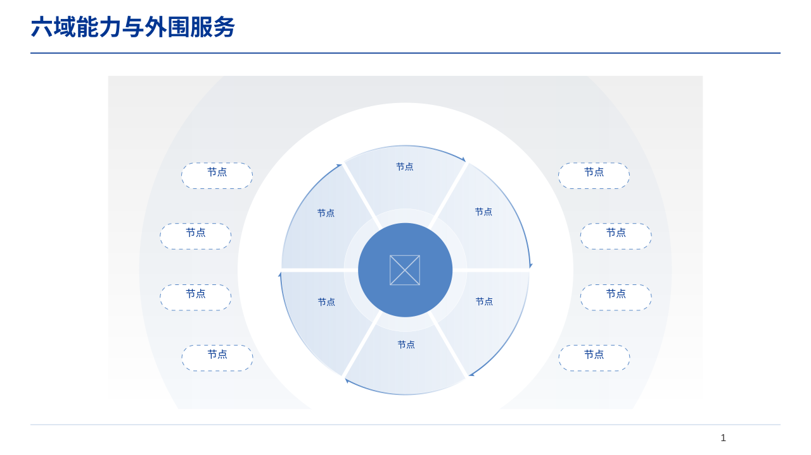

# 六域能力与外围服务

来源为圆形逻辑图PPT模版.pptx#17。

## 结构与适用场景

中心系统圆；6扇区功能，3段外方向箭头；左右各4扩展服务

六域能力与外围服务

保留6扇区圆盘、箭头方向、两侧模块，不能以椭圆+5卡替代；非占比

固定节点、圆弧、扇区、分面和连接表达定性关系。数量比较、趋势或占比使用数据驱动图表，源页中已登记的微图槽可接收实际数据。

## 预览



## 调用

将下列完整page对象放入schema_version=1、template_id=business-blue-v1的pages数组，替换各节点内容。nodes键对应原文本框或已明确拆分的语义分段，字段角色及source_ref、segment见下表。

```json
{
  "id": "circular-17",
  "family": "source-circular",
  "variant": "page-17",
  "content": {
    "title": "六域能力与外围服务",
    "nodes": {
      "shape_44": "节点",
      "shape_45": "节点",
      "shape_46": "节点",
      "shape_47": "节点",
      "shape_48": "节点",
      "shape_49": "节点",
      "shape_50": "节点",
      "shape_51": "节点",
      "shape_52": "节点",
      "shape_53": "节点",
      "shape_54": "节点",
      "shape_55": "节点",
      "shape_56": "节点",
      "shape_57": "节点"
    }
  },
  "config": {
    "show_source": true,
    "show_page_number": true
  }
}
```

config支持show_source、show_page_number、image_fit与image_position。image_fit可选contain或cover，image_position为xMin/xMid/xMax与YMin/YMid/YMax组合的九个焦点，默认为xMidYMid。字体、颜色、全局区和固定字阶取自tokens，节点数与连接结构由variant确定。

## 字段合同

每个业务节点required=true、min=1，max按具体框体登记。字符按规范化后的Unicode码点计数，空格标点换行均计入。build会以实际字体测量宽高，字符数通过后仍可能需要调整文字。

| 字段 | 节点角色与源标签 | 最短/最长 | 字阶 | 框体px | 原框引用 | 分段 | 旋转° | 垂直锚点 |
|---|---|---|---|---|---|---|---|---|
| nodes.shape_44 | 上左节点，源标签“电子档案” | 1/13 | caption | [294.8933, 263.9387, 95.2307, 28.4387] | slide:44 |  | 0.0 | t |
| nodes.shape_45 | 中左节点，源标签“智能税务” | 1/13 | caption | [261.16, 359.7633, 95.2307, 28.4387] | slide:45 |  | 0.0 | t |
| nodes.shape_46 | 中左节点，源标签“智能核算” | 1/13 | caption | [261.16, 456.5633, 95.2307, 28.4387] | slide:46 |  | 0.0 | t |
| nodes.shape_47 | 下左节点，源标签“数据分析” | 1/13 | caption | [295.3847, 552.3807, 95.2307, 28.4387] | slide:47 |  | 0.0 | t |
| nodes.shape_48 | 上右节点，源标签“智能报表” | 1/13 | caption | [889.876, 263.9387, 95.2307, 28.4387] | slide:48 |  | 0.0 | t |
| nodes.shape_49 | 中右节点，源标签“智能报账” | 1/13 | caption | [924.5847, 359.7633, 95.2307, 28.4387] | slide:49 |  | 0.0 | t |
| nodes.shape_50 | 中右节点，源标签“智能结算” | 1/13 | caption | [924.5847, 456.5633, 95.2307, 28.4387] | slide:50 |  | 0.0 | t |
| nodes.shape_51 | 下右节点，源标签“智能客服” | 1/13 | caption | [889.876, 552.7253, 95.2307, 28.4387] | slide:51 |  | 0.0 | t |
| nodes.shape_52 | 中中节点，源标签“自动 / 核算制证” | 1/30 | diagramCompact | [467.5567, 470.8193, 95.2307, 45.9507] | slide:52 |  | 0.0 | t |
| nodes.shape_53 | 中中节点，源标签“电子 / 文档管理” | 1/30 | diagramCompact | [466.684, 330.0413, 95.2307, 45.9507] | slide:53 |  | 0.0 | t |
| nodes.shape_54 | 上中节点，源标签“自助 / 便捷报价” | 1/30 | diagramCompact | [591.094, 256.6493, 95.2307, 45.9507] | slide:54 |  | 0.0 | t |
| nodes.shape_55 | 中中节点，源标签“单据 / 智能审核” | 1/30 | diagramCompact | [715.5847, 328.0247, 95.2307, 45.9507] | slide:55 |  | 0.0 | t |
| nodes.shape_56 | 中中节点，源标签“签批 / 流程管理” | 1/30 | diagramCompact | [716.6407, 470.0493, 95.2307, 45.9507] | slide:56 |  | 0.0 | t |
| nodes.shape_57 | 下中节点，源标签“经费 / 支付管控” | 1/30 | diagramCompact | [593.4407, 538.2347, 95.2307, 45.9507] | slide:57 |  | 0.0 | t |

## 可替换图片

在content.visuals提供下列槽位对象，省略时显示中性空槽。每项含path和可选alt，path为--assets目录下的相对本地路径，1至260码点，alt为0至200码点。原案例照片、界面或品牌保留来源引用，默认页使用空槽。

- `visuals.brand_mark`用于品牌标识，替换原矢量品牌或应用标识，框体为`[615.8, 404.2913, 46.442, 46.442]`，源引用为`['slide:13']`。

```json
{
  "visuals": {
    "brand_mark": {
      "path": "assets/replacement.png",
      "alt": "品牌标识，替换原矢量品牌或应用标识"
    }
  }
}
```


全局title必填、2至32码点，使用统一标题框。section_name可选0至24码点，source可选0至64码点。所有可编辑文本通过独立原生carrier导出，页码为派生文字。

## 来源处理

原生PPTX源件保存于用户材料目录，分发包仅含用户资产衍生的几何、字段和说明。原始逐框文字、源框与标准化框在page-catalog.json的variant.fields中。

源标题引用为`slide:43`，原文为“财务智能系统解决方案”。模板默认标题依据真实结构设置。

密集全景中的diagramCompact为14px、diagramMicro为12px。适用于体系概览或附录局部标签，现场关键结论用统一标题与正常正文字阶表达。

源画布边界裁切已烘焙为可编辑Bezier几何，3D顶面、侧面与前面通过tokens配色的相对明暗保留。

