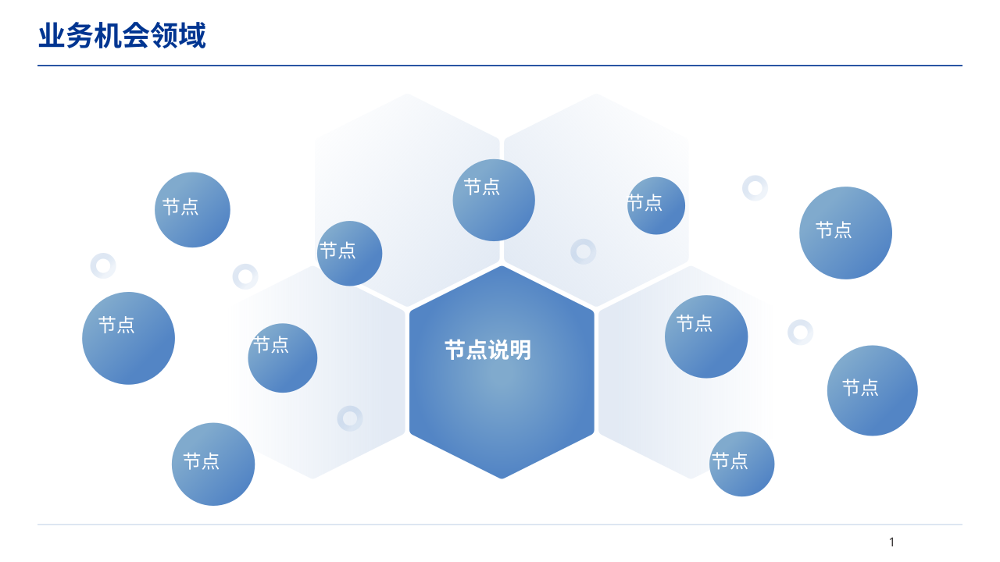

# 业务机会领域

来源为圆形逻辑图PPT模版.pptx#18。

## 结构与适用场景

中心六边形；背景蜂窝；周围10行业球体，部分不同大小，无连线

机会领域罗列

节点大小源无指标，不能当量化气泡图；明确平级机会清单

固定节点、圆弧、扇区、分面和连接表达定性关系。数量比较、趋势或占比使用数据驱动图表，源页中已登记的微图槽可接收实际数据。

## 预览



## 调用

将下列完整page对象放入schema_version=1、template_id=business-blue-v1的pages数组，替换各节点内容。nodes键对应原文本框或已明确拆分的语义分段，字段角色及source_ref、segment见下表。

```json
{
  "id": "circular-18",
  "family": "source-circular",
  "variant": "page-18",
  "content": {
    "title": "业务机会领域",
    "nodes": {
      "shape_47": "节点说明",
      "shape_49": "节点",
      "shape_50": "节点",
      "shape_51": "节点",
      "shape_52": "节点",
      "shape_53": "节点",
      "shape_54": "节点",
      "shape_55": "节点",
      "shape_56": "节点",
      "shape_57": "节点",
      "shape_58": "节点",
      "shape_59": "节点"
    }
  },
  "config": {
    "show_source": true,
    "show_page_number": true
  }
}
```

config支持show_source、show_page_number、image_fit与image_position。image_fit可选contain或cover，image_position为xMin/xMid/xMax与YMin/YMid/YMax组合的九个焦点，默认为xMidYMid。字体、颜色、全局区和固定字阶取自tokens，节点数与连接结构由variant确定。

## 字段合同

每个业务节点required=true、min=1，max按具体框体登记。字符按规范化后的Unicode码点计数，空格标点换行均计入。build会以实际字体测量宽高，字符数通过后仍可能需要调整文字。

| 字段 | 节点角色与源标签 | 最短/最长 | 字阶 | 框体px | 原框引用 | 分段 | 旋转° | 垂直锚点 |
|---|---|---|---|---|---|---|---|---|
| nodes.shape_47 | 中中节点，源标签“新型电商平台 / 青睐的商品品相” | 1/34 | heading | [529.5465, 431.8011, 225.6151, 91.3803] | slide:47 |  | 0.0 | t |
| nodes.shape_49 | 上左节点，源标签“营养品” | 1/7 | body | [204.9709, 251.2309, 82.9094, 35.247] | slide:49 |  | 0.0 | t |
| nodes.shape_50 | 中左节点，源标签“茶饮 / 甜品” | 1/7 | body | [123.0794, 402.5437, 82.9094, 61.6776] | slide:50 |  | 0.0 | t |
| nodes.shape_51 | 中左节点，源标签“母婴 / 用品” | 1/7 | body | [320.4188, 427.8837, 82.9094, 61.6776] | slide:51 |  | 0.0 | t |
| nodes.shape_52 | 中中节点，源标签“生鲜” | 1/7 | body | [406.1821, 307.1188, 82.9094, 35.247] | slide:52 |  | 0.0 | t |
| nodes.shape_53 | 上中节点，源标签“低价 / 生活用品” | 1/10 | body | [574.2005, 225.5818, 116.0205, 61.6776] | slide:53 |  | 0.0 | t |
| nodes.shape_54 | 上中节点，源标签“保健品” | 1/7 | body | [798.6795, 245.9593, 82.9094, 35.247] | slide:54 |  | 0.0 | t |
| nodes.shape_55 | 中右节点，源标签“美妆彩妆” | 1/9 | body | [1030.1751, 280.8699, 104.8865, 35.247] | slide:55 |  | 0.0 | t |
| nodes.shape_56 | 下右节点，源标签“个护” | 1/7 | body | [1075.3654, 482.8356, 82.9094, 35.247] | slide:56 |  | 0.0 | t |
| nodes.shape_57 | 中右节点，源标签“时装 / 衣鞋包” | 1/7 | body | [862.7566, 400.526, 82.9094, 61.6776] | slide:57 |  | 0.0 | t |
| nodes.shape_58 | 下右节点，源标签“微整形” | 1/7 | body | [908.2923, 576.8608, 82.9094, 35.247] | slide:58 |  | 0.0 | t |
| nodes.shape_59 | 下左节点，源标签“3C数码” | 1/9 | body | [219.8404, 577.1516, 106.4498, 35.247] | slide:59 |  | 0.0 | t |

全局title必填、2至32码点，使用统一标题框。section_name可选0至24码点，source可选0至64码点。所有可编辑文本通过独立原生carrier导出，页码为派生文字。

## 来源处理

原生PPTX源件保存于用户材料目录，分发包仅含用户资产衍生的几何、字段和说明。原始逐框文字、源框与标准化框在page-catalog.json的variant.fields中。

源标题引用为`slide:2`，原文为“外部机会点：商品品相”。模板默认标题依据真实结构设置。

密集全景中的diagramCompact为14px、diagramMicro为12px。适用于体系概览或附录局部标签，现场关键结论用统一标题与正常正文字阶表达。

源画布边界裁切已烘焙为可编辑Bezier几何，3D顶面、侧面与前面通过tokens配色的相对明暗保留。

