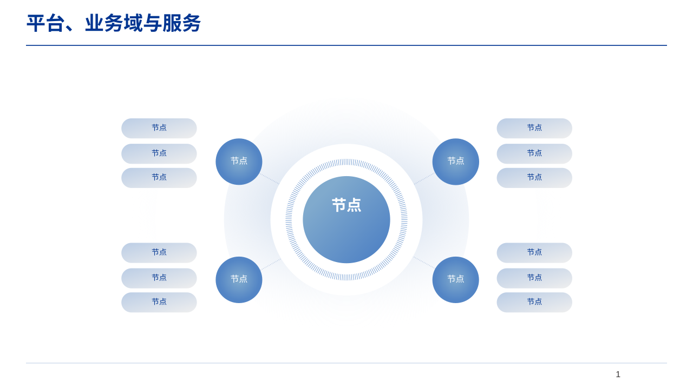

# 平台、业务域与服务

来源为圆形逻辑图PPT模版.pptx#19。

## 结构与适用场景

中心社区，4卫星业务域，4条中心连接；每域外侧3服务条

平台→业务域→具体服务

保留三级树与每域独立服务条；当前Copilot若3大类，应有3域派生

固定节点、圆弧、扇区、分面和连接表达定性关系。数量比较、趋势或占比使用数据驱动图表，源页中已登记的微图槽可接收实际数据。

## 预览



## 调用

将下列完整page对象放入schema_version=1、template_id=business-blue-v1的pages数组，替换各节点内容。nodes键对应原文本框或已明确拆分的语义分段，字段角色及source_ref、segment见下表。

```json
{
  "id": "circular-19",
  "family": "source-circular",
  "variant": "page-19",
  "content": {
    "title": "平台、业务域与服务",
    "nodes": {
      "shape_47": "节点",
      "shape_48": "节点",
      "shape_49": "节点",
      "shape_50": "节点",
      "shape_37": "节点",
      "shape_61": "节点",
      "shape_65": "节点",
      "shape_66": "节点",
      "shape_67": "节点",
      "shape_68": "节点",
      "shape_69": "节点",
      "shape_70": "节点",
      "shape_71": "节点",
      "shape_72": "节点",
      "shape_73": "节点",
      "shape_74": "节点",
      "shape_75": "节点"
    }
  },
  "config": {
    "show_source": true,
    "show_page_number": true
  }
}
```

config支持show_source、show_page_number、image_fit与image_position。image_fit可选contain或cover，image_position为xMin/xMid/xMax与YMin/YMid/YMax组合的九个焦点，默认为xMidYMid。字体、颜色、全局区和固定字阶取自tokens，节点数与连接结构由variant确定。

## 字段合同

每个业务节点required=true、min=1，max按具体框体登记。字符按规范化后的Unicode码点计数，空格标点换行均计入。build会以实际字体测量宽高，字符数通过后仍可能需要调整文字。

| 字段 | 节点角色与源标签 | 最短/最长 | 字阶 | 框体px | 原框引用 | 分段 | 旋转° | 垂直锚点 |
|---|---|---|---|---|---|---|---|---|
| nodes.shape_47 | 上中节点，源标签“社区 / 经营” | 1/44 | caption | [798.6493, 256.2313, 86.3867, 86.3867] | slide:47 |  | 0.0 | ctr |
| nodes.shape_48 | 上中节点，源标签“物业服务” | 1/44 | caption | [398.3593, 256.2313, 86.108, 86.108] | slide:48 |  | 0.0 | ctr |
| nodes.shape_49 | 中中节点，源标签“社区电商” | 1/44 | caption | [398.3593, 474.8967, 86.108, 86.108] | slide:49 |  | 0.0 | ctr |
| nodes.shape_50 | 中中节点，源标签“智慧社区” | 1/44 | caption | [798.6493, 474.8967, 86.108, 86.108] | slide:50 |  | 0.0 | ctr |
| nodes.shape_37 | 中中节点，源标签“极致 / 社区” | 1/18 | heading | [577.1753, 365.1313, 125.6493, 82.9327] | slide:37 |  | 0.0 | t |
| nodes.shape_61 | 上左节点，源标签“在线报修” | 1/44 | diagramCompact | [224.2, 219.0367, 139.4287, 37.1947] | slide:61 |  | 0.0 | ctr |
| nodes.shape_65 | 上左节点，源标签“装修申请” | 1/44 | diagramCompact | [224.2, 266.1093, 139.4287, 37.1947] | slide:65 |  | 0.0 | ctr |
| nodes.shape_66 | 中左节点，源标签“投诉建议” | 1/44 | diagramCompact | [224.2, 310.7473, 139.4287, 37.1947] | slide:66 |  | 0.0 | ctr |
| nodes.shape_67 | 上右节点，源标签“停车缴费” | 1/44 | diagramCompact | [917.552, 219.0367, 139.4287, 37.1947] | slide:67 |  | 0.0 | ctr |
| nodes.shape_68 | 上右节点，源标签“欠费查询” | 1/44 | diagramCompact | [917.552, 266.1093, 139.4287, 37.1947] | slide:68 |  | 0.0 | ctr |
| nodes.shape_69 | 中右节点，源标签“预缴物业费” | 1/44 | diagramCompact | [917.552, 310.7473, 139.4287, 37.1947] | slide:69 |  | 0.0 | ctr |
| nodes.shape_70 | 中左节点，源标签“餐饮” | 1/44 | diagramCompact | [224.2, 449.4573, 139.4287, 37.1947] | slide:70 |  | 0.0 | ctr |
| nodes.shape_71 | 下左节点，源标签“超市、便利店” | 1/44 | diagramCompact | [224.2, 496.53, 139.4287, 37.1947] | slide:71 |  | 0.0 | ctr |
| nodes.shape_72 | 下左节点，源标签“蛋糕、鲜花” | 1/44 | diagramCompact | [224.2, 541.168, 139.4287, 37.1947] | slide:72 |  | 0.0 | ctr |
| nodes.shape_73 | 中右节点，源标签“智慧停车” | 1/44 | diagramCompact | [917.552, 449.4573, 139.4287, 37.1947] | slide:73 |  | 0.0 | ctr |
| nodes.shape_74 | 下右节点，源标签“智能家园” | 1/44 | diagramCompact | [917.552, 496.53, 139.4287, 37.1947] | slide:74 |  | 0.0 | ctr |
| nodes.shape_75 | 下右节点，源标签“生活服务” | 1/44 | diagramCompact | [917.552, 541.168, 139.4287, 37.1947] | slide:75 |  | 0.0 | ctr |

全局title必填、2至32码点，使用统一标题框。section_name可选0至24码点，source可选0至64码点。所有可编辑文本通过独立原生carrier导出，页码为派生文字。

## 来源处理

原生PPTX源件保存于用户材料目录，分发包仅含用户资产衍生的几何、字段和说明。原始逐框文字、源框与标准化框在page-catalog.json的variant.fields中。

源标题引用为`slide:11`，原文为“面向业主和客户的社区运营平台”。模板默认标题依据真实结构设置。

密集全景中的diagramCompact为14px、diagramMicro为12px。适用于体系概览或附录局部标签，现场关键结论用统一标题与正常正文字阶表达。

源画布边界裁切已烘焙为可编辑Bezier几何，3D顶面、侧面与前面通过tokens配色的相对明暗保留。

装饰转换记录为`[{"source_ref": "slide:36", "reason": "原文本为textCircle变形的重复竖线装饰，转换为可编辑径向刻线，不设业务文字字段", "ticks": 195}]`。
