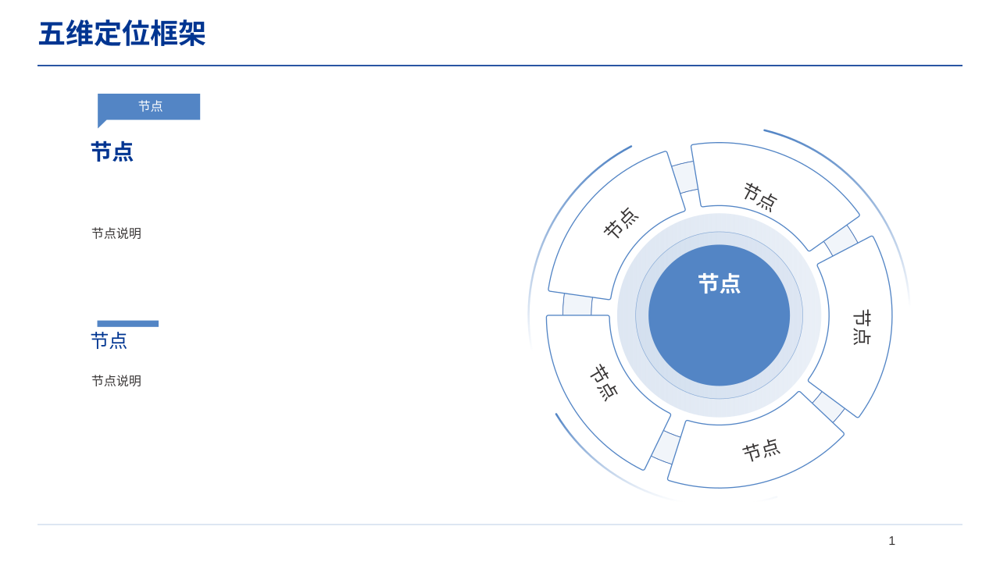

# 五维定位框架

来源为圆形逻辑图PPT模版.pptx#20。

## 结构与适用场景

左用户分析文字，右中心支行定位+5扇区，外弧箭头

5维定位框架

原文画像与右支行图明显不一致，应分离示例；不能用原文强作扇区数据

固定节点、圆弧、扇区、分面和连接表达定性关系。数量比较、趋势或占比使用数据驱动图表，源页中已登记的微图槽可接收实际数据。

## 预览



## 调用

将下列完整page对象放入schema_version=1、template_id=business-blue-v1的pages数组，替换各节点内容。nodes键对应原文本框或已明确拆分的语义分段，字段角色及source_ref、segment见下表。

```json
{
  "id": "circular-20",
  "family": "source-circular",
  "variant": "page-20",
  "content": {
    "title": "五维定位框架",
    "nodes": {
      "shape_53": "节点",
      "shape_54": "节点",
      "shape_55": "节点说明",
      "shape_56": "节点说明",
      "shape_57": "节点",
      "shape_58": "节点",
      "shape_59": "节点",
      "shape_60": "节点",
      "shape_61": "节点",
      "shape_62": "节点",
      "shape_50": "节点"
    }
  },
  "config": {
    "show_source": true,
    "show_page_number": true
  }
}
```

config支持show_source、show_page_number、image_fit与image_position。image_fit可选contain或cover，image_position为xMin/xMid/xMax与YMin/YMid/YMax组合的九个焦点，默认为xMidYMid。字体、颜色、全局区和固定字阶取自tokens，节点数与连接结构由variant确定。

## 字段合同

每个业务节点required=true、min=1，max按具体框体登记。字符按规范化后的Unicode码点计数，空格标点换行均计入。build会以实际字体测量宽高，字符数通过后仍可能需要调整文字。

| 字段 | 节点角色与源标签 | 最短/最长 | 字阶 | 框体px | 原框引用 | 分段 | 旋转° | 垂直锚点 |
|---|---|---|---|---|---|---|---|---|
| nodes.shape_53 | 上左节点，源标签“观看直播的用户 / 用户画像” | 1/75 | heading | [115.3049, 179.9603, 320.5415, 109.8069] | slide:53 |  | 0.0 | t |
| nodes.shape_54 | 中左节点，源标签“知乎用户年龄分布” | 1/29 | body | [115.3049, 424.1032, 320.5415, 40.7396] | slide:54 |  | 0.0 | t |
| nodes.shape_55 | 中左节点，源标签“通过前面了解到观看知乎直播的人群基本上来自观看知乎的人群，对应着「知乎人群特征」” | 1/165 | caption | [116.8718, 290.7073, 400.3967, 79.4849] | slide:55 |  | 0.0 | t |
| nodes.shape_56 | 下左节点，源标签“在年龄分布上，20-29岁的用户数量占总用户数量的63%左右，这个年龄阶段的人群” | 1/275 | caption | [116.8718, 479.6856, 400.3967, 103.4158] | slide:56 |  | 0.0 | t |
| nodes.shape_57 | 中右节点，源标签“支行 / 定位” | 1/30 | heading | [852.6149, 349.0342, 136.0454, 109.8069] | slide:57 |  | 0.0 | t |
| nodes.shape_58 | 上中节点，源标签“财务” | 1/7 | body | [753.8143, 270.9928, 85.4676, 36.0863] | slide:58 |  | -45 | ctr |
| nodes.shape_59 | 上右节点，源标签“促销/营销活动” | 1/18 | body | [870.62, 236.8057, 199.4244, 36.0863] | slide:59 |  | 28.18 | ctr |
| nodes.shape_60 | 中右节点，源标签“产品” | 1/11 | body | [1038.7063, 401.0934, 123.4532, 36.0863] | slide:60 |  | 90 | ctr |
| nodes.shape_61 | 下右节点，源标签“人员团队” | 1/15 | body | [889.6128, 561.5826, 170.9352, 36.0863] | slide:61 |  | -16.12 | ctr |
| nodes.shape_62 | 中中节点，源标签“客户服务” | 1/13 | body | [698.7352, 473.2661, 142.446, 36.0863] | slide:62 |  | 60 | ctr |
| nodes.shape_50 | 上左节点，源标签“1.1 数据沉淀” | 1/14 | caption | [140.0335, 127.8342, 105.1441, 20.0] | slide:50 |  | 0 | t |

全局title必填、2至32码点，使用统一标题框。section_name可选0至24码点，source可选0至64码点。所有可编辑文本通过独立原生carrier导出，页码为派生文字。

## 来源处理

原生PPTX源件保存于用户材料目录，分发包仅含用户资产衍生的几何、字段和说明。原始逐框文字、源框与标准化框在page-catalog.json的variant.fields中。

源标题引用为`None`，原文为“无独立源标题”。模板默认标题依据真实结构设置。

密集全景中的diagramCompact为14px、diagramMicro为12px。适用于体系概览或附录局部标签，现场关键结论用统一标题与正常正文字阶表达。

源画布边界裁切已烘焙为可编辑Bezier几何，3D顶面、侧面与前面通过tokens配色的相对明暗保留。

