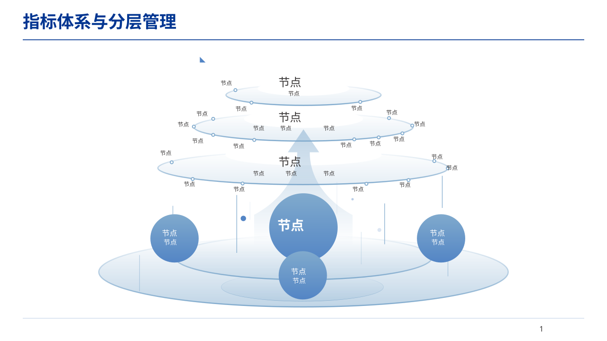

# 指标体系与分层管理

来源为圆形逻辑图PPT模版.pptx#21。

## 结构与适用场景

底3驱动球与中心费力度；上3层环经营/现场/执行，多角色节点；总上箭头

指标体系与分层管理

各环语义为管理层次，旁节点为职责场景；不把高低位置当数值等级

固定节点、圆弧、扇区、分面和连接表达定性关系。数量比较、趋势或占比使用数据驱动图表，源页中已登记的微图槽可接收实际数据。

## 预览



## 调用

将下列完整page对象放入schema_version=1、template_id=business-blue-v1的pages数组，替换各节点内容。nodes键对应原文本框或已明确拆分的语义分段，字段角色及source_ref、segment见下表。

```json
{
  "id": "circular-21",
  "family": "source-circular",
  "variant": "page-21",
  "content": {
    "title": "指标体系与分层管理",
    "nodes": {
      "shape_10": "节点",
      "shape_30": "节点",
      "shape_31": "节点",
      "shape_32": "节点",
      "shape_33": "节点",
      "shape_34": "节点",
      "shape_35": "节点",
      "shape_36": "节点",
      "shape_37": "节点",
      "shape_38": "节点",
      "shape_39": "节点",
      "shape_40": "节点",
      "shape_41": "节点",
      "shape_42": "节点",
      "shape_43": "节点",
      "shape_44": "节点",
      "shape_45": "节点",
      "shape_46": "节点",
      "shape_47": "节点",
      "shape_48": "节点",
      "shape_49": "节点",
      "shape_50": "节点",
      "shape_51": "节点",
      "shape_52": "节点",
      "shape_53": "节点",
      "shape_61": "节点",
      "shape_62": "节点",
      "shape_63": "节点",
      "shape_64": "节点",
      "shape_54": "节点",
      "shape_55": "节点",
      "shape_56": "节点",
      "shape_57": "节点",
      "shape_58": "节点",
      "shape_59": "节点",
      "shape_60": "节点"
    }
  },
  "config": {
    "show_source": true,
    "show_page_number": true
  }
}
```

config支持show_source、show_page_number、image_fit与image_position。image_fit可选contain或cover，image_position为xMin/xMid/xMax与YMin/YMid/YMax组合的九个焦点，默认为xMidYMid。字体、颜色、全局区和固定字阶取自tokens，节点数与连接结构由variant确定。

## 字段合同

每个业务节点required=true、min=1，max按具体框体登记。字符按规范化后的Unicode码点计数，空格标点换行均计入。build会以实际字体测量宽高，字符数通过后仍可能需要调整文字。

| 字段 | 节点角色与源标签 | 最短/最长 | 字阶 | 框体px | 原框引用 | 分段 | 旋转° | 垂直锚点 |
|---|---|---|---|---|---|---|---|---|
| nodes.shape_10 | 上中节点，源标签“选址” | 1/7 | diagramMicro | [740.2691, 220.8523, 38.8178, 21.4527] | slide:10 |  | 0.0 | t |
| nodes.shape_30 | 上中节点，源标签“货架空间规划” | 1/14 | diagramMicro | [814.2249, 229.7198, 79.6747, 21.4527] | slide:30 |  | 0.0 | t |
| nodes.shape_31 | 上右节点，源标签“品类空间规划” | 1/14 | diagramMicro | [872.8831, 254.416, 79.6747, 21.4527] | slide:31 |  | 0.0 | t |
| nodes.shape_32 | 中中节点，源标签“激活” | 1/7 | diagramMicro | [829.1052, 286.1398, 38.8178, 21.4527] | slide:32 |  | 0.0 | t |
| nodes.shape_33 | 中中节点，源标签“维修” | 1/7 | diagramMicro | [779.1533, 295.491, 38.8178, 21.4527] | slide:33 |  | 0.0 | t |
| nodes.shape_34 | 中中节点，源标签“设备采买” | 1/10 | diagramMicro | [717.6024, 298.6207, 59.2462, 21.4527] | slide:34 |  | 0.0 | t |
| nodes.shape_35 | 中中节点，源标签“人员管理可视化” | 1/16 | diagramMicro | [491.23, 300.9253, 89.8889, 21.4527] | slide:35 |  | 0.0 | t |
| nodes.shape_36 | 上中节点，源标签“联营商管理” | 1/12 | diagramMicro | [496.4367, 222.2085, 69.4605, 21.4527] | slide:36 |  | 0.0 | t |
| nodes.shape_37 | 上中节点，源标签“总部管理” | 1/10 | diagramMicro | [465.1681, 167.7801, 59.2462, 21.4527] | slide:37 |  | 0.0 | t |
| nodes.shape_38 | 上左节点，源标签“排班” | 1/7 | diagramMicro | [413.9927, 232.5935, 38.8178, 21.4527] | slide:38 |  | 0.0 | t |
| nodes.shape_39 | 上左节点，源标签“调度” | 1/7 | diagramMicro | [374.4636, 255.0515, 38.8178, 21.4527] | slide:39 |  | 0.0 | t |
| nodes.shape_40 | 中中节点，源标签“促销位商品规划” | 1/16 | diagramMicro | [405.0304, 289.8196, 89.8889, 21.4527] | slide:40 |  | 0.0 | t |
| nodes.shape_41 | 中左节点，源标签“体系化” | 1/9 | diagramMicro | [337.5616, 315.4832, 49.032, 21.4527] | slide:41 |  | 0.0 | t |
| nodes.shape_42 | 中左节点，源标签“捡货” | 1/7 | diagramMicro | [387.3808, 381.1311, 38.8178, 21.4527] | slide:42 |  | 0.0 | t |
| nodes.shape_43 | 中中节点，源标签“打包” | 1/7 | diagramMicro | [492.1025, 391.8574, 38.8178, 21.4527] | slide:43 |  | 0.0 | t |
| nodes.shape_44 | 中中节点，源标签“生产小二” | 1/11 | diagramMicro | [533.3862, 358.5972, 64.3581, 22.9796] | slide:44 |  | 0.0 | t |
| nodes.shape_45 | 中中节点，源标签“非生产小二” | 1/14 | diagramMicro | [601.9077, 358.5972, 75.8432, 22.9796] | slide:45 |  | 0.0 | t |
| nodes.shape_46 | 中中节点，源标签“前场小二” | 1/11 | diagramMicro | [681.7815, 358.5972, 64.3581, 22.9796] | slide:46 |  | 0.0 | t |
| nodes.shape_47 | 上中节点，源标签“生产主管” | 1/11 | diagramMicro | [533.3862, 263.1508, 64.3581, 22.9796] | slide:47 |  | 0.0 | t |
| nodes.shape_48 | 上中节点，源标签“商品空间规划师” | 1/18 | diagramMicro | [590.4985, 263.1508, 98.8322, 22.9796] | slide:48 |  | 0.0 | t |
| nodes.shape_49 | 上中节点，源标签“区域IT” | 1/9 | diagramMicro | [681.7815, 263.1508, 51.5832, 22.9796] | slide:49 |  | 0.0 | t |
| nodes.shape_50 | 上中节点，源标签“客户运营” | 1/11 | diagramMicro | [607.655, 189.8588, 64.3581, 22.9796] | slide:50 |  | 0.0 | t |
| nodes.shape_51 | 上中节点，源标签“经营决策” | 1/9 | body | [587.2266, 159.7567, 105.2149, 35.2424] | slide:51 |  | 0.0 | t |
| nodes.shape_52 | 上中节点，源标签“现场管理” | 1/9 | body | [587.2266, 233.7031, 105.2149, 35.2424] | slide:52 |  | 0.0 | t |
| nodes.shape_53 | 中中节点，源标签“作业执行” | 1/9 | body | [587.2266, 327.708, 105.2149, 35.2424] | slide:53 |  | 0.0 | t |
| nodes.shape_61 | 中右节点，源标签“上架” | 1/7 | diagramMicro | [909.5481, 323.4213, 38.8178, 21.4527] | slide:61 |  | 0.0 | t |
| nodes.shape_62 | 中右节点，源标签“理货” | 1/7 | diagramMicro | [941.1676, 346.7328, 38.8178, 21.4527] | slide:62 |  | 0.0 | t |
| nodes.shape_63 | 中右节点，源标签“补货” | 1/7 | diagramMicro | [841.9086, 382.7718, 38.8178, 21.4527] | slide:63 |  | 0.0 | t |
| nodes.shape_64 | 中中节点，源标签“效期巡检” | 1/10 | diagramMicro | [743.0194, 391.8574, 59.2462, 21.4527] | slide:64 |  | 0.0 | t |
| nodes.shape_54 | 中中节点，源标签“费力度” | 1/8 | heading | [585.0358, 459.2788, 110.3268, 45.9687] | slide:54 |  | 0.0 | t |
| nodes.shape_55 | 下中节点，源标签“学情监督” | 1/12 | caption | [594.8896, 563.2229, 89.8889, 30.6426] | slide:55 |  | 0.0 | t |
| nodes.shape_56 | 下中节点，源标签“健康度” | 1/8 | diagramCompact | [611.4865, 584.4765, 56.6951, 24.516] | slide:56 |  | 0.0 | t |
| nodes.shape_57 | 下左节点，源标签“设备体验” | 1/12 | caption | [323.0796, 481.9455, 89.8889, 30.6426] | slide:57 |  | 0.0 | t |
| nodes.shape_58 | 下左节点，源标签“满意度” | 1/8 | diagramCompact | [339.686, 503.199, 56.6951, 24.516] | slide:58 |  | 0.0 | t |
| nodes.shape_59 | 下右节点，源标签“肢体劳动” | 1/12 | caption | [887.6781, 481.9455, 89.8889, 30.6426] | slide:59 |  | 0.0 | t |
| nodes.shape_60 | 下右节点，源标签“疲劳度” | 1/8 | diagramCompact | [904.275, 503.199, 56.6951, 24.516] | slide:60 |  | 0.0 | t |

全局title必填、2至32码点，使用统一标题框。section_name可选0至24码点，source可选0至64码点。所有可编辑文本通过独立原生carrier导出，页码为派生文字。

## 来源处理

原生PPTX源件保存于用户材料目录，分发包仅含用户资产衍生的几何、字段和说明。原始逐框文字、源框与标准化框在page-catalog.json的variant.fields中。

源标题引用为`slide:6`，原文为“费力度指标体系与应用”。模板默认标题依据真实结构设置。

密集全景中的diagramCompact为14px、diagramMicro为12px。适用于体系概览或附录局部标签，现场关键结论用统一标题与正常正文字阶表达。

源画布边界裁切已烘焙为可编辑Bezier几何，3D顶面、侧面与前面通过tokens配色的相对明暗保留。

